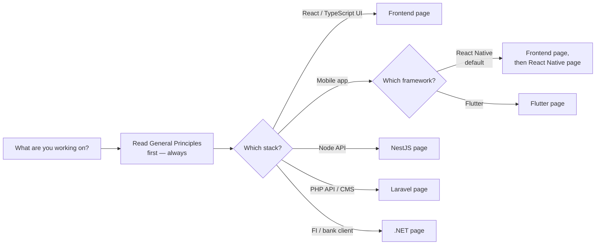

Coding Standards
================

How we write code at Trinergy. Built to be skimmed: tables and ✅ / ❌ examples over long paragraphs, diagrams where they beat a page of text.

* * *

### Start here

| Page | Who it's for |
| --- | --- |
| **[General Principles](/Coding-Standards/General-Principles)** | Everyone. Naming, simplicity vs. over-engineering, error handling, comments — applies no matter what language you're writing. |
| **[Frontend — React + TypeScript](/Coding-Standards/Frontend-React-TypeScript)** | Anyone touching the React/Vite/TypeScript apps. |
| **[Mobile — React Native + Expo](/Coding-Standards/Mobile-React-Native)** | The mobile apps. Our default mobile stack — read the Frontend page too, most of it applies. |
| **[Mobile — Flutter + Dart](/Coding-Standards/Mobile-Flutter)** | Mobile projects on Flutter — UI/animation-heavy apps, or where the client mandates it. |
| **[Backend — NestJS](/Coding-Standards/Backend-NestJS)** | The Node.js/NestJS API projects. |
| **[Backend — Laravel (PHP)](/Coding-Standards/Backend-Laravel-PHP)** | The Laravel projects. |
| **[Backend — .NET / C#](/Coding-Standards/Backend-DotNet-CSharp)** | The .NET / ASP.NET Core projects — typically FI (bank/insurance) clients, see [Tech Stack](/Tech-Stack). |

* * *

