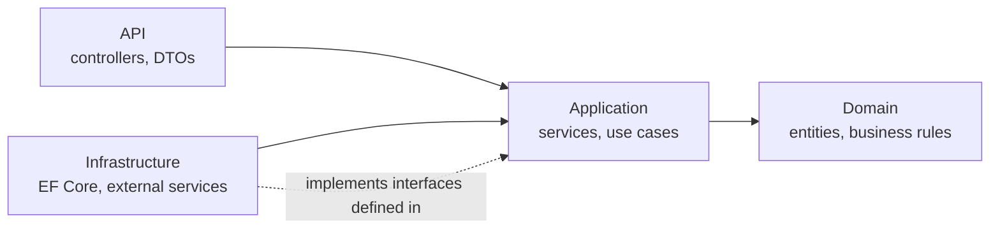

Backend — .NET / C#
===================

> Read **[General Principles](/Coding-Standards/General-Principles)** first — this page only covers what's specific to .NET. This is typically the stack for FI (bank/insurance) clients — see [Tech Stack](/Tech-Stack).

* * *

## At a Glance

| Topic | The rule |
| --- | --- |
| [Layering](#layering) | **Dependencies point inward, controllers stay thin**<br/><sub>Domain knows nothing about EF Core or ASP.NET, so business rules don't depend on infrastructure.</sub> |
| [API responses](#return-dtos-not-entities) | **Return DTOs, never EF entities**<br/><sub>An entity leaks internal fields and can trigger lazy loads mid-response.</sub> |
| [Service lifetimes](#dependency-injection-and-service-lifetimes) | **Anything touching `DbContext` is scoped**<br/><sub>A singleton holding a scoped service keeps one request's `DbContext` forever.</sub> |
| [Database changes](#database-changes) | **EF migrations for every schema change, `AsNoTracking()` for reads**<br/><sub>Every environment gets the same changes, and list queries skip work they don't need.</sub> |
| [Raw SQL](#raw-sql) | **Parameterized only**<br/><sub>String-built SQL with user input is a SQL injection hole.</sub> |
| [Null safety](#nullable-reference-types) | **Nullable reference types on, warnings fixed**<br/><sub>The compiler finds the null check you forgot before a user does.</sub> |
| [Config](#validate-config-at-startup) | **`ValidateOnStart()` on required settings**<br/><sub>A missing value stops the app on startup, not in production at first use.</sub> |
| [Authorization](#authorization-with-policies) | **Policy-based `[Authorize]`**<br/><sub>One named policy instead of role strings copied through controllers.</sub> |
| [Async code](#async-all-the-way) | **`await` all the way down for I/O**<br/><sub>`.Result` and `.Wait()` block threads and can deadlock.</sub> |
| [Linting and formatting](#linting-and-formatting) | **Built-in analyzers plus `.editorconfig`, enforced by `dotnet format`**<br/><sub>Nothing extra to install. CI verifies instead of rewriting.</sub> |
| [Testing](#testing-and-tooling) | **xUnit for logic, `WebApplicationFactory` for critical flows**<br/><sub>Don't over-mock until the test just repeats the implementation.</sub> |

* * *

## Concepts you'll meet on this codebase

### Dependency injection and service lifetimes

ASP.NET Core has a container built in. You register a service once in `Program.cs` and constructors ask for it by interface. The part people get wrong is the lifetime:

| Lifetime | One instance per | Use for |
| --- | --- | --- |
| `AddSingleton` | Application | Stateless, thread-safe things (config, caches) |
| `AddScoped` | HTTP request | Anything touching `DbContext` |
| `AddTransient` | Injection | Cheap, stateless helpers |

Injecting a scoped service into a singleton is the classic bug — the singleton captures one request's `DbContext` and holds it forever. The container will throw at startup if it can catch it; it can't always catch it.

```csharp
// ✅ InvoiceService uses AppDbContext, so it lives as long as one request
builder.Services.AddScoped<IInvoiceService, InvoiceService>();

// ❌ one InvoiceService, and therefore one DbContext, shared by every request
builder.Services.AddSingleton<IInvoiceService, InvoiceService>();
```

### Dependencies point inward

Domain knows nothing about anything else. Application knows Domain. Infrastructure and API know Application. Infrastructure implements interfaces that Application *defines* — that's how EF Core ends up as a detail you could swap, instead of something baked into your business rules. See [Layering](#layering).

### DTO

The shape you send over the wire, separate from the EF entity. An entity carries navigation properties and change-tracking state; serialising one exposes internals and can trigger lazy loads mid-response.

### Change tracking and AsNoTracking

`DbContext` keeps a snapshot of every entity it loads so it can work out what to save. Useful for writes, pure overhead for reads. `.AsNoTracking()` skips the snapshot — noticeably faster on list queries.

### Nullable reference types

With NRTs on, `string` means "never null" and `string?` means "might be." The compiler then tells you where you forgot to check, instead of a user finding it. Warnings here are the feature working; fix them rather than suppress them.

```csharp
public string? MiddleName { get; set; }

// ❌ silences the warning; still crashes when MiddleName is null
var initial = person.MiddleName!.Substring(0, 1);

// ✅ handles the null case the compiler pointed out
var initial = person.MiddleName is { Length: > 0 } m ? m[..1] : "";
```

* * *

## Layering



- Domain has **no** framework dependencies.
- Controllers bind, validate, and call an application service. No business logic in the controller.
- Return DTOs/records over the API. Never expose an EF Core entity directly.

### Return DTOs not entities

Entity in, DTO out.

```csharp
// ❌ Serialises the EF entity — navigation properties, internal fields and all
[HttpGet("{id}")]
public async Task<Invoice> Get(int id) =>
    await _db.Invoices.Include(i => i.Customer).FirstAsync(i => i.Id == id);

// ✅ Explicit contract, shaped in the query so only those columns are selected
[HttpGet("{id}")]
public async Task<InvoiceDto> Get(int id) =>
    await _db.Invoices
        .AsNoTracking()
        .Where(i => i.Id == id)
        .Select(i => new InvoiceDto(i.Id, i.Customer.Name, i.Total))
        .FirstAsync();
```

* * *

## Database changes

**Every schema change is a migration.** Change the entity, generate the migration, and commit it with your code.

```bash
# ✅ creates a migration every environment will apply in the same order
dotnet ef migrations add AddInvoiceDueDate
dotnet ef database update

# ❌ ALTER TABLE run by hand in SQL Server Management Studio: no other environment knows about it
```

**Watch for N+1 queries.** Touching a navigation property inside a loop can fire one query per row. Load what you need up front with `Include()`, or better, project with `Select()`.

```csharp
// ❌ 1 query for the invoices, then 1 more per invoice if lazy loading is on
var invoices = await _db.Invoices.ToListAsync();
foreach (var invoice in invoices)
    Console.WriteLine(invoice.Customer.Name);

// ✅ 1 query, only the columns you need, no change tracking
var rows = await _db.Invoices
    .AsNoTracking()
    .Select(i => new { i.Id, CustomerName = i.Customer.Name })
    .ToListAsync();
```

* * *

## Raw SQL

Stick to LINQ where you can. When you need raw SQL, use `FromSqlInterpolated`, which turns every `{value}` into a parameter.

```csharp
// ✅ {email} becomes a SQL parameter, so it can't change the query
var users = _db.Users.FromSqlInterpolated($"SELECT * FROM Users WHERE Email = {email}");

// ❌ the input becomes part of the SQL: email = "' OR 1=1 --" returns every user
var users = _db.Users.FromSqlRaw("SELECT * FROM Users WHERE Email = '" + email + "'");
```

* * *

## Validate config at startup

Bind settings to a typed options class and call `ValidateOnStart()`, so a missing or invalid value stops the app as soon as it boots.

```csharp
public class JwtOptions
{
    [Required, MinLength(32)] public string Secret { get; init; } = "";
}

// ✅ the app refuses to start if Jwt:Secret is missing or too short
builder.Services.AddOptions<JwtOptions>()
    .Bind(builder.Configuration.GetSection("Jwt"))
    .ValidateDataAnnotations()
    .ValidateOnStart();

// ❌ null until the first login, possibly in production
var secret = builder.Configuration["Jwt:Secret"];
```

* * *

## Authorization with policies

```csharp
// Program.cs — the rule is defined once, by name
builder.Services.AddAuthorization(o =>
    o.AddPolicy("CanApproveInvoices", p => p.RequireRole("Finance", "Admin")));

// ✅ the controller only names the policy
[Authorize(Policy = "CanApproveInvoices")]
[HttpPost("{id}/approve")]
public Task<IActionResult> Approve(int id) => /* ... */;

// ❌ role strings repeated in every action that needs them
if (!User.IsInRole("Finance") && !User.IsInRole("Admin")) return Forbid();
```

* * *

## Async all the way

For anything that does I/O (database, HTTP, files), use the async method and `await` it, all the way up to the controller.

```csharp
// ✅
var invoice = await _db.Invoices.FindAsync(id);

// ❌ blocks a thread while it waits, and can deadlock
var invoice = _db.Invoices.FindAsync(id).Result;
```

* * *

## Do / Don't

Each row links to the section with its full example.

| ✅ Do | ❌ Don't | Example |
| --- | --- | --- |
| Return DTOs/records from controllers | Expose an EF Core entity directly | [Return DTOs](#return-dtos-not-entities) |
| `AddScoped` for anything using `DbContext` | Inject a scoped service into a singleton | [Service lifetimes](#dependency-injection-and-service-lifetimes) |
| `dotnet ef migrations add` for every schema change | Hand-edit the database schema | [Database changes](#database-changes) |
| `.AsNoTracking()` on read-only queries, deliberate `Include()` | Cause an N+1 query without noticing | [Database changes](#database-changes) |
| Parameterized LINQ / `FromSqlInterpolated` | Interpolate raw SQL with user input | [Raw SQL](#raw-sql) |
| Nullable reference types enabled, warnings fixed | Suppress nullability warnings | [Null safety](#nullable-reference-types) |
| `ValidateOnStart()` on required config | Discover a missing/bad config value in production | [Config](#validate-config-at-startup) |
| Policy-based `[Authorize]` | Inline role-string checks scattered through controllers | [Authorization](#authorization-with-policies) |
| `await` async I/O all the way up | Block with `.Result` / `.Wait()` | [Async](#async-all-the-way) |

* * *

## Linting and formatting

No separate linter to install — the .NET SDK ships both.

```xml
<!-- .csproj -->
<PropertyGroup>
  <AnalysisLevel>latest</AnalysisLevel>
  <EnforceCodeStyleInBuild>true</EnforceCodeStyleInBuild>
</PropertyGroup>
```

**Style: [Microsoft's own C# conventions](https://learn.microsoft.com/en-us/dotnet/csharp/fundamentals/coding-style/coding-conventions)** — the same ones `dotnet new` assumes and every C# developer has already seen. A starting `.editorconfig` at the solution root, which `dotnet format` then enforces:

```ini
[*.cs]
indent_size = 4
csharp_new_line_before_open_brace = all      # Allman braces — opening brace on its own line
csharp_style_var_for_built_in_types = true:suggestion
csharp_style_var_when_type_is_apparent = true:suggestion
dotnet_naming_rule.private_fields_should_be_camel_case.severity = warning
```

Commit it; without one, `dotnet format` has nothing to enforce beyond bare defaults, and every new solution reinvents brace style and naming from scratch.

- `EnforceCodeStyleInBuild` turns on Roslyn's built-in analyzers as part of a normal build, so a style violation shows up as a build warning instead of only surfacing when someone happens to run `dotnet format` manually.
- `dotnet format` rewrites code to match `.editorconfig`. Run it locally before committing; run it with `--verify-no-changes` in CI so CI fails instead of silently reformatting.
- Pre-commit: a git hook (or `husky.net`) running `dotnet format --verify-no-changes`.

* * *

## Testing and tooling

- **xUnit** unit tests for domain/application logic (Moq/NSubstitute for mocks — don't over-mock to the point where the test just re-asserts the implementation).
- Integration tests via `WebApplicationFactory` / Testcontainers for critical flows.
- `dotnet format --verify-no-changes` + full test suite in CI on every PR.
- Async all the way for I/O — no `.Result` / `.Wait()` blocking calls (see [Async all the way](#async-all-the-way)).

```csharp
// InvoiceTests.cs — unit: a business rule on its own, no database
[Fact]
public void Total_is_the_sum_of_line_amounts()
{
    var invoice = new Invoice();
    invoice.AddLine(qty: 2, unitPrice: 50m);
    invoice.AddLine(qty: 1, unitPrice: 25m);

    Assert.Equal(125m, invoice.Total);
}
```

* * *

## Further reading

- [.NET Coding Conventions — C# (Microsoft Learn, official)](https://learn.microsoft.com/en-us/dotnet/csharp/fundamentals/coding-style/coding-conventions)
- [Building a Clean ASP.NET Core API with EF Core and DDD](https://www.c-sharpcorner.com/article/building-a-clean-asp-net-core-api-with-c-sharp-13-ef-core-and-ddd/)
- [Unit Testing Best Practices in .NET](https://milanjovanovic.tech/blog/unit-testing-best-practices-dotnet)
