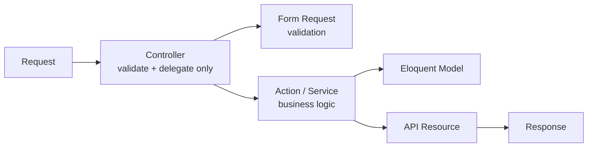

Backend — Laravel (PHP)
=======================

> Read **[General Principles](/Coding-Standards/General-Principles)** first — this page only covers what's specific to Laravel. See also [Tech Stack](/Tech-Stack) for when we use Laravel vs. the other backends.

* * *

## At a Glance

| Topic | The rule |
| --- | --- |
| [Controllers](#skinny-controllers) | **Form Request validates, Action does the work, Resource shapes the response**<br/><sub>The controller only wires them together, so the logic can be reused from jobs and tested on its own.</sub> |
| [Mass assignment](#mass-assignment) | **Explicit `$fillable` on every model**<br/><sub>Otherwise the user chooses which columns get written, including `is_admin`.</sub> |
| [Queries](#eager-load-relations) | **Eager-load relations you use in a loop**<br/><sub>An N+1 query passes review on seed data and falls over in production. Treat it as a bug.</sub> |
| [Database changes](#database-changes) | **Migrations with a working `down()`, transactions for multi-step writes**<br/><sub>Every environment gets the same changes, and a failure never leaves half a write behind.</sub> |
| [Authorization](#authorization-with-policies) | **Policies and Gates, not role checks in controllers**<br/><sub>When the rule changes, there's one file to change.</sub> |
| [Linting and formatting](#linting-and-formatting) | **Pint formats, Larastan checks**<br/><sub>Laravel preset, strictness raised over time.</sub> |
| [Testing](#testing-and-tooling) | **Pest feature tests for endpoints, unit tests for Actions**<br/><sub>Model factories for test data, not hand-built fixtures.</sub> |

* * *

## Concepts you'll meet on this codebase

### Service container and dependency injection

Type-hint what you need and Laravel resolves it for you — constructor or method, controller or action. You rarely write `new` for a service.

```php
// ✅ Laravel builds InvoiceMailer and hands it over
public function __construct(private InvoiceMailer $mailer) {}
```

The point is the same as anywhere else: a class that receives its dependencies can be tested with fakes; a class that constructs them can't.

### Form Request

A class that owns the validation rules for one endpoint. Type-hint it on the controller method and the request is already validated by the time your code runs — invalid input never reaches the method body.

### Action class

One class, one business operation, one `__invoke()`. `CreateInvoiceAction` does exactly that and nothing else. Controllers and queued jobs can both call it, which is the main reason we don't leave the logic in the controller.

### API Resource

A translation layer between an Eloquent model and the JSON you return. Without it you're serialising whatever columns happen to exist — add a `notes` column for internal use and you've just published it.

### Mass assignment

`create()` and `update()` will set any attribute you pass them. If the array came from user input and the model has no `$fillable`, the user picks which columns to write.

```php
// ❌ POST {"name":"Ali","is_admin":true} — congratulations, they're an admin
User::create($request->all());

// ✅ $fillable on the model limits it to the columns you meant
protected $fillable = ['name', 'email'];
```

### Policies and Gates

Authorization rules kept in one class per model (`InvoicePolicy`) instead of `if ($user->role === 'admin')` sprinkled through controllers. When the rule changes, there's one file to change and one place to check. See [Authorization with policies](#authorization-with-policies).

* * *

## Skinny controllers

Fat models and services, skinny controllers.



- Validation → **Form Request** classes, not inline `$request->validate([...])`.
- Business logic → **Action classes** (`CreateInvoiceAction`, one `__invoke()` each) or services, not the controller.
- Response shape → **API Resources** (`JsonResource`). Never return a raw Eloquent model from a controller.

```php
// ✅ each piece has one job; the controller just wires them together
public function store(StoreInvoiceRequest $request, CreateInvoiceAction $create)
{
    $invoice = $create($request->validated());

    return new InvoiceResource($invoice);
}

// ❌ validation, business logic and a raw model, all in the controller
public function store(Request $request)
{
    $data = $request->validate(['title' => 'required|min:3']);
    $data['total'] = collect($request->lines)->sum(fn ($l) => $l['qty'] * $l['unit_price']);

    return Invoice::create($data); // every column, including internal ones, goes out as JSON
}
```

* * *

## Eager load relations

The N+1 query is the most common bug we catch in Laravel review. It doesn't look like a bug — it looks like a `foreach`.

```php
// ❌ 1 query for the invoices, then 1 more per invoice for its customer
$invoices = Invoice::where('status', 'unpaid')->get();

foreach ($invoices as $invoice) {
    echo $invoice->customer->name;
}

// ✅ 2 queries, no matter how many invoices come back
$invoices = Invoice::where('status', 'unpaid')->with('customer')->get();

foreach ($invoices as $invoice) {
    echo $invoice->customer->name;
}
```

It passes review on 20 rows of seed data and falls over on 20,000 in production. Check the query count, not the wall clock.

> 💡 **Tip:** Add `Model::preventLazyLoading(! app()->isProduction());` in `AppServiceProvider::boot()`. Any N+1 then throws an exception on your machine instead of slipping through.

* * *

## Database changes

**Every schema change is a migration, and `down()` actually undoes it.** That's what lets anyone roll back a bad deploy.

```php
// ✅ up() and down() mirror each other
public function up(): void
{
    Schema::table('invoices', fn (Blueprint $table) => $table->date('due_date')->nullable());
}

public function down(): void
{
    Schema::table('invoices', fn (Blueprint $table) => $table->dropColumn('due_date'));
}

// ❌ an empty down(), or a column added by hand in phpMyAdmin that no other environment knows about
```

**Wrap multi-step writes in `DB::transaction()`**, so either every step happens or none do.

```php
// ❌ if the second write fails, the invoice exists but the balance was never updated
$invoice = Invoice::create($data);
$invoice->customer->increment('balance', $invoice->total);

// ✅ both writes succeed, or both are rolled back
DB::transaction(function () use ($data) {
    $invoice = Invoice::create($data);
    $invoice->customer->increment('balance', $invoice->total);
});
```

* * *

## Authorization with policies

```php
// app/Policies/InvoicePolicy.php — the rule lives in one place
public function update(User $user, Invoice $invoice): bool
{
    return $user->id === $invoice->owner_id || $user->isAdmin();
}

// ✅ controller asks the policy; a 403 is returned automatically if it says no
public function update(UpdateInvoiceRequest $request, Invoice $invoice)
{
    $this->authorize('update', $invoice);
    // ...
}

// ❌ the rule copied into every controller that needs it, slightly different each time
if ($request->user()->role !== 'admin') {
    abort(403);
}
```

* * *

## Do / Don't

Each row links to the section with its full example.

| ✅ Do | ❌ Don't | Example |
| --- | --- | --- |
| Form Request for validation, Action for logic, Resource for output | Inline `$request->validate()` and business logic in the controller | [Controllers](#skinny-controllers) |
| Return an API Resource | Return a raw Eloquent model from a controller | [Controllers](#skinny-controllers) |
| Migrations for every schema change, `down()` implemented | Modify the database by hand | [Database changes](#database-changes) |
| Eager-load relations used in a loop (`with()`) | Cause an N+1 query — treat it as a bug, not a perf nitpick | [Eager load relations](#eager-load-relations) |
| Explicit `$fillable` on every model | Leave a model mass-assignment-open with no `$fillable`/`$guarded` | [Mass assignment](#mass-assignment) |
| `DB::transaction()` for multi-step writes | Leave a multi-step write partially applied on failure | [Database changes](#database-changes) |
| Policies/Gates for authorization | Scatter `if ($user->role === 'admin')` checks through controllers | [Authorization](#authorization-with-policies) |

* * *

## Linting and formatting

```bash
composer require --dev laravel/pint larastan/larastan
```

- **Pint** formats. Laravel's own preset is the default (`"preset": "laravel"` in `pint.json`) — a PSR-12–based style with Laravel's own conventions on top. Start there and only deviate deliberately. Run it with `./vendor/bin/pint`.
- **Larastan** lints, layered on top of PHPStan for Laravel's dynamic bits (facades, magic methods). Configure the strictness level in `phpstan.neon` and raise it over time rather than parking at level 0 forever.
- Pre-commit: a git hook running `./vendor/bin/pint --test` (dry run, fails without rewriting) and `./vendor/bin/phpstan analyse`.
- CI: the same two commands as a merge gate. Use `--test` in CI, not the rewriting form — CI should verify, not silently fix and push back.

* * *

## Testing and tooling

- **Pest** (preferred) or PHPUnit — feature tests for HTTP endpoints (happy path + validation/auth/not-found), unit tests for Actions/Services.
- Model factories for test data, not hand-built fixtures.

```php
// tests/Feature/CreateInvoiceTest.php
it('rejects an invoice without a title', function () {
    $user = User::factory()->create();

    $this->actingAs($user)
        ->postJson('/api/invoices', ['customer_id' => Customer::factory()->create()->id])
        ->assertUnprocessable()
        ->assertJsonValidationErrors('title');
});
```

* * *

## Further reading

- [19 Laravel Best Practices for Developers in 2026](https://buttercms.com/blog/laravel-best-practices/)
- [Supercharge Your Laravel Codebase with PHPStan, Pest, Peck, Pint, and Rector](https://medium.com/appfoster/supercharge-your-laravel-codebase-with-phpstan-pest-peck-pint-and-rector-5b3615bfe21a)
- [Testing Laravel with Pest — Spatie](https://spatie.be/courses/testing-laravel-with-pest)
