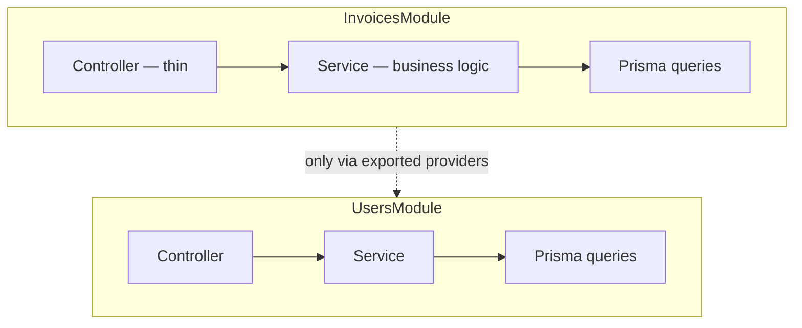

Backend — NestJS
================

> Read **[General Principles](/Coding-Standards/General-Principles)** first — this page only covers what's specific to our NestJS stack.
> **Which tools we use, why, and how to set them up:** [Tech Stack → Backend Stack](/Tech-Stack/Backend-Stack). This page is how to write code with them day to day.

* * *

## At a Glance

| Topic | The rule |
| --- | --- |
| [Module structure](#one-module-per-business-domain) | **One module per business domain**<br/><sub>Modules talk only through exported providers, so any of them can become its own service later.</sub> |
| [Controllers](#keep-controllers-thin) | **Parse input, call the service, return the result**<br/><sub>Business logic in a controller can't be reused or unit tested on its own.</sub> |
| [Validation](#validate-at-the-boundary) | **Every request body is a Zod DTO**<br/><sub>Invalid input is rejected with a 400 before it reaches your service.</sub> |
| [Database changes](#database-changes) | **Migrations for every schema change, transactions for multi-step writes**<br/><sub>Every environment gets the same changes, and a failure never leaves half a write behind.</sub> |
| [Errors](#errors) | **Throw Nest exceptions, let the global filter shape the response**<br/><sub>The frontend handles one error format, not one per endpoint.</sub> |
| [Logging](#logging) | **Structured Pino logs, never secrets**<br/><sub>Every line carries the request ID, so one grep tells the whole story.</sub> |
| [Config](#config) | **Read env vars through `ConfigService`, validated at boot**<br/><sub>A missing variable stops the app on startup, not on the first login in production.</sub> |
| [Linting and formatting](#linting-and-formatting) | **Prettier formats, ESLint checks, Husky runs both on commit**<br/><sub>Same settings as the frontend, so a PR touching both reads the same way.</sub> |
| [Testing](#testing) | **Unit test services, e2e test the flows that must not break**<br/><sub>Test what the caller sees: status codes, response bodies, database rows.</sub> |

* * *

## Concepts you'll meet on this codebase

Skip this if you've worked in Nest before. If you haven't, the rest of the page assumes these.

### Modular monolith

One deployable app, but the code inside is split into modules that don't reach into each other. You get the simplicity of a single deploy now, and the option to break a module out into its own service later without untangling it first.

The rule that makes it work: a module talks to another module only through what that module explicitly exports. The moment `InvoicesModule` queries the users table directly, it stops being separable.

### Dependency injection

A class doesn't build the things it depends on. It lists them in the constructor and Nest's container supplies them at runtime.

```ts
// ❌ The service builds its own mailer — every test now sends real email
export class InvoiceService {
  private mailer = new SmtpMailer(process.env.SMTP_HOST);
}

// ✅ Ask for it. Nest wires it up; a test passes a fake instead
@Injectable()
export class InvoiceService {
  constructor(private readonly mailer: Mailer) {}
}
```

That's the whole payoff: you can replace a dependency without editing the class that uses it.

### Provider

Anything the container knows how to hand out — services, repositories, config objects. A module lists providers it creates and `exports` the ones other modules are allowed to ask for.

### DTO

A **Data Transfer Object** is the shape of data crossing a boundary, separate from your database model. `CreateInvoiceDto` is what the client is allowed to send; the Prisma `Invoice` model is what's in the table. Keeping them separate means a column rename doesn't silently change your API.

### Global exception filter

One place that catches thrown errors and turns them into the same JSON shape every time, so the frontend has one error format to handle instead of one per endpoint. See [Errors](#errors).

### Correlation ID

A unique ID attached to a request and included in every log line it produces. When something fails in production, you grep one ID and get the whole story instead of guessing which log lines belong together. See [Logging](#logging).

* * *

## One module per business domain



- Controllers only validate and delegate. Business logic lives in services.
- Modules talk through exported providers — never reach into another module's Prisma models directly. That's what keeps this splittable into real services later.

```ts
// users.module.ts — UsersService is the only thing other modules may use
@Module({ providers: [UsersService], exports: [UsersService] })
export class UsersModule {}

// invoices.service.ts
// ✅ ask the users module
const customer = await this.users.findById(dto.customerId);

// ❌ query another module's table directly
const customer = await this.prisma.user.findUnique({ where: { id: dto.customerId } });
```

* * *

## Keep controllers thin

**Fat controller** is the code smell to watch for here. If a controller method has more than a few lines that aren't "parse input → call service → return result", that logic belongs in the service.

```ts
// ❌ Lookup, business rule and persistence, all in the controller
@Post()
async create(@Body() body: CreateInvoiceDto) {
  const customer = await this.prisma.customer.findUnique({ where: { id: body.customerId } });
  if (!customer) throw new NotFoundException('Customer not found');
  const total = body.lines.reduce((sum, l) => sum + l.qty * l.unitPrice, 0);
  return this.prisma.invoice.create({ data: { ...body, total } });
}

// ✅ Parse input → call service → return result
@Post()
create(@Body() body: CreateInvoiceDto) {
  return this.invoices.create(body);
}
```

* * *

## Validate at the boundary

Every request body is typed as a Zod DTO. The global validation pipe checks it before your controller runs, so the service can trust what it receives. How the schema and pipe are set up is in [Tech Stack → Validation](/Tech-Stack/Backend-Stack#validation).

```ts
// ✅ typed as the DTO: a missing title is a 400 before create() is called
@Post()
create(@Body() body: CreateInvoiceDto) {
  return this.invoices.create(body);
}

// ❌ any shape gets through, and the service has to guess what it was given
@Post()
create(@Body() body: any) {
  return this.invoices.create(body);
}
```

* * *

## Database changes

**Every schema change is a migration.** Edit `schema.prisma`, run `prisma migrate dev`, and commit the migration file with your code. Other environments apply it with `prisma migrate deploy`. The full workflow is in [Tech Stack → Database and ORM](/Tech-Stack/Backend-Stack#database-and-orm).

```bash
# ✅ creates a migration file that every environment will apply in the same order
pnpm prisma migrate dev --name add-invoice-due-date

# ❌ changes the database with no record; staging and production never get it
pnpm prisma db push      # fine on a throwaway local DB, never on a shared one
```

**Wrap multi-step writes in a transaction**, so either every step happens or none do.

```ts
// ❌ if the second write fails, the invoice exists but the balance was never updated
const invoice = await this.prisma.invoice.create({ data });
await this.prisma.customer.update({
  where: { id: data.customerId },
  data: { balance: { increment: invoice.total } },
});

// ✅ both writes succeed, or both are rolled back
await this.prisma.$transaction(async (tx) => {
  const invoice = await tx.invoice.create({ data });
  await tx.customer.update({
    where: { id: data.customerId },
    data: { balance: { increment: invoice.total } },
  });
});
```

* * *

## Errors

Throw Nest's built-in exceptions from services. The global exception filter turns every one of them into the same envelope, `{ error: { code, message } }`.

```ts
// ✅ throw, and let the filter shape the response
throw new NotFoundException('Invoice not found');
// → 404 { "error": { "code": "NOT_FOUND", "message": "Invoice not found" } }

// ❌ a hand-built response in one controller: the frontend now has two error formats
return res.status(404).json({ msg: 'not found' });
```

* * *

## Logging

Log with the injected Pino logger, pass data as fields, and never log secrets. Setup, including redaction, is in [Tech Stack → Logging](/Tech-Stack/Backend-Stack#logging).

```ts
// ✅ structured: searchable by invoiceId, and the request ID is added automatically
this.logger.info({ invoiceId: invoice.id }, 'Invoice created');

// ❌ unstructured, no request ID, and it leaks a password into the logs
console.log('login attempt', email, password);
```

> ⚠️ Never log tokens, passwords, full card numbers or personal data. If you need to identify a user in a log, log their ID.

* * *

## Config

Read environment variables through `ConfigService`, never `process.env` directly. The `envSchema` validates every variable at boot, so a missing one stops the app on startup instead of failing later. Setup is in [Tech Stack → Config and Secrets](/Tech-Stack/Backend-Stack#config-and-secrets).

```ts
// ✅ validated at boot, and fails loudly by name if missing
const secret = this.config.getOrThrow<string>('JWT_SECRET');

// ❌ undefined until the first login in production
const secret = process.env.JWT_SECRET;
```

* * *

## Do / Don't

Each row links to the section with its full example.

| ✅ Do | ❌ Don't | Example |
| --- | --- | --- |
| Talk to other modules through their exported providers | Query another module's tables directly | [Modules](#one-module-per-business-domain) |
| Keep controllers to parse → call service → return | Put lookups and business rules in the controller | [Controllers](#keep-controllers-thin) |
| Zod schema → `z.infer` for DTOs, validated at the controller boundary | Let unvalidated input reach a service | [Validation](#validate-at-the-boundary) |
| `prisma migrate dev` / `deploy` for every schema change | Hand-edit the DB or `db push` on shared environments | [Database changes](#database-changes) |
| Wrap multi-step writes in `$transaction(...)` | Leave a multi-step write half-applied on failure | [Database changes](#database-changes) |
| One consistent error envelope (`{ error: { code, message } }`) via a global filter | Let each controller invent its own error shape | [Errors](#errors) |
| Structured Pino logs with a request/correlation ID, secrets redacted | `console.log`, or logging tokens/passwords | [Logging](#logging) |
| Fail fast at boot if a required env var is missing (`@nestjs/config` + Zod) | Discover a missing env var at first use in production | [Config](#config) |
| Ask for dependencies in the constructor | `new` up a service or client inside another class | [Dependency injection](#dependency-injection) |

* * *

## Linting and formatting

`nest new` scaffolds ESLint and Prettier already wired together — check the ESLint config (`eslint.config.mjs`, or `.eslintrc.js` on older projects) and `.prettierrc` exist before adding your own. If the project predates that scaffold:

```bash
pnpm add -D prettier eslint eslint-config-prettier \
  @typescript-eslint/parser @typescript-eslint/eslint-plugin
```

- `package.json` already has `"lint"` and `"format"` scripts from the Nest CLI — extend the ESLint config rather than replacing it. Bring the `.prettierrc` values over from the [Frontend page](/Coding-Standards/Frontend-React-TypeScript#linting-and-formatting) (`singleQuote`, `trailingComma: "all"`) so API and frontend code read the same way when a PR touches both.
- Pre-commit: `husky` + `lint-staged` on staged files. `prisma format` runs whenever the schema changes, and the typecheck runs on the **whole project**, because changing one file can break another:

```js
// lint-staged.config.js
export default {
  '*.ts': ['prettier --write', 'eslint --fix', () => 'tsc --noEmit'],
  '*.prisma': () => 'prisma format',
};
```

```bash
# .husky/pre-commit
pnpm exec lint-staged
```

- CI: `pnpm lint`, `pnpm format --check`, and `tsc --noEmit` before the test suite — a type or lint failure is cheaper to catch before spinning up a test database.

* * *

## Testing

- **Unit** (Jest): services/business logic, Prisma mocked.
- **Integration** (Supertest): auth, payment/invoice creation, and other flows that must not break — against a real test DB.
- CI: lint + type-check + unit + e2e on every PR, migrations applied to a disposable test DB.

```ts
// invoices.service.spec.ts — unit: the service on its own, Prisma swapped for a fake
const module = await Test.createTestingModule({
  providers: [InvoicesService, { provide: PrismaService, useValue: { invoice: { create: jest.fn() } } }],
}).compile();

const service = module.get(InvoicesService);
```

```ts
// test/invoices.e2e-spec.ts — e2e: real HTTP, real validation, real database
it('rejects an invoice without a title', () =>
  request(app.getHttpServer())
    .post('/invoices')
    .set('Authorization', `Bearer ${token}`)
    .send({ customerId, lines: [] })
    .expect(400));
```

Test what the caller sees (status codes, response bodies, rows in the database), not which private methods were called.

* * *

## Further reading

- [NestJS Modular Architecture: Project Structure Guide](https://www.capitalcompute.com/building-a-modular-and-maintainable-backend-with-nestjs-a-practical-guide/)
- [Prisma ORM — Best Practices (official docs)](https://www.prisma.io/docs/orm/v7/more/best-practices)
- [12 REST API Best Practices That Hold Up in 2026](https://www.moesif.com/blog/technical/api-development/essential-REST-API-best-practices/)
