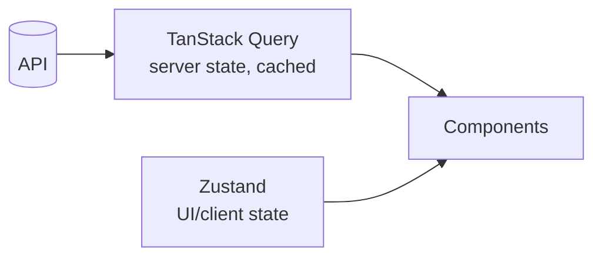

[🏠 Home](../README.md) › [Coding Standards](README.md) › **Frontend — React + TypeScript**

# Frontend — React + TypeScript

> Read **[General Principles](General-Principles.md)** first — this page only covers what's specific to our React/TypeScript stack.
> **Which tools we use, why, and how to set them up:** [Tech Stack → Frontend Stack](../Tech-Stack/Frontend-Stack.md). This page is how to write code with them day to day.

* * *

## At a Glance

| Topic | The rule |
| --- | --- |
| [Folder structure](#folder-structure) | **Group by feature, not by layer**<br/><sub>Everything for invoices lives in `features/invoices/`. Deleting a feature means deleting a folder.</sub> |
| [Type safety](#type-safety) | **`strict: true`, no `any`**<br/><sub>Use `unknown` and narrow it. Never loosen the compiler to silence an error.</sub> |
| [Server and client state](#keep-server-data-out-of-stores) | **API data in TanStack Query, UI state in Zustand**<br/><sub>Copying server data into a store means it goes stale the moment the server changes.</sub> |
| [Query keys](#query-key-factories) | **One typed key factory per feature**<br/><sub>A typo becomes a compile error instead of a cache that never refreshes.</sub> |
| [Forms and validation](#schema-first-with-zod) | **Write the Zod schema first, derive the type**<br/><sub>One definition, so the type and the validation can't disagree.</sub> |
| [Calling the API](#calling-the-api) | **Always use the shared `api` instance**<br/><sub>Base URL, auth header and error handling are set up once, in one place.</sub> |
| [Styling](#styling-with-the-design-system) | **shadcn/ui primitives, theme classes, variants**<br/><sub>No hard-coded colours, no copy-pasted components. Keeps dark mode and rebrands working.</sub> |
| [Linting and formatting](#linting-and-formatting) | **Prettier formats, ESLint checks, Husky runs both on commit**<br/><sub>Nobody argues about style in a PR.</sub> |
| [Testing](#testing) | **Test what the user sees, mock the network**<br/><sub>Vitest + RTL for components, Playwright for a few critical flows, MSW for API calls.</sub> |
| [Storybook](#storybook-stories) | **One story per state, next to the component**<br/><sub>Default, disabled, loading, error, long text.</sub> |

* * *

## Concepts you'll meet on this codebase

Short definitions of the terms the rest of the page uses. Skip the ones you already know.

### Server state and client state

The distinction the whole page hangs off. **Server state** is data that lives somewhere else and can change without you; it needs caching, refetching and invalidating. **Client state** is yours alone: which tab is open, whether the modal is showing. They're different problems, so they get different tools. See [Keep server data out of stores](#keep-server-data-out-of-stores).

### Query key factories

TanStack Query caches by key. Two components asking for the same key share one request and one cache entry, and a mutation invalidates by key to force a refetch. Type the keys in one factory per feature so a typo is a compile error, not a cache that silently never updates.

```ts
export const invoiceKeys = {
  all: ['invoices'] as const,
  list: () => [...invoiceKeys.all, 'list'] as const,
  detail: (id: string) => [...invoiceKeys.all, 'detail', id] as const,
};

useQuery({ queryKey: invoiceKeys.detail(id), queryFn: () => getInvoice(id) });

// after saving an invoice, refresh every invoice list and detail in one line
queryClient.invalidateQueries({ queryKey: invoiceKeys.all });
```

Once a feature has more than two or three queries, this is what keeps refreshing reliable.

### Schema first with Zod

Write the Zod schema, then derive the TypeScript type from it with `z.infer`. One definition, so the type and the runtime validation can't disagree. Hand-writing both is how you end up with a type that says `string` and an API that sends `null`.

```tsx
// features/invoices/schema.ts
export const invoiceSchema = z.object({
  title: z.string().min(3, 'Title must be at least 3 characters'),
  email: z.string().email('Enter a valid email'),
  notes: z.string().max(500).optional(),
});
export type InvoiceFormValues = z.infer<typeof invoiceSchema>; // the type comes from the rules

// features/invoices/components/invoice-form.tsx
const form = useForm<InvoiceFormValues>({ resolver: zodResolver(invoiceSchema) });
```

Add a rule (say, a 100-character limit on `title`) and both the on-screen validation and the type update together.

### Colocation

Tests, stories, hooks and components for a feature live next to that feature, not in a parallel folder tree. Deleting a feature should be deleting a folder.

```
shared/ui/
  button.tsx
  button.test.tsx       ✅ next to the component
  button.stories.tsx    ✅ updated in the same commit

src/stories/
  Button.stories.tsx    ❌ far away, quietly goes stale
```

### Mock Service Worker

Intercepts requests at the network layer, so your component runs its real query hooks against fake HTTP responses. Mocking the hook instead tests that the mock works; mocking the network tests your code.

* * *

## Folder structure

Group by **feature**, not by technical layer.

```
src/
├─ features/
│  └─ invoices/
│     ├─ components/    → UI for this feature only
│     ├─ hooks/
│     ├─ api/            → query/mutation hooks + api calls
│     ├─ schema.ts       → Zod schemas and the types derived from them
│     └─ index.ts         → only what other features are allowed to import
└─ shared/                → design-system primitives (ui/), the api instance, generic hooks, utils
```

> ⚠️ Don't group by layer at the root (`components/`, `hooks/`, `services/` all mixed together) once the app is past a few screens. You end up hunting across five folders to understand one feature.

Other features import through `index.ts`, never from inside the folder:

```ts
// ✅ the feature decides what's public
import { InvoiceStatusBadge } from '@/features/invoices';

// ❌ reaches into another feature's internals; breaks when they refactor
import { InvoiceStatusBadge } from '@/features/invoices/components/invoice-status-badge';
```

* * *

## Type safety

Keep `strict: true` in `tsconfig.json` and fix the error instead of loosening the compiler. When you don't know a type yet, use `unknown` and narrow it. `any` switches checking off for everything it touches.

```ts
// ❌ any: compiles, then crashes at runtime if the shape is wrong
function getMessage(error: any) {
  return error.response.data.message;
}

// ✅ unknown: TypeScript makes you check before you use it
function getMessage(error: unknown) {
  if (error instanceof Error) return error.message;
  return 'Something went wrong';
}
```

> 💡 **Tip:** For API responses, don't narrow by hand. Parse with the Zod schema (`invoiceSchema.parse(data)`) and you get a typed value or a clear error.

* * *

## Keep server data out of stores

| State | Belongs in |
| --- | --- |
| Anything fetched from an API | **TanStack Query** |
| Modal open/closed, active tab, wizard step | **Zustand** (or local `useState`) |



Copying server data into a Zustand store "for convenience" means it goes stale the moment the server changes. The same goes for `useEffect` + `useState` fetching: you end up hand-writing the caching TanStack Query already does.

```tsx
// ❌ Server data living in a store: now you own the refetching, caching and invalidation
const useInvoiceStore = create<InvoiceState>((set) => ({
  invoices: [],
  setInvoices: (invoices) => set({ invoices }),
}));

useEffect(() => {
  api.get('invoices').json<Invoice[]>().then(setInvoices);
}, []);

// ✅ Query owns server data, the store owns UI state
const { data: invoices } = useQuery({
  queryKey: invoiceKeys.list(),
  queryFn: () => api.get('invoices').json<Invoice[]>(),
});
const selectedId = useInvoiceStore((s) => s.selectedId);
```

* * *

## Calling the API

There is one configured `ky` instance in `src/shared/api.ts`, holding the base URL, auth header and error handling. Feature code always imports it. How it's set up is in [Tech Stack → HTTP Client](../Tech-Stack/Frontend-Stack.md#http-client).

```ts
// features/invoices/api/get-invoice.ts
// ✅ uses the shared instance: base URL and token are already handled
import { api } from '@/shared/api';

export const getInvoice = (id: string) => api.get(`invoices/${id}`).json<Invoice>();

// ❌ a second instance: no auth header, wrong base URL in staging
import ky from 'ky';
export const getInvoice = (id: string) =>
  ky.get(`http://localhost:3000/invoices/${id}`).json<Invoice>();
```

* * *

## Styling with the design system

The shared components in `shared/ui` are our design system. Build with them, and style with theme classes so dark mode and a client rebrand only need a change in one place.

**Compose primitives instead of rebuilding them.** A dialog has focus trapping, Escape-to-close and screen-reader labels. A hand-made one usually has none of those.

```tsx
// ✅ composed from the shared Dialog
import { Dialog, DialogContent, DialogTitle } from '@/shared/ui/dialog';

<Dialog open={open} onOpenChange={setOpen}>
  <DialogContent>
    <DialogTitle>Delete invoice?</DialogTitle>
  </DialogContent>
</Dialog>

// ❌ a div that looks like a dialog
{open && <div className="fixed inset-0 bg-black/50">...</div>}
```

**Use theme classes, not raw colours.**

```tsx
// ✅ follows the theme, including dark mode
<p className="bg-primary text-primary-foreground">Paid</p>

// ❌ ignores dark mode and every future rebrand
<p className="bg-[#1d4ed8]" style={{ color: 'white' }}>Paid</p>
```

**Need a new look? Add a variant, don't copy the component.**

```tsx
// ✅ shared/ui/button.tsx: one new line in the existing variants
variant: {
  default: 'bg-primary text-primary-foreground',
  destructive: 'bg-destructive text-white',
  success: 'bg-green-600 text-white', // new
},

// usage anywhere
<Button variant="success">Mark as paid</Button>

// ❌ features/invoices/components/green-button.tsx, a copy that drifts from the original
```

* * *

## Do / Don't

Each row links to the section with its full example.

| ✅ Do | ❌ Don't | Example |
| --- | --- | --- |
| `strict: true` in `tsconfig.json` | Loosen strictness to silence an error | [Type safety](#type-safety) |
| `unknown` + narrowing when a type is genuinely uncertain | Reach for `any` | [Type safety](#type-safety) |
| Zod schema first, derive the type with `z.infer` | Hand-write a parallel TS type that can drift from validation | [Schema first](#schema-first-with-zod) |
| Import the shared `api` instance | Create a `ky` instance in feature code | [Calling the API](#calling-the-api) |
| Typed query-key factories (`invoiceKeys.detail(id)`) | Ad hoc array query keys scattered around | [Query keys](#query-key-factories) |
| Fetch API data with TanStack Query | `useEffect` + `useState` fetching, or API data copied into Zustand | [Server data](#keep-server-data-out-of-stores) |
| Compose from shadcn/ui primitives | Rebuild a dialog or dropdown from scratch | [Styling](#styling-with-the-design-system) |
| Theme classes (`bg-primary`, `text-muted-foreground`) | Hard-coded colours (`bg-[#1d4ed8]`, `style={{ color: ... }}`) | [Styling](#styling-with-the-design-system) |
| Add a `variant` to the shared component | Copy-paste a slightly different Button into a feature folder | [Styling](#styling-with-the-design-system) |
| Import other features through their `index.ts` | Reach into another feature's internal files | [Folder structure](#folder-structure) |
| Colocate tests next to source (`X.test.tsx`) | One giant `__tests__` folder disconnected from source | [Colocation](#colocation) |

* * *

## Linting and formatting

Prettier for formatting, ESLint for everything else. See [General Principles → Linting and formatting](General-Principles.md#linting-and-formatting) for why the split matters.

```bash
pnpm add -D prettier eslint eslint-config-prettier \
  @typescript-eslint/parser @typescript-eslint/eslint-plugin \
  eslint-plugin-react-hooks
```

**Style: Prettier's own defaults, with two team calls on top of them.** Everything Prettier doesn't decide by default, decide once here and stop re-deciding it per project:

```json
// .prettierrc
{
  "singleQuote": true,
  "trailingComma": "all"
}
```

Semicolons, 2-space indent, and 80-character width stay as Prettier's default — don't override settings just because a past project did it differently. Fewer overrides means a new project's config is one copy-paste, not an argument.

```js
// eslint.config.js — the shape, not the full file
export default [
  js.configs.recommended,
  ...tseslint.configs.recommended,
  reactHooks.configs.recommended,
  eslintConfigPrettier, // last — turns off formatting rules Prettier already owns
];
```

Extend `recommended` configs rather than adopting a full third-party style guide (Airbnb, Google) wholesale — those duplicate a lot of what Prettier already enforces and go stale between major releases. `eslint-plugin-react-hooks` catches a missing or wrong dependency in `useEffect`/`useMemo`/`useCallback` — the single most common React bug this stack sees, and worth having even if nothing else about the config changes.

- `package.json` scripts: `"lint": "eslint ."` and `"format": "prettier --write ."`. Add `"format:check": "prettier --check ."` for CI, since CI should verify, not rewrite, your code.
- Pre-commit: `husky` + `lint-staged`, running Prettier and ESLint only on staged files so a large existing codebase doesn't block every commit on unrelated pre-existing issues. The typecheck runs on the **whole project**, because changing one file can break another:

```js
// lint-staged.config.js
export default {
  '*.{ts,tsx}': ['prettier --write', 'eslint --fix', () => 'tsc --noEmit -p tsconfig.app.json'],
  '*.{json,md,css}': 'prettier --write',
};
```

```bash
# .husky/pre-commit
pnpm exec lint-staged
```

- CI: run `pnpm lint` and `pnpm format:check` on every PR, alongside `tsc --noEmit`.

* * *

## Testing

- **Vitest + RTL** for components/units — assert on behaviour and output, not internal state.
- **Playwright** for a handful of critical flows (auth, checkout/submission), not every screen.
- Mock at the network boundary ([MSW](#mock-service-worker)), not by stubbing hooks.

```tsx
// shared/ui/status-badge.test.tsx — next to the component
import { render, screen } from '@testing-library/react';

test('shows "Closed" for closed invoices', () => {
  render(<StatusBadge status="closed" />);
  expect(screen.getByText('Closed')).toBeInTheDocument();
});
```

```ts
// e2e/submit-invoice.spec.ts — only for flows that would really hurt if they broke
test('a user can submit an invoice', async ({ page }) => {
  await page.goto('/invoices/new');
  await page.getByLabel('Title').fill('March consulting');
  await page.getByRole('button', { name: 'Submit' }).click();
  await expect(page.getByText('Invoice submitted')).toBeVisible();
});
```

Find elements the way a user would (`getByRole`, `getByLabel`, `getByText`), not by CSS class or test ID. Tests then survive restyling.

* * *

## Storybook stories

One story per meaningful state (default, disabled, loading, error, long text), in a `.stories.tsx` file **next to the component** (see [Colocation](#colocation)).

```tsx
// shared/ui/button.stories.tsx
import type { Meta, StoryObj } from '@storybook/react-vite';
import { Button } from './button';

const meta = { component: Button } satisfies Meta<typeof Button>;
export default meta;

export const Primary: StoryObj<typeof meta> = { args: { children: 'Submit' } };
export const Destructive: StoryObj<typeof meta> = { args: { children: 'Delete', variant: 'destructive' } };
```

* * *

## Further reading

- [React + TypeScript Style Guide](https://react-typescript-style-guide.com/)
- [React.js Best Practices in 2026](https://abisolutions.online/blog/react-best-practices-2026)
- [Zustand & TanStack Query: Optimal State Management](https://arjun-dev.hashnode.dev/managing-state-the-right-way-zustand-for-client-state-and-tanstack-query-for-server-state)

---

[⬅ Back to Coding Standards](README.md)
