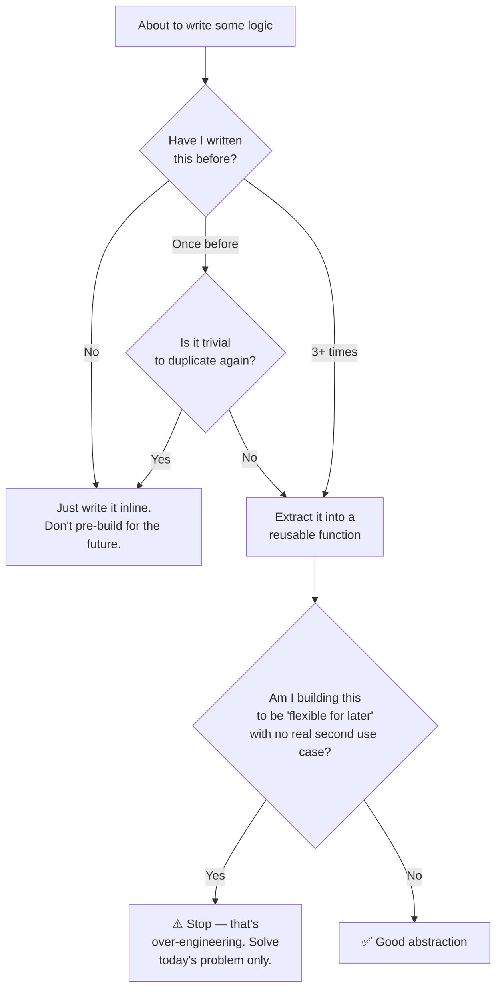

General Principles
===================

> Applies to every language we use. Stack-specific rules live on the [Frontend](/Coding-Standards/Frontend-React-TypeScript), [React Native](/Coding-Standards/Mobile-React-Native), [Flutter](/Coding-Standards/Mobile-Flutter), [NestJS](/Coding-Standards/Backend-NestJS), [Laravel](/Coding-Standards/Backend-Laravel-PHP), and [.NET](/Coding-Standards/Backend-DotNet-CSharp) pages.

* * *

## At a Glance

| Topic | The rule |
| --- | --- |
| [Case convention](#case-convention-by-language) | **Follow your language's convention**<br/><sub>camelCase in TypeScript, PascalCase methods in C#, a real `_` prefix for private in Dart.</sub> |
| [Naming](#good-name-vs-bad-name) | **Descriptive beats short**<br/><sub>`userAddress`, not `uAddr`. Saving 4 characters isn't worth an ambiguous name.</sub> |
| [Name length](#how-long-is-too-long) | **Length matches scope**<br/><sub>`i` in a 3-line loop is fine. An exported name has to explain itself.</sub> |
| [Duplication](#keep-it-simple) | **Extract on the third copy, not before**<br/><sub>Copying once is fine. Building a "flexible" system for one use case is over-engineering.</sub> |
| [Nesting](#use-guard-clauses-instead-of-nested-if-else) | **Guard clauses and early returns**<br/><sub>Each rejection sits next to the condition that caused it.</sub> |
| [Ternaries](#avoid-nested-ternaries) | **One ternary, never a ternary inside a ternary**<br/><sub>Shorter stops being better once nobody can read it.</sub> |
| [Functions](#functions-should-do-one-thing) | **One job per function**<br/><sub>Easier to read top to bottom, and each piece can be tested on its own.</sub> |
| [Comments](#comments) | **Comment the why, not the what**<br/><sub>Good names make most comments unnecessary.</sub> |
| [Error handling](#error-handling) | **Never fail silently**<br/><sub>Show the user something they can act on, and log the real error with context.</sub> |
| [Secrets](#secrets-and-configuration) | **Secrets never go in the repo**<br/><sub>Once committed, it's in git history forever. Rotating it is the only fix.</sub> |
| [Configuration](#secrets-and-configuration) | **Validate config at startup**<br/><sub>A missing variable should stop the app with a clear message, not crash three screens in.</sub> |
| [Linting and formatting](#linting-and-formatting) | **The formatter decides, hooks and CI enforce it**<br/><sub>No style arguments in review, whatever editor you use.</sub> |
| [Dependencies](#adding-a-dependency) | **Check the Tech Stack before adding a package**<br/><sub>A new one gets one line of reasoning in the PR description.</sub> |

* * *

## Writing code

### Naming

**The name is the cheapest documentation you'll ever write.** Follow the case convention for your language, and make the name describe *what the thing is*.

#### Case convention by language

| | C# | TypeScript / JavaScript | PHP | Dart |
| --- | --- | --- | --- | --- |
| **Public variable** | `PascalCase` → `Sales` | `camelCase` → `sales` | `camelCase` → `$sales` | `camelCase` → `sales` |
| **Private variable** | `_camelCase` → `_sales` | `_camelCase` → `_sales` | `camelCase` (marked `private`) → `private $sales` | `_camelCase` → `_sales` |
| **Public function** | `PascalCase()` → `GetSales()` | `camelCase()` → `getSales()` | `camelCase()` → `getSales()` | `camelCase()` → `getSales()` |
| **Private function** | `PascalCase()` → `GetSales()` | `_camelCase()` → `_getSales()` | `camelCase()` (marked `private`) → `private function getSales()` | `_camelCase()` → `_getSales()` |

Three things people get wrong:

- **C#** — the `_` prefix is for private and internal *fields* only. Every method is `PascalCase`, private ones included. <sup>[1]</sup>
- **PHP** — method names must be `camelCase`. <sup>[2]</sup> Property casing is our own call; `snake_case` stays for database columns and the Eloquent attributes that map to them (`created_at`).
- **Dart** — the `_` prefix isn't a convention, it's the language: it's what actually makes a member private to its library. <sup>[5]</sup> File names are the exception to camelCase — those are `snake_case.dart`.

Worth knowing: neither Pint nor `dotnet format` will catch a naming violation. Formatters reformat, they don't rename. That one's on the reviewer.

#### Good name vs bad name

| ❌ Bad | Why it's bad | ✅ Good |
| --- | --- | --- |
| `uAddr` | Shortened past recognition | `userAddress` |
| `cat` | Category? A cat? | `category` |
| `cnp` | Acronym only you know | `carNumberPlate` |
| `userAdd` | Reads as "user, add" or "additional info" | `userAddr` / `userAddress` |
| `analService` | Awkward abbreviation reads badly out loud | `analyzerService` |

> 💡 **Rule:** descriptive beats short. If you're saving 4 characters by making a name ambiguous, you're not saving anything.

#### How long is too long

"Descriptive" isn't a licence to write `theCurrentlySelectedCustomerAddressLineOne`. Two rules settle most of these arguments.

**Length should match scope.** <sup>[3]</sup> The further a name travels from where it's declared, the more work it has to do on its own.

| Where it lives | Reasonable |
| --- | --- |
| A 3-line loop or callback | `i`, `id`, `res` |
| A 20-line function | `invoiceTotal`, `unpaidInvoices` |
| Exported and used across the codebase | `calculateInvoiceTotalWithTax` |

`i` in a `for` loop is not a naming failure. `i` as a module-level export is.

**Drop context the reader already has.** <sup>[3]</sup>

| ❌ Says it twice | ✅ |
| --- | --- |
| `user.userName` | `user.name` |
| `usersArray`, `nameString` | `users`, `name` |
| `invoiceService.createInvoice()` | `invoiceService.create()` |

If the name still needs five or more words after all that, the name isn't your problem — the function is doing too much. Split it (see [Functions should do one thing](#functions-should-do-one-thing)).

* * *

### Keep it simple

Don't repeat yourself, but don't over-engineer either.

Two failure modes, both common:

- **Duplication** — the same logic copy-pasted in several places. One bug fix now means finding and fixing it N times.
- **Premature abstraction** — a generic, configurable, "flexible" system for a problem you don't have yet. It adds layers people have to tunnel through to find the actual logic.



**Rule of Three:** copy-pasting something once is fine. The third time you write it, extract it.

#### Code smells cheat sheet

| Smell | Looks like | Fix |
| --- | --- | --- |
| **Duplicated code** | Same block of logic in 2+ places | Extract into one reusable function/service. [Example](#duplication-example) |
| **God function / class** | One function does fetching, validating, formatting, AND rendering | Split by responsibility. [Example](#functions-should-do-one-thing) |
| **Premature abstraction** | A generic `BaseHandler<T, Options>` built for one concrete use case | Delete the abstraction; write the concrete version. Generalize only on the 3rd real use case. [Decision chart](#keep-it-simple) |
| **Magic numbers/strings** | `if (status === 3)` | Named constant: `if (status === Status.APPROVED)` |
| **Deep nesting** | `if { if { if { ... } } }` 4+ levels deep | Guard clauses / early returns. [Example](#use-guard-clauses-instead-of-nested-if-else) |
| **Long parameter list** | `createUser(name, email, age, addr, phone, role, isActive, ...)` | Group into an object/DTO: `createUser(userDto)` |
| **Shotgun surgery** | One small change requires edits across 6 unrelated files | Usually a sign logic is duplicated instead of shared — consolidate it |
| **Dead code** | Commented-out blocks, unused functions "just in case" | Delete it. Git history remembers it, your file doesn't need to. [Comments](#comments) |

#### Duplication example

Invoice totals, calculated in three places:

```ts
// ❌ InvoiceSummary.tsx
const total = lines.reduce((sum, l) => sum + l.qty * l.unitPrice, 0) * 1.06;

// ❌ generateInvoicePdf.ts
const total = lines.reduce((sum, l) => sum + l.qty * l.unitPrice, 0) * 1.06;

// ❌ monthlyRevenueReport.ts
const total = lines.reduce((sum, l) => sum + l.qty * l.unitPrice, 0) * 1.08;
//                                                                    ^^^^
// SST went to 8%. Someone updated this copy and missed the other two.
```

The screen now shows one number, the PDF shows the same wrong number, and the finance report shows a third. The client finds it before you do.

```ts
// ✅ One function, one tax rate, one place to fix it
export const SST_RATE = 0.08;

export function calculateInvoiceTotal(lines: InvoiceLine[]) {
  const subtotal = lines.reduce((sum, l) => sum + l.qty * l.unitPrice, 0);
  return subtotal * (1 + SST_RATE);
}
```

* * *

### Readability and complexity

#### Prefer the shorter form when it reads the same

```ts
// ❌ Six lines to pick one of two values
let displayName = '';
if (user.preferredName) {
  displayName = user.preferredName;
} else {
  displayName = user.fullName;
}

// ✅
const displayName = user.preferredName || user.fullName;
```

#### Avoid nested ternaries

Prefer the shorter form, but not by nesting ternaries. Shorter stops being better the moment nobody can read the result. One ternary is fine. A ternary inside a ternary is where it turns.

```ts
// ❌ Try reviewing this in a diff
const shippingFee = country === 'MY'
  ? weight > 5 ? 15 : 8
  : country === 'SG'
    ? weight > 5 ? 35 : 20
    : weight > 5 ? 90 : 60;

// ✅ Same logic, reads top to bottom
function getShippingFee(country: string, weight: number) {
  const isHeavy = weight > 5;

  if (country === 'MY') return isHeavy ? 15 : 8;
  if (country === 'SG') return isHeavy ? 35 : 20;
  return isHeavy ? 90 : 60;
}
```

This one isn't just our preference — ESLint ships a `no-nested-ternary` rule for exactly this, on the grounds that nesting them "can make code more difficult to understand." Its recommended fix is the same as ours: `if / else if / else`, or a single un-nested ternary. <sup>[4]</sup>

#### Use guard clauses instead of nested if else

The pain isn't the indentation. It's that by the time you reach an `else`, you've forgotten which `if` it belongs to.

```ts
// ❌ The one line that does the actual work is four levels deep
async function submitOrder(order: Order) {
  if (order) {
    if (order.items.length > 0) {
      if (order.payment?.isVerified) {
        if (await hasStock(order.items)) {
          return await createOrder(order);
        } else {
          throw new Error('Out of stock');
        }
      } else {
        throw new Error('Payment not verified');
      }
    } else {
      throw new Error('Order is empty');
    }
  } else {
    throw new Error('No order supplied');
  }
}

// ✅ Each rejection sits next to the condition that caused it
async function submitOrder(order: Order) {
  if (!order) throw new Error('No order supplied');
  if (!order.items.length) throw new Error('Order is empty');
  if (!order.payment?.isVerified) throw new Error('Payment not verified');
  if (!(await hasStock(order.items))) throw new Error('Out of stock');

  return createOrder(order);
}
```

Adding a fifth rule to the second version is one line. Adding it to the first means finding the right nesting level and getting the matching `else` right.

#### Replace long condition chains with a lookup

```ts
// ❌ Copy-pasted comparisons
if (name === 'Ali' || name === 'Muthu' || name === 'Ah Hock') doSomething();

// ✅ Data, not repeated code
const validNames = ['Ali', 'Muthu', 'Ah Hock'];
if (validNames.includes(name)) doSomething();
```

> 💡 If you're writing the same condition in more than one place, that's the [duplication smell](#code-smells-cheat-sheet). Extract it.

* * *

### Functions should do one thing

A function that fetches data, calculates a total, updates the DOM, *and* resets a form is four functions in a trench coat. Split it — it reads top-to-bottom and each piece is testable.

```ts
// ❌ One function doing everything
calculateClicked() {
  const rate = this.getRate();
  this.total = userInput * rate * 12;
  // ...long calculation...
  this.userInputDisplay = `Your total is: ${this.total}`;
  document.getElementById('display').innerHTML = this.userInputDisplay;
  document.getElementById('form').reset();
}

// ✅ Each function has one job
calculateClicked() {
  this.calculate();
  this.setDisplay();
  this.resetForm();
}
calculate()   { /* ...only the math... */ }
setDisplay()  { /* ...only the DOM update... */ }
resetForm()   { /* ...only the reset... */ }
```

* * *

### Comments

- If your names are good (see [Naming](#naming)), most code needs **zero** comments.
- Comment the *why*, not the *what*: a workaround, a non-obvious business rule, a tricky calculation.
- Leave a clear `// TODO:` on handoffs so the next person knows where to pick up. Say what's left and why, not just `TODO`.

```ts
// ❌ Doesn't explain anything a reader couldn't already see
// loop through data
for (const row of data) { ... }

// ✅ Explains the non-obvious "why"
// Skip rows created before the 2024 tax-rule change — they use the old schema
for (const row of data.filter(r => r.createdAt >= TAX_RULE_CHANGE_DATE)) { ... }
```

```ts
// ❌ The next person has no idea what's missing
// TODO

// ✅ Says what's left and why it isn't done yet
// TODO: apply the customer's discount tier here. Waiting on the pricing rules from finance.
```

> ⚠️ No offensive or "fun" comments, or jokes in error messages. A client may read the code during an audit.

* * *

## Errors and configuration

### Error handling

| Do | Don't |
| --- | --- |
| Wrap anything that can fail in a try/catch | Let an exception silently crash the flow |
| Show the user something actionable ("Retry" button, clear message) | Fail silently on a UI action |
| Log backend errors with context (which function, which input) | Log a bare `"Error in API"` with nothing else |
| Pay attention to console warnings during dev | Ignore yellow/red console output — today's warning is tomorrow's production bug |
| Write the error message like a colleague would read it | Put jokes or venting in error text (`"ugh, broke again"`) |

```ts
// ❌ Tells you nothing about what actually broke
try {
  // ...
} catch (ex) {
  console.log('An error occurred');
}

// ✅ Says where, and includes the real exception
try {
  // ...
} catch (ex) {
  console.error('Error in pageLoaded():', ex);
}
```

On a user action, tell the user too. A button that silently does nothing gets clicked again and again.

```ts
// ❌ The save failed, but the user sees nothing happen
async function onSave() {
  try {
    await saveInvoice(form);
  } catch {}
}

// ✅ The user knows what happened and what to do; the log has the detail
async function onSave() {
  try {
    await saveInvoice(form);
  } catch (ex) {
    console.error('Error in onSave() for invoice', form.id, ex);
    toast.error('Could not save the invoice. Check your connection and try again.');
  }
}
```

* * *

### Secrets and configuration

**Anything that differs between environments is configuration. Anything that would be damaging if a stranger read it is a secret.** They're handled differently, and the mistake is treating the second like the first.

| | Where it goes |
| --- | --- |
| API base URLs, feature flags, timeouts | Environment config, committed defaults are fine |
| API keys, DB passwords, signing keys, client credentials | Environment variables / a secrets store — **never** in the repo |
| Anything at all in a client-side bundle | Treat as public. Web bundles and mobile app binaries can both be unpacked and read |

```ts
// ❌ Committed once, in git history forever — rotating the key is now the only fix
const client = new PaymentClient('sk_live_4eC39Hq...');

// ✅ Read from config, validated at startup so a missing value fails loudly
const client = new PaymentClient(config.paymentApiKey);
```

- Commit a `.env.example` listing every variable the app needs, with dummy values. Never commit `.env` itself.

```bash
# .env.example: committed, so a new developer knows what to fill in
API_BASE_URL=http://localhost:3000
PAYMENT_API_KEY=replace-me
```

- Validate config **at startup**, not at first use. A missing variable should stop the app with a clear message, not surface as a `undefined is not a function` three screens in.

```ts
// ✅ Fails on boot with "PAYMENT_API_KEY: Required" instead of crashing at checkout
const config = z
  .object({ API_BASE_URL: z.string().url(), PAYMENT_API_KEY: z.string().min(1) })
  .parse(process.env);
```

> ⚠️ If a secret does get committed, rotate it. Deleting the line doesn't remove it from git history, and assuming nobody noticed isn't a mitigation.

* * *

## Tooling and dependencies

### Linting and formatting

Two different jobs, often lumped together. A **formatter** rewrites code to one layout — spacing, line breaks, quote style — and isn't configurable enough to argue about, which is the point. A **linter** catches what a formatter can't: an unused variable, a missing dependency in a hook, a raw SQL string that should be parameterized. Skip either one and a codebase drifts — five people writing "the same" code five slightly different ways, and every diff full of noise nobody meant to touch.

Nobody has ever won a tabs-versus-spaces argument, so we don't have them. The formatter decides, every time, automatically.

**Recommended baseline per stack** — the style to extend, not just the tool. Each stack's own page has the setup steps and the actual config values.

| Stack | Formatter | Style baseline | Linter |
| --- | --- | --- | --- |
| [Frontend — React + TypeScript](/Coding-Standards/Frontend-React-TypeScript) | Prettier | Prettier defaults, minus a couple of team calls (below) | ESLint `recommended` + `typescript-eslint recommended` |
| [Mobile — React Native + Expo](/Coding-Standards/Mobile-React-Native) | Prettier | Same as Frontend | `eslint-config-expo` |
| [Mobile — Flutter + Dart](/Coding-Standards/Mobile-Flutter) | `dart format` | [Effective Dart](https://dart.dev/effective-dart/style) — not configurable, which is the point | `flutter_lints` (official) |
| [Backend — NestJS](/Coding-Standards/Backend-NestJS) | Prettier | Same as Frontend | ESLint `recommended` + `typescript-eslint recommended` |
| [Backend — Laravel (PHP)](/Coding-Standards/Backend-Laravel-PHP) | Pint | `laravel` preset (PSR-12–based) | Larastan (PHPStan) |
| [Backend — .NET / C#](/Coding-Standards/Backend-DotNet-CSharp) | `dotnet format` | [Microsoft's C# conventions](https://learn.microsoft.com/en-us/dotnet/csharp/fundamentals/coding-style/coding-conventions), via `.editorconfig` | Built-in Roslyn analyzers |

Default to the tool's own official preset (`flutter_lints`, the `laravel` Pint preset, Microsoft's conventions, Prettier's defaults) rather than a third-party style guide like Airbnb's. The maintained default gets updated with the language; a style guide frozen from whenever someone adopted it doesn't. Deviate only for a specific, agreed reason — and once you do, write it in the config file's own comments, not somewhere it'll get separated from the setting it explains.

For the two JS/TS-based stacks specifically, don't reach for ESLint to also do formatting — `eslint-config-prettier` turns off every ESLint rule that would fight with Prettier over layout, so ESLint stays scoped to catching bugs (`typescript-eslint recommended`, `react-hooks` rules) and Prettier owns everything about how a line looks.

A few habits that hold regardless of stack:

- Wire both into the editor — format and lint on save — and as a pre-commit hook. Catching drift before a commit exists is cheaper than catching it in review.
- Run the same check in CI as a merge gate. A pre-commit hook only helps the people who have it installed; CI is what actually enforces it.
- Commit the config file (`.prettierrc`, `pint.json`, `analysis_options.yaml`, `.editorconfig` — whatever the tool uses) so the rules travel with the repo instead of living in one person's editor.
- A formatter reformats, it doesn't rename (see [Naming](#naming)). A clean diff from the formatter says the code is well-spaced, not well-named.

#### Keeping it the same across developers and IDEs

The thing that actually keeps everyone consistent isn't anyone's editor — it's the config file plus the pre-commit hook plus the CI gate. Those three run from the command line, not from a specific IDE, so it doesn't matter whether the person who wrote the code was on VS Code, a JetBrains IDE, Vim, or something else entirely. IDE integration is a convenience layered on top of that — instant feedback, format on save — not the mechanism that enforces the standard. Someone with no plugin installed still can't land code that violates it, because the hook and CI don't care what wrote the file.

That said, the convenience is worth setting up so people find out about a violation before committing, not after:

- **`.editorconfig` first, even before Prettier/Pint/`dotnet format`.** VS Code, JetBrains IDEs, and most others read it natively with no plugin, so it's the one thing that stops two editors defaulting to different indentation or line endings before anyone's installed the project's actual formatter.

  ```ini
  # .editorconfig
  root = true

  [*]
  indent_style = space
  indent_size = 2
  end_of_line = lf
  insert_final_newline = true

  # PHP and C# conventions use 4 spaces
  [*.{php,cs}]
  indent_size = 4
  ```
- **Commit shared editor config where the tooling supports it.** For VS Code: `.vscode/settings.json` with `"editor.formatOnSave": true` and the right `editor.defaultFormatter` per language, plus `.vscode/extensions.json` recommending the project's Prettier/ESLint/PHP/C# extensions — a new teammate gets a one-click prompt instead of having to know what to install.

  ```json
  // .vscode/settings.json
  {
    "editor.formatOnSave": true,
    "editor.defaultFormatter": "esbenp.prettier-vscode",
    "editor.codeActionsOnSave": { "source.fixAll.eslint": "explicit" }
  }
  ```

  JetBrains IDEs (Rider, WebStorm, PhpStorm) pick up `.editorconfig` automatically and can be pointed at the same Prettier/ESLint/Pint config the CLI uses; there's no separate "JetBrains style" to maintain.
- **If a rule isn't in the shared config file, it doesn't count.** A personal IDE setting that changes what gets written to a file — but isn't in `.prettierrc`, `eslint.config.js`, `.editorconfig`, or `pint.json` — won't be caught by CI and won't apply on a teammate's machine. Personal preferences like theme, keybindings, and font are fine to keep personal; anything that changes the file's actual content belongs in the repo.
- **The pre-commit hook is the real cross-IDE guarantee.** It runs from git, not from an editor, so it fires the same way regardless of what staged the change — which is what actually catches the person who skipped the IDE setup entirely.

* * *

### Adding a dependency

Every package you add is code you're responsible for but didn't write. Most of the time that's a good trade — nobody should be hand-rolling date arithmetic or JWT verification. Sometimes it isn't.

Before adding one, the honest version of the checklist:

- **Is it in the [Tech Stack](/Tech-Stack) already?** Use that. A second HTTP client or a second date library in one project is how a codebase ends up with two ways to do everything.
- **Could this be 20 lines of our own code?** A one-function dependency is rarely worth a supply-chain risk and an upgrade obligation.
- **Is it maintained?** Last release, open issues, whether it supports the current major version of your framework. An abandoned package is a migration you've scheduled for your future self. <sup>[6]</sup>
- **What does it drag in?** A package with forty transitive dependencies is forty more things that can break, and on mobile and web it's bundle size the user pays for.

> 💡 **Rule:** a new dependency that isn't in the Tech Stack is a decision worth one line in the PR description. Not a debate — just say what it's for and why the existing tools didn't cover it.
> ```md
> **New dependency:** `react-signature-canvas`, for the delivery sign-off screen.
> Nothing in the Tech Stack draws signatures, and writing canvas touch handling ourselves would be ~300 lines.
> ```

And keep the lockfile honest: one package manager per project, lockfile committed, and upgrades as their own PR rather than smuggled into a feature branch.

* * *

## Sources

1.  **.NET Runtime — C# Coding Style** (rules 3 and 13)
    [https://github.com/dotnet/runtime/blob/main/docs/coding-guidelines/coding-style.md](https://github.com/dotnet/runtime/blob/main/docs/coding-guidelines/coding-style.md)
2.  **PSR-1 — Basic Coding Standard**
    [https://www.php-fig.org/psr/psr-1/](https://www.php-fig.org/psr/psr-1/)
3.  **Google Go Style Guide — Variable names**
    [https://google.github.io/styleguide/go/decisions](https://google.github.io/styleguide/go/decisions)
4.  **ESLint — `no-nested-ternary`**
    [https://eslint.org/docs/latest/rules/no-nested-ternary](https://eslint.org/docs/latest/rules/no-nested-ternary)
5.  **Effective Dart — Style**
    [https://dart.dev/effective-dart/style](https://dart.dev/effective-dart/style)
6.  **OpenSSF — Concise Guide for Evaluating Open Source Software**
    [https://best.openssf.org/Concise-Guide-for-Evaluating-Open-Source-Software](https://best.openssf.org/Concise-Guide-for-Evaluating-Open-Source-Software)
