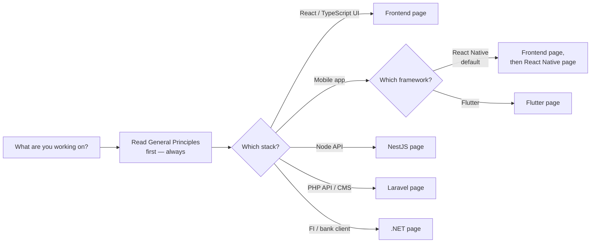

[🏠 Home](../README.md) › **Coding Standards**

# Coding Standards

How we write code at Trinergy. Built to be skimmed: tables and ✅ / ❌ examples over long paragraphs, diagrams where they beat a page of text.

* * *

### Start here

| Page | Who it's for |
| --- | --- |
| **[General Principles](General-Principles.md)** | Everyone. Naming, simplicity vs. over-engineering, error handling, comments — applies no matter what language you're writing. |
| **[Frontend — React + TypeScript](Frontend-React-TypeScript.md)** | Anyone touching the React/Vite/TypeScript apps. |
| **[Mobile — React Native + Expo](Mobile-React-Native.md)** | The mobile apps. Our default mobile stack — read the Frontend page too, most of it applies. |
| **[Mobile — Flutter + Dart](Mobile-Flutter.md)** | Mobile projects on Flutter — UI/animation-heavy apps, or where the client mandates it. |
| **[Backend — NestJS](Backend-NestJS.md)** | The Node.js/NestJS API projects. |
| **[Backend — Laravel (PHP)](Backend-Laravel-PHP.md)** | The Laravel projects. |
| **[Backend — .NET / C#](Backend-DotNet-CSharp.md)** | The .NET / ASP.NET Core projects — typically FI (bank/insurance) clients, see [Tech Stack](../Tech-Stack/README.md). |

* * *
