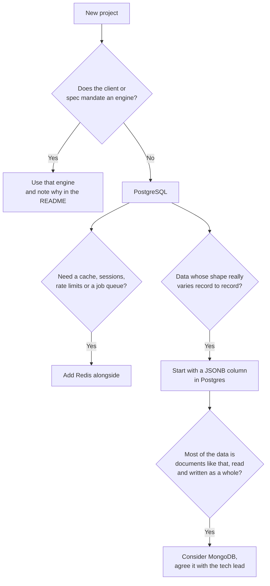

Database Standards
==================

How we design, query, change and run databases at Trinergy. Built to be skimmed: tables and ✅ / ❌ examples over long paragraphs, real SQL you can copy, diagrams where they beat a page of text.

> 📝 **PostgreSQL is our default database for every new project**, unless the client or the spec says otherwise. Examples on these pages are written for Postgres. Where another engine does it differently, the page says so, and each engine has its own page below.

* * *

## At a Glance

The rules that matter most. Each one links to the page that explains it.

| Topic | The rule |
| --- | --- |
| [Default engine](/Database-Standards/General-Principles#postgres-unless-told-otherwise) | **PostgreSQL, unless the client or spec says otherwise** Any other relational engine is a documented exception. Redis and MongoDB sit next to it, never instead of it by default. |
| [Constraints](/Database-Standards/General-Principles#constraints-belong-in-the-database) | **The schema enforces the rules, not just the app** NOT NULL, foreign keys, UNIQUE and CHECK catch what app validation misses: race conditions, scripts, the next app. |
| [Think in sets](/Database-Standards/General-Principles#think-in-sets-not-loops) | **One query for many rows, not one query per row** 1,000 round trips are always slower than one statement that touches 1,000 rows. |
| [Parameters](/Database-Standards/General-Principles#always-parameterize) | **Values are always parameters, never pasted into the SQL string** That's the whole defence against SQL injection, ORM or not. |
| [Indexes](/Database-Standards/Indexing) | **Index for the queries you actually run, and prove it with EXPLAIN** Every foreign key gets one. Every other index has to earn its write cost. |
| [Schema changes](/Database-Standards/Migrations-and-Schema-Changes) | **Every change is a committed migration, safe to run on a live table** Nobody runs ALTER TABLE by hand on a shared database. |
| [Production](/Database-Standards/General-Principles#touching-production-by-hand) | **Hand-run writes go inside a transaction, row count checked before COMMIT** ROLLBACK is free. Restoring from a backup is not. |
| [Backups](/Database-Standards/Backups-and-Recovery) | **A backup only counts once you've restored it** Every project knows how far back it can recover, and has tested that it actually can. |
| [Access](/Database-Standards/Access-and-Roles) | **The app connects as a least-privilege user, never as the owner or superuser** A bug or injection in the app can only do what its database user is allowed to do. |

* * *

## Start here

### Designing and writing — everyone

| Page | Covers |
| --- | --- |
| **[General Principles](/Database-Standards/General-Principles)** | Read this first. The rules that apply whatever engine or ORM you're on. |
| **[Schema Design](/Database-Standards/Schema-Design)** | Naming, primary keys, data types, constraints, NULLs, time, money, soft deletes. |
| **[Logic in the Database](/Database-Standards/Logic-in-the-Database)** | When logic belongs in the database instead of the app: views, functions, procedures, triggers, the outbox pattern, and their traps. |
| **[Writing Queries](/Database-Standards/Writing-Queries)** | Selecting columns, filters that can use an index, joins, EXISTS vs IN, CTEs vs subqueries, pagination, N+1. |
| **[Indexing](/Database-Standards/Indexing)** | Which index for which query, composite column order, covering, partial and expression indexes, and when not to index. |
| **[Performance and Diagnostics](/Database-Standards/Performance-and-Diagnostics)** | Reading a query plan, finding the slow queries, connection pooling, VACUUM and statistics. |
| **[Transactions and Concurrency](/Database-Standards/Transactions-and-Concurrency)** | Isolation levels, locks and deadlocks, job queues, optimistic locking, safe upserts. |
| **[Migrations and Schema Changes](/Database-Standards/Migrations-and-Schema-Changes)** | Changing a live table without downtime, with Prisma, TypeORM, Laravel, EF Core and DbUp. |
| **[Large Data and Bulk Operations](/Database-Standards/Large-Data-and-Bulk-Operations)** | Batching big writes, bulk loads, partitioning and archiving. |
| **[SQL Cookbook](/Database-Standards/SQL-Cookbook)** | Ready-to-use recipes: top N per group, de-duplication, running totals, trees, date buckets and more. |

### Running a database — whoever owns the project's infrastructure

| Page | Covers |
| --- | --- |
| **[Access and Roles](/Database-Standards/Access-and-Roles)** | Database users per app and per person, least privilege, credentials and network access. |
| **[Backups and Recovery](/Database-Standards/Backups-and-Recovery)** | Backup types, point-in-time recovery, restore drills, and the strategy for each engine. |
| **[Replication and Monitoring](/Database-Standards/Replication-and-Monitoring)** | Read replicas, failover, and what to watch on a database in production. |

### Engine pages

| Page | Type | Covers |
| --- | --- | --- |
| **[Engine Differences](/Database-Standards/Engine-Differences)** | Cheat sheet | Behaviour that silently differs between Postgres, SQL Server and MySQL: GROUP BY, NULLs, text comparison, division, DDL, limits. |
| **[PostgreSQL](/Database-Standards/PostgreSQL)** | Relational — **our default** | JSONB, arrays, enums, extensions, full-text search, psql tips. |
| **[SQL Server](/Database-Standards/SQL-Server)** | Relational | The .NET / FI-client projects. T-SQL differences, temp tables, Query Store. |
| **[MySQL](/Database-Standards/MySQL)** | Relational | Existing Laravel/PHP projects and client hosting that only offers MySQL. |
| **[MongoDB](/Database-Standards/MongoDB)** | NoSQL — document store | When a document store is the right call, and how to model it when it is. |
| **[Redis](/Database-Standards/Redis)** | NoSQL — in-memory key-value | Caching, sessions, rate limits, queues and locks. Never the only copy of important data. |

* * *

## Which database?

A new project gets **PostgreSQL**. Add **Redis** next to it when you need a cache, sessions, rate limiting or a job queue. The others are for when a client, an existing system or a genuinely different data shape calls for them.

| Engine | Type | Use it for | Don't use it for |
| --- | --- | --- | --- |
| **PostgreSQL** | Relational (SQL) | Every new project by default. Transactional data, reporting, semi-structured data in JSONB, built-in full-text search. | Nothing it can't handle at our scale. Pair it with Redis for caching instead of stretching it into one. |
| **SQL Server** | Relational (SQL) | FI (bank/insurance) clients and .NET projects where the client's infrastructure or licensing mandates it. | A new project with no client requirement for it. |
| **MySQL / MariaDB** | Relational (SQL) | Existing Laravel/PHP projects, and client hosting where it's the only option. | A new project where Postgres is available. |
| **MongoDB** | NoSQL — documents | Data that is mostly self-contained documents with a shape that varies per record, read and written as a whole: content blocks, event payloads, catalogues with very different attributes per product. | Anything with relationships you join on, money and ledgers, or "we don't want to design a schema yet". A JSONB column in Postgres usually covers flexible data without a second database. |
| **Redis** | NoSQL — in-memory key-value | Cache, sessions, rate limiting, job queues, pub/sub, leaderboards, short-lived locks. | The only copy of data you can't afford to lose. Redis is fast because it lives in memory; treat it as rebuildable. |

> ⚠️ Picking anything other than PostgreSQL for the main database is an exception, so write down why. See [How to Use This Wiki → Document every exception](/How-to-Use-This-Wiki#document-every-exception).

* * *

## Related pages

- [Tech Stack → Backend Stack](/Tech-Stack/Backend-Stack#database-and-orm) — which ORM each stack uses, and the one-time setup.
- [Coding Standards](/Coding-Standards) — the day-to-day code around the database: services, repositories, transactions in Prisma, TypeORM, Eloquent, EF Core and Dapper.
- [Security](/Security) — SQL injection, secrets and access control from the security angle.
