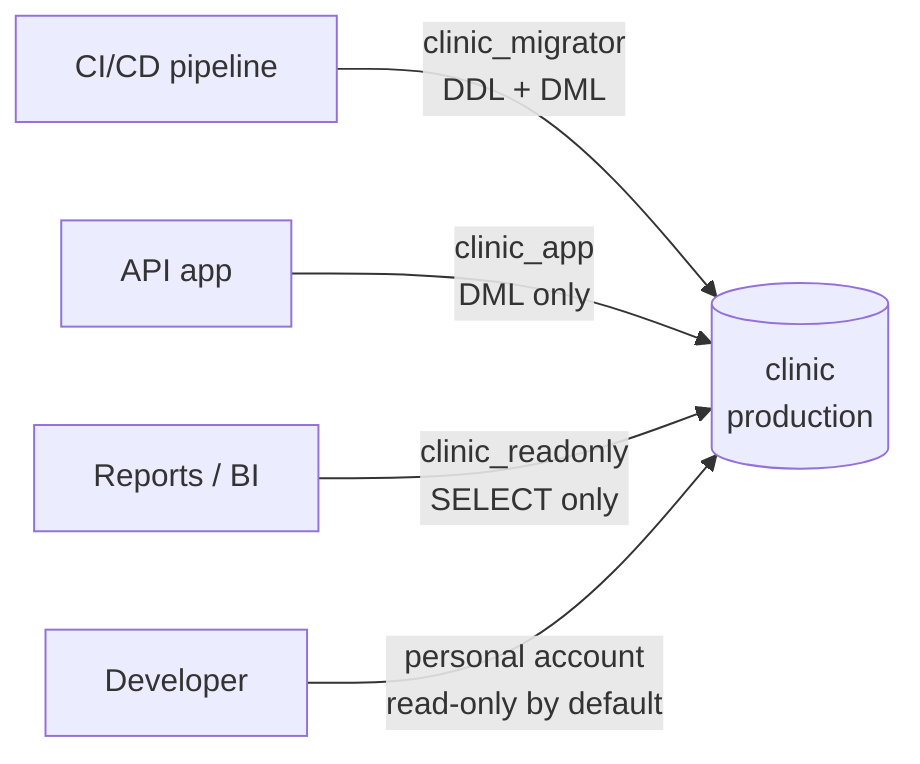
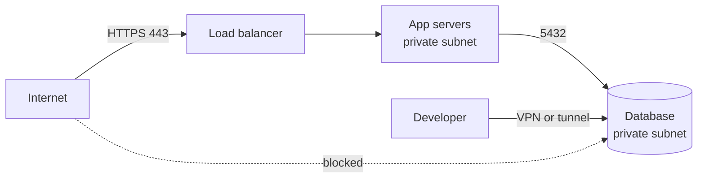

Access and Roles
================

> Who and what can connect to a database, and what each is allowed to do. Read **[General Principles](/Database-Standards/General-Principles)** first.
> **The security baseline this builds on:** [Security → Authentication and Access Control](/Security/Authentication-and-Access-Control#least-privilege).

* * *

## At a Glance

| Topic | The rule |
| --- | --- |
| [Users per app](#one-user-per-job-per-environment) | **One database user per app, per job, per environment**<br/><sub>Staging credentials never open production, and a leaked reporting password can't write anything.</sub> |
| [App user](#the-three-users-every-project-gets) | **The app connects as a least-privilege user, never the owner or superuser**<br/><sub>Read and write rows in its own schema. No DDL, no other databases.</sub> |
| [Migration user](#the-three-users-every-project-gets) | **Schema changes run as a separate migration user, from the pipeline only**<br/><sub>The running app never holds the rights to drop a table.</sub> |
| [Read-only user](#the-three-users-every-project-gets) | **Reports, BI tools and debugging use a read-only user**<br/><sub>A dashboard with a bug can't change data it was only meant to show.</sub> |
| [People](#named-accounts-for-people) | **Named personal accounts, never a shared admin login**<br/><sub>You can see who did what, and remove one person without rotating everyone's password.</sub> |
| [Production writes](#production-write-access-for-people) | **People get production write access rarely, for a set time, and it's logged**<br/><sub>Read-only is the default for humans, even for the tech lead.</sub> |
| [Credentials](#credentials-and-tls) | **Passwords live in a secrets manager or env vars, connections use verified TLS**<br/><sub>A password in a repo is public, and an unverified TLS connection can be intercepted.</sub> |
| [Network](#network-access) | **No database is reachable from the public internet**<br/><sub>Private network, IP allowlist, VPN or a bastion. Never an open port 5432, 1433, 3306, 27017 or 6379.</sub> |
| [Multi-tenant data](#row-level-security-for-multi-tenant-data) | **Consider row-level security when one database holds many clients' data**<br/><sub>The database filters rows by tenant even if a query forgets the WHERE.</sub> |
| [Auditing](#auditing) | **Log role changes and schema changes on production**<br/><sub>When something changes unexpectedly, you can find out who did it and when.</sub> |
| [Offboarding](#offboarding-checklist) | **When someone leaves, their database access goes the same day**<br/><sub>Shared credentials they knew get rotated too.</sub> |

* * *

## Concepts you'll meet on this page

### Role, user and login

- **PostgreSQL** has only *roles*. A role that can log in is a user; a `NOLOGIN` role is a group you grant privileges to and add users into.
- **SQL Server**: a **login** connects to the server; a **user** in each database maps to it and holds the permissions there.
- **MySQL**: an account is name **and** host. `'clinic_app'@'10.0.1.%'` and `'clinic_app'@'%'` are two different accounts.

### Privilege

A permission on an object: `SELECT` on a table, `CREATE` on a schema, `CONNECT` on a database. Least privilege = only the ones a user needs.

### DDL and DML

**DDL** (Data Definition Language) changes structure: `CREATE`, `ALTER`, `DROP`. **DML** (Data Manipulation Language) changes rows: `SELECT`, `INSERT`, `UPDATE`, `DELETE`. The app needs DML; only migrations need DDL.

### Owner

The role that created an object, or was made its owner. It can do anything to it, including drop it, and bypasses most permission checks, so the app must never own its tables.

* * *

## Who gets access

### One user per job per environment

Each environment (local, staging, UAT, production) has its own users and passwords; within it, each **job** has its own user:



Two apps on one database (e.g. an API and a background worker) can share `clinic_app` if they need the same rights. If one needs less, give it its own user.

### The three users every project gets

| User | Used by | Can | Can't |
| --- | --- | --- | --- |
| `clinic_migrator` | The deployment pipeline, to run migrations | Own the schema: create, alter and drop tables, indexes, constraints. Read and write rows. | Anything outside the `clinic` database. Not a superuser. |
| `clinic_app` | The running application | `SELECT`, `INSERT`, `UPDATE`, `DELETE` on the app's tables. Use its sequences. | Create, alter or drop anything. Read other databases. Grant rights. |
| `clinic_readonly` | Reporting, BI tools, read replicas, people debugging | `SELECT` on the app's tables | Change anything |

> ⚠️ **Never connect the app as the superuser** (`postgres`, `sa`, `root`) **or as the schema owner.** If the app is tricked into running attacker-controlled SQL, its user's rights cap the damage: rows with `clinic_app`; the whole server, sometimes the machine, with `postgres`.

> 📝 **Local development is the exception.** One all-rights user on your own machine is fine; Prisma's `migrate dev` even needs to create a temporary *shadow database*. Never point `migrate dev` at a shared database.

### Named accounts for people

- **Each person gets their own named account** (e.g. `amir_khan`), never a shared `admin` or `dev` login.
- **Grant access through group roles**, not to people directly: adding or removing someone is one line, and the same job gets the same rights.
- **Read-only by default**, including in production.
- **On managed cloud databases, prefer cloud-identity sign-in** (AWS IAM database authentication, Microsoft Entra ID, Google Cloud IAM database authentication): access ends when the company account is disabled.

### Production write access for people

The exception, not the norm. See [General Principles → Touching production by hand](/Database-Standards/General-Principles#touching-production-by-hand).

| ✅ Do | ❌ Don't |
| --- | --- |
| Grant write access for the task, remove it when done | Leave a standing write account "in case" |
| Record who had it, when, and why (ticket or PR) | Grant it over chat with no record |
| Prefer a reviewed script run through the pipeline | Paste a fix into a console because it's faster |

* * *

## Setting it up per engine

### Roles in PostgreSQL

Privileges go to two **group roles** (`clinic_read`, `clinic_write`); login users are members; the migrator owns the schema.

```sql
-- Run as an admin, connected to the server
CREATE ROLE clinic_migrator LOGIN PASSWORD 'from-the-secrets-manager';
CREATE DATABASE clinic OWNER clinic_migrator;

CREATE ROLE clinic_read  NOLOGIN;   -- groups: hold the privileges
CREATE ROLE clinic_write NOLOGIN;

CREATE ROLE clinic_app      LOGIN PASSWORD 'from-the-secrets-manager' IN ROLE clinic_write;
CREATE ROLE clinic_readonly LOGIN PASSWORD 'from-the-secrets-manager' IN ROLE clinic_read;
CREATE ROLE amir_khan       LOGIN PASSWORD 'set-by-amir'              IN ROLE clinic_read;

-- Nobody else can connect to this database
REVOKE ALL ON DATABASE clinic FROM PUBLIC;
GRANT CONNECT ON DATABASE clinic TO clinic_read, clinic_write;

-- Now connected to the clinic database (\c clinic in psql)

-- Since Postgres 15 this is already the default. On older versions it is not:
REVOKE CREATE ON SCHEMA public FROM PUBLIC;

GRANT USAGE ON SCHEMA public TO clinic_read, clinic_write;

-- Tables that exist today
GRANT SELECT                         ON ALL TABLES    IN SCHEMA public TO clinic_read;
GRANT SELECT, INSERT, UPDATE, DELETE ON ALL TABLES    IN SCHEMA public TO clinic_write;
GRANT USAGE, SELECT                  ON ALL SEQUENCES IN SCHEMA public TO clinic_write;

-- Tables the migrator creates from now on
ALTER DEFAULT PRIVILEGES FOR ROLE clinic_migrator IN SCHEMA public
    GRANT SELECT ON TABLES TO clinic_read;
ALTER DEFAULT PRIVILEGES FOR ROLE clinic_migrator IN SCHEMA public
    GRANT SELECT, INSERT, UPDATE, DELETE ON TABLES TO clinic_write;
ALTER DEFAULT PRIVILEGES FOR ROLE clinic_migrator IN SCHEMA public
    GRANT USAGE, SELECT ON SEQUENCES TO clinic_write;
```

> ⚠️ **`ALTER DEFAULT PRIVILEGES` only applies to objects created by the role named in `FOR ROLE`.** A migration run as anyone else creates tables with no grants, and the app fails with `permission denied for table ...`. So only the pipeline, as `clinic_migrator`, runs migrations.

> 💡 **`pg_read_all_data`** (Postgres 14+) is a built-in role that reads every table in every database on the server. Fine for a server-wide backup or monitoring user; too broad for a project's reporting user (use `clinic_read`).

> 📝 **Managed Postgres** (Amazon RDS and Aurora, Azure Database for PostgreSQL Flexible Server, Google Cloud SQL) has no true superuser. The admin user from creation (`rds_superuser` members on RDS, `azure_pg_admin` on Azure) can run everything above. Keep it for setup and emergencies only.

### Logins and users in SQL Server

```sql
-- Server level: a login lets you connect
CREATE LOGIN clinic_app WITH PASSWORD = 'from-the-secrets-manager';

-- Database level: a user holds the permissions
USE clinic;
CREATE USER clinic_app FOR LOGIN clinic_app;
ALTER ROLE db_datareader ADD MEMBER clinic_app;
ALTER ROLE db_datawriter ADD MEMBER clinic_app;
GRANT EXECUTE TO clinic_app;          -- only if the app calls stored procedures

CREATE USER clinic_migrator FOR LOGIN clinic_migrator;
ALTER ROLE db_ddladmin   ADD MEMBER clinic_migrator;
ALTER ROLE db_datareader ADD MEMBER clinic_migrator;
ALTER ROLE db_datawriter ADD MEMBER clinic_migrator;
```

| Fixed database role | Grants |
| --- | --- |
| `db_datareader` | `SELECT` on every table and view in the database |
| `db_datawriter` | `INSERT`, `UPDATE`, `DELETE` on every table |
| `db_ddladmin` | Any DDL: create, alter and drop objects |
| `db_owner` | Everything in the database. Not for the app. |

- **Disable `sa`** (`ALTER LOGIN sa DISABLE;`) once named admin logins exist. Attackers try it first.
- **Azure SQL Database: use contained users** (no server login): `CREATE USER clinic_app WITH PASSWORD = '...';`.
- **Better still on Azure: Microsoft Entra ID** (formerly Azure AD). Give the app a managed identity, `CREATE USER [clinic-api] FROM EXTERNAL PROVIDER;`, and connect with `Authentication=Active Directory Managed Identity`. No password to store or rotate.

### Accounts in MySQL

```sql
-- The host part limits where the account can connect from. Avoid '%' (anywhere).
CREATE USER 'clinic_app'@'10.0.1.%'      IDENTIFIED BY 'from-the-secrets-manager' REQUIRE SSL;
CREATE USER 'clinic_migrator'@'10.0.1.%' IDENTIFIED BY 'from-the-secrets-manager' REQUIRE SSL;

GRANT SELECT, INSERT, UPDATE, DELETE ON clinic.* TO 'clinic_app'@'10.0.1.%';
GRANT ALL PRIVILEGES                 ON clinic.* TO 'clinic_migrator'@'10.0.1.%';

-- Group rights with roles (MySQL 8.0+)
CREATE ROLE 'clinic_read';
GRANT SELECT ON clinic.* TO 'clinic_read';

CREATE USER 'amir_khan'@'10.8.0.%' IDENTIFIED BY 'set-by-amir' REQUIRE SSL;
GRANT 'clinic_read' TO 'amir_khan'@'10.8.0.%';
SET DEFAULT ROLE ALL TO 'amir_khan'@'10.8.0.%';
```

> ⚠️ **A granted MySQL role isn't active until it's set as a default role** (or the server has `activate_all_roles_on_login=ON`). Without `SET DEFAULT ROLE`, the user logs in with no privileges and gets "access denied".

- `ALL PRIVILEGES ON clinic.*` stays inside the `clinic` database: right for the migrator, wrong for the app.
- **`root` is for administration only**, never with host `'%'`.
- **Authentication:** `caching_sha2_password` is the default since MySQL 8.0. `mysql_native_password` is disabled by default in 8.4 and removed in 9.0. Upgrade old client libraries; don't downgrade the server.
- `require_secure_transport=ON` refuses unencrypted connections for every account.

### Users in MongoDB

```js
// mongosh, connected as an admin
use admin
db.createUser({
  user: "clinic_app",
  pwd: passwordPrompt(),
  roles: [{ role: "readWrite", db: "clinic" }]
})
db.createUser({
  user: "clinic_readonly",
  pwd: passwordPrompt(),
  roles: [{ role: "read", db: "clinic" }]
})
```

```yaml
# mongod.conf: authentication on, listening only on private addresses
security:
  authorization: enabled
net:
  bindIp: 127.0.0.1,10.0.1.5
```

- **Never run MongoDB without `authorization: enabled`.** Unauthenticated, internet-facing MongoDB is one of the most common causes of public data leaks.
- **Built-in `readWrite` can also create indexes and drop collections.** If the app mustn't drop collections, use a custom role with only `find`, `insert`, `update` and `remove` on the database.
- Users created in `admin` connect with `authSource=admin` in the connection string.
- **MongoDB Atlas:** create users in the Atlas project, restrict the **IP Access List** to the app's addresses (never `0.0.0.0/0`), and prefer private endpoints or VPC/VNet peering for production.

### ACL users in Redis

**ACL users** since Redis 6; before that, one shared password (`requirepass`). Valkey, the open-source fork several cloud providers now offer, uses the same commands.

```text
# The app can use keys and channels under its own prefix, and nothing dangerous
ACL SETUSER clinic_app on >from-the-secrets-manager ~clinic:* &clinic:* +@all -@dangerous

# Turn off the passwordless default user
ACL SETUSER default off

# Write the users to the ACL file so they survive a restart (needs aclfile set in redis.conf)
ACL SAVE
```

| Setting | What it does |
| --- | --- |
| `~clinic:*` | Which keys the user can touch |
| `&clinic:*` | Which pub/sub channels it can use (Redis 6.2+) |
| `-@dangerous` | Blocks commands like `FLUSHALL`, `FLUSHDB`, `CONFIG`, `KEYS`, `DEBUG`, `SHUTDOWN` |
| `ACL SETUSER default off` | No anonymous connections |

- **Never expose port 6379 to the internet.** Keep `protected-mode yes` (the default) and `bind` to private addresses.
- Hide dangerous commands with ACLs, not the old `rename-command`.
- Some client libraries call blocked commands at startup (e.g. BullMQ uses `INFO` to check the server). On a `NOPERM` error, add just that command (`+info`); don't remove `-@dangerous`.
- **Managed Redis** (Amazon ElastiCache, Azure Managed Redis, Redis Cloud) supports users and in-transit encryption: turn both on. Azure Cache for Redis is being retired in favour of Azure Managed Redis, so new Azure projects start on Azure Managed Redis.

* * *

## Protecting the connection

### Credentials and TLS

- **Passwords come from a secrets manager or environment variables**, never the repo. See [Security → Secrets and Dependency Management](/Security/Secrets-and-Dependency-Management#secrets-never-go-in-git).
- **Rotate** database passwords when someone who knew them leaves, after any suspected leak, and on the client's schedule. AWS Secrets Manager, Azure Key Vault and Google Secret Manager can rotate automatically.
- **Encrypt every connection that leaves the machine, and verify the server's certificate.** Unverified encryption stops eavesdroppers, not someone impersonating your database.

| Engine | ✅ Verified TLS | ❌ Encrypted, but anyone can pretend to be the server |
| --- | --- | --- |
| PostgreSQL | `sslmode=verify-full` (with `sslrootcert` pointing at the provider's CA) | `sslmode=require` |
| SQL Server | `Encrypt=True;TrustServerCertificate=False` | `TrustServerCertificate=True` |
| MySQL | `ssl-mode=VERIFY_IDENTITY` | `ssl-mode=REQUIRED` |
| MongoDB | `tls=true` (certificates verified by default) | `tlsAllowInvalidCertificates=true` |
| Redis | `rediss://` URL with certificate verification on | `rediss://` with verification turned off |

> 📝 Microsoft.Data.SqlClient 4.0+ encrypts by default. If a .NET project can't connect after upgrading, fix the certificate; don't add `TrustServerCertificate=True` to silence the error.

### Network access

| Layer | What we do |
| --- | --- |
| **Where it lives** | A private subnet or network, no public IP address |
| **Who can reach it** | The app's servers or containers, via security group, firewall rule or IP allowlist |
| **How people reach it** | VPN, a bastion host, or a cloud tunnel (AWS Systems Manager Session Manager port forwarding, Azure Bastion, Google Cloud IAP), never an open port |
| **Managed databases** | Public access off; if it must stay on, allowlist exact IP addresses only |



Staging gets the same protection as production: it often holds real or near-real data. See [Security → Network and Environment Protection](/Security/Network-and-Environment-Protection#staging-is-not-exempt).

* * *

## Going further

### Row-level security for multi-tenant data

When several clients (tenants) share the same tables, every query must filter by tenant; forget once and one clinic sees another's patients. PostgreSQL **row-level security (RLS)** makes the database add that filter itself.

```sql
ALTER TABLE appointments ENABLE ROW LEVEL SECURITY;
ALTER TABLE appointments FORCE ROW LEVEL SECURITY;   -- applies to the table owner too

CREATE POLICY tenant_isolation ON appointments
    USING (clinic_id = current_setting('app.clinic_id')::bigint);

-- The app sets the tenant at the start of each transaction
BEGIN;
SET LOCAL app.clinic_id = '42';
SELECT * FROM appointments;   -- only clinic 42's rows, even without a WHERE
COMMIT;
```

- **Use `SET LOCAL` inside a transaction**, never plain `SET`. With a connection pool, `SET` stays on the connection and leaks into the next request that borrows it.
- **The table owner bypasses RLS unless you add `FORCE ROW LEVEL SECURITY`.** Superusers and `BYPASSRLS` roles always bypass it.
- RLS is a second line of defence, not a replacement for filtering in the app. Test it: a query as tenant A must return none of tenant B's rows.
- SQL Server has the same idea (security policies with a predicate function). MySQL has no built-in equivalent.

### Auditing

On production, log at minimum who changed permissions and the schema.

| Engine | Tool |
| --- | --- |
| PostgreSQL | The `pgaudit` extension (e.g. `pgaudit.log = 'ddl, role'`), plus `log_connections = on`. Available on the major managed services. |
| SQL Server | SQL Server Audit, or Azure SQL auditing to a storage account or Log Analytics |
| MySQL | MySQL Enterprise Audit, or the audit plugins shipped with Percona Server and MariaDB |
| MongoDB | MongoDB Enterprise and Atlas (dedicated tiers) only, not the Community edition |
| Redis | `ACL LOG` shows recent denied commands and failed logins |

> ⚠️ Don't log every `SELECT` in production unless the client requires it: the volume grows fast and the logs fill with personal data.

### Offboarding checklist

The same day someone leaves the project or the company:

- [ ] Drop or disable their personal database accounts on every environment (`DROP ROLE`, `DROP LOGIN`, `DROP USER`, `ACL DELUSER`).
- [ ] Remove them from the cloud account, VPN and bastion (this also ends any IAM or Entra ID database sign-in).
- [ ] Rotate any shared credential they could have seen: migrator password, app password if they ever had it, Redis passwords.
- [ ] Move anything running under their name (scheduled jobs, BI dashboards, replication users) to a service account.
- [ ] Note in the ticket what was removed and rotated.

* * *

## Do / Don't

Each row links to the section with its full example.

| ✅ Do | ❌ Don't | Example |
| --- | --- | --- |
| Give each environment and each job its own user | Reuse one user and password everywhere | [Users per job](#one-user-per-job-per-environment) |
| Connect the app as `clinic_app` with DML only | Connect the app as `postgres`, `sa`, `root` or the schema owner | [The three users](#the-three-users-every-project-gets) |
| Run migrations as `clinic_migrator`, from the pipeline | Give the running app DDL rights | [The three users](#the-three-users-every-project-gets) |
| Set `ALTER DEFAULT PRIVILEGES FOR ROLE clinic_migrator` | Grant on today's tables and forget tomorrow's | [PostgreSQL](#roles-in-postgresql) |
| Give people named accounts through group roles | Share an `admin` login in a password manager | [People](#named-accounts-for-people) |
| Grant production write access for a task, then remove it | Keep a standing write account for people | [Production writes](#production-write-access-for-people) |
| `SET DEFAULT ROLE` after granting a MySQL role | Assume a granted role is active | [MySQL](#accounts-in-mysql) |
| Turn on MongoDB `authorization` and restrict the Atlas IP Access List | Allow `0.0.0.0/0` or run without auth | [MongoDB](#users-in-mongodb) |
| Use Redis ACL users with a key prefix and `-@dangerous` | Rely on one `requirepass` for everything | [Redis](#acl-users-in-redis) |
| Verify the server certificate on every connection | `sslmode=require` or `TrustServerCertificate=True` in production | [TLS](#credentials-and-tls) |
| Keep databases in a private network, reached by VPN or tunnel | Open a database port to the internet, even "temporarily" | [Network](#network-access) |
| Use `SET LOCAL` and `FORCE ROW LEVEL SECURITY` with RLS | Use plain `SET` with a connection pool | [RLS](#row-level-security-for-multi-tenant-data) |
| Remove access and rotate shared secrets on the day someone leaves | Wait until someone notices | [Offboarding](#offboarding-checklist) |

* * *

## Further reading

1.  **PostgreSQL Documentation — Database Roles and Privileges**
    [https://www.postgresql.org/docs/current/user-manag.html](https://www.postgresql.org/docs/current/user-manag.html)
2.  **PostgreSQL Documentation — ALTER DEFAULT PRIVILEGES**
    [https://www.postgresql.org/docs/current/sql-alterdefaultprivileges.html](https://www.postgresql.org/docs/current/sql-alterdefaultprivileges.html)
3.  **PostgreSQL Documentation — Row Security Policies**
    [https://www.postgresql.org/docs/current/ddl-rowsecurity.html](https://www.postgresql.org/docs/current/ddl-rowsecurity.html)
4.  **Microsoft Learn — Database-level roles (SQL Server)**
    [https://learn.microsoft.com/sql/relational-databases/security/authentication-access/database-level-roles](https://learn.microsoft.com/sql/relational-databases/security/authentication-access/database-level-roles)
5.  **MySQL 8.4 Reference Manual — Access Control and Account Management**
    [https://dev.mysql.com/doc/refman/8.4/en/access-control.html](https://dev.mysql.com/doc/refman/8.4/en/access-control.html)
6.  **MongoDB Manual — Security Checklist**
    [https://www.mongodb.com/docs/manual/administration/security-checklist/](https://www.mongodb.com/docs/manual/administration/security-checklist/)
7.  **Redis Documentation — ACL**
    [https://redis.io/docs/latest/operate/oss_and_stack/management/security/acl/](https://redis.io/docs/latest/operate/oss_and_stack/management/security/acl/)
8.  **OWASP — Database Security Cheat Sheet**
    [https://cheatsheetseries.owasp.org/cheatsheets/Database_Security_Cheat_Sheet.html](https://cheatsheetseries.owasp.org/cheatsheets/Database_Security_Cheat_Sheet.html)

* * *

## Related pages

- [Backups and Recovery](/Database-Standards/Backups-and-Recovery) — backup files hold the same data, so they need the same access rules.
- [Replication and Monitoring](/Database-Standards/Replication-and-Monitoring) — replication users and monitoring users follow the same least-privilege rule.
- [Security → Authentication and Access Control](/Security/Authentication-and-Access-Control) — least privilege and MFA for everything with a login.
- [Security → Network and Environment Protection](/Security/Network-and-Environment-Protection) — VPN and allowlists for staging and internal tools.
