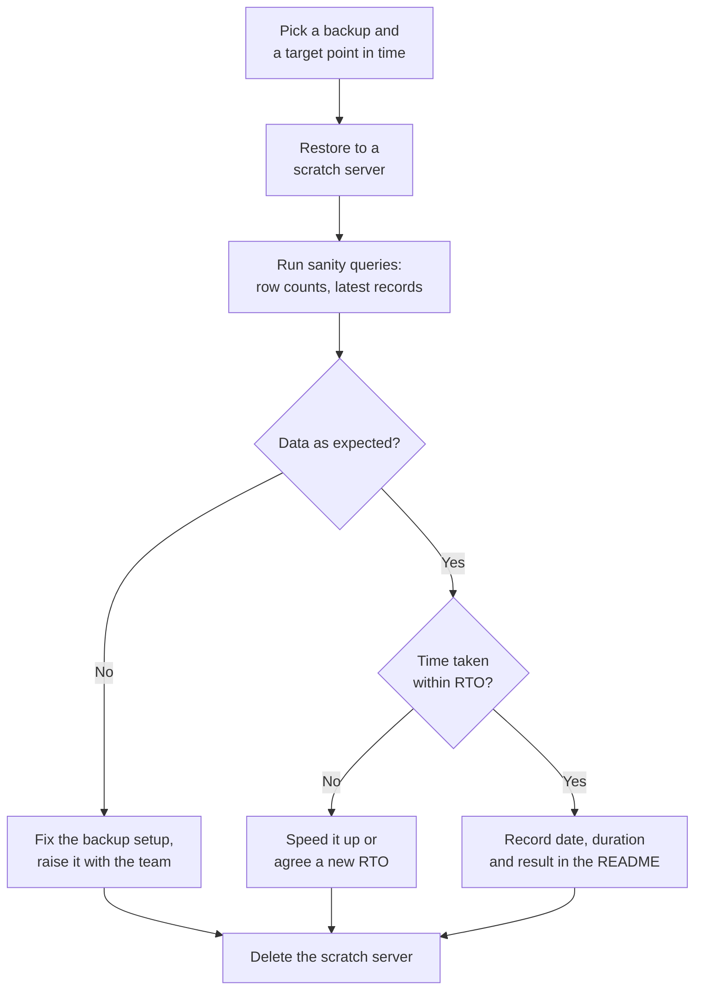

Backups and Recovery
====================

> How a project's data gets brought back after a mistake, a failure or an attack, and how far back it can go. Read **[General Principles](/Database-Standards/General-Principles)** first. Each engine needs a different strategy, so each has its own section.

* * *

## At a Glance

| Topic | The rule |
| --- | --- |
| [RPO and RTO](#rpo-and-rto) | **Agree with the client how much data you may lose and how long recovery may take**<br/><sub>Those two numbers decide the backup setup, not the other way round.</sub> |
| [3-2-1](#the-3-2-1-rule) | **Three copies, two kinds of storage, one somewhere else**<br/><sub>One of them out of reach of the production account, so ransomware or a bad script can't delete it too.</sub> |
| [Point-in-time recovery](#backup-types) | **Production databases get point-in-time recovery, not just nightly dumps**<br/><sub>A nightly dump means losing up to a day. PITR means minutes.</sub> |
| [Replicas](#a-replica-is-not-a-backup) | **A replica is not a backup**<br/><sub>A DROP TABLE reaches the replica in milliseconds.</sub> |
| [Restore drills](#restore-drills) | **A backup only counts once you've restored it**<br/><sub>Restore to a scratch server on a schedule, and time it against the agreed RTO.</sub> |
| [Before a risky change](#before-a-risky-change) | **Snapshot or confirm PITR before a big migration or a manual fix**<br/><sub>The easiest restore is the one you prepared for five minutes earlier.</sub> |
| [Protecting backups](#protecting-backups) | **Backups are encrypted and access-controlled like production**<br/><sub>A backup holds every row of personal data the database does.</sub> |
| [Retention](#retention) | **Keep backups as long as the client needs, and no longer**<br/><sub>Deleted personal data stays in old backups until they expire.</sub> |
| [Monitoring](#monitoring-that-backups-ran) | **Alert when a backup is missing, not just when one fails**<br/><sub>A backup job that silently stopped running sends no failure email.</sub> |
| [Runbook](#restore-runbook-template) | **Every project's README has a restore runbook**<br/><sub>At 2 a.m., nobody should be working out the restore command from the docs.</sub> |

* * *

## Concepts you'll meet on this page

### RPO

**Recovery Point Objective**: how much data you can afford to lose, measured in time. An RPO of 15 minutes means you get back everything up to at most 15 minutes before the disaster.

### RTO

**Recovery Time Objective**: how long the system can be down while you recover. An RTO of 4 hours means the database is serving the app again within 4 hours of the decision to restore.

### Logical and physical backups

A **logical** backup writes the data out as SQL or a portable dump (`pg_dump`, `mysqldump`, `mongodump`): slow on big databases, but restorable into a different version or as a single table. A **physical** backup copies the database's files: fast to take and restore, but only into the same engine version.

### Point-in-time recovery

**PITR**: restore a full backup, then replay the change log (Postgres WAL, SQL Server transaction log, MySQL binlog, MongoDB oplog) up to a chosen moment, e.g. one minute before the bad `DELETE`.

* * *

## Deciding the strategy

### RPO and RTO

Agree both numbers with the client (and the project manager) at the start of the project, and write them in the project README. Our starting points:

| Project tier | Example | RPO | RTO | Typical setup |
| --- | --- | --- | --- | --- |
| **Internal tool or prototype** | Admin dashboard, demo | 24 hours | 1 working day | Managed automated backups at default settings, or a nightly logical dump |
| **Standard client app** | Clinic booking system | 15 minutes or less | 4 hours | Managed backups with PITR, 14+ days retention, a copy in another region |
| **Critical or regulated** | Payments, FI clients | Close to zero | 1 hour or less | PITR, plus a high-availability standby, plus cross-region backup copies or a cross-region replica |

> 📝 A lower RPO or RTO costs more: storage, standby servers, testing. That trade-off is the client's decision, so put it to them in those terms.

### The 3-2-1 rule

- **3** copies of the data: production plus two backups.
- **2** different kinds of storage (e.g. the provider's backup service and an object storage bucket).
- **1** copy off-site: another region.

Plus, against ransomware and accidents: **at least one copy the production account can't delete**. That means a separate cloud account or subscription (AWS Backup cross-account copies, a separate Azure subscription), or immutable storage (S3 Object Lock, Azure immutable blob storage). If the credentials that can drop the database can also delete every backup, you have one point of failure, not three copies.

### Backup types

| Type | What it is | Good for | Not enough on its own because |
| --- | --- | --- | --- |
| **Managed automated backups** | The cloud provider's daily snapshot plus continuous log backup | Every production database on a managed service: it's PITR with no work | It lives in the same account and region unless you add copies |
| **Logical dump** | `pg_dump`, `mysqldump`, `mongodump` | Small databases, copying one database or table, moving between versions | Restoring a large database takes hours, and you lose everything since the dump |
| **Physical backup** | A copy of the data files (`pg_basebackup`, XtraBackup, SQL Server full backup) | Large self-hosted databases | Without logs, it's only as recent as the last backup |
| **Continuous log archiving** | Every change shipped off the server as it happens | PITR on self-hosted databases | Needs a base physical backup to replay on top of |
| **Disk or volume snapshot** | A snapshot of the server's disk | Quick rollback before a risky change | Only consistent if the engine supports it (journaling/WAL), and usually stored in the same account |

### A replica is not a backup

Replication copies every change within seconds, including `DROP TABLE`, a `DELETE` without a `WHERE`, and ransomware encrypting rows. A replica protects you from a **server** dying; only a backup protects you from a **change** you didn't want. See [Replication and Monitoring](/Database-Standards/Replication-and-Monitoring).

* * *

## Strategy per engine

### Backing up PostgreSQL

**Managed** (Amazon RDS and Aurora, Azure Database for PostgreSQL Flexible Server, Google Cloud SQL): turn on automated backups with PITR and set the retention period (RDS and Azure Flexible Server allow up to 35 days). Restores always create a **new** server; point the app at it, or copy data back from it.

**Self-hosted**: a dedicated tool for base backups plus continuous WAL archiving.

| Tool | Notes |
| --- | --- |
| **pgBackRest** | Full, differential and incremental backups; parallel, compressed, encrypted; S3/Azure/GCS. The most widely used. In 2026 its maintainer briefly announced the project would stop, then it continued with new sponsors: check its status before adopting it on a new project. |
| **Barman** | Maintained by EDB. Backup server that manages many Postgres servers. |
| **WAL-G** | Lightweight, cloud-storage first. Also supports MySQL and MongoDB. |

```bash
# pgBackRest: take a full backup, then restore to a point in time
pgbackrest --stanza=clinic --type=full backup
pgbackrest --stanza=clinic --delta --type=time "--target=2026-11-05 14:29:00+00" restore
```

**Logical dumps** still suit small databases, copying data between environments, and an extra copy:

```bash
# Custom format (-Fc): compressed, and pg_restore can pick tables and run in parallel
pg_dump -Fc -d clinic -f clinic_2026-11-05.dump

# Roles and grants are not in pg_dump. Dump them separately:
pg_dumpall --globals-only -f globals.sql

# Restore into a new, empty database with 4 parallel jobs
createdb clinic_restore
pg_restore -d clinic_restore -j 4 --no-owner clinic_2026-11-05.dump
```

> 📝 On managed services you're not a superuser, so `pg_dumpall --globals-only` needs `--no-role-passwords` to run.

```bash
# Physical base backup, the starting point for streaming replicas and manual PITR
pg_basebackup -D /backups/base_2026-11-05 -Ft -z -X stream -P
```

### Backing up SQL Server

Three backup types; the database's **recovery model** decides which you can use.

| Backup | What it holds |
| --- | --- |
| **Full** | The whole database |
| **Differential** | Everything changed since the last full backup |
| **Transaction log** | Every change since the last log backup. Needed for point-in-time restore. |

| Recovery model | Log backups | Point-in-time restore | Use for |
| --- | --- | --- | --- |
| `SIMPLE` | Not possible | No, only back to the last full or differential | Dev, test, and data you can rebuild |
| `FULL` | Required | Yes | Every production database |

> ⚠️ **In `FULL` recovery, the transaction log keeps growing until a log backup runs.** `FULL` with no log backups fills the disk. Schedule log backups every 5 to 15 minutes; that interval also sets your RPO.

```sql
-- Nightly full, with checksums so corruption is caught at backup time
BACKUP DATABASE clinic TO DISK = N'D:\Backups\clinic_full.bak'
    WITH CHECKSUM, COMPRESSION;

-- Every 15 minutes
BACKUP LOG clinic TO DISK = N'D:\Backups\clinic_log_202611051430.trn'
    WITH CHECKSUM, COMPRESSION;

-- An ad-hoc backup that doesn't disturb the scheduled chain
BACKUP DATABASE clinic TO DISK = N'D:\Backups\clinic_before_migration.bak'
    WITH COPY_ONLY, CHECKSUM, COMPRESSION;

-- Point-in-time restore into a new database: full, then logs up to just before the mistake
RESTORE DATABASE clinic_restore FROM DISK = N'D:\Backups\clinic_full.bak'
    WITH MOVE N'clinic'     TO N'D:\Data\clinic_restore.mdf',
         MOVE N'clinic_log' TO N'D:\Data\clinic_restore_log.ldf',
         NORECOVERY;
RESTORE LOG clinic_restore FROM DISK = N'D:\Backups\clinic_log_202611051430.trn'
    WITH STOPAT = '2026-11-05T14:29:00', RECOVERY;
```

- `RESTORE VERIFYONLY` checks the file is readable. It is **not** a restore test; only restoring and querying the result is.
- Copy backup files off the server. A backup on the database's disk dies with it.
- **Azure SQL Database** takes full, differential and log backups for you, with PITR for 1 to 35 days (7 by default). Add **long-term retention** (weekly, monthly or yearly backups, kept up to 10 years) when the client needs it.

### Backing up MySQL

| Method | Use for |
| --- | --- |
| `mysqldump --single-transaction` | Small InnoDB databases. Consistent without locking tables. |
| **MySQL Shell dump utilities** (`util.dumpInstance`, `util.dumpSchemas`, `util.loadDump`) | Medium to large databases. Parallel and much faster than `mysqldump`. |
| **Percona XtraBackup** or **MySQL Enterprise Backup** | Large self-hosted databases: physical, hot backups |
| **Binary log (binlog)** | Point-in-time recovery on top of any of the above |

```bash
# Consistent logical dump of one InnoDB database, including routines, triggers and events
mysqldump --single-transaction --routines --triggers --events clinic > clinic_2026-11-05.sql

# PITR: restore the last full backup, then replay the binlog up to just before the mistake
mysqlbinlog --stop-datetime="2026-11-05 14:29:00" binlog.000123 binlog.000124 | mysql -u admin -p
```

```js
// MySQL Shell (mysqlsh, JavaScript mode): parallel dump and load
util.dumpInstance("/backups/clinic_2026-11-05", { threads: 4 })
util.loadDump("/backups/clinic_2026-11-05", { threads: 4 })
```

- `mysqlpump` was removed in MySQL 8.4. Use `mysqldump` or MySQL Shell.
- Keep binary logging on, with retention (`binlog_expire_logs_seconds`) reaching back at least to the oldest full backup you'd restore from. Binlogs turn a nightly backup into point-in-time recovery.
- **Managed MySQL** (Amazon RDS and Aurora MySQL, Azure Database for MySQL Flexible Server, Google Cloud SQL) has automated backups with PITR. Set the retention period explicitly.

### Backing up MongoDB

| Method | Use for |
| --- | --- |
| **MongoDB Atlas cloud backups** with continuous backup | Every Atlas production cluster. Snapshots plus oplog replay to restore to a chosen minute. |
| `mongodump` / `mongorestore` | Small databases, copying a database between environments |
| **Filesystem or volume snapshots** | Self-hosted, with journaling on (it is by default) and data and journal on the same volume |
| **Percona Backup for MongoDB** | Self-hosted replica sets and sharded clusters, including PITR from the oplog |

```bash
# Dump and restore one database as a single compressed archive
mongodump    --uri="$MONGO_URI" --db=clinic --gzip --archive=clinic_2026-11-05.archive
mongorestore --uri="$RESTORE_URI" --gzip --archive=clinic_2026-11-05.archive --nsInclude="clinic.*"
```

- `mongodump` doesn't scale to large datasets or sharded clusters. Beyond a few GB, use Atlas backups, snapshots or Percona Backup for MongoDB.
- Atlas continuous backup costs extra; on a client project holding anything important, it's worth it.

### Backing up Redis

First decide **what Redis is for** on this project; that decides whether it needs persistence at all.

| Redis used as | Data lost on restart means | Persistence |
| --- | --- | --- |
| **Cache** | Slower requests until it warms up again | Usually none. The source of truth is in the main database. |
| **Sessions** | Every user is logged out | RDB snapshots at least, or AOF if that's unacceptable |
| **Job queue** (BullMQ and similar) | Queued jobs disappear: emails never sent, payments never processed | AOF with `appendfsync everysec`, plus RDB |

| Persistence | How it works | Trade-off |
| --- | --- | --- |
| **RDB** | Point-in-time snapshot of the whole dataset at intervals | Compact and fast to restore, but you lose everything since the last snapshot |
| **AOF** | Logs every write; `appendfsync everysec` syncs to disk once a second | At most about one second of writes lost, larger files |
| **Both** | AOF for durability, RDB for backups | The recommended setup when the data matters |

```text
# redis.conf: durable queue or session store
appendonly yes
appendfsync everysec
save 3600 1 300 100 60 10000
```

- For an off-site backup, `BGSAVE`, then copy `dump.rdb` off the server.
- Managed Redis (Amazon ElastiCache, Azure Managed Redis, Redis Cloud) offers persistence and snapshots on some tiers only. Check your tier before putting a queue on it.

* * *

## Making backups trustworthy

### Restore drills

A backup nobody has restored is a hope. Drills find the missing permission, the expired key and the job that stopped three months ago, before a real incident does.

- **Schedule them**: at least quarterly for standard projects, monthly for critical ones, and after any change to the backup setup.
- **Restore to a scratch server**, never over production.
- **Prove the data is there** with sanity queries (row counts, latest records), not just "the restore finished". If it's wrong, fix the backup setup and raise it with the team.
- **Time it** against the agreed RTO. Over it? Speed it up or agree a new RTO.
- **Record date, duration and result in the README**, fix what slowed you down, then delete the scratch server.



```sql
-- Sanity queries after a restore: does it look like the real thing, and how recent is it?
SELECT count(*)        FROM appointments;
SELECT max(created_at) FROM appointments;   -- should be close to the restore target time
```

### Before a risky change

Before a big migration, a bulk data fix or a major version upgrade on production:

- **Managed service**: take a manual snapshot, or at least confirm PITR is on and note the exact start time.
- **SQL Server**: take a `COPY_ONLY` full backup.
- **Self-hosted**: take a fresh backup with your normal tool, or a disk snapshot if the engine is safe to snapshot.

Rest of the checklist: [General Principles → Touching production by hand](/Database-Standards/General-Principles#touching-production-by-hand).

### Protecting backups

- **Encrypt at rest.** Managed backups use the service's keys. For your own files and buckets, use server-side encryption with managed keys (KMS, Key Vault), or encrypt before upload.
- **Restrict who can read and delete them** as tightly as production. Reading a backup is reading the database.
- **Keep backup credentials separate** from the app's. The app must never be able to delete a backup.
- **Never download production backups to a laptop.** See [General Principles → Production data stays in production](/Database-Standards/General-Principles#production-data-stays-in-production).

### Retention

| Copy | Typical retention |
| --- | --- |
| PITR window | 7 to 35 days, depending on the tier |
| Daily backups | 14 to 35 days |
| Monthly backups | 12 months, only if the client or a regulation needs it |
| Pre-change snapshots | Delete once the change is confirmed good, within a few weeks |

> ⚠️ **Data deleted from production stays in backups until they expire.** If a client's privacy policy promises deletion within a set time, backup retention must fit inside that promise. Write the retention down so it can be shown in an audit.

### Monitoring that backups ran

A failed backup is easy to notice; one that **silently stopped running** isn't.

- **Alert on a missing backup**: no successful backup in 26 hours for a daily schedule, no log backup in 30 minutes for a 15-minute schedule.
- **Check the size.** A 0-byte or suddenly much smaller "successful" backup is a failure.
- **Use the tools' own status:** `pgbackrest info`, AWS Backup job notifications, Azure Backup alerts, Atlas backup alerts, SQL Server Agent job history.

* * *

## Restore runbook template

Copy this into the project's README and fill it in. Update it after every restore drill.

```md
## Database restore runbook

- **Engine and hosting:** PostgreSQL 17 on Amazon RDS, eu-west-2
- **Agreed RPO / RTO:** 15 minutes / 4 hours (agreed with client on 2026-03-12)
- **Backups:** RDS automated backups, PITR, 14-day retention.
  Daily copy to the backup account in eu-west-1.
- **Who can restore:** tech lead, infrastructure owner (AWS role: db-restore)

### Steps
1. Decide the target time (just before the incident). Note it in the incident ticket.
2. Restore to a NEW instance: RDS console → Automated backups → Restore to point in time.
3. Run the sanity queries in `scripts/restore-check.sql`.
4. Point the app at the new instance (update DATABASE_URL in the secrets manager, redeploy).
5. Keep the old instance, stopped, until the incident is closed.

### Last restore drill
- 2026-10-02: restored to 14:00, took 38 minutes, sanity checks passed.
```

* * *

## Do / Don't

Each row links to the section with its full example.

| ✅ Do | ❌ Don't | Example |
| --- | --- | --- |
| Agree RPO and RTO with the client and write them down | Pick backup settings without knowing what's acceptable | [RPO and RTO](#rpo-and-rto) |
| Keep one copy in another region and out of reach of the production account | Keep every copy where one set of credentials can delete them | [3-2-1](#the-3-2-1-rule) |
| Turn on PITR for production | Rely on a nightly dump alone | [Backup types](#backup-types) |
| Treat replicas as availability, backups as recovery | Count a replica as a backup | [Replicas](#a-replica-is-not-a-backup) |
| Dump roles with `pg_dumpall --globals-only` alongside `pg_dump` | Assume `pg_dump` includes users and grants | [PostgreSQL](#backing-up-postgresql) |
| Run SQL Server production databases in `FULL` with frequent log backups | Use `FULL` without log backups and fill the disk | [SQL Server](#backing-up-sql-server) |
| Use `COPY_ONLY` for ad-hoc SQL Server backups | Break the differential chain with an ad-hoc full backup | [SQL Server](#backing-up-sql-server) |
| `mysqldump --single-transaction` or MySQL Shell for MySQL | Use `mysqlpump` on 8.4 or later | [MySQL](#backing-up-mysql) |
| Use Atlas continuous backup for production MongoDB | Rely on `mongodump` for a large or sharded cluster | [MongoDB](#backing-up-mongodb) |
| Decide Redis persistence by what it stores | Put a job queue on Redis with no persistence | [Redis](#backing-up-redis) |
| Restore to a scratch server on a schedule, timed against RTO | Call `RESTORE VERIFYONLY` a restore test | [Restore drills](#restore-drills) |
| Take a snapshot before a risky change | Start a big migration without knowing your restore point | [Before a risky change](#before-a-risky-change) |
| Encrypt and restrict backups like production | Download a production backup to a laptop | [Protecting backups](#protecting-backups) |
| Alert on missing and suspiciously small backups | Only alert on failed jobs | [Monitoring](#monitoring-that-backups-ran) |

* * *

## Further reading

1.  **PostgreSQL Documentation — Backup and Restore**
    [https://www.postgresql.org/docs/current/backup.html](https://www.postgresql.org/docs/current/backup.html)
2.  **pgBackRest User Guide**
    [https://pgbackrest.org/user-guide.html](https://pgbackrest.org/user-guide.html)
3.  **Microsoft Learn — Back up and restore of SQL Server databases**
    [https://learn.microsoft.com/sql/relational-databases/backup-restore/back-up-and-restore-of-sql-server-databases](https://learn.microsoft.com/sql/relational-databases/backup-restore/back-up-and-restore-of-sql-server-databases)
4.  **Microsoft Learn — Recovery models (SQL Server)**
    [https://learn.microsoft.com/sql/relational-databases/backup-restore/recovery-models-sql-server](https://learn.microsoft.com/sql/relational-databases/backup-restore/recovery-models-sql-server)
5.  **MySQL 8.4 Reference Manual — Backup and Recovery**
    [https://dev.mysql.com/doc/refman/8.4/en/backup-and-recovery.html](https://dev.mysql.com/doc/refman/8.4/en/backup-and-recovery.html)
6.  **MongoDB Manual — Backup Methods**
    [https://www.mongodb.com/docs/manual/core/backups/](https://www.mongodb.com/docs/manual/core/backups/)
7.  **Redis Documentation — Persistence**
    [https://redis.io/docs/latest/operate/oss_and_stack/management/persistence/](https://redis.io/docs/latest/operate/oss_and_stack/management/persistence/)
8.  **Amazon RDS User Guide — Backing up, restoring and exporting data**
    [https://docs.aws.amazon.com/AmazonRDS/latest/UserGuide/CHAP_CommonTasks.BackupRestore.html](https://docs.aws.amazon.com/AmazonRDS/latest/UserGuide/CHAP_CommonTasks.BackupRestore.html)

* * *

## Related pages

- [Access and Roles](/Database-Standards/Access-and-Roles) — who may read backups and run restores.
- [Replication and Monitoring](/Database-Standards/Replication-and-Monitoring) — high availability, and why it doesn't replace backups.
- [Migrations and Schema Changes](/Database-Standards/Migrations-and-Schema-Changes) — the risky changes that deserve a fresh restore point.
- [Security](/Security) — how personal data and secrets are protected, including in backups.
