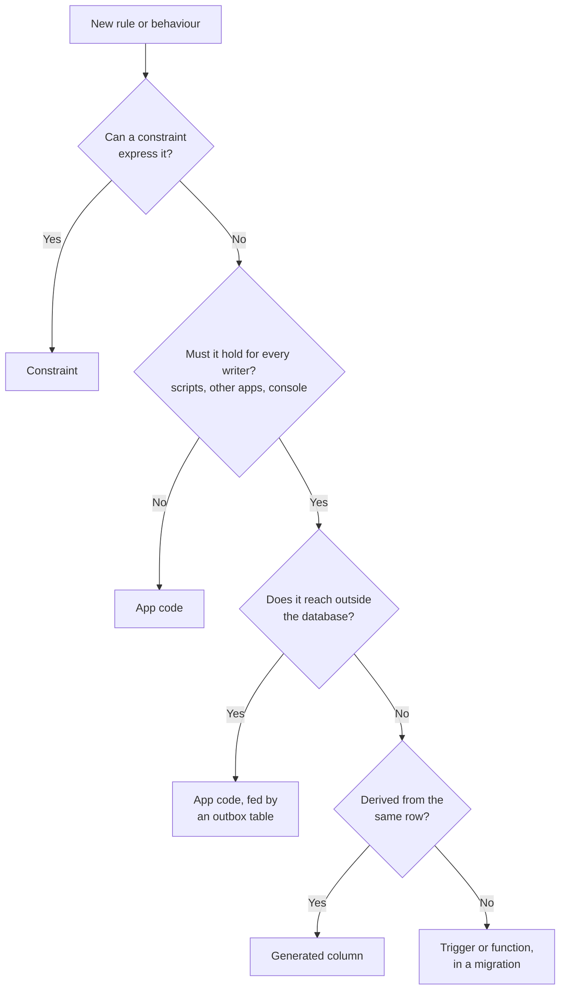

Logic in the Database
=====================

> Read **[General Principles](/Database-Standards/General-Principles)** first. This page answers: **does this logic belong in the app or in the database?** When it's the database, it covers views, functions, procedures and triggers, and the traps in each.

* * *

## At a Glance

| Topic | The rule |
| --- | --- |
| [The decision](#database-or-app) | **Business rules live in the app by default**<br/><sub>The database gets integrity rules every writer must respect, and set-based work too big to move to the app.</sub> |
| [Constraints first](#constraints-first) | **If a constraint can express it, don't write a trigger**<br/><sub>Constraints, generated columns and domains are declared, visible and impossible to bypass.</sub> |
| [Views](#views) | **Name every column, use `security_invoker` over RLS tables**<br/><sub>`SELECT *` is frozen at creation, and a plain view runs with its owner's rights.</sub> |
| [Functions](#functions-and-procedures) | **Plain SQL over PL/pgSQL, with the right volatility label**<br/><sub>SQL functions can be inlined. A wrong `IMMUTABLE` gives wrong results.</sub> |
| [Triggers](#triggers) | **Triggers keep data consistent, nothing more**<br/><sub>`updated_at`, audit, derived totals. Never workflows, emails or API calls.</sub> |
| [Side effects](#side-effects-go-through-an-outbox) | **Anything outside the database goes through an outbox table**<br/><sub>Written in the same transaction, sent afterwards by a worker.</sub> |
| [SQL Server triggers](#sql-server-triggers) | **Write every SQL Server trigger for many rows**<br/><sub>It fires once per statement. Code that assumes one row silently drops the rest.</sub> |
| [Versioning](#versioning-and-testing) | **Every view, function, procedure and trigger lives in a migration**<br/><sub>Never edited by hand on a server, and tested against a real database.</sub> |
| [Security](#security) | **REVOKE EXECUTE FROM PUBLIC, pin search_path, no string-built dynamic SQL**<br/><sub>Database code can be injected and abused like app code.</sub> |

* * *

## Database or app

The app is the default: logic there is versioned with the code, unit tested, reviewed, debuggable, and scales by adding servers. Database CPU is the hardest thing in the stack to scale.

| Put it in the app | Put it in the database |
| --- | --- |
| Business workflows: booking rules, pricing, discounts, approvals | Integrity every writer must respect: constraints, `updated_at`, audit trail |
| Anything that calls another system: email, SMS, payments, webhooks | Per-tenant row filtering with row-level security (see [Access and Roles](/Database-Standards/Access-and-Roles)) |
| Rules that change often or sit behind a feature flag | Set-based calculations over many rows: a view or function for a report |
| Logic that needs logs, retries, or unit tests with fakes | A client or DBA mandate (common with FI clients): procedures as the API |



> ⚠️ Database logic is invisible from the app. List every trigger and function in the project README, and comment the app code that relies on one.

* * *

## Constraints first

| Need | Use |
| --- | --- |
| Present, unique, in range, references a row | `NOT NULL`, `UNIQUE`, `CHECK`, `FOREIGN KEY` (see [Schema Design](/Database-Standards/Schema-Design)) |
| A value computed from the same row | **Generated column**: `line_total numeric(12,2) GENERATED ALWAYS AS (quantity * unit_price) STORED` |
| The same rule on many columns | **Domain**: `CREATE DOMAIN email_address AS text CHECK (VALUE ~ '^[^@\s]+@[^@\s]+$')` |
| No two appointments overlap in one room | **Exclusion constraint** (see [Indexing](/Database-Standards/Indexing)). A trigger that checks races. |
| A rule only true once the transaction ends (swapping two positions) | **Deferrable constraint**: `UNIQUE (clinic_id, position) DEFERRABLE INITIALLY IMMEDIATE`, then `SET CONSTRAINTS ... DEFERRED` in that transaction |

- `STORED` generated columns (Postgres 12+) can be indexed; adding one rewrites the table (see [Migrations and Schema Changes](/Database-Standards/Migrations-and-Schema-Changes)). `VIRTUAL` (Postgres 18+, the default when neither is written) is computed on read and can't be indexed.
- A deferrable unique constraint can't be the target of `INSERT ... ON CONFLICT`. Only make it deferrable when you need to.

* * *

## Views

```sql
-- ✅ explicit columns; the caller's permissions and row-level security apply (Postgres 15+)
CREATE VIEW invoice_summaries
WITH (security_invoker = true) AS
SELECT i.id, i.number, i.status, i.total, c.name AS customer_name
FROM   invoices AS i
JOIN   customers AS c ON c.id = i.customer_id;
```

| You want | Use |
| --- | --- |
| A reporting user sees some columns of a table it can't read | A plain view (runs with the **owner's** rights), `GRANT SELECT` on the view only |
| A view over tables protected by row-level security | `WITH (security_invoker = true)`. A plain view **bypasses** the caller's RLS. |
| A heavy report precomputed | A materialized view (see [Large Data and Bulk Operations](/Database-Standards/Large-Data-and-Bulk-Operations)) |

### View gotchas

| Gotcha | What to do |
| --- | --- |
| `SELECT *` is expanded at creation: columns added later never appear | List every column |
| You can't change the type of, or drop, a column a view uses | In one migration: drop the view, change the column, recreate the view. Never `DROP COLUMN ... CASCADE`, which silently drops the views. |
| `CREATE OR REPLACE VIEW` can only add columns at the end | `DROP VIEW` + `CREATE VIEW` to rename, reorder or remove |
| Updatable views and `INSTEAD OF` triggers hide where data goes | Write to the tables |
| Postgres `RULE`s | Never use them. Use a trigger or a view. |

* * *

## Functions and procedures

| | `FUNCTION` | `PROCEDURE` (Postgres 11+) |
| --- | --- | --- |
| Called with | `SELECT`, or inside any expression | `CALL` |
| Returns | A value, row or set | Nothing (`INOUT` parameters; `OUT` from Postgres 14) |
| Transactions | Inside the caller's transaction | Can `COMMIT` inside, when not called in an explicit transaction block |
| Use for | Calculations, reusable queries, trigger bodies | Maintenance jobs that commit in batches |

> 💡 In `psql`, `\df+ name` lists a function's signature and properties, and `\sf name` prints its source. Check them before you change one.

### SQL or PLpgSQL

```sql
-- ✅ one SELECT, STABLE: the planner can inline it into the calling query like a view
CREATE OR REPLACE FUNCTION unpaid_invoices(p_customer_id bigint)
RETURNS TABLE (id bigint, number text, total numeric)
LANGUAGE sql STABLE
AS $$
    SELECT i.id, i.number, i.total
    FROM   invoices AS i
    WHERE  i.customer_id = p_customer_id
      AND  i.status = 'sent'
$$;
```

- PL/pgSQL is a black box to the planner: a fixed cost, and a default guess of 1,000 rows for set-returning functions. Use it only for variables, loops, `IF` or exception handling.
- Lint PL/pgSQL with **plpgsql_check**: `SELECT * FROM plpgsql_check_function('audit_row()', 'invoices');`

When you do need PL/pgSQL, keep it short and fail loudly:

```sql
CREATE OR REPLACE FUNCTION invoice_balance(p_invoice_id bigint)
RETURNS numeric
LANGUAGE plpgsql STABLE
AS $$
DECLARE
    v_total numeric;
    v_paid  numeric;
BEGIN
    SELECT i.total INTO v_total
    FROM   invoices AS i
    WHERE  i.id = p_invoice_id;

    IF NOT FOUND THEN
        RAISE EXCEPTION 'Invoice % not found', p_invoice_id
            USING ERRCODE = 'no_data_found';
    END IF;

    SELECT coalesce(sum(p.amount), 0) INTO v_paid
    FROM   payments AS p
    WHERE  p.invoice_id = p_invoice_id;

    RETURN v_total - v_paid;
END;
$$;
```

- **Prefix parameters `p_` and variables `v_`.** A parameter named like a column (`invoice_id`) makes the query ambiguous and fails with `column reference "invoice_id" is ambiguous`.
- **`RAISE EXCEPTION` with an `ERRCODE`** so the app can tell "not found" from a real failure, instead of getting a silent `NULL`.

### Procedures for batch jobs

A procedure can commit as it goes, so a long cleanup doesn't hold one huge transaction and its locks:

```sql
CREATE OR REPLACE PROCEDURE purge_old_audit_rows(p_before timestamptz, p_batch int DEFAULT 5000)
LANGUAGE plpgsql
AS $$
DECLARE
    v_deleted int;
BEGIN
    LOOP
        DELETE FROM audit_log
        WHERE  id IN (
                   SELECT id
                   FROM   audit_log
                   WHERE  created_at < p_before
                   LIMIT  p_batch
               );
        GET DIAGNOSTICS v_deleted = ROW_COUNT;
        COMMIT;
        EXIT WHEN v_deleted < p_batch;
    END LOOP;
END;
$$;

CALL purge_old_audit_rows(now() - interval '2 years');   -- run on its own, not inside BEGIN
```

More batching patterns: [Large Data and Bulk Operations](/Database-Standards/Large-Data-and-Bulk-Operations).

### Volatility labels

| Label | Promise | If it's wrong |
| --- | --- | --- |
| `IMMUTABLE` | Same input, same result, forever. Reads no tables or settings. | Required for expression indexes and generated columns. Marking a function that depends on time zone or `DateStyle` (e.g. `to_char()` on `timestamptz`) as `IMMUTABLE` makes the index silently wrong. |
| `STABLE` | Same result within one statement; may read tables | |
| `VOLATILE` (default) | Can change every call, or writes data | Left on a read-only function, it's re-run per row and blocks index use in `WHERE` |

### Function gotchas

| Gotcha | What to do |
| --- | --- |
| `CREATE OR REPLACE FUNCTION` with different argument types creates a **second** overload; callers keep using the old one | `DROP FUNCTION invoice_balance(integer)` in the same migration |
| Changing the return type or an argument name fails (`cannot change return type of existing function`) | `DROP FUNCTION`, then `CREATE` |
| A procedure with `COMMIT` fails inside `BEGIN ... COMMIT` | Run it from a scheduled job or `psql` with a bare `CALL` |
| An `EXCEPTION` block starts a subtransaction every time it's entered: slow in a loop, and burns transaction IDs | Catch errors once, outside the loop, or let them bubble up to the app |
| A function called in `SELECT` over a big table runs once **per row**, often with its own queries inside | Rewrite as a join, or as an inline SQL function |
| Functions default to `PARALLEL UNSAFE`, which stops the whole query going parallel | Mark read-only ones `PARALLEL SAFE` |
| `STRICT` returns `NULL` without running if any argument is `NULL` | Use it on purpose, not by copy-paste |
| A function that changes data called from a `SELECT` hides writes in a read | Change data with a procedure or an explicit statement |

### Other engines

| | SQL Server | MySQL |
| --- | --- | --- |
| Create or replace | `CREATE OR ALTER` (2016 SP1+); start procedures with `SET NOCOUNT ON;` | None: `DROP ... IF EXISTS`, then `CREATE` |
| Scalar functions | Run per row and block parallelism before 2019. 2019+ (compatibility level 150) inlines eligible ones; check `is_inlineable` in `sys.sql_modules`. Prefer **inline** table-valued functions. | Must be declared `DETERMINISTIC`, `NO SQL` or `READS SQL DATA` when binary logging is on (else error 1418) |
| Restore trap | | Routines and triggers carry a `DEFINER`. Restoring where that user doesn't exist breaks them: create the user first. |

Our stored-procedure policy for .NET projects: [SQL Server](/Database-Standards/SQL-Server).

* * *

## Triggers

| ✅ Good uses | ❌ Bad uses |
| --- | --- |
| `updated_at` (see [Schema Design](/Database-Standards/Schema-Design)) | Business workflows ("when paid, book the follow-up") |
| An audit trail | Email, SMS, API calls, files: use an [outbox](#side-effects-go-through-an-outbox) |
| A denormalized total kept in sync with its lines | Anything a `CHECK` or `UNIQUE` constraint can do |

`BEFORE` triggers change the row being written (`NEW.updated_at := now()`). `AFTER` triggers react to a change that has happened (audit).

### An audit trail

```sql
CREATE TABLE audit_log (
    id          bigint GENERATED ALWAYS AS IDENTITY PRIMARY KEY,
    table_name  text        NOT NULL,
    row_id      bigint      NOT NULL,
    action      text        NOT NULL,
    old_data    jsonb,
    new_data    jsonb,
    changed_by  text,
    changed_at  timestamptz NOT NULL DEFAULT now()
);

CREATE OR REPLACE FUNCTION audit_row() RETURNS trigger
LANGUAGE plpgsql
AS $$
BEGIN
    IF TG_OP = 'DELETE' THEN
        INSERT INTO audit_log (table_name, row_id, action, old_data, changed_by)
        VALUES (TG_TABLE_NAME, OLD.id, TG_OP, to_jsonb(OLD), nullif(current_setting('app.user_id', true), ''));
    ELSE
        INSERT INTO audit_log (table_name, row_id, action, old_data, new_data, changed_by)
        VALUES (TG_TABLE_NAME, NEW.id, TG_OP,
                CASE WHEN TG_OP = 'UPDATE' THEN to_jsonb(OLD) END,
                to_jsonb(NEW), nullif(current_setting('app.user_id', true), ''));
    END IF;
    RETURN NULL;   -- ignored for AFTER triggers
END;
$$;

CREATE TRIGGER invoices_audit
AFTER INSERT OR UPDATE OR DELETE ON invoices
FOR EACH ROW EXECUTE FUNCTION audit_row();   -- Postgres 11+; older: EXECUTE PROCEDURE
```

- **The real user:** the database only sees the app's login. Run `SET LOCAL app.user_id = '42'` at the start of each transaction; `current_setting(..., true)` returns NULL if it was never set, and an empty string once a previous transaction on the same pooled connection set it, hence the `nullif`.
- **Bulk updates:** a row trigger runs once per row. For heavy bulk writes, use a `FOR EACH STATEMENT` trigger with `REFERENCING OLD TABLE AS old_rows NEW TABLE AS new_rows` (Postgres 10+) and one `INSERT ... SELECT`.

### Trigger gotchas

| Gotcha | What to do |
| --- | --- |
| The ORM doesn't see values a trigger changed; the entity in memory is stale | Reload: EF Core `Entry(e).ReloadAsync()`, Laravel `$model->refresh()`, a fresh query in Prisma or TypeORM, or `RETURNING` / `OUTPUT` in your own SQL |
| Trigger chains: one trigger's write fires another table's triggers | Keep it to one level. `WHEN (pg_trigger_depth() = 0)` stops a trigger firing from another trigger. |
| `SET session_replication_role = replica` disables triggers **and foreign keys** for the session | Only for replication and restores. Never to "get around" a trigger. |
| Schema changes made outside migrations | **Event triggers** fire on DDL and can log or block it. They need superuser; check your managed provider. |
| You need full row history, not a log | SQL Server 2016+ **temporal tables** (`SYSTEM_VERSIONING = ON`). Postgres has none built in: use the audit trigger. |
| Streaming changes to another system | **Change data capture** (e.g. Debezium) reads the database log, no triggers needed |
| MySQL: triggers are row-level only, and can't modify the table that fired them | Do that work in the app or a procedure |

### SQL Server triggers

A SQL Server trigger fires **once per statement**. `inserted` and `deleted` can hold any number of rows.

```sql
-- ❌ a 50-row UPDATE audits only one row, silently
DECLARE @Id bigint;
SELECT @Id = Id FROM inserted;
INSERT INTO dbo.AuditLog (TableName, RowId, Action) VALUES ('Invoices', @Id, 'UPDATE');

-- ✅ set-based, inside CREATE OR ALTER TRIGGER trg_Invoices_Audit ON dbo.Invoices AFTER UPDATE
SET NOCOUNT ON;
INSERT INTO dbo.AuditLog (TableName, RowId, Action)
SELECT 'Invoices', i.Id, 'UPDATE'
FROM   inserted AS i;
```

| Gotcha | What to do |
| --- | --- |
| `@@IDENTITY` returns the id a trigger inserted (the audit row), not yours | `SCOPE_IDENTITY()` |
| `OUTPUT` without `INTO` fails on a table with enabled triggers, so **EF Core 7+ saves fail** | Declare it: `.ToTable(tb => tb.HasTrigger("trg_Invoices_Audit"))`. EF Core 8+ also has `tb.UseSqlOutputClause(false)`. |
| No `BEFORE` triggers | `INSTEAD OF` or `AFTER` only |

* * *

## Side effects go through an outbox

A trigger or transaction that sends email can't take it back on rollback, and holds its locks while the mail server answers. Write the intent to an `outbox` table in the same transaction instead.

```sql
CREATE TABLE outbox (
    id            bigint GENERATED ALWAYS AS IDENTITY PRIMARY KEY,
    event_type    text        NOT NULL,
    payload       jsonb       NOT NULL,
    created_at    timestamptz NOT NULL DEFAULT now(),
    processed_at  timestamptz
);

BEGIN;
UPDATE appointments SET status = 'confirmed' WHERE id = 812;
INSERT INTO outbox (event_type, payload)
VALUES ('appointment.confirmed', jsonb_build_object('appointment_id', 812));
COMMIT;   -- both happen, or neither
```

- A worker (BullMQ job, Laravel queued job, .NET `BackgroundService`) claims rows with `... WHERE processed_at IS NULL ORDER BY id LIMIT 50 FOR UPDATE SKIP LOCKED`, sends them, and sets `processed_at`.
- Delivery is **at least once**. Make receivers idempotent (see [Transactions and Concurrency](/Database-Standards/Transactions-and-Concurrency)).
- Postgres `LISTEN` / `NOTIFY` is fine as a wake-up signal for the worker, not as delivery: a notification with no listener is lost.

* * *

## Versioning and testing

Every view, function, procedure and trigger is created in a migration. Every change is a new migration with the full new definition.

| Tool | How |
| --- | --- |
| Prisma | `pnpm prisma migrate dev --create-only --name add_audit_trigger`, write the SQL into `migration.sql`, then `prisma migrate dev` |
| TypeORM | `pnpm typeorm migration:create src/migrations/AddAuditTrigger`, then `queryRunner.query(...)` |
| Laravel | `DB::unprepared(...)`: function bodies contain several statements. Fixed SQL only, it takes no bindings. |
| EF Core | `migrationBuilder.Sql(...)` |
| DbUp | A new numbered `.sql` script |

> ⚠️ Prisma and TypeORM schemas can't describe triggers or functions. The hand-written migration SQL is the only record, so never squash or regenerate migrations without carrying it over.

**Testing:** an integration test against a real database (write a row, check the audit log) covers most cases. For projects with a lot of database code, **pgTAP** (Postgres, run with `pg_prove`) and **tSQLt** (SQL Server) are unit-test frameworks written in SQL.

* * *

## Calling database logic from the app

```ts
// Prisma: the tagged template makes ${invoiceId} a parameter
await prisma.$queryRaw`SELECT invoice_balance(${invoiceId}) AS balance`;
// TypeORM
await dataSource.query('SELECT invoice_balance($1) AS balance', [invoiceId]);
```

```php
// Laravel
DB::selectOne('select invoice_balance(?) as balance', [$invoiceId])->balance;
```

```csharp
// EF Core: SqlQuery<T> for a scalar needs the column named "Value" (quoted on Postgres)
await db.Database.SqlQuery<decimal>($"SELECT invoice_balance({invoiceId}) AS \"Value\"").SingleAsync();

// Dapper: a SQL Server procedure by name
await conn.ExecuteAsync("dbo.CloseMonth", new { Month = month }, commandType: CommandType.StoredProcedure);
```

> ⚠️ **Dapper on Postgres:** with Npgsql 7+, `CommandType.StoredProcedure` sends `CALL`, so it works only for procedures. Call functions with a normal `SELECT`.

* * *

## Security

| Risk | Fix |
| --- | --- |
| Postgres grants `EXECUTE` on every new function to `PUBLIC` | `REVOKE EXECUTE ON FUNCTION ... FROM PUBLIC`, then `GRANT` to the roles that need it. `ALTER DEFAULT PRIVILEGES FOR ROLE clinic_migrator REVOKE EXECUTE ON FUNCTIONS FROM PUBLIC` covers future ones. |
| `SECURITY DEFINER` runs with the owner's rights; a caller can plant a same-named object earlier in `search_path` | Always `SET search_path = pg_catalog, pg_temp` on the function and schema-qualify every table |
| Dynamic SQL inside a function or procedure | Never concatenate input. Use `format()` with `%I` for names and `EXECUTE ... USING` for values; on SQL Server, `sp_executesql` with parameters and `QUOTENAME()` for names. |

```sql
-- ✅ lets the app anonymize a patient without broad UPDATE rights
CREATE OR REPLACE FUNCTION anonymize_patient(p_patient_id bigint)
RETURNS void
LANGUAGE sql
SECURITY DEFINER
SET search_path = pg_catalog, pg_temp
AS $$
    UPDATE public.patients
    SET    name = 'Deleted patient', email = NULL, phone = NULL
    WHERE  id = p_patient_id
$$;

REVOKE EXECUTE ON FUNCTION anonymize_patient(bigint) FROM PUBLIC;
GRANT  EXECUTE ON FUNCTION anonymize_patient(bigint) TO clinic_app;
```

```sql
-- ❌ PL/pgSQL: input pasted into the statement
EXECUTE 'SELECT count(*) FROM ' || p_table || ' WHERE status = ''' || p_status || '''' INTO v_count;
-- ✅ identifier quoted with %I, value passed as a parameter
EXECUTE format('SELECT count(*) FROM %I WHERE status = $1', p_table) INTO v_count USING p_status;
```

Who gets which rights: [Access and Roles](/Database-Standards/Access-and-Roles).

* * *

## Do / Don't

| ✅ Do | ❌ Don't | Example |
| --- | --- | --- |
| Keep business workflows in the app | Hide booking or pricing rules in triggers | [Database or app](#database-or-app) |
| Use constraints, generated columns and domains first | Write a trigger a CHECK could replace | [Constraints first](#constraints-first) |
| List every column in a view; `security_invoker` over RLS tables | `SELECT *` in a view, or `DROP COLUMN ... CASCADE` | [View gotchas](#view-gotchas) |
| SQL functions with the right volatility | `IMMUTABLE` on something that isn't | [Volatility labels](#volatility-labels) |
| `DROP FUNCTION` when the signature changes | Expect `CREATE OR REPLACE` to replace a new signature | [Function gotchas](#function-gotchas) |
| Triggers for `updated_at`, audit, derived totals | Email or API calls from a trigger | [Triggers](#triggers) |
| An outbox written in the same transaction | `NOTIFY` as message delivery | [Outbox](#side-effects-go-through-an-outbox) |
| SQL Server triggers over all of `inserted`; `SCOPE_IDENTITY()`; `HasTrigger` in EF Core | One row from `inserted`; `@@IDENTITY` | [SQL Server triggers](#sql-server-triggers) |
| Database code only in migrations, tested against a real DB | Edit a function by hand on a server | [Versioning](#versioning-and-testing) |
| Revoke `PUBLIC`, pin `search_path`, parameterize dynamic SQL | Concatenate input into `EXECUTE` | [Security](#security) |

* * *

## Further reading

1.  **PostgreSQL Documentation — CREATE TRIGGER**
    [https://www.postgresql.org/docs/current/sql-createtrigger.html](https://www.postgresql.org/docs/current/sql-createtrigger.html)
2.  **PostgreSQL Documentation — Function Volatility Categories**
    [https://www.postgresql.org/docs/current/xfunc-volatility.html](https://www.postgresql.org/docs/current/xfunc-volatility.html)
3.  **PostgreSQL Documentation — CREATE FUNCTION** (writing SECURITY DEFINER functions safely)
    [https://www.postgresql.org/docs/current/sql-createfunction.html](https://www.postgresql.org/docs/current/sql-createfunction.html)
4.  **PostgreSQL Wiki — Don't Do This** (rules)
    [https://wiki.postgresql.org/wiki/Don't_Do_This](https://wiki.postgresql.org/wiki/Don't_Do_This)
5.  **Microsoft — Breaking changes in EF Core 7** (SQL Server tables with triggers)
    [https://learn.microsoft.com/en-us/ef/core/what-is-new/ef-core-7.0/breaking-changes](https://learn.microsoft.com/en-us/ef/core/what-is-new/ef-core-7.0/breaking-changes)
6.  **Microsoft — Scalar UDF inlining**
    [https://learn.microsoft.com/en-us/sql/relational-databases/user-defined-functions/scalar-udf-inlining](https://learn.microsoft.com/en-us/sql/relational-databases/user-defined-functions/scalar-udf-inlining)
7.  **MySQL — Restrictions on Stored Programs**
    [https://dev.mysql.com/doc/refman/8.4/en/stored-program-restrictions.html](https://dev.mysql.com/doc/refman/8.4/en/stored-program-restrictions.html)
8.  **microservices.io — Transactional outbox**
    [https://microservices.io/patterns/data/transactional-outbox.html](https://microservices.io/patterns/data/transactional-outbox.html)
9.  **pgTAP**, **plpgsql_check**, **tSQLt**
    [https://pgtap.org/](https://pgtap.org/) · [https://github.com/okbob/plpgsql_check](https://github.com/okbob/plpgsql_check) · [https://tsqlt.org/](https://tsqlt.org/)

* * *

## Related pages

- [Schema Design](/Database-Standards/Schema-Design) — constraints and the `updated_at` trigger.
- [Access and Roles](/Database-Standards/Access-and-Roles) — grants, row-level security, ownership.
- [Migrations and Schema Changes](/Database-Standards/Migrations-and-Schema-Changes) — shipping database code safely.
- [Transactions and Concurrency](/Database-Standards/Transactions-and-Concurrency) — idempotent consumers and `SKIP LOCKED`.
- [SQL Server](/Database-Standards/SQL-Server) — stored-procedure policy for .NET projects.
