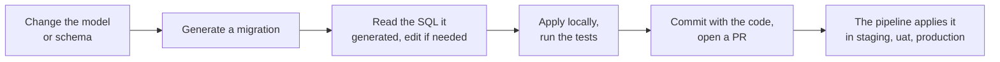
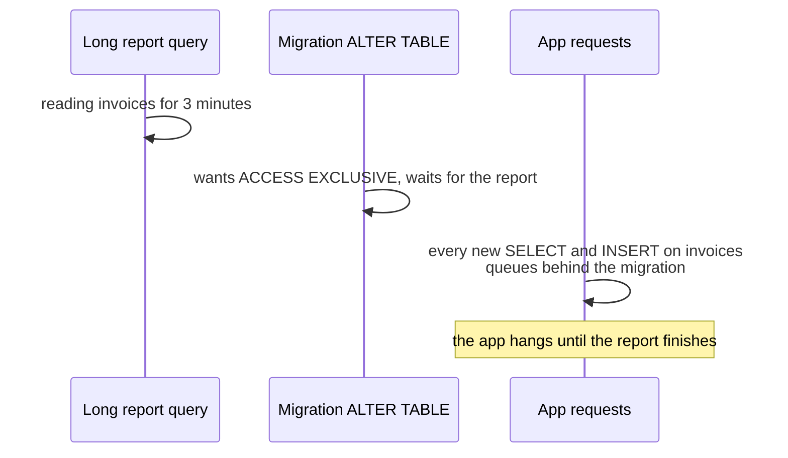
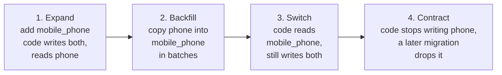

Migrations and Schema Changes
=============================

> Read **[General Principles](/Database-Standards/General-Principles)** first — this page builds on [every schema change is a migration](/Database-Standards/General-Principles#every-schema-change-is-a-migration).
> It covers the workflow in each tool, and changing a table a live app is using without taking it down. Examples are PostgreSQL; SQL Server and MySQL are in [Schema changes in other engines](#schema-changes-in-other-engines).

* * *

## At a Glance

| Topic | The rule |
| --- | --- |
| [Workflow](#the-workflow-in-each-tool) | **Generate the migration, read its SQL, commit it with the code**<br/><sub>Every environment applies the same files in the same order. Nothing is changed by hand.</sub> |
| [Immutable migrations](#never-edit-a-migration-that-has-run) | **Once merged, a migration never changes. Fix it with a new one**<br/><sub>Environments that already ran the old version will never run your edit.</sub> |
| [Forward only](#forward-only-in-production) | **Production never runs a down migration**<br/><sub>To undo a change, write a new migration that reverses it.</sub> |
| [Backward compatible](#every-migration-must-work-with-the-code-already-running) | **A migration must work with the code that's running when it applies**<br/><sub>Migrations run before the new code is live, and old instances keep running during a deploy.</sub> |
| [Lock timeout](#set-a-lock-timeout) | **Start risky migrations with `SET lock_timeout`**<br/><sub>A migration stuck waiting for a lock blocks every query queued behind it.</sub> |
| [Safe changes](#safe-changes-on-a-live-postgres-table) | **Know which ALTERs lock or rewrite the table**<br/><sub>Adding a nullable column is instant. Adding an index the normal way blocks writes until it's built.</sub> |
| [Indexes](#creating-an-index-without-blocking-writes) | **`CREATE INDEX CONCURRENTLY` on any table with real traffic**<br/><sub>It can't run inside a transaction, so each tool needs a small tweak.</sub> |
| [NOT NULL and foreign keys](#making-a-column-not-null) | **Add the constraint `NOT VALID`, then validate it separately**<br/><sub>Validating doesn't block writes. Adding it in one step does.</sub> |
| [Renames](#renames-and-splits-with-expand-and-contract) | **Never rename or drop in one step. Expand, migrate, then contract**<br/><sub>The running code still uses the old name until the new release is fully out.</sub> |
| [Backfills](#backfilling-data) | **Fill a new column in batches, outside the schema migration**<br/><sub>One `UPDATE` over 10 million rows is a long lock and a lot of WAL.</sub> |

* * *

## Concepts you'll meet on this page

### Lock level

Every `ALTER TABLE` locks the table, most with **ACCESS EXCLUSIVE**: nobody can read or write it until the migration's transaction ends. Fine for a millisecond change; for one that scans or rewrites a big table, the app is down that long.

### Table rewrite

Some changes (a column type change, a column with a volatile default) copy every row into a new file. On a big table that takes minutes under ACCESS EXCLUSIVE, and briefly needs double the disk space.

### Expand and contract

Also called **parallel change**. Make a breaking change in safe steps: add the new thing next to the old, move the code over, remove the old thing in a later release.

### Backfill

Filling in values for existing rows after adding a column. A data change, not a schema change, done in batches on a big table.

* * *

## The workflow in each tool



### Prisma

| Step | Command |
| --- | --- |
| Create and apply on your machine | `pnpm prisma migrate dev --name add-invoice-due-date` |
| Create without applying, so you can edit the SQL first | `pnpm prisma migrate dev --create-only --name add-invoice-due-date` |
| Apply in every other environment | `pnpm prisma migrate deploy` |
| Mark a failed migration as rolled back (after fixing the database by hand) | `pnpm prisma migrate resolve --rolled-back 20261105120000_add_invoice_due_date` |

- **Never `prisma db push`** on a shared database: it changes the schema with no migration file, so no other environment gets the change.
- **Never `prisma migrate reset`** outside your own machine. It drops the database.
- `migrate dev` warns about **drift** when the database doesn't match the migration history; locally that usually means someone changed it by hand. Never "fix" drift on a shared database by resetting it.

### TypeORM

| Step | Command |
| --- | --- |
| Generate from entity changes | `pnpm typeorm migration:generate src/migrations/AddInvoiceDueDate -d src/data-source.ts` |
| Create an empty one, for hand-written SQL | `pnpm typeorm migration:create src/migrations/BackfillInvoiceDueDate` |
| Apply | `pnpm typeorm migration:run -d src/data-source.ts` |
| Undo the last one (local only) | `pnpm typeorm migration:revert -d src/data-source.ts` |

- `synchronize` is `false` everywhere except your own throwaway database. It alters the schema to match the entities on every start, and drops columns it no longer sees.
- Read what `migration:generate` produced. It often turns a rename into drop-and-add, which deletes the data.
- `migrationsRun: true` (apply on app start) has the same problem as EF Core's startup migrations below. Run migrations as a deploy step.

### Laravel

| Step | Command |
| --- | --- |
| Create | `php artisan make:migration add_due_date_to_invoices` |
| Apply locally | `php artisan migrate` |
| See the SQL without running it | `php artisan migrate --pretend` |
| Apply in production (skips the confirmation prompt) | `php artisan migrate --force` |
| Check what has run | `php artisan migrate:status` |

- `migrate:fresh` and `migrate:refresh` drop or roll back everything. Local only.
- Years of migrations can be squashed into a schema file with `php artisan schema:dump`.

### EF Core

| Step | Command |
| --- | --- |
| Create | `dotnet ef migrations add AddInvoiceDueDate` |
| Remove the last one, **only if it hasn't been applied anywhere** | `dotnet ef migrations remove` |
| Generate a SQL script that's safe to run on any environment | `dotnet ef migrations script --idempotent -o migrate.sql` |
| Or build a self-contained migration executable | `dotnet ef migrations bundle --self-contained -r linux-x64`, then run `./efbundle --connection "..."` |

- Apply migrations as **a deploy pipeline step**, with the idempotent script or a bundle. Read the script in the PR.
- **Don't call `Database.Migrate()` at app startup** in shared environments: instances starting together race each other. EF Core 9+ takes a lock to stop that, but Microsoft still recommends applying at deploy time, and a failed migration at startup means the app doesn't start.

### DbUp for Dapper projects

A Dapper-only project has no ORM to generate migrations. Write numbered `.sql` scripts and let [DbUp](https://dbup.readthedocs.io/) run the unapplied ones, recording each in a journal table (`schemaversions` by default).

```csharp
var upgrader = DeployChanges.To
    .PostgresqlDatabase(connectionString)
    .WithScriptsEmbeddedInAssembly(Assembly.GetExecutingAssembly())
    .LogToConsole()
    .Build();

var result = upgrader.PerformUpgrade();
if (!result.Successful) return 1;   // fail the deploy step
```

```
Scripts/
  0041_create_payments.sql
  0042_add_invoice_due_date.sql     ← zero-padded, so they sort in the right order
```

If the project also uses EF Core, EF Core migrations own the schema and DbUp isn't needed.

* * *

## Rules for every migration

### Never edit a migration that has run

Once merged into a shared branch, a migration is read-only: staging may already have applied it and will never apply your edit, and Prisma and EF Core report the changed file as a mismatch. To fix a mistake, **add a new migration**.

### Forward only in production

Down migrations (`down()`, `migration:revert`, EF Core's `Down()`) are for iterating on your own machine. **Production never runs them**: the new code may already have written data the old shape can't hold, and a `down()` can't bring back a dropped column. To undo a change, write a new migration that reverses it and send it through the normal flow.

### One change per migration

One logical change per migration: "add due date to invoices", not "Sprint 14 changes". Easier to review, and if it fails part-way you know the database's state. On MySQL this matters more, because DDL can't be rolled back (see [Schema changes in other engines](#schema-changes-in-other-engines)).

### Read the generated SQL

ORMs generate SQL for the change you described, not necessarily the one you meant. Look for:

- a rename that became `DROP COLUMN` + `ADD COLUMN` (data loss),
- a `CREATE INDEX` without `CONCURRENTLY` on a big table,
- `ALTER COLUMN ... TYPE` on a big table (a full rewrite),
- `SET NOT NULL` on a big table (a full scan under the strongest lock).

The [safe changes table](#safe-changes-on-a-live-postgres-table) shows which need rewriting by hand.

### Every migration must work with the code already running

During a deploy the migration runs **first**, and the old app version serves traffic until the new one is fully up. A migration must not break the live code; [expand and contract](#renames-and-splits-with-expand-and-contract) is how.

| ❌ Breaks the running code | ✅ Safe with the running code |
| --- | --- |
| Rename a column | Add a new column, keep the old one for now |
| Drop a column the current code still reads | Drop it in a later release, after no code reads it |
| Add a `NOT NULL` column with no default | Add it nullable, or with a default |

* * *

## Why a migration can take production down

The danger is often not the change but **waiting for the lock**:



Even a one-millisecond `ALTER` blocks everything behind it while it waits.

### Set a lock timeout

Start any migration that alters a busy table with a lock timeout. If it can't get the lock quickly, it fails instead of freezing the app, and you rerun it later.

```sql
SET lock_timeout = '5s';

ALTER TABLE invoices ADD COLUMN due_date date;
```

> 💡 If it keeps failing on the lock, find the long-running query or open transaction holding it (`pg_stat_activity`). See [Performance and Diagnostics](/Database-Standards/Performance-and-Diagnostics).

* * *

## Safe changes on a live Postgres table

| Change | What it does on a big table | Safe way |
| --- | --- | --- |
| Add a nullable column | Instant | Just do it |
| Add a column with a constant default (`DEFAULT 'draft'`, `DEFAULT now()`) | Instant on Postgres 11+ | Just do it |
| Add a column with a volatile default (`DEFAULT uuidv7()`, `gen_random_uuid()`, `clock_timestamp()`) | Rewrites the table | Add it nullable, [backfill](#backfilling-data), then set the default |
| Make a column `NOT NULL` | Scans the whole table under ACCESS EXCLUSIVE | [Check constraint first](#making-a-column-not-null) |
| Add a foreign key or CHECK constraint | Scans the table while blocking writes | [`NOT VALID`, then `VALIDATE`](#adding-a-foreign-key) |
| Create an index | Blocks writes until it's built | [`CONCURRENTLY`](#creating-an-index-without-blocking-writes) |
| Add a UNIQUE constraint | Builds an index while blocking writes | `CREATE UNIQUE INDEX CONCURRENTLY`, then `ADD CONSTRAINT ... UNIQUE USING INDEX` |
| Drop an index | Brief ACCESS EXCLUSIVE | `DROP INDEX CONCURRENTLY` |
| Change a column's type | Rewrites the table (except e.g. `varchar(50)` → `varchar(100)` or `text`) | [Expand and contract](#renames-and-splits-with-expand-and-contract) with a new column |
| Rename a column or table | Instant, but breaks the running code | [Expand and contract](#renames-and-splits-with-expand-and-contract) |
| Drop a column | Instant, but breaks code that still reads it | Stop using it in one release, drop it in the next |

### Adding a column

```sql
-- ✅ instant: nullable, or a constant default (Postgres 11+)
ALTER TABLE invoices ADD COLUMN due_date date;
ALTER TABLE invoices ADD COLUMN status text NOT NULL DEFAULT 'draft';

-- ❌ volatile default: every existing row gets its own value, so the whole table is rewritten
ALTER TABLE invoices ADD COLUMN public_id uuid NOT NULL DEFAULT uuidv7();
```

### Making a column NOT NULL

`SET NOT NULL` checks every row under ACCESS EXCLUSIVE. On Postgres 12+ it skips the check if a valid `CHECK (col IS NOT NULL)` already exists, so add that first, without blocking:

```sql
-- migration 1: instant; only new and updated rows are checked
ALTER TABLE invoices
    ADD CONSTRAINT invoices_due_date_not_null CHECK (due_date IS NOT NULL) NOT VALID;

-- migration 2 (after any backfill): scans the table, but reads and writes carry on
ALTER TABLE invoices VALIDATE CONSTRAINT invoices_due_date_not_null;

-- migration 3: instant, because the valid CHECK proves no NULLs exist
ALTER TABLE invoices ALTER COLUMN due_date SET NOT NULL;
ALTER TABLE invoices DROP CONSTRAINT invoices_due_date_not_null;
```

### Adding a foreign key

```sql
-- ✅ instant: new rows are checked from now on
ALTER TABLE invoices
    ADD CONSTRAINT invoices_customer_id_fkey
    FOREIGN KEY (customer_id) REFERENCES customers (id) NOT VALID;

-- ✅ checks existing rows without blocking writes
ALTER TABLE invoices VALIDATE CONSTRAINT invoices_customer_id_fkey;
```

The same two steps work for `CHECK` constraints. [Index the foreign key column](/Database-Standards/Indexing) too.

### Creating an index without blocking writes

```sql
-- ❌ blocks every INSERT, UPDATE and DELETE on invoices until the index is built
CREATE INDEX idx_invoices_customer_id ON invoices (customer_id);

-- ✅ takes longer, but the app keeps writing
CREATE INDEX CONCURRENTLY idx_invoices_customer_id ON invoices (customer_id);
```

`CREATE INDEX CONCURRENTLY` **cannot run inside a transaction**, and most tools wrap migrations in one. Per tool:

| Tool | How |
| --- | --- |
| Prisma | Add the `@@index` to `schema.prisma`, run `migrate dev --create-only`, and edit the generated statement to add `CONCURRENTLY`. Keep it as **the only statement in that migration file**: Postgres runs a multi-statement script as a single transaction. |
| TypeORM | Set `migrationsTransactionMode: 'each'` on the data source, and `transaction = false` on that migration class. (The per-migration flag is ignored in the default `'all'` mode.) |
| Laravel | Add `public $withinTransaction = false;` to the migration class, and run the statement with `DB::statement(...)`. |
| EF Core | `migrationBuilder.Sql("CREATE INDEX CONCURRENTLY ...", suppressTransaction: true);` |
| DbUp | Works as a plain script, unless the runner is configured with `WithTransaction()` or `WithTransactionPerScript()`. |

```ts
// TypeORM
export class AddInvoiceCustomerIndex1762344000000 implements MigrationInterface {
  transaction = false;

  async up(q: QueryRunner) {
    await q.query('CREATE INDEX CONCURRENTLY IF NOT EXISTS idx_invoices_customer_id ON invoices (customer_id)');
  }

  async down(q: QueryRunner) {
    await q.query('DROP INDEX CONCURRENTLY IF EXISTS idx_invoices_customer_id');
  }
}
```

> ⚠️ If a concurrent build fails part-way (a timeout, or a duplicate value for a unique index), it leaves an **INVALID** index behind that slows writes and helps no reads. Find it, drop it, and try again:
> ```sql
> SELECT indexrelid::regclass AS index_name FROM pg_index WHERE NOT indisvalid;
> DROP INDEX CONCURRENTLY idx_invoices_customer_id;
> ```

### Changing a column's type

Most type changes (`int` → `bigint`, `text` → `numeric`) rewrite the whole table under ACCESS EXCLUSIVE. On anything bigger than a small lookup table, treat it like a rename: add a new column with the new type, backfill, switch the code, drop the old one later.

* * *

## Renames and splits with expand and contract

Example: `customers.phone` becomes `customers.mobile_phone`.



| Step | Migration | Code |
| --- | --- | --- |
| 1. Expand | `ADD COLUMN mobile_phone text` | Writes `phone` **and** `mobile_phone`. Still reads `phone`. |
| 2. Backfill | A batched data job, not a schema migration | No change |
| 3. Switch | Optionally the [NOT NULL steps](#making-a-column-not-null) | Reads `mobile_phone`. Still writes both, so the previous release keeps working if it has to be redeployed. |
| 4. Contract | `DROP COLUMN phone`, in a **later** release | Stops writing `phone` |

**How this fits our release flow.** Each step is its own feature branch through `release/staging` → `release/uat` → `release/production` (see [Git Guide → Branching Strategy](/Git-Guide/Branching-Strategy)). Don't merge a step into an environment until the previous step is live there, and don't start the contract step until the switch step is in `release/production`.

> 💡 **Dropping a column with an ORM.** Prisma and EF Core select every mapped column by name, so code that still has the field breaks the moment the column disappears. Remove it from the code in one release (Prisma also lets you mark the field `@ignore` while it still exists), and drop it in the next.

* * *

## Backfilling data

Don't fill a new column for every existing row in the schema migration itself:

```sql
-- ❌ one statement over 10 million rows: locks them all, generates a huge amount of WAL,
--    lags replicas, and if it fails at row 9 million, all of it rolls back
UPDATE customers SET mobile_phone = phone;
```

Run it as a separate job in batches of a few thousand rows, each committed on its own. The pattern, and making the job safe to restart, is on [Large Data and Bulk Operations](/Database-Standards/Large-Data-and-Bulk-Operations).

### Seed data versus migration data

| Kind of data | Where it goes |
| --- | --- |
| Rows the app can't work without, in every environment (roles, countries, invoice statuses in a lookup table) | A migration, so every environment gets exactly the same rows |
| Sample customers, test invoices, a demo admin user | Seed scripts and factories (Prisma seed, Laravel seeders, EF Core seed code). Never run in production. |

* * *

## Schema changes in other engines

| Engine | What's different |
| --- | --- |
| **SQL Server** | `CREATE INDEX ... WITH (ONLINE = ON)` builds without blocking writes, but only on Enterprise edition and Azure SQL. On Standard edition, plan index builds for a quiet window. Adding a `NOT NULL` column with a constant default is metadata-only on Enterprise (2012+). DDL is transactional, so a failed EF Core migration rolls back cleanly. |
| **MySQL 8** | DDL **commits implicitly** and can't be rolled back, so a migration that fails half-way stays half-applied. Ask for the cheap algorithm explicitly so MySQL errors instead of silently copying the table: `ALTER TABLE invoices ADD COLUMN due_date DATE, ALGORITHM=INSTANT;` (instant `ADD COLUMN` is 8.0.12+, at any position 8.0.29+). Index builds can usually run `ALGORITHM=INPLACE, LOCK=NONE`. For changes that need a full copy on a big table, use [gh-ost](https://github.com/github/gh-ost) or `pt-online-schema-change`. |

* * *

## Do / Don't

Each row links to the section with its full example.

| ✅ Do | ❌ Don't | Example |
| --- | --- | --- |
| Generate, read, and commit every migration | Change a shared database by hand | [Workflow](#the-workflow-in-each-tool) |
| `migrate deploy` / `migration:run` / `migrate --force` / bundle or script in the pipeline | `db push`, `synchronize: true`, or `Database.Migrate()` at startup on shared environments | [Workflow](#the-workflow-in-each-tool) |
| Fix a merged migration with a new one | Edit a migration another environment has already run | [Immutable](#never-edit-a-migration-that-has-run) |
| Undo in production with a new forward migration | Run `down()` in production | [Forward only](#forward-only-in-production) |
| Keep each migration to one logical change | Bundle a sprint's worth of changes in one file | [One change](#one-change-per-migration) |
| Check that each migration works with the code currently live | Rename or drop something the running code uses | [Backward compatible](#every-migration-must-work-with-the-code-already-running) |
| Start migrations on busy tables with `SET lock_timeout` | Let an `ALTER` queue behind a long query | [Lock timeout](#set-a-lock-timeout) |
| `CREATE INDEX CONCURRENTLY`, outside a transaction | A plain `CREATE INDEX` on a table with traffic | [Indexes](#creating-an-index-without-blocking-writes) |
| `CHECK ... NOT VALID` → `VALIDATE` → `SET NOT NULL` | `SET NOT NULL` directly on a big table | [NOT NULL](#making-a-column-not-null) |
| Add foreign keys `NOT VALID`, then `VALIDATE` | Add and validate in one step on a big table | [Foreign keys](#adding-a-foreign-key) |
| Expand, backfill, switch, contract | Rename a column in one release | [Expand and contract](#renames-and-splits-with-expand-and-contract) |
| Backfill in committed batches | One `UPDATE` over the whole table | [Backfilling](#backfilling-data) |
| Required lookup rows in migrations, demo data in seeders | Seed demo data in production | [Seed data](#seed-data-versus-migration-data) |

* * *

## Further reading

1.  **PostgreSQL Documentation — ALTER TABLE** (see the Notes section on locks and rewrites)
    [https://www.postgresql.org/docs/current/sql-altertable.html](https://www.postgresql.org/docs/current/sql-altertable.html)
2.  **PostgreSQL Documentation — CREATE INDEX, Building Indexes Concurrently**
    [https://www.postgresql.org/docs/current/sql-createindex.html#SQL-CREATEINDEX-CONCURRENTLY](https://www.postgresql.org/docs/current/sql-createindex.html#SQL-CREATEINDEX-CONCURRENTLY)
3.  **Martin Fowler — Parallel Change** (expand and contract)
    [https://martinfowler.com/bliki/ParallelChange.html](https://martinfowler.com/bliki/ParallelChange.html)
4.  **strong_migrations** — a well-known checklist of unsafe schema changes and their safe alternatives (written for Rails, but the Postgres advice applies to any stack)
    [https://github.com/ankane/strong_migrations](https://github.com/ankane/strong_migrations)
5.  **Prisma — Prisma Migrate**
    [https://www.prisma.io/docs/orm/prisma-migrate](https://www.prisma.io/docs/orm/prisma-migrate)
6.  **TypeORM — Migrations**
    [https://typeorm.io/docs/advanced-topics/migrations](https://typeorm.io/docs/advanced-topics/migrations)
7.  **Laravel — Database: Migrations**
    [https://laravel.com/docs/migrations](https://laravel.com/docs/migrations)
8.  **Microsoft Learn — Applying Migrations (EF Core)**
    [https://learn.microsoft.com/en-us/ef/core/managing-schemas/migrations/applying](https://learn.microsoft.com/en-us/ef/core/managing-schemas/migrations/applying)
9.  **DbUp documentation**
    [https://dbup.readthedocs.io/](https://dbup.readthedocs.io/)

* * *

## Related pages

- [General Principles](/Database-Standards/General-Principles) — every schema change is a migration, and the per-stack commands.
- [Large Data and Bulk Operations](/Database-Standards/Large-Data-and-Bulk-Operations) — how to run a backfill safely.
- [Indexing](/Database-Standards/Indexing) — which index to create before you worry about creating it concurrently.
- [Transactions and Concurrency](/Database-Standards/Transactions-and-Concurrency) — locks and timeouts in more detail.
- [Git Guide → Branching Strategy](/Git-Guide/Branching-Strategy) — the release flow each migration travels through.
