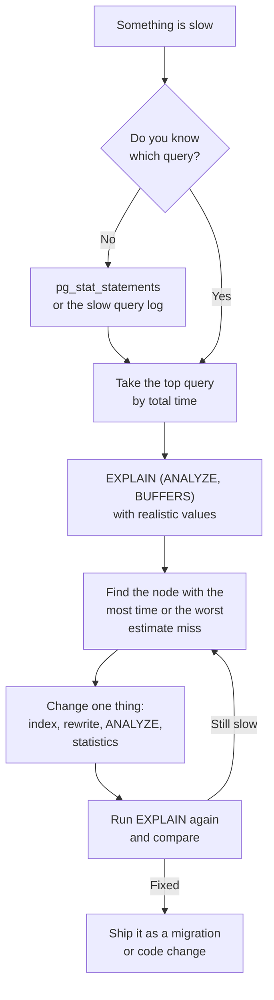

Performance and Diagnostics
===========================

> Read **[General Principles](/Database-Standards/General-Principles)** first. This page covers finding out **why** something is slow: query plans, the expensive queries on a running system, and the settings and connection limits that cause slowness on their own.
> Examples are PostgreSQL. SQL Server and MySQL equivalents are in [Other engines](#other-engines).

* * *

## At a Glance

| Topic | The rule |
| --- | --- |
| [The workflow](#finding-a-slow-query-step-by-step) | **Find it, read the plan, change one thing, measure again**<br/><sub>Guessing which part is slow is wrong more often than right.</sub> |
| [EXPLAIN](#explain-and-explain-analyze) | **`EXPLAIN (ANALYZE, BUFFERS)` shows what actually happened**<br/><sub>Plain `EXPLAIN` is only the planner's estimate. `ANALYZE` really runs the query, so wrap writes in `ROLLBACK`.</sub> |
| [Reading a plan](#reading-a-plan) | **Look for the node with the most time and the biggest estimate miss**<br/><sub>Estimated rows far off from actual rows is the root of most bad plans.</sub> |
| [Top queries](#finding-the-expensive-queries-with-pg-stat-statements) | **`pg_stat_statements` on every database**<br/><sub>The queries worth fixing are the ones with the most total time, not the slowest single run.</sub> |
| [Slow query log](#logging-slow-queries) | **Log anything slower than a threshold, with its plan**<br/><sub>`log_min_duration_statement` and `auto_explain` catch slow queries you weren't watching for.</sub> |
| [Right now](#what-is-running-right-now) | **`pg_stat_activity` shows what's running and what's waiting**<br/><sub>Cancel a runaway query before you reach for terminate.</sub> |
| [Timeouts](#timeouts) | **Set `statement_timeout` and `idle_in_transaction_session_timeout`**<br/><sub>One stuck query or forgotten transaction shouldn't be able to hold locks for hours.</sub> |
| [Vacuum](#vacuum-analyze-and-bloat) | **Let autovacuum run, and check it keeps up on busy tables**<br/><sub>Dead rows and stale statistics make good queries slow over time.</sub> |
| [Connections](#connection-pooling) | **A small pool per app, PgBouncer when there are many app instances**<br/><sub>More connections than the server has cores makes everything slower, not faster.</sub> |
| [ORM logging](#seeing-the-sql-your-orm-sends) | **Log the SQL your ORM generates while you develop**<br/><sub>N+1 and accidental full loads are obvious in the log and invisible in the code.</sub> |

* * *

## Concepts you'll meet on this page

### Planner

The part of Postgres that decides **how** to run a query (indexes, join method, order), based on **statistics**: a sample of each column's contents, collected by `ANALYZE`.

### Plan node

One step in the plan: a scan, a join, a sort. Nodes form a tree; each gets rows from the nodes under it and passes rows up.

### Dead tuple

The old version of a row after an `UPDATE` or `DELETE`. Postgres keeps it until no running transaction could still need it, then **VACUUM** removes it.

### Connection pool

Open database connections the app reuses instead of opening one per request. Each new Postgres connection starts a server process, so it's expensive.

* * *

## Finding a slow query step by step



1. **Find the query.** For a slow page, the ORM log or APM trace shows the SQL. If the whole system is slow, start from [pg_stat_statements](#finding-the-expensive-queries-with-pg-stat-statements).
2. **Get its plan with real values**, on production-shaped data. A plan on 50 local rows tells you nothing about 5 million.
3. **Find the expensive node** (see [Reading a plan](#reading-a-plan)).
4. **Change one thing**, and measure again. Change three at once and you won't know which helped, or which made something else worse.

> 💡 Run the query twice and read the second run. The first may be slow only because the data wasn't in memory yet.

* * *

## EXPLAIN and EXPLAIN ANALYZE

| Command | What it does | Runs the query? |
| --- | --- | --- |
| `EXPLAIN` | Shows the plan and the planner's **estimates** | No |
| `EXPLAIN ANALYZE` | Runs the query and adds **actual** rows and times per node | **Yes** |
| `EXPLAIN (ANALYZE, BUFFERS)` | Also shows how many pages came from memory (`shared hit`) vs disk (`read`) | **Yes** |

```sql
EXPLAIN (ANALYZE, BUFFERS)
SELECT i.id, i.number, i.total
FROM   invoices AS i
WHERE  i.customer_id = 42
  AND  i.status = 'paid'
ORDER  BY i.created_at DESC
LIMIT  20;
```

> 📝 Since **PostgreSQL 18**, `EXPLAIN ANALYZE` includes buffer statistics by default. On older versions, ask for `BUFFERS` explicitly.

> ⚠️ `EXPLAIN ANALYZE` on an `INSERT`, `UPDATE` or `DELETE` really changes the data. Wrap it:
> ```sql
> BEGIN;
> EXPLAIN (ANALYZE, BUFFERS) UPDATE invoices SET status = 'overdue' WHERE due_date < current_date;
> ROLLBACK;
> ```

### Getting the real query out of the ORM

Plans depend on the values: `WHERE status = $1` can get a different plan for `'paid'` (90% of rows) than for `'disputed'` (0.1%). Copy the SQL from the [ORM's query log](#seeing-the-sql-your-orm-sends), substitute real values, then `EXPLAIN` that.

* * *

## Reading a plan

Read **from the innermost, most-indented node outward**: those run first and feed rows up. Each node shows:

```
Index Scan using invoices_customer_id_created_at_idx on invoices i
    (cost=0.43..85.10 rows=20 width=32)
    (actual time=0.031..0.112 rows=20 loops=1)
  Index Cond: (customer_id = 42)
  Filter: (status = 'paid'::text)
  Rows Removed by Filter: 3
  Buffers: shared hit=24
```

| Part | Meaning |
| --- | --- |
| `cost=0.43..85.10` | The planner's estimate in arbitrary units: cost to the first row, then to the last row. Only useful for comparing plans. |
| `rows=20` (first bracket) | How many rows the planner **expected** |
| `actual time=0.031..0.112` | Milliseconds to the first row, then to the last row, **per loop** |
| `rows=20` (second bracket) | How many rows **actually** came out, per loop |
| `loops=1` | How many times this node ran. **Multiply** time and rows by loops to get the real total. |
| `Rows Removed by Filter` | Rows read and then thrown away. A big number means the index isn't selective enough for this query. |
| `Buffers: shared hit / read` | Pages from memory / from disk |

### Node types you'll see

| Node | What it is | Worth a look when |
| --- | --- | --- |
| **Seq Scan** | Reads the whole table | The table is big and the query returns few rows |
| **Index Scan** | Walks the index, then fetches each matching row from the table | Fine for few rows. Slow if it fetches a huge share of the table one row at a time |
| **Index Only Scan** | Answers from the index alone | `Heap Fetches` is high: the table needs vacuuming |
| **Bitmap Index Scan** + **Bitmap Heap Scan** | Collects matching row locations from one or more indexes, then reads the table pages in order | Normal for medium result sizes, and for `OR` across two indexed columns |
| **Nested Loop** | For each row on the outer side, looks up matches on the inner side | Many outer rows with no index on the inner side: `loops` will be huge |
| **Hash Join** | Builds a hash table from one side, probes it with the other | `Batches` above 1 means it ran out of memory and spilled to disk |
| **Merge Join** | Joins two inputs that are both sorted on the join key | Rarely a problem |
| **Sort** | Sorts rows | `Sort Method: external merge  Disk: ...` means it spilled to disk |
| **HashAggregate / GroupAggregate** | `GROUP BY` | Large and spilling to disk |

### The most common problems

**1. Estimated rows far from actual rows.** Expected 10, got 200,000: every decision above that node was made for the wrong amount of data. Usual causes:

```sql
-- stale statistics after a big import or delete: refresh them
ANALYZE invoices;

-- dependent columns (city decides postal code): the planner assumes independence and
-- underestimates. Tell it they're related, then refresh:
CREATE STATISTICS customers_city_postal_code_stats (dependencies)
    ON city, postal_code FROM customers;
ANALYZE customers;
```

**2. A Seq Scan on a big table returning few rows.** Usually a missing index, or a condition that can't use one (e.g. a function around the column). See [Indexing](/Database-Standards/Indexing) and [Writing Queries](/Database-Standards/Writing-Queries).

**3. A Nested Loop with a huge `loops` count.** The inner side runs once per outer row: 50,000 loops × 0.1 ms is 5 seconds. Usually a missing index on the inner join column, or a wrong row estimate (problem 1).

**4. Sorts and hashes spilling to disk.** Each sort or hash can use up to `work_mem` (default 4MB) before writing to disk. For one heavy report, raise it for that transaction only:

```sql
BEGIN;
SET LOCAL work_mem = '64MB';   -- this transaction only
SELECT ...;                    -- the report
COMMIT;
```

> ⚠️ Don't raise `work_mem` globally to fix one query. It's allowed **per sort or hash, per connection**, so 100 connections running a query with three sorts can each use 3 × `work_mem`.

### Visualising a plan

Paste long plans (text or `EXPLAIN (ANALYZE, BUFFERS, FORMAT JSON)`) into **[explain.dalibo.com](https://explain.dalibo.com/)** (PEV2) or **[explain.depesz.com](https://explain.depesz.com/)**.

> ⚠️ A plan contains your table names, column names and the values in the query, which may be customer data. Don't paste client plans into a public site without checking. explain.depesz.com can obfuscate names, and PEV2 can be downloaded and run locally as a single HTML file.

* * *

## Finding the expensive queries with pg stat statements

`pg_stat_statements` records every distinct query: how often, total time, average time. **Enable it on every project's database.**

```ini
# postgresql.conf (needs a restart). On managed services, set it in the parameter group or server parameters.
shared_preload_libraries = 'pg_stat_statements'
```

```sql
CREATE EXTENSION IF NOT EXISTS pg_stat_statements;

-- the queries using the most time overall
SELECT calls,
       round(total_exec_time::numeric)    AS total_ms,
       round(mean_exec_time::numeric, 1)  AS mean_ms,
       rows,
       left(query, 120)                   AS query
FROM   pg_stat_statements
ORDER  BY total_exec_time DESC
LIMIT  20;
```

- **Sort by total time first.** A 5 ms query run 2 million times a day costs more than a 4-second report run twice. Then sort by `mean_exec_time` for the individually slow ones.
- Values are replaced by `$1`, `$2`, so all calls of the same query are counted together.
- Reset the counters after a fix to measure cleanly: `SELECT pg_stat_statements_reset();`

> 📝 The column names are `total_exec_time` and `mean_exec_time` since PostgreSQL 13. Older articles use `total_time` and `mean_time`.

* * *

## Logging slow queries

### log_min_duration_statement

```sql
-- logs every statement slower than the threshold, with its duration; one database, no restart
ALTER DATABASE app SET log_min_duration_statement = '500ms';
```

### auto_explain

Logs the **plan** of every slow query, so you can see why it was slow even when you can't reproduce it.

```ini
# postgresql.conf
shared_preload_libraries = 'pg_stat_statements,auto_explain'
auto_explain.log_min_duration = '1s'
auto_explain.log_analyze = on     # actual row counts and times; adds some overhead to every query
```

> ⚠️ Slow-query logs can contain parameter values: emails, names, tokens. Treat the database logs as sensitive, and keep their access and retention the same as for the data itself.

* * *

## What is running right now

```sql
SELECT pid,
       usename,
       state,
       now() - query_start   AS running_for,
       wait_event_type,
       wait_event,
       left(query, 100)      AS query
FROM   pg_stat_activity
WHERE  state <> 'idle'
  AND  pid <> pg_backend_pid()
ORDER  BY query_start;
```

| `state` | Meaning |
| --- | --- |
| `active` | Running a query now |
| `idle in transaction` | Opened a transaction and is doing nothing. **It still holds its locks.** Usually an app bug or a forgotten console session. |
| `idle` | Connected, nothing open. Normal for pooled connections. |

### Who is blocking whom

```sql
SELECT pid,
       pg_blocking_pids(pid) AS blocked_by,
       now() - query_start   AS waiting_for,
       left(query, 100)      AS query
FROM   pg_stat_activity
WHERE  cardinality(pg_blocking_pids(pid)) > 0;
```

Follow `blocked_by` to the top of the chain: that session is the one to deal with.

### Stopping a query

```sql
SELECT pg_cancel_backend(12345);      -- ✅ try first: cancels the current query, keeps the connection
SELECT pg_terminate_backend(12345);   -- only if cancel didn't work: ends the whole session
```

Terminating a session rolls back its open transaction. On production, say in the team channel what you stopped and why.

* * *

## Timeouts

Set limits on the **app's database role**, so they apply to every connection it opens:

```sql
ALTER ROLE app_user SET statement_timeout = '30s';                     -- a single query running longer than this
ALTER ROLE app_user SET idle_in_transaction_session_timeout = '60s';  -- a transaction left open and idle, holding its locks
ALTER ROLE app_user SET lock_timeout = '10s';                          -- waiting longer than this for a lock
```

A reporting or migration role can have longer limits. Migrations should set their own short `lock_timeout`, see [Migrations and Schema Changes](/Database-Standards/Migrations-and-Schema-Changes).

* * *

## VACUUM ANALYZE and bloat

Every `UPDATE` and `DELETE` leaves a dead row version behind. **Autovacuum** cleans them up and refreshes statistics in the background. Leave it on, always.

```sql
-- is autovacuum keeping up?
SELECT relname,
       n_live_tup,
       n_dead_tup,
       last_autovacuum,
       last_autoanalyze
FROM   pg_stat_user_tables
ORDER  BY n_dead_tup DESC
LIMIT  10;
```

| Symptom | Likely cause | What to do |
| --- | --- | --- |
| `n_dead_tup` high, `last_autovacuum` old | Autovacuum can't keep up with a busy table | Tune autovacuum for that table, e.g. `ALTER TABLE orders SET (autovacuum_vacuum_scale_factor = 0.02);` |
| Autovacuum runs but dead rows stay | A long-running or `idle in transaction` session is holding old row versions in place | Find it in [pg_stat_activity](#what-is-running-right-now), and set [timeouts](#timeouts) |
| Plans got worse after a big import or delete | Statistics are stale | `ANALYZE table_name;` |
| A table or index far bigger than its row count explains | Bloat from heavy updates or deletes | `REINDEX INDEX CONCURRENTLY` for indexes. For tables, `pg_repack`, planned with the tech lead. |

> ⚠️ Avoid `VACUUM FULL` on production. It rewrites the table and **locks it completely** until it finishes.

> 📝 Vacuum also prevents **transaction ID wraparound**: a table left unvacuumed long enough eventually makes Postgres stop accepting writes to protect the data. Another reason never to turn autovacuum off.

* * *

## Connection pooling

Each Postgres connection is a server process with its own memory. Beyond a modest number of **active** connections, more of them make every query slower as they fight over CPU, disk and locks.

**Size the pool small.** Start at about **2 × the server's CPU cores** for total active connections, shared across every app instance, then measure. Hundreds of connections is almost always a misconfiguration.

| Stack | Where the pool is | Setting |
| --- | --- | --- |
| Prisma 7+ (driver adapter) | The `pg` pool the adapter uses | The pool's `max` (defaults to 10) |
| Prisma 6 and older | Prisma's own engine | `?connection_limit=` in the connection URL |
| TypeORM | The `pg` pool underneath | `poolSize` in the data source options |
| Laravel (PHP-FPM) | **No pool.** One connection per PHP worker per request | Put **PgBouncer** in front once you have more than a few workers |
| EF Core / Dapper (Npgsql) | Npgsql's built-in pool, on by default | `Maximum Pool Size` in the connection string (defaults to 100) |

Total connections = pool size × app instances. Four API containers with a pool of 25 each is 100, already Postgres's default `max_connections`.

### PgBouncer

PgBouncer shares a few real Postgres connections among many clients. Use **transaction mode**: a client holds a real connection only for one transaction.

> ⚠️ **In transaction mode, the next transaction may run on a different server connection.** Anything that lives on the session breaks:
> - `SET` without `LOCAL`, session-level advisory locks, `LISTEN`, and temp tables that outlive a transaction.
> - **Prepared statements**, unless PgBouncer is **1.21 or newer** with `max_prepared_statements` set above 0. Most ORMs use prepared statements.
>
> Run **migrations on a direct connection** to Postgres, not through PgBouncer.

**Prisma behind PgBouncer:** with PgBouncer 1.21+ and `max_prepared_statements` set, don't add `pgbouncer=true` to the URL; only older versions need it. Give the Prisma CLI a direct, unpooled URL for migrations.

* * *

## Seeing the SQL your ORM sends

Turn on query logging in development. Most N+1 problems are obvious the first time you see 51 queries for one page.

```ts
// Prisma
const prisma = new PrismaClient({ log: ['query', 'warn', 'error'] });

// TypeORM: log queries, and any query slower than 500 ms
new DataSource({ /* ... */ logging: ['query', 'error'], maxQueryExecutionTime: 500 });
```

```php
// Laravel: log every query in development (AppServiceProvider::boot)
DB::listen(fn (QueryExecuted $q) => logger()->debug($q->sql, ['bindings' => $q->bindings, 'ms' => $q->time]));

// ✅ make lazy loading (the N+1 source) throw outside production
Model::preventLazyLoading(! app()->isProduction());
```

Laravel Telescope and Debugbar show the same per request, with duplicate queries highlighted.

```csharp
// EF Core: development only
options.UseNpgsql(connectionString)
       .LogTo(Console.WriteLine, LogLevel.Information)
       .EnableSensitiveDataLogging();   // ⚠️ logs parameter values: never in production
```

**Dapper** generates nothing, so the SQL is already in your code. To time queries per request, wrap the connection in MiniProfiler's `ProfiledDbConnection`.

* * *

## Other engines

| | PostgreSQL | SQL Server | MySQL |
| --- | --- | --- | --- |
| Estimated plan | `EXPLAIN` | SSMS **Display Estimated Execution Plan** (Ctrl+L) | `EXPLAIN` |
| Actual plan | `EXPLAIN (ANALYZE, BUFFERS)` | SSMS **Include Actual Execution Plan** (Ctrl+M), then run | `EXPLAIN ANALYZE` (8.0.18+); `EXPLAIN FORMAT=TREE` (8.0.16+) for a readable tree |
| I/O and time per query | `BUFFERS` | `SET STATISTICS IO, TIME ON;` | `EXPLAIN ANALYZE` |
| Top queries over time | `pg_stat_statements` | **Query Store** (on by default for new databases since SQL Server 2022), `sys.dm_exec_query_stats` | `performance_schema`, and the `sys` schema views such as `sys.statement_analysis` |
| Slow query log | `log_min_duration_statement`, `auto_explain` | Query Store, Extended Events | `slow_query_log = ON`, `long_query_time` |
| Running now / blocking | `pg_stat_activity`, `pg_blocking_pids()` | `sys.dm_exec_requests` (`blocking_session_id`) | `SHOW PROCESSLIST`, `sys.innodb_lock_waits` |
| Refresh statistics | `ANALYZE` | `UPDATE STATISTICS` | `ANALYZE TABLE` |

Engine-specific detail: [SQL Server](/Database-Standards/SQL-Server), [MySQL](/Database-Standards/MySQL).

* * *

## Do / Don't

| ✅ Do | ❌ Don't | Example |
| --- | --- | --- |
| Read the plan, change one thing, measure again | Change several things at once on a hunch | [The workflow](#finding-a-slow-query-step-by-step) |
| Wrap `EXPLAIN ANALYZE` of a write in `BEGIN ... ROLLBACK` | `EXPLAIN ANALYZE` a `DELETE` and lose the rows | [EXPLAIN](#explain-and-explain-analyze) |
| Test plans on production-sized data with real values | Trust a plan from a 50-row local table | [The workflow](#finding-a-slow-query-step-by-step) |
| Compare estimated and actual rows first | Only look at the total time | [Reading a plan](#reading-a-plan) |
| `SET LOCAL work_mem` for one heavy report | Raise `work_mem` globally | [Reading a plan](#reading-a-plan) |
| Enable `pg_stat_statements` and sort by total time | Optimise the query someone complained about loudest | [Top queries](#finding-the-expensive-queries-with-pg-stat-statements) |
| Treat slow-query logs as sensitive | Paste client plans into a public site unchecked | [Slow query log](#logging-slow-queries) |
| `pg_cancel_backend` first | Jump straight to `pg_terminate_backend` | [Right now](#what-is-running-right-now) |
| Set statement and idle-in-transaction timeouts on the app role | Let one stuck transaction hold locks all night | [Timeouts](#timeouts) |
| Keep autovacuum on and check it keeps up | `VACUUM FULL` on production | [Vacuum](#vacuum-analyze-and-bloat) |
| Small pools, PgBouncer in transaction mode for many clients | Hundreds of direct connections | [Connections](#connection-pooling) |
| Log ORM queries in development, `preventLazyLoading` in Laravel | `EnableSensitiveDataLogging` in production | [ORM logging](#seeing-the-sql-your-orm-sends) |

* * *

## Further reading

1.  **PostgreSQL Documentation — Using EXPLAIN**
    [https://www.postgresql.org/docs/current/using-explain.html](https://www.postgresql.org/docs/current/using-explain.html)
2.  **PostgreSQL Documentation — pg_stat_statements**
    [https://www.postgresql.org/docs/current/pgstatstatements.html](https://www.postgresql.org/docs/current/pgstatstatements.html)
3.  **PostgreSQL Documentation — auto_explain**
    [https://www.postgresql.org/docs/current/auto-explain.html](https://www.postgresql.org/docs/current/auto-explain.html)
4.  **PostgreSQL Documentation — Routine Vacuuming**
    [https://www.postgresql.org/docs/current/routine-vacuuming.html](https://www.postgresql.org/docs/current/routine-vacuuming.html)
5.  **PostgreSQL Wiki — Number Of Database Connections**
    [https://wiki.postgresql.org/wiki/Number_Of_Database_Connections](https://wiki.postgresql.org/wiki/Number_Of_Database_Connections)
6.  **PgBouncer — Configuration** (`pool_mode`, `max_prepared_statements`)
    [https://www.pgbouncer.org/config.html](https://www.pgbouncer.org/config.html)
7.  **Prisma — Configure Prisma Client with PgBouncer**
    [https://www.prisma.io/docs/orm/prisma-client/setup-and-configuration/databases-connections/pgbouncer](https://www.prisma.io/docs/orm/prisma-client/setup-and-configuration/databases-connections/pgbouncer)

* * *

## Related pages

- [Indexing](/Database-Standards/Indexing) — what to do once the plan shows a missing index.
- [Writing Queries](/Database-Standards/Writing-Queries) — query patterns that keep plans fast.
- [Replication and Monitoring](/Database-Standards/Replication-and-Monitoring) — watching database health in production, beyond individual queries.
