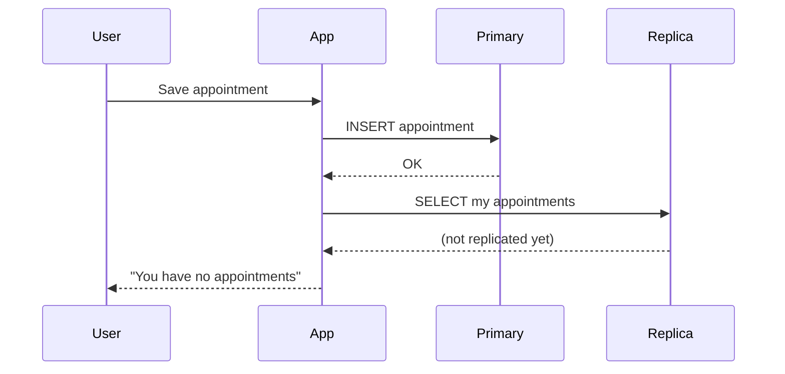

Replication and Monitoring
==========================

> Keeping a database available when a server fails, spreading reads across copies, and knowing something is wrong before the client tells you. Read **[General Principles](/Database-Standards/General-Principles)** first. Each engine replicates differently, so each has its own section.

* * *

## At a Glance

| Topic | The rule |
| --- | --- |
| [What replication is for](#what-replication-is-for) | **Replicas are for availability and read scaling, never instead of backups**<br/><sub>A DROP TABLE on the primary reaches every replica within seconds.</sub> |
| [Do you need it](#do-you-need-replication) | **Start with one primary and good backups, add replicas when the RTO or the load needs them**<br/><sub>Every replica is another server to pay for, patch and watch.</sub> |
| [Failover](#failover) | **Use the managed service's high availability, or a proven tool, never a home-made script**<br/><sub>Two servers that both think they're the primary is worse than one that's down.</sub> |
| [Read your own writes](#read-your-own-writes) | **Reads that follow a write go to the primary**<br/><sub>A replica a second behind shows the user the record they just saved as missing.</sub> |
| [App configuration](#connecting-the-app-to-replicas) | **Two connection strings, primary and replica, wired explicitly in each stack**<br/><sub>Prisma, TypeORM, Laravel, EF Core and Dapper all handle it differently.</sub> |
| [What to watch](#what-to-watch) | **Alert on disk, connections, replication lag, long transactions, backups and errors**<br/><sub>Those catch most outages before they happen.</sub> |
| [Postgres specifics](#monitoring-postgresql) | **Watch idle-in-transaction sessions, dead rows and transaction ID age**<br/><sub>They're the Postgres problems that grow quietly until they stop the database.</sub> |
| [Health checks](#health-checks) | **The app's readiness check pings the database; its liveness check doesn't**<br/><sub>A database blip shouldn't make the orchestrator restart every app container.</sub> |
| [Capacity](#capacity-planning) | **Act on the trend at 70 to 80 percent, not when it's full**<br/><sub>Growing a disk or a server takes planning; running out takes the app down.</sub> |

* * *

## Concepts you'll meet on this page

### Primary and replica

The **primary** accepts writes. A **replica** (standby, secondary) receives a copy of every change and can serve reads. If the primary fails, a replica can be **promoted** to primary.

### Synchronous and asynchronous replication

**Asynchronous**: the primary confirms a write once it's saved locally; the replica catches up shortly after. Fast, but a failover can lose the last few changes. **Synchronous**: the primary waits until a replica has the change too. Nothing confirmed is lost, but every write is slower, and writes stall if the replica is unreachable.

### Replication lag

How far a replica is behind the primary, in seconds or bytes. Milliseconds is normal; seconds or minutes means stale replica reads, and data lost on failover.

### Failover and split brain

**Failover**: promoting a replica when the primary is lost. **Split brain**: two servers both accepting writes as primary, usually because a failover happened while the old primary was still running. The data diverges, and merging it back is manual and painful.

* * *

## Replication

### What replication is for

| ✅ Replication gives you | ❌ Replication doesn't give you |
| --- | --- |
| **High availability**: a standby takes over in seconds or minutes when the primary's server, disk or zone fails | Protection from mistakes: a bad `UPDATE`, `DELETE` or `DROP` is copied straight to every replica |
| **Read scaling**: reports, search and heavy read endpoints run on replicas, away from the primary | Protection from ransomware or a compromised account |
| **Offloading**: backups, exports and analytics read from a replica instead of loading production | A way to go back in time |

For going back in time, you need [Backups and Recovery](/Database-Standards/Backups-and-Recovery).

### Do you need replication

| Situation | What to do |
| --- | --- |
| Internal tool, prototype, small client app | One primary, managed backups with PITR. A restore is your recovery plan. |
| The agreed RTO is shorter than a restore takes | Add a **high-availability standby** (managed Multi-AZ / zone-redundant HA). |
| Reports or heavy reads slow down the app | Add a **read replica**, and point only those queries at it. |
| Critical system, must survive a whole region failing | Cross-region replica or geo-replication, with a rehearsed failover. |

> 💡 Before adding a replica to fix slow reads, check the queries: a missing index is cheaper than a second server. See [Performance and Diagnostics](/Database-Standards/Performance-and-Diagnostics).

### Failover

**On a managed service, use its high-availability option.** It handles detection, promotion and moving the DNS name to the new primary, and the provider has tested it far more than you could.

| Service | High availability | Readable standby? |
| --- | --- | --- |
| Amazon RDS (Postgres, MySQL, SQL Server) | Multi-AZ DB instance: one standby in another zone | No. Add a read replica for reads. A Multi-AZ DB **cluster** (Postgres, MySQL) has two readable standbys. |
| Amazon Aurora | Replicas share the cluster's storage; any replica can be promoted | Yes |
| Azure Database for PostgreSQL / MySQL Flexible Server | Zone-redundant or same-zone HA standby | No. Add a read replica for reads. |
| Azure SQL Database | Built into every tier; Business Critical and Premium include a readable replica | Business Critical / Premium, with `ApplicationIntent=ReadOnly` |
| Google Cloud SQL | Regional HA instance | No. Add a read replica for reads. |
| MongoDB Atlas | Every cluster is a replica set with automatic failover | Yes, via read preference |

**Self-hosted**, use a proven tool: **Patroni** (with etcd, Consul or ZooKeeper) for Postgres, **Always On availability groups** for SQL Server, **InnoDB Cluster** for MySQL, a **replica set** for MongoDB, **Sentinel** or **Cluster** for Redis.

> ⚠️ **Rehearse failover before you need it.** Trigger one on staging (most managed services have a "reboot with failover" or "failover" action) and check the app reconnects by itself. An app that caches a database IP address, or a pool that never drops dead connections, turns a 30-second failover into an outage.

### Read your own writes

With asynchronous replicas, a read can reach a replica before the write it depends on.



- **Reads inside a transaction, or right after a write in the same request, go to the primary.**
- **Send to replicas only reads that tolerate a few seconds of staleness**: reports, dashboards, search, public listings.
- **When in doubt, use the primary.** A replica is an optimisation, not the default.

### Connecting the app to replicas

| Stack | How |
| --- | --- |
| **Prisma** | The `@prisma/extension-read-replicas` extension. Reads go to a replica, writes and raw queries to the primary, `$primary()` forces the primary. From Prisma 7 it takes replica `PrismaClient` instances instead of URLs. |
| **TypeORM** | The `replication` option in the data source. Query-builder reads go to a replica, writes and transactions to the primary. |
| **Laravel** | `read` and `write` hosts on the connection, with `'sticky' => true`. |
| **EF Core** | A second `DbContext` with the replica's connection string, used only for read-only queries. |
| **Dapper** | A second connection (or data source) for the replica, chosen explicitly per query. |

```ts
// Prisma 7: the replica is its own client, then the extension routes reads to it
import { PrismaPg } from '@prisma/adapter-pg';
import { readReplicas } from '@prisma/extension-read-replicas';
import { PrismaClient } from '../generated/prisma/client'; // your generated client's path

const replica = new PrismaClient({
  adapter: new PrismaPg({ connectionString: process.env.DATABASE_REPLICA_URL }),
});

export const prisma = new PrismaClient({
  adapter: new PrismaPg({ connectionString: process.env.DATABASE_URL }),
}).$extends(readReplicas({ replicas: [replica] }));

// Right after a write, read from the primary
await prisma.$primary().appointment.findMany({ where: { patientId } });
```

```ts
// TypeORM data source
export const dataSource = new DataSource({
  type: 'postgres',
  replication: {
    master: { url: process.env.DATABASE_URL },
    slaves: [{ url: process.env.DATABASE_REPLICA_URL }],
  },
  // entities, migrations, ...
});
```

```php
// config/database.php (Laravel)
'pgsql' => [
    'driver' => 'pgsql',
    'read'   => ['host' => [env('DB_READ_HOST')]],
    'write'  => ['host' => [env('DB_HOST')]],
    'sticky' => true,   // after a write, the rest of this request reads from the primary
    // database, username, password, ...
],
```

```csharp
// .NET: EF Core for normal work, a no-tracking context for replica reads
builder.Services.AddDbContext<ClinicDbContext>(o =>
    o.UseNpgsql(config.GetConnectionString("Primary")));
builder.Services.AddDbContext<ClinicReadDbContext>(o =>
    o.UseNpgsql(config.GetConnectionString("Replica"))
     .UseQueryTrackingBehavior(QueryTrackingBehavior.NoTracking));

// Dapper: an explicit data source for replica reads
builder.Services.AddKeyedSingleton("replica",
    NpgsqlDataSource.Create(config.GetConnectionString("Replica")!));
```

> 📝 On SQL Server, a readable secondary in an availability group (or Azure SQL Business Critical) is reached through the listener, with `ApplicationIntent=ReadOnly` in the replica connection string.

* * *

## Replication per engine

### Replicating PostgreSQL

| Kind | What it copies | Use for |
| --- | --- | --- |
| **Streaming (physical) replication** | The whole server, byte for byte, from the WAL | HA standbys and read replicas |
| **Logical replication** | Chosen tables, as row changes (`CREATE PUBLICATION` / `CREATE SUBSCRIPTION`) | Major version upgrades with little downtime, copying a subset of tables to another system |

- **Asynchronous by default.** For synchronous, set `synchronous_standby_names` on the primary, e.g. `'ANY 1 (replica_a, replica_b)'`: one of two standbys must confirm each commit.
- **Standby queries can be cancelled** when they conflict with replayed changes ("canceling statement due to conflict with recovery"). On a reporting replica, raise `max_standby_streaming_delay`, or turn on `hot_standby_feedback`, which avoids most cancellations but lets dead rows build up on the primary while long queries run.
- **Logical replication doesn't copy schema changes (DDL).** Apply migrations to both sides. Check your version's docs for how sequences are handled.

```sql
-- On the primary: each standby and how far behind it is
SELECT client_addr, state, write_lag, flush_lag, replay_lag
FROM   pg_stat_replication;

-- On a standby: time since the last replayed transaction
-- (this also grows when the primary is simply idle)
SELECT now() - pg_last_xact_replay_timestamp() AS replay_delay;
```

> 💡 libpq-based clients accept several hosts in one connection string: `postgresql://db-a,db-b/clinic?target_session_attrs=read-write` connects to whichever is the primary (Postgres 10+; `primary`, `standby` and `prefer-standby` since Postgres 14).

### Replicating SQL Server

- **Always On availability groups**: a primary replica plus secondaries, each in **synchronous-commit** (no data loss, used for automatic failover) or **asynchronous-commit** (distant replicas) mode. Apps connect through the **listener** name, which always points at the current primary.
- **Readable secondaries** serve `ApplicationIntent=ReadOnly` connections once read-only routing is configured.
- **Azure SQL Database**: HA is built in. Add **active geo-replication** or a **failover group** for a copy in another region; a failover group's listener survives a regional failover.

```sql
-- How far each secondary is behind (on the primary)
SELECT ar.replica_server_name, drs.synchronization_state_desc,
       drs.log_send_queue_size, drs.redo_queue_size
FROM   sys.dm_hadr_database_replica_states AS drs
JOIN   sys.availability_replicas AS ar ON ar.replica_id = drs.replica_id;
```

### Replicating MySQL

- **Asynchronous** binlog replication is the default. **Semi-synchronous** makes the source wait until at least one replica has received each transaction.
- **Turn on GTIDs** (`gtid_mode=ON`, `enforce_gtid_consistency=ON`). A global ID per transaction makes failover and re-pointing replicas far safer than tracking binlog file positions.
- **InnoDB Cluster** (Group Replication + MySQL Router + MySQL Shell) gives automatic failover for self-hosted MySQL. **InnoDB ReplicaSet** is the simpler, manual-failover version.

```sql
-- On a replica (MySQL 8.0.22+; older versions use SHOW SLAVE STATUS)
SHOW REPLICA STATUS\G
-- Check Replica_IO_Running and Replica_SQL_Running are both Yes,
-- and Seconds_Behind_Source is small
```

### Replicating MongoDB

- **Production MongoDB is always a replica set** of at least **three** members, so a majority can still elect a primary when one fails. Atlas does this for you.
- **Write concern `majority`** (the default since MongoDB 5.0 in most deployments) confirms a write only once most members have it, so it survives a failover.
- **Read preference**: leave it at `primary` unless the reads tolerate staleness, then use `secondaryPreferred`.
- **Sharding** splits a collection across replica sets. It adds real complexity and the shard key is hard to change. Shard only when one replica set genuinely can't hold the data or write load, and agree it with the tech lead first.

```js
// mongosh
rs.status()                           // members, states, health
rs.printSecondaryReplicationInfo()    // how far each secondary is behind
```

### Replicating Redis

| Setup | What it gives you | Use when |
| --- | --- | --- |
| **Primary + replicas** | Copies for reads, manual failover | Rarely on its own |
| **Primary + replicas + Sentinel** | Automatic failover for one primary; run at least three Sentinel processes | The data fits on one server and you need HA |
| **Redis Cluster** | Data split across several primaries (16,384 hash slots), each with replicas | The data or load is too big for one server |

- Redis replication is **asynchronous**: a failover can lose the last writes.
- In Redis Cluster, multi-key commands only work within one hash slot. Use **hash tags** (`{clinic:42}:sessions`, `{clinic:42}:queue`) to keep related keys together.
- The client library must support Sentinel or Cluster mode; a plain client pointed at one node won't follow a failover.
- On managed Redis (Amazon ElastiCache, Azure Managed Redis, Redis Cloud), HA and clustering are tier options.

* * *

## Monitoring

### What to watch

Starting thresholds; tune them once you know the project's normal pattern.

| Metric | Why it matters | Alert when |
| --- | --- | --- |
| **Disk space** | A full disk stops writes, and on some engines stops the database | Over 80% used, or on track to fill within 7 days |
| **CPU** | Sustained high CPU is usually a missing index or a runaway query | Over 80% for 15 minutes |
| **Memory and swap** | Swapping makes everything slow | Any sustained swapping |
| **Disk IOPS and throughput** | Hitting the provisioned limit queues every query | At the provisioned limit for 15 minutes |
| **Connections** | At the limit, new requests can't connect at all | Over 80% of `max_connections` |
| **Replication lag** | Stale reads, and data lost on failover | Above what the project tolerates, e.g. 30 seconds |
| **Long-running queries and transactions** | They hold locks and block cleanup | Any transaction open longer than 5 minutes |
| **Idle in transaction** (Postgres) | A session that opened a transaction and stopped, holding locks | Any session idle in a transaction for over 1 minute |
| **Lock waits and deadlocks** | Requests queue behind each other | Lock waits over a few seconds, or a jump in deadlocks |
| **Cache hit ratio** | Reads going to disk instead of memory | Noticeably below its usual level (OLTP apps usually sit above 99%) |
| **Dead rows and autovacuum** (Postgres) | Table bloat, slower queries | Dead rows growing while autovacuum hasn't run for days |
| **Transaction ID age** (Postgres) | Past a hard limit, Postgres stops accepting writes to protect data | Over 1 billion, or steadily growing |
| **Backups** | No backup means no recovery | No successful backup within the expected window |
| **Errors and slow queries** | The first sign something changed | A jump in errors, or in queries slower than the slow-query threshold |

### Monitoring PostgreSQL

On every production server:

```text
log_min_duration_statement = 1000              # log queries slower than 1 second
log_lock_waits = on                            # log waits longer than deadlock_timeout
idle_in_transaction_session_timeout = '5min'   # end sessions that forgot to COMMIT
```

Plus a statement timeout for the app, so one runaway query can't hold a connection for an hour:

```sql
ALTER ROLE clinic_app SET statement_timeout = '30s';

-- Queries to keep at hand

-- Long-running transactions and who's idle inside one
SELECT pid, usename, state, now() - xact_start AS open_for, left(query, 80) AS query
FROM   pg_stat_activity
WHERE  xact_start < now() - interval '5 minutes'
ORDER  BY open_for DESC;

-- Who is blocked, and by whom
SELECT pid, pg_blocking_pids(pid) AS blocked_by, wait_event_type, left(query, 80) AS query
FROM   pg_stat_activity
WHERE  cardinality(pg_blocking_pids(pid)) > 0;

-- Connections in use versus the limit
SELECT count(*) AS connections, current_setting('max_connections') AS max
FROM   pg_stat_activity;

-- Tables with the most dead rows, and when autovacuum last ran
SELECT relname, n_live_tup, n_dead_tup, last_autovacuum
FROM   pg_stat_user_tables
ORDER  BY n_dead_tup DESC
LIMIT  10;

-- Transaction ID age per database (wraparound protection)
SELECT datname, age(datfrozenxid) AS xid_age
FROM   pg_database
ORDER  BY xid_age DESC;
```

Finding slow queries (`pg_stat_statements`, `EXPLAIN`): [Performance and Diagnostics](/Database-Standards/Performance-and-Diagnostics).

### Monitoring other engines

| Engine | Where to look |
| --- | --- |
| **SQL Server** | **Query Store** (on by default for new databases since SQL Server 2022, and in Azure SQL) for slow and regressed queries; DMVs `sys.dm_exec_requests`, `sys.dm_os_wait_stats`; SQL Server Agent alerts |
| **MySQL** | The slow query log (`slow_query_log = ON`, `long_query_time`), Performance Schema and the `sys` schema, `SHOW REPLICA STATUS` |
| **MongoDB** | Atlas metrics and Performance Advisor; self-hosted: `db.currentOp()`, `mongostat`, `mongotop`, `rs.status()`, the database profiler |
| **Redis** | `INFO` (`used_memory`, `maxmemory`, `evicted_keys`, `connected_clients`, `keyspace_hits` / `keyspace_misses`, `master_link_status`), `SLOWLOG GET 10`, `LATENCY DOCTOR` |

```js
// MongoDB: operations running longer than 5 seconds
db.currentOp({ active: true, secs_running: { $gt: 5 } })
```

> ⚠️ **Redis used as a job queue must not evict keys.** Set `maxmemory-policy noeviction` (BullMQ requires it) and alert on memory well before `maxmemory`. With an eviction policy, a full Redis silently deletes queued jobs. A pure cache is the opposite: there, an eviction policy such as `allkeys-lru` is what you want.

### Monitoring tools

| Option | Notes |
| --- | --- |
| **The cloud provider's built-in monitoring** | Start here on managed databases. **AWS:** CloudWatch metrics and CloudWatch Database Insights (which replaced the Performance Insights console in 2026). **Azure:** Azure Monitor metrics and alerts, Query Store and Query Performance Insight. **Google Cloud:** Cloud Monitoring and Query Insights. **Atlas:** built-in metrics and alerts. |
| **Prometheus + Grafana** | Self-hosted or mixed setups. Exporters: `postgres_exporter`, `mysqld_exporter`, `mongodb_exporter`, `redis_exporter`. |
| **pgwatch** | Open-source Postgres monitoring with ready-made dashboards. |
| **pganalyze, Datadog Database Monitoring** | Commercial. Query-level insight, plan history and index advice. Worth it on large or critical projects. |

Whatever the tool, **alerts go where a person will see them** (the team's alert channel, or on-call for critical projects), and each alert says what to check first.

### Health checks

| Check | Should it touch the database? | Why |
| --- | --- | --- |
| **Liveness** ("is the process stuck?") | **No** | If it fails, the app is restarted. A database blip would restart every container at once and make things worse. |
| **Readiness** ("can it serve traffic?") | **Yes**, a quick `SELECT 1` with a short timeout (1 to 2 seconds) | If it fails, traffic goes elsewhere until the database is back. |

Use the stack's health-check package, not your own: `@nestjs/terminus` (NestJS), `AspNetCore.HealthChecks.NpgSql` / `.SqlServer` (.NET), or a `/health` route that checks the connection (Laravel 11+ ships a basic `/up` route).

### Capacity planning

- **Review the trend monthly**: disk growth, peak connections, peak CPU. A straight line on a graph tells you when you'll run out.
- **Plan the change at 70 to 80 percent** of any limit. Growing a disk is usually online; a bigger server usually means a short failover or restart, scheduled with the client.
- **Turn on storage autoscaling** on managed services, with a maximum, so a runaway table can't grow the bill without limit.
- **Connections don't scale with server size forever.** Each Postgres connection is a process. Use a pool (PgBouncer, RDS Proxy, or the platform's built-in pooler) before raising `max_connections`. See [Performance and Diagnostics](/Database-Standards/Performance-and-Diagnostics).

* * *

## Do / Don't

Each row links to the section with its full example.

| ✅ Do | ❌ Don't | Example |
| --- | --- | --- |
| Use replicas for availability and read scaling, backups for recovery | Count a replica as a backup | [What replication is for](#what-replication-is-for) |
| Add HA when the RTO is shorter than a restore | Add replicas to hide a missing index | [Do you need it](#do-you-need-replication) |
| Use managed HA, Patroni, availability groups, InnoDB Cluster or Sentinel | Write your own failover script | [Failover](#failover) |
| Rehearse a failover on staging and check the app reconnects | Discover during an outage that the app caches the old IP | [Failover](#failover) |
| Read from the primary right after a write | Send every read to a replica | [Read your own writes](#read-your-own-writes) |
| Use `sticky`, `$primary()` or an explicit primary connection | Assume the ORM knows which reads must be fresh | [App configuration](#connecting-the-app-to-replicas) |
| Use GTIDs on MySQL replication | Track binlog positions by hand | [MySQL](#replicating-mysql) |
| Run MongoDB as a replica set of at least three members | Run a single production `mongod` | [MongoDB](#replicating-mongodb) |
| Set `noeviction` on Redis used as a queue | Let Redis evict queued jobs | [Other engines](#monitoring-other-engines) |
| Alert on disk, connections, lag, long transactions and backups | Find out from the client that the site is down | [What to watch](#what-to-watch) |
| Set `statement_timeout` and `idle_in_transaction_session_timeout` | Let one forgotten transaction hold locks for hours | [PostgreSQL](#monitoring-postgresql) |
| Check the database in readiness, not liveness | Restart every container because the database blinked | [Health checks](#health-checks) |
| Plan upgrades at 70 to 80 percent of a limit | Wait for the disk to fill | [Capacity](#capacity-planning) |

* * *

## Further reading

1.  **PostgreSQL Documentation — High Availability, Load Balancing, and Replication**
    [https://www.postgresql.org/docs/current/high-availability.html](https://www.postgresql.org/docs/current/high-availability.html)
2.  **PostgreSQL Documentation — The Cumulative Statistics System**
    [https://www.postgresql.org/docs/current/monitoring-stats.html](https://www.postgresql.org/docs/current/monitoring-stats.html)
3.  **PostgreSQL Documentation — Preventing Transaction ID Wraparound Failures**
    [https://www.postgresql.org/docs/current/routine-vacuuming.html#VACUUM-FOR-WRAPAROUND](https://www.postgresql.org/docs/current/routine-vacuuming.html#VACUUM-FOR-WRAPAROUND)
4.  **Patroni documentation**
    [https://patroni.readthedocs.io/](https://patroni.readthedocs.io/)
5.  **Microsoft Learn — What is an Always On availability group?**
    [https://learn.microsoft.com/sql/database-engine/availability-groups/windows/overview-of-always-on-availability-groups-sql-server](https://learn.microsoft.com/sql/database-engine/availability-groups/windows/overview-of-always-on-availability-groups-sql-server)
6.  **MySQL 8.4 Reference Manual — Replication**
    [https://dev.mysql.com/doc/refman/8.4/en/replication.html](https://dev.mysql.com/doc/refman/8.4/en/replication.html)
7.  **MongoDB Manual — Replication**
    [https://www.mongodb.com/docs/manual/replication/](https://www.mongodb.com/docs/manual/replication/)
8.  **Redis Documentation — High availability with Redis Sentinel**
    [https://redis.io/docs/latest/operate/oss_and_stack/management/sentinel/](https://redis.io/docs/latest/operate/oss_and_stack/management/sentinel/)
9.  **Prisma Documentation — Read replicas**
    [https://www.prisma.io/docs/orm/v7/prisma-client/setup-and-configuration/read-replicas](https://www.prisma.io/docs/orm/v7/prisma-client/setup-and-configuration/read-replicas)
10. **Laravel Documentation — Database: read and write connections**
    [https://laravel.com/docs/database#read-and-write-connections](https://laravel.com/docs/database#read-and-write-connections)

* * *

## Related pages

- [Backups and Recovery](/Database-Standards/Backups-and-Recovery) — what actually protects you from a bad change.
- [Performance and Diagnostics](/Database-Standards/Performance-and-Diagnostics) — finding and fixing the slow queries monitoring points you to.
- [Access and Roles](/Database-Standards/Access-and-Roles) — replication and monitoring users follow least privilege too.
- [Transactions and Concurrency](/Database-Standards/Transactions-and-Concurrency) — why long transactions and lock waits happen.
