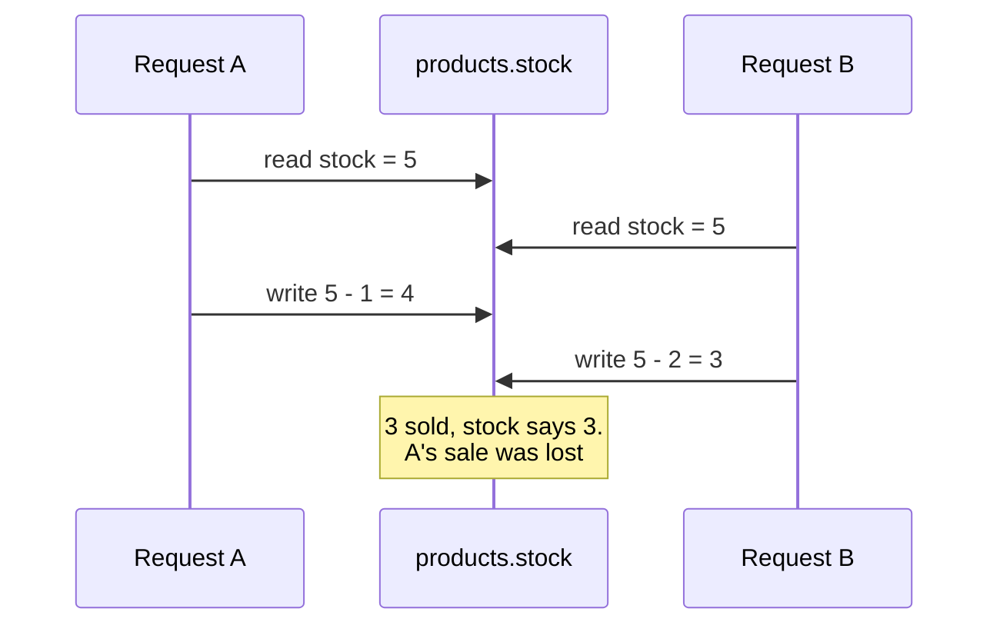

Transactions and Concurrency
============================

> Read **[General Principles](/Database-Standards/General-Principles)** first — this page goes deeper on [keeping transactions short](/Database-Standards/General-Principles#keep-transactions-short) and on two requests touching the same rows at once.
> Examples are PostgreSQL. Where SQL Server or MySQL differ, the section says so.

* * *

## At a Glance

| Topic | The rule |
| --- | --- |
| [Transactions in each tool](#transactions-in-each-tool) | **Every query inside the transaction uses the transaction's handle**<br/><sub>`tx` in Prisma, `manager` in TypeORM, the passed `transaction` in Dapper. One query on the wrong handle runs outside it.</sub> |
| [Isolation levels](#isolation-levels) | **Read Committed by default, Serializable only with a retry loop**<br/><sub>Higher levels don't block conflicts, they abort one side. Your code has to try again.</sub> |
| [Lost updates](#stopping-lost-updates) | **Do the arithmetic in the UPDATE, not in your code**<br/><sub>`SET stock = stock - 1` can't lose a concurrent change. Read, subtract, write back can.</sub> |
| [Row locks](#lock-the-row-with-select-for-update) | **`SELECT ... FOR UPDATE` when you must read, decide, then write**<br/><sub>The second request waits until the first commits, then sees its result.</sub> |
| [Optimistic locking](#optimistic-locking-with-a-version-column) | **A version column for edits a user makes in a form**<br/><sub>The save fails with a conflict instead of silently overwriting someone else's change.</sub> |
| [Job queues](#job-queues-with-skip-locked) | **`FOR UPDATE SKIP LOCKED` to hand out work**<br/><sub>Each worker gets different rows, and nobody waits on anybody else.</sub> |
| [One job at a time](#one-job-at-a-time-with-advisory-locks) | **An advisory lock stops two copies of a scheduled job running together**<br/><sub>Two app instances, two cron triggers, one invoice run.</sub> |
| [Deadlocks](#deadlocks) | **Lock rows in a consistent order, keep transactions short, retry on 40P01**<br/><sub>Deadlocks can't be ruled out completely, so they have to be survivable.</sub> |
| [Upserts](#upserts-and-idempotency) | **`INSERT ... ON CONFLICT` for insert-or-update, never select-then-insert**<br/><sub>It's one atomic statement, backed by a unique index.</sub> |
| [Idempotency](#idempotency-keys) | **Retried requests carry a key with a UNIQUE constraint on it**<br/><sub>A double-clicked "Pay" button charges once.</sub> |
| [Timeouts](#timeouts-that-protect-you) | **Set `idle_in_transaction_session_timeout`, `lock_timeout` and `statement_timeout`**<br/><sub>One stuck transaction shouldn't be able to freeze the whole app.</sub> |

* * *

## Concepts you'll meet on this page

### ACID

What a transaction guarantees:

| Letter | Means | In practice |
| --- | --- | --- |
| **A**tomic | All of it happens, or none of it does | The invoice and the balance update both land, or neither does |
| **C**onsistent | Every constraint holds when it commits | A foreign key or CHECK violation rolls the whole thing back |
| **I**solated | Concurrent transactions don't see each other's half-finished work | How much they *can* see is the [isolation level](#isolation-levels) |
| **D**urable | Once it says COMMIT, it survives a crash | It's written to the write-ahead log before COMMIT returns |

### Race condition

The result depends on which of two simultaneous requests gets there first. Correct when tested alone, wrong in production under load.

### Lost update

The most common race: two requests read the same value, both change it in app code, both write it back. The second write silently wipes out the first.

### Lock

A marker meaning "this row (or table) is being changed, wait your turn". Writes lock the rows they touch until the transaction ends. In Postgres, readers never wait for writers and writers never wait for readers.

### Deadlock

A holds a lock B needs while B holds a lock A needs. The database detects it and kills one of them with an error.

* * *

## Transactions in each tool

**Every query in the transaction must run through the transaction's own handle.** One that uses the normal client or repository runs on another connection, outside the transaction, and won't be rolled back.

### Prisma

```ts
// ✅ interactive transaction: every query goes through tx
await prisma.$transaction(
  async (tx) => {
    const invoice = await tx.invoice.create({ data });
    await tx.customer.update({
      where: { id: data.customerId },
      data: { balance: { increment: invoice.total } },
    });
  },
  {
    maxWait: 2000,   // ms to wait for a connection from the pool (default 2000)
    timeout: 5000,   // ms before Prisma rolls the transaction back (default 5000)
  },
);

// ❌ uses prisma instead of tx: this update is NOT part of the transaction
await prisma.$transaction(async (tx) => {
  const invoice = await tx.invoice.create({ data });
  await prisma.customer.update({ where: { id: data.customerId }, data: { /* ... */ } });
});
```

- Isolation level: add `isolationLevel: Prisma.TransactionIsolationLevel.Serializable` to the options.
- Independent writes that don't read each other's results: the array form `prisma.$transaction([q1, q2])` is enough.

### TypeORM

```ts
// ✅ use the manager the callback gives you
await dataSource.transaction(async (manager) => {
  const invoice = await manager.save(Invoice, data);
  await manager.increment(Customer, { id: data.customerId }, 'balance', invoice.total);
});

// ❌ the injected repository runs on its own connection, outside the transaction
await dataSource.transaction(async (manager) => {
  await manager.save(Invoice, data);
  await this.customerRepo.increment({ id: data.customerId }, 'balance', data.total);
});
```

Isolation level goes first: `dataSource.transaction('SERIALIZABLE', async (manager) => { ... })`. For manual control, use a `QueryRunner`, and always release it:

```ts
const qr = dataSource.createQueryRunner();
await qr.connect();
await qr.startTransaction();
try {
  await qr.manager.save(Invoice, data);
  await qr.commitTransaction();
} catch (err) {
  await qr.rollbackTransaction();
  throw err;
} finally {
  await qr.release();   // forget this and the pool slowly runs out of connections
}
```

### Laravel

```php
// ✅ the second argument retries the whole closure on a deadlock or concurrency error
DB::transaction(function () use ($data) {
    $invoice = Invoice::create($data);
    Customer::whereKey($data['customer_id'])->increment('balance', $invoice->total);
}, 3);
```

> ⚠️ **Queued jobs and events dispatched inside a transaction** can run before it commits, and then can't find the row. Dispatch with `->afterCommit()`, or set `'after_commit' => true` on the queue connection in `config/queue.php`.

### EF Core

`SaveChanges()` already wraps all pending changes in one transaction. You need an explicit one only when several `SaveChanges()` calls, or raw SQL, must succeed together.

```csharp
// ✅ with retries enabled (EnableRetryOnFailure), wrap the transaction in the execution strategy
var strategy = db.Database.CreateExecutionStrategy();
await strategy.ExecuteAsync(async () =>
{
    await using var tx = await db.Database.BeginTransactionAsync();

    db.Invoices.Add(invoice);
    await db.SaveChangesAsync();

    await db.Customers
        .Where(c => c.Id == invoice.CustomerId)
        .ExecuteUpdateAsync(s => s.SetProperty(c => c.Balance, c => c.Balance + invoice.Total));

    await tx.CommitAsync();
});
```

> ⚠️ With connection resiliency on, a `BeginTransaction()` outside `strategy.ExecuteAsync(...)` throws an `InvalidOperationException`. The strategy must be able to replay the whole transaction, not just the failed statement.

Isolation level: `BeginTransactionAsync(IsolationLevel.Serializable)` (from `System.Data`).

### Dapper

Dapper has no transaction of its own. Open one on the connection and **pass it to every call.**

```csharp
await using var conn = new NpgsqlConnection(connectionString);
await conn.OpenAsync();
await using var tx = await conn.BeginTransactionAsync();

var invoiceId = await conn.ExecuteScalarAsync<long>(
    "INSERT INTO invoices (customer_id, number, total) VALUES (@CustomerId, @Number, @Total) RETURNING id",
    invoice, transaction: tx);

await conn.ExecuteAsync(
    "UPDATE customers SET balance = balance + @Total WHERE id = @CustomerId",
    invoice, transaction: tx);

await tx.CommitAsync();   // disposing without Commit rolls back
```

> 📝 SQL Server's client throws if a command on a connection with an open transaction doesn't pass it; Npgsql enlists it anyway. Pass `transaction: tx` every time regardless, so the code means the same on every provider.

* * *

## Isolation levels

The isolation level decides how much a transaction sees of concurrent ones. **Postgres defaults to Read Committed**, the right default for almost everything.

### What each level prevents

| Level | Each statement sees | Prevents | Still possible |
| --- | --- | --- | --- |
| **Read Committed** (Postgres default) | Everything committed before *that statement* started | Dirty reads (seeing uncommitted data) | Two reads in one transaction disagree; lost updates; write skew |
| **Repeatable Read** | Everything committed before the *transaction's* first statement | The above, plus changing reads and phantom rows | Write skew. Updating a row someone else changed meanwhile fails with `40001` |
| **Serializable** | Same as Repeatable Read, and Postgres checks the result is as if transactions ran one at a time | Every anomaly | Nothing — but any transaction may be aborted with `40001` and must be retried |

> 📝 Postgres never shows uncommitted data, even if you ask for `READ UNCOMMITTED`. It quietly treats it as Read Committed.

**Write skew** is the one that bites real apps. Two receptionists book Dr. Khan's last free slot at the same time:

```sql
-- both transactions run this check, both see 0, both insert: the slot is now double-booked
SELECT count(*) FROM appointments
WHERE doctor_id = 7 AND starts_at = '2026-11-12 10:00+00';

INSERT INTO appointments (doctor_id, patient_id, starts_at) VALUES (7, 311, '2026-11-12 10:00+00');
```

Three fixes, best first:

1. **A constraint**, if the rule fits one: `UNIQUE (doctor_id, starts_at)`, or an exclusion constraint for overlapping time ranges. The database refuses the second insert at any isolation level. See [Schema Design](/Database-Standards/Schema-Design).
2. **Lock something both transactions must touch first**, such as the doctor's row, with [`SELECT ... FOR UPDATE`](#lock-the-row-with-select-for-update).
3. **Run the transaction as Serializable** and [retry on failure](#retry-serialization-failures).

### Retry serialization failures

Under Repeatable Read and Serializable, Postgres resolves a conflict by aborting one transaction with SQLSTATE `40001` (`serialization_failure`); deadlocks abort with `40P01`. Both mean "nothing was saved, run the whole transaction again".

```ts
// ✅ retry the WHOLE transaction, including its reads, a few times with a short back-off
async function withRetry<T>(work: () => Promise<T>, attempts = 3): Promise<T> {
  for (let attempt = 1; ; attempt++) {
    try {
      return await work();
    } catch (err: any) {
      // Prisma reports both as P2034; pg / TypeORM expose the SQLSTATE on err.code
      const retryable = ['P2034', '40001', '40P01'].includes(err?.code);
      if (!retryable || attempt >= attempts) throw err;
      await new Promise((r) => setTimeout(r, 50 * attempt + Math.random() * 50));
    }
  }
}

await withRetry(() =>
  prisma.$transaction(async (tx) => { /* reads and writes */ }, {
    isolationLevel: Prisma.TransactionIsolationLevel.Serializable,
  }),
);
```

| Tool | Built-in retry |
| --- | --- |
| Prisma, TypeORM, Dapper | None. Wrap the transaction in a helper like the one above. |
| Laravel | `DB::transaction($callback, 3)` retries the closure on deadlocks and concurrency errors. |
| EF Core | `EnableRetryOnFailure()` retries errors the provider classes as transient. Check your provider's list rather than assuming. |

> ⚠️ Never retry just the statement that failed. The reads earlier in the transaction are now stale, and the decision you made from them may be wrong.

### Isolation in other engines

| Engine | Default | Watch out for |
| --- | --- | --- |
| **SQL Server** | Read Committed, **using locks**: readers wait for writers | Unless `READ_COMMITTED_SNAPSHOT` is ON (it's on by default in Azure SQL Database). Without it, a long write blocks every report reading the same rows. Deadlock error is `1205`. |
| **MySQL (InnoDB)** | **Repeatable Read** | Plain `SELECT`s read a snapshot, but `UPDATE` and locking reads see the latest data, so read-then-write in app code still loses updates. InnoDB also takes gap locks, which cause deadlocks Postgres wouldn't. Deadlock error is `1213`. |

* * *

## Stopping lost updates



| Situation | Fix |
| --- | --- |
| The new value is simple arithmetic on the old one | [Do the arithmetic in the database](#do-the-arithmetic-in-the-database) |
| You read a row, run some business logic, then write within one request | [Lock the row with SELECT FOR UPDATE](#lock-the-row-with-select-for-update) |
| A user loads a form, edits for a few minutes, then saves | [Optimistic locking with a version column](#optimistic-locking-with-a-version-column) |

### Do the arithmetic in the database

```ts
// ❌ read, change in code, write back: a concurrent sale is overwritten
const product = await prisma.product.findUnique({ where: { id } });
await prisma.product.update({ where: { id }, data: { stock: product.stock - qty } });

// ✅ one atomic statement; the condition also stops stock going negative
const { count } = await prisma.product.updateMany({
  where: { id, stock: { gte: qty } },
  data: { stock: { decrement: qty } },
});
if (count === 0) throw new ConflictException('Not enough stock');
```

```sql
UPDATE products
SET    stock = stock - $1
WHERE  id = $2
  AND  stock >= $1
RETURNING stock;          -- no row back means not enough stock
```

Other tools: TypeORM `repo.decrement({ id }, 'stock', qty)`, Laravel `->decrement('stock', $qty)`, EF Core `ExecuteUpdateAsync(s => s.SetProperty(p => p.Stock, p => p.Stock - qty))`, Dapper with the SQL above.

### Lock the row with SELECT FOR UPDATE

When the decision needs more than a `WHERE` clause, lock the row first. A second transaction locking the same row waits until the first commits, then reads the new values.

```sql
BEGIN;

SELECT id, status, total
FROM   orders
WHERE  id = 1042
FOR UPDATE;               -- other FOR UPDATE / UPDATE on this row now wait

-- app logic: is it still 'paid'? is the warehouse open? ...

UPDATE orders SET status = 'shipped' WHERE id = 1042;

COMMIT;                   -- the lock is released here
```

| Tool | How |
| --- | --- |
| Prisma | No built-in API. Use `` tx.$queryRaw`SELECT ... FOR UPDATE` `` inside an interactive transaction. |
| TypeORM | `.setLock('pessimistic_write')` on a query builder, inside a transaction. |
| Laravel | `Order::whereKey($id)->lockForUpdate()->first()` inside `DB::transaction`. |
| EF Core | `db.Orders.FromSql($"SELECT * FROM orders WHERE id = {id} FOR UPDATE")` inside a transaction. |
| Dapper | The SQL above, with `transaction: tx`. |

> ⚠️ A lock outside a transaction does nothing. In autocommit mode, the lock is released the moment the `SELECT` finishes.

### Optimistic locking with a version column

You can't hold a lock while a user types for minutes. Store a version number instead: the save only succeeds if the row still has the version the user loaded.

```sql
-- the user loaded version 7
UPDATE customers
SET    name = $1, email = $2, version = version + 1
WHERE  id = $3
  AND  version = 7;
-- 0 rows updated: someone else saved first. Return 409 Conflict and show the latest data.
```

| Tool | How |
| --- | --- |
| EF Core + SQL Server | `[Timestamp] public byte[] RowVersion { get; set; }` (a `rowversion` column). A stale save throws `DbUpdateConcurrencyException`. |
| EF Core + Postgres (Npgsql) | `[Timestamp] public uint Version { get; set; }` maps to Postgres's built-in `xmin` system column, so no extra column is needed. |
| EF Core, any engine | `[ConcurrencyCheck]` on a column you increment yourself. |
| TypeORM | `@VersionColumn()` increments the version on `save()`, but **`save()` doesn't check it.** Do the conditional update yourself: `repo.update({ id, version }, { ...changes, version: () => 'version + 1' })` and treat `affected === 0` as a conflict. |
| Prisma | `updateMany({ where: { id, version }, data: { ...changes, version: { increment: 1 } } })` and treat `count === 0` as a conflict. |
| Laravel | `Customer::whereKey($id)->where('version', $version)->update([... , 'version' => DB::raw('version + 1')])` returns the number of rows changed. |
| Dapper | The SQL above. `ExecuteAsync` returns the number of rows changed. |

* * *

## Job queues with SKIP LOCKED

`FOR UPDATE SKIP LOCKED` lets several workers pull from one table without fighting: each skips rows another worker has locked.

```sql
WITH next_jobs AS (
    SELECT id
    FROM   jobs
    WHERE  status = 'pending'
      AND  run_at <= now()
    ORDER  BY run_at
    LIMIT  10
    FOR UPDATE SKIP LOCKED
)
UPDATE jobs AS j
SET    status    = 'running',
       locked_at = now(),
       attempts  = j.attempts + 1
FROM   next_jobs
WHERE  j.id = next_jobs.id
RETURNING j.id, j.type, j.payload;
```

- Mark jobs `running` and commit, then do the work. Don't hold the transaction open for the length of the job.
- A sweeper puts `running` jobs with an old `locked_at` back to `pending`, so a crashed worker's jobs aren't lost.
- Index the query: `CREATE INDEX ON jobs (run_at) WHERE status = 'pending';`

> 💡 **Before writing your own queue, use an existing one.** BullMQ (on [Redis](/Database-Standards/Redis)) for NestJS, Laravel's queue workers, Hangfire for .NET, or pg-boss / Graphile Worker if you want the queue in Postgres. They already handle retries, back-off and stuck jobs.

| Engine | Equivalent |
| --- | --- |
| MySQL 8.0+ | `FOR UPDATE SKIP LOCKED`, same syntax |
| SQL Server | `WITH (UPDLOCK, READPAST, ROWLOCK)` table hints |

* * *

## One job at a time with advisory locks

On two app instances, a scheduled job (nightly invoice run, report export) fires on both. An **advisory lock** is a named lock only your code checks: the second instance sees it's taken and skips the run.

```sql
BEGIN;
SELECT pg_try_advisory_xact_lock(1001);   -- true: you have it; false: another instance is running
-- ... the job, only if it returned true ...
COMMIT;                                   -- the lock is released with the transaction
```

- Keep lock IDs as named constants in one file (`NIGHTLY_INVOICE_RUN = 1001`), so two jobs never share a number by accident.
- Prefer the `_xact_` versions, which release at the end of the transaction. Session-level locks (`pg_advisory_lock`) aren't reliable behind PgBouncer in transaction mode, because the next statement may run on a different server connection.

| Engine | Equivalent |
| --- | --- |
| SQL Server | `sp_getapplock` / `sp_releaseapplock` |
| MySQL | `GET_LOCK('nightly-invoice-run', 0)` / `RELEASE_LOCK(...)` |
| Several databases, or no shared database | A lock in [Redis](/Database-Standards/Redis) with an expiry |

* * *

## Deadlocks

```sql
-- Transaction A                              -- Transaction B
UPDATE invoices SET ... WHERE id = 1;         UPDATE invoices SET ... WHERE id = 2;
UPDATE invoices SET ... WHERE id = 2;  -- waits for B
                                              UPDATE invoices SET ... WHERE id = 1;  -- waits for A: deadlock
```

After about a second (`deadlock_timeout`), Postgres aborts one with `40P01` (`deadlock_detected`). To make them rare:

1. **Touch rows in the same order everywhere.** Sort IDs before updating them one by one. For a bulk change, lock in order first:
   ```sql
   SELECT id FROM invoices WHERE id = ANY($1) ORDER BY id FOR UPDATE;
   ```
2. **Keep transactions short**, so there's less time for another to interleave.
3. **Don't mix read-then-write patterns across tables** in different orders in different services.

They can't be ruled out completely, so **retry the whole transaction on `40P01`** like [serialization failures](#retry-serialization-failures).

* * *

## Upserts and idempotency

### INSERT ON CONFLICT

Insert-or-update with `ON CONFLICT`: atomic, and needs a unique index or constraint on the conflict columns.

```sql
-- ✅ one statement; EXCLUDED is the row you tried to insert
INSERT INTO products (sku, name, price)
VALUES ($1, $2, $3)
ON CONFLICT (sku) DO UPDATE
SET    name       = EXCLUDED.name,
       price      = EXCLUDED.price,
       updated_at = now();

-- ✅ insert only if it isn't there yet
INSERT INTO product_tags (product_id, tag)
VALUES ($1, $2)
ON CONFLICT (product_id, tag) DO NOTHING;
```

```ts
// ❌ select-then-insert: two concurrent requests both see "missing" and both insert
const existing = await repo.findOneBy({ sku });
if (existing) await repo.update({ sku }, changes);
else await repo.insert({ sku, ...changes });
```

| Tool | Upsert |
| --- | --- |
| Prisma | `upsert()`. Prisma uses a native `ON CONFLICT` only when the query meets its conditions (one unique field in `where`, matching `create` data); otherwise it reads then writes and can throw `P2002` under concurrency. Catch and retry, or use `$executeRaw`. |
| TypeORM | `repo.upsert(rows, ['sku'])` generates `ON CONFLICT`. |
| Laravel | `Product::upsert($rows, ['sku'], ['name', 'price'])`: the rows, the unique-by columns, the columns to update. |
| EF Core | No built-in upsert. Use the SQL above with `ExecuteSqlAsync` or Dapper. |
| Dapper | The SQL above. |

### MERGE

Postgres 15+ supports SQL-standard `MERGE`, handy for syncing a staging table into a real one in a batch job. For concurrent single-row upserts from the app, **prefer `ON CONFLICT`**: if another transaction inserts the same key at the same moment, `MERGE` can fail with a unique violation, while `ON CONFLICT` handles it.

### Idempotency keys

A retried request (timeout, double click, webhook delivered twice) must not create the payment twice. The client sends a key, and a UNIQUE constraint enforces "once".

```sql
CREATE TABLE payments (
    id               bigint GENERATED ALWAYS AS IDENTITY PRIMARY KEY,
    idempotency_key  uuid          NOT NULL UNIQUE,
    order_id         bigint        NOT NULL REFERENCES orders (id),
    amount           numeric(12,2) NOT NULL,
    created_at       timestamptz   NOT NULL DEFAULT now()
);

INSERT INTO payments (idempotency_key, order_id, amount)
VALUES ($1, $2, $3)
ON CONFLICT (idempotency_key) DO NOTHING
RETURNING id;
-- no row back: this request was already processed. Look it up and return the original result.
```

> 💡 Pass the same key on to the payment provider (most accept an idempotency key), so a retry on your side can't double-charge on theirs either.

### Upserts in other engines

| Engine | Upsert | Watch out for |
| --- | --- | --- |
| **SQL Server** | No `ON CONFLICT`. Usually `UPDATE`, then `INSERT` if `@@ROWCOUNT = 0`, inside a transaction with `WITH (UPDLOCK, HOLDLOCK)` on the update. | `MERGE` exists but isn't safe under concurrency without `WITH (HOLDLOCK)`, and has a history of bugs. Many teams avoid it for app upserts. |
| **MySQL** | `INSERT ... ON DUPLICATE KEY UPDATE`. On 8.0.19+, use a row alias: `INSERT INTO products (sku, name) VALUES (?, ?) AS new ON DUPLICATE KEY UPDATE name = new.name` | `VALUES(col)` in the update clause is deprecated since 8.0.20. The statement fires on *any* unique key, not just the one you meant. |

* * *

## Timeouts that protect you

One forgotten open transaction holds its locks forever, blocking every migration and write that needs those rows. Set limits on the app's database role:

```sql
ALTER ROLE app_user SET idle_in_transaction_session_timeout = '60s';  -- kills a session left idle inside an open transaction
ALTER ROLE app_user SET lock_timeout = '10s';                          -- give up instead of waiting forever for a lock
ALTER ROLE app_user SET statement_timeout = '30s';                     -- no single query runs longer than this
```

- These apply to new connections. Fit values to the app: a reporting role may need a longer `statement_timeout`.
- Postgres 17+ also has `transaction_timeout`, a cap on a transaction's total length.
- Prisma's interactive transaction `timeout` is a second, app-side safety net, not a replacement.
- Never keep a transaction open across an HTTP call or while waiting for a user. See [General Principles → Keep transactions short](/Database-Standards/General-Principles#keep-transactions-short).

* * *

## Do / Don't

Each row links to the section with its full example.

| ✅ Do | ❌ Don't | Example |
| --- | --- | --- |
| Run every query in a transaction through its handle (`tx`, `manager`, `transaction: tx`) | Mix in the normal client or an injected repository | [Transactions in each tool](#transactions-in-each-tool) |
| Wrap EF Core transactions in the execution strategy when retries are on | Call `BeginTransaction()` on its own with `EnableRetryOnFailure` | [EF Core](#ef-core) |
| Stay on Read Committed unless you have a reason | Switch to Serializable without a retry loop | [Isolation levels](#isolation-levels) |
| Retry the whole transaction on `40001` and `40P01` | Retry just the failed statement | [Retry](#retry-serialization-failures) |
| `SET stock = stock - $1 WHERE stock >= $1` | Read, subtract in code, write back | [Arithmetic in the database](#do-the-arithmetic-in-the-database) |
| `SELECT ... FOR UPDATE` inside a transaction before read-decide-write | Lock outside a transaction | [Row locks](#lock-the-row-with-select-for-update) |
| Use a version column for long edits and return 409 on conflict | Trust TypeORM's `@VersionColumn` to check it for you | [Optimistic locking](#optimistic-locking-with-a-version-column) |
| Use an existing queue library, or `SKIP LOCKED` | Poll a table with plain `SELECT` and hope workers don't collide | [Job queues](#job-queues-with-skip-locked) |
| Guard scheduled jobs with `pg_try_advisory_xact_lock` | Let two instances run the same nightly job | [Advisory locks](#one-job-at-a-time-with-advisory-locks) |
| Lock and update rows in a consistent order | Update the same rows in different orders in different code paths | [Deadlocks](#deadlocks) |
| `INSERT ... ON CONFLICT` | Select-then-insert | [INSERT ON CONFLICT](#insert-on-conflict) |
| Enforce idempotency keys with a UNIQUE constraint | Rely on the frontend disabling the button | [Idempotency keys](#idempotency-keys) |
| Set idle-in-transaction, lock and statement timeouts on the app role | Leave them at "unlimited" | [Timeouts](#timeouts-that-protect-you) |

* * *

## Further reading

1.  **PostgreSQL Documentation — Transaction Isolation**
    [https://www.postgresql.org/docs/current/transaction-iso.html](https://www.postgresql.org/docs/current/transaction-iso.html)
2.  **PostgreSQL Documentation — Serialization Failure Handling**
    [https://www.postgresql.org/docs/current/mvcc-serialization-failure-handling.html](https://www.postgresql.org/docs/current/mvcc-serialization-failure-handling.html)
3.  **PostgreSQL Documentation — Explicit Locking** (row locks, advisory locks, deadlocks)
    [https://www.postgresql.org/docs/current/explicit-locking.html](https://www.postgresql.org/docs/current/explicit-locking.html)
4.  **PostgreSQL Documentation — INSERT** (the `ON CONFLICT` clause)
    [https://www.postgresql.org/docs/current/sql-insert.html](https://www.postgresql.org/docs/current/sql-insert.html)
5.  **Prisma — Transactions and batch queries**
    [https://www.prisma.io/docs/orm/prisma-client/queries/transactions](https://www.prisma.io/docs/orm/prisma-client/queries/transactions)
6.  **Microsoft Learn — Handling Concurrency Conflicts (EF Core)**
    [https://learn.microsoft.com/en-us/ef/core/saving/concurrency](https://learn.microsoft.com/en-us/ef/core/saving/concurrency)
7.  **Microsoft Learn — Connection Resiliency (EF Core)**
    [https://learn.microsoft.com/en-us/ef/core/miscellaneous/connection-resiliency](https://learn.microsoft.com/en-us/ef/core/miscellaneous/connection-resiliency)
8.  **Laravel — Database Transactions**
    [https://laravel.com/docs/database#database-transactions](https://laravel.com/docs/database#database-transactions)

* * *

## Related pages

- [General Principles](/Database-Standards/General-Principles) — keep transactions short, and never touch production by hand without one.
- [Schema Design](/Database-Standards/Schema-Design) — the constraints that make many of these races impossible in the first place.
- [Migrations and Schema Changes](/Database-Standards/Migrations-and-Schema-Changes) — how locks behave when the schema changes under a live app.
- [Redis](/Database-Standards/Redis) — queues and locks that span more than one database.
