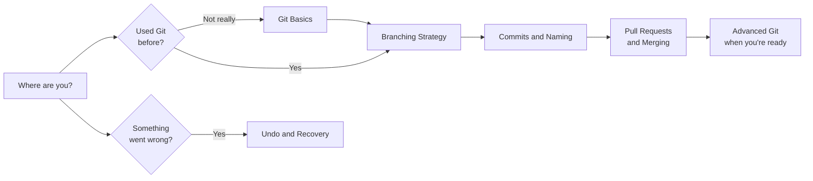

Git Guide
=========

How we use Git at Trinergy. It doesn't matter if you've used Git for a week or ten years, every project follows the same branches, the same naming and the same merge rules. That way anyone can jump into any repo and know what's going on.

The pages don't depend on where the repo is hosted. Azure DevOps, GitHub, GitLab, Bitbucket all work the same way here. Where a button has a different name on each platform, we say so.

* * *

### Start here

| Page | Who it's for |
| --- | --- |
| **[Git Basics](/Git-Guide/Git-Basics)** | New to Git, or only ever used "commit and push" from the IDE. What Git actually is, first-time setup, and the daily workflow step by step. |
| **[Branching Strategy](/Git-Guide/Branching-Strategy)** | Everyone. Our branches, what goes where, and how code travels from your laptop to production. |
| **[Commits and Naming](/Git-Guide/Commits-and-Naming)** | Everyone. How to write commit messages, name branches and name tags. |
| **[Pull Requests and Merging](/Git-Guide/Pull-Requests-and-Merging)** | Everyone. Opening a PR, keeping your branch up to date (merge), which merge button to press (merge commit, everywhere), and sorting out conflicts. |
| **[Advanced Git](/Git-Guide/Advanced-Git)** | Once the basics feel easy. Rebase and its pitfalls, cherry-pick, stash, bisect, tags, hooks. |
| **[Undo and Recovery](/Git-Guide/Undo-and-Recovery)** | Anyone who just said "oh no". Committed to the wrong branch, lost work, pushed a secret, and so on. |

* * *

### The rules that matter most

If you only remember one section, make it this one.

1. **Never commit secrets.** No `.env`, no API keys, no passwords. If it happens, tell your lead and rotate the key. Deleting the file doesn't remove it from history.
2. **One feature = one branch**, merged into `staging`, `uat` and `production` in turn as it clears each gate. Don't pile unrelated work into the same branch.
3. **Branch from `main` for new work.** Never start a feature from a `release/*` branch.
4. **Merge to stay up to date, merge commit to land — never squash or rebase a release branch.** Bring `main` into your branch with `git merge origin/main`. The same feature branch lands in `staging`, `uat` and `production` with a merge commit each time, so Git keeps recognising it's the same work. Rebase is optional, advanced, and only for tidying your own branch before it's ever shared.
5. **Never force-push to `main` or `release/*`.** On your own branch it's fine with `--force-with-lease`.
6. **Fix it where you found it, then merge the same branch up through every environment that still needs it.** Otherwise an environment is silently missing a fix that's already live elsewhere.
7. **Pull before you start, push before you leave.** Small, frequent syncs mean small conflicts.
8. **Test again after every merge.** Even if Git says "no conflicts". Git only checks text, not whether your app still works.

* * *

### Related pages

- [Code Review](/Code-Review) covers the reviewing side of a pull request.
- [General Principles](/Coding-Standards/General-Principles) covers secrets and `.env` files in more detail.
