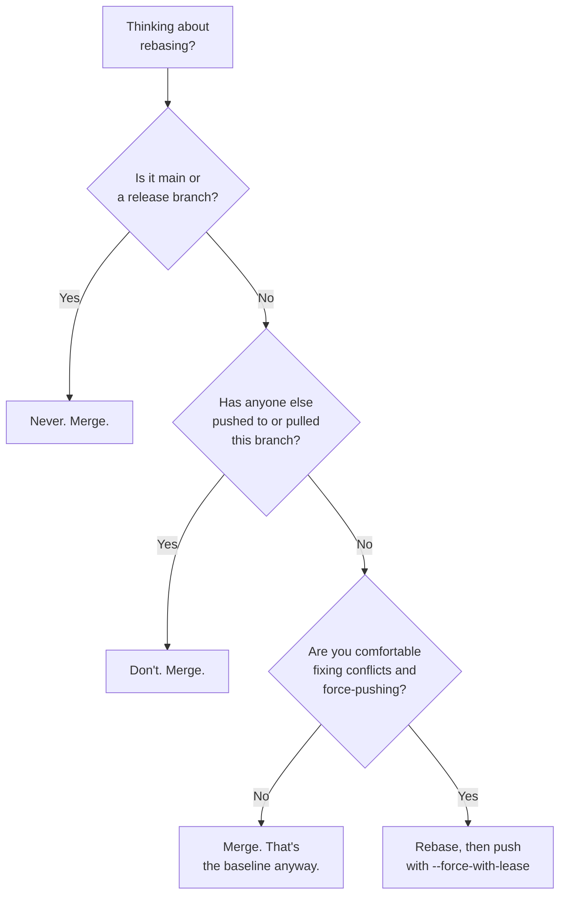

Advanced Git
============

> Tools for once the basics feel easy. None of this is needed day to day, but every one of these commands saves hours when you do need it. Most of them rewrite history, so the same warning applies to all of them: **only on your own branch, never on `main` or `release/*`.**

* * *

## 1. Rebase (use with care)

Our baseline is **merge `main` into your branch, land everything with a merge commit** (see [Pull Requests and Merging](/Git-Guide/Pull-Requests-and-Merging)). You never *have* to rebase. But once you're comfortable with Git, rebase is handy for one thing day to day: tidying your commits before the first PR, while the branch is still unshared.

The catch: **rebase rewrites history.** It doesn't move your commits, it throws them away and makes new copies with new IDs. That's what makes it powerful, and it's where every one of the pitfalls below comes from.

### Updating your branch with rebase

Instead of merging `main` in, rebase takes your commits off, brings your branch up to date with `main`, then puts copies of your commits back on top, one by one.

```
Before:
main:     A --- B --- C --- D        (C and D are other people's work)
               \
yours:          E --- F

After git rebase origin/main:
main:     A --- B --- C --- D
                             \
yours:                        E' --- F'     (new commits, new IDs)
```

```bash
git fetch origin
git rebase origin/main

# If there's a conflict: fix the files, then
git add <file>
git rebase --continue

# Already pushed this branch before? You need to force-push after a rebase
git push --force-with-lease
```

### Tidying your commits (interactive rebase)

You've been working on a branch for two days and your history looks like this:

```
a1b2c3d feat: add SMS reminder service
d4e5f6a wip
b7c8d9e fix typo
e1f2a3b wip again
c4d5e6f feat: add reminder settings page
f7a8b9c forgot a file
```

Nobody needs to see `wip` and `forgot a file`. Interactive rebase lets you tidy it up before the PR. There are two ways to start it:

```bash
# Rebase onto the remote main: covers every commit on your branch,
# and brings the branch up to date at the same time
git rebase -i origin/main

# Or only the last N commits on the branch, without touching the base
git rebase -i HEAD~3
```

Use `origin/main` when you want to tidy the whole branch. Use `HEAD~N` when you only want to touch your last few commits. Check `git log --oneline` first and count carefully (see the pitfalls below).

Git opens an editor with your commits listed oldest first:

```
pick a1b2c3d feat: add SMS reminder service
pick d4e5f6a wip
pick b7c8d9e fix typo
pick e1f2a3b wip again
pick c4d5e6f feat: add reminder settings page
pick f7a8b9c forgot a file
```

Change the word at the start of each line to say what to do with it:

```
pick   a1b2c3d feat: add SMS reminder service
fixup  d4e5f6a wip
fixup  b7c8d9e fix typo
fixup  e1f2a3b wip again
pick   c4d5e6f feat: add reminder settings page
fixup  f7a8b9c forgot a file
```

Save and close. You end up with two clean commits.

| Word | What it does |
| --- | --- |
| `pick` | Keep the commit as it is |
| `reword` | Keep it, but change the message |
| `squash` | Combine with the commit above, and let me edit the combined message |
| `fixup` | Combine with the commit above, throw this message away |
| `drop` | Delete the commit completely |
| (move a line) | Reorder commits |

If it goes wrong half-way, `git rebase --abort` puts everything back.

If the branch was already pushed, you need `git push --force-with-lease` afterwards.

Since the same commits will go into `release/staging`, `release/uat` and `release/production` via merge commits (never squashed, see [Pull Requests and Merging](/Git-Guide/Pull-Requests-and-Merging)), this is mostly about making your PR easier to review commit by commit. It's nice to have, not a requirement — but it's your only chance to do it, since these commits can't be rewritten once the branch is shared.

#### Quicker: fixing up as you go

If you already know a change belongs with an earlier commit:

```bash
git commit --fixup a1b2c3d
# later
git rebase -i --autosquash origin/main
```

Git lines up the fixup commits for you.

### When rebase is OK, and when it isn't



**The golden rule: only rebase commits that nobody else has.** If they only exist on your laptop, or on a branch only you push to, go ahead. If anyone else could have them, don't.

### Pitfalls

**1. It breaks everyone else's copy of the branch.** After a rebase your commits have new IDs. Anyone who already pulled the old ones now has a different history from the remote. When they pull, Git tries to combine the two and they end up with every commit twice, plus conflicts that make no sense. This is why we never rebase `main`, `release/*`, or any branch someone else is working on.

**2. You have to force-push, and force-pushing can delete work.** A rebased branch can't be pushed normally. Always use `--force-with-lease`, never `--force` (see section 2 below). With plain `--force`, anything a teammate pushed in the meantime is gone from the remote.

**3. The same conflict, over and over.** Rebase replays your commits one at a time. If ten of your commits touch the same lines that changed in `main`, you can end up fixing the same conflict ten times. A merge would have asked once. If it keeps stopping, run `git rebase --abort` and merge instead. No shame in it.

**4. Commits in the middle may no longer work.** When you fix a conflict during a rebase, you're fixing it inside one of your old commits. It's easy to get a commit that doesn't build, and you won't notice, because you only test the end result. Since we never squash a release-branch merge, those individual commits stay visible in `staging`, `uat` and `production` too, so this one actually matters for us — it makes `git bisect` and reviewing commit by commit less useful.

**5. `HEAD~N` counted wrong.** `git rebase -i HEAD~10` when your branch only has 4 commits reaches back into commits that are already in `main`. If you then change or reorder them, you've rewritten shared history on your branch, and your PR will suddenly show other people's changes. Always check `git log --oneline origin/main..HEAD` first to see exactly which commits are yours. When in doubt, use `git rebase -i origin/main`, which can only pick up your own commits.

**6. Rebasing a branch you've already merged `main` into.** Since merge is our default, your branch might already have `Merge branch 'main'` commits in it. A rebase drops those merge commits and replays your work again, which can bring back conflicts you already fixed. Pick one approach per branch. If you've been merging, keep merging.

**7. Reviewers lose their place.** Force-pushing a rebased branch while a PR is open replaces the commits the reviewer already looked at. Some platforms can no longer show "changes since your last review", and comments can end up attached to commits that no longer exist. Rebase before you open the PR, not during review. If you must, tell the reviewer.

**8. `drop` and wrong conflict fixes lose code quietly.** Delete the wrong line in the interactive editor, or pick the wrong side in a conflict, and the change just disappears. Git won't warn you. Compare before and after (see below).

### A safety net before you rebase

Rebase feels scary because it looks like your old commits are gone. They aren't, for a while at least. Before a rebase you're unsure about, make a backup branch. It costs nothing:

```bash
git branch backup/sms-reminders        # a bookmark of where you are now
git rebase -i origin/main

# Check nothing went missing: this should only show changes from main
git diff backup/sms-reminders

# Went wrong? Go back to exactly where you were
git reset --hard backup/sms-reminders

# All good? Delete the backup
git branch -D backup/sms-reminders
```

Forgot the backup? `git reflog` still knows where your branch was before the rebase. See [Get lost commits back](/Git-Guide/Undo-and-Recovery#get-lost-commits-back).

* * *

## 2. Force-pushing safely

After a rebase or amend, your local branch and the remote one have different histories, so a normal push is refused. You need a force-push.

```bash
git push --force-with-lease     # ✅ use this
git push --force                # ❌ don't
```

`--force` overwrites the remote no matter what. If a teammate pushed to your branch in the meantime, their commits are gone.

`--force-with-lease` only overwrites if the remote is still exactly how you last saw it. If someone pushed in between, it refuses, and you can pull their work first.

On `main` and `release/*`: never, with either option. Branch protection should block it anyway.

* * *

## 3. Cherry-pick: copying one commit

Cherry-pick copies a single commit from one branch onto the branch you're on.

**Example:** a teammate's feature branch has a small commit that fixes a date formatting helper. You need that fix in your branch right now, but their feature won't be merged for a week.

```bash
git log feature/clinic-search --oneline     # find the commit
# 9f8e7d6 fix: format dates using clinic timezone

git switch feature/sms-reminders
git cherry-pick 9f8e7d6
```

Use it sparingly. The copied commit gets a new ID, so Git sees it as a different commit from the original, which can cause confusing conflicts later. It's for the occasional one-off. For moving a fix between our environment branches, merge the actual `bugfix/*`/`hotfix/*` branch into each one instead — see [Branching Strategy](/Git-Guide/Branching-Strategy).

* * *

## 4. Stash: putting work aside

You're halfway through a change and your lead asks you to look at an urgent bug on another branch. You're not ready to commit.

```bash
git stash push -m "half-done reminder settings"
git switch release/staging
# ...deal with the bug...
git switch feature/sms-reminders
git stash pop
```

| Command | What it does |
| --- | --- |
| `git stash push -m "note"` | Save your changes and clean the working folder |
| `git stash push -u` | Include new (untracked) files too |
| `git stash list` | Show everything you've stashed |
| `git stash pop` | Bring back the latest stash and remove it from the list |
| `git stash apply stash@{2}` | Bring back a specific stash and keep it in the list |
| `git stash drop stash@{2}` | Delete a stash |

Don't use stash as long-term storage. Stashes are easy to forget about, and they never get pushed. If it's going to wait more than a day, commit it on a branch.

* * *

## 5. Worktrees: two branches open at once

Stash works for a quick switch. But sometimes you need two branches running side by side, for example your feature in one window and a production hotfix in another, without reinstalling `node_modules` every time you switch.

```bash
git worktree add ../booking-hotfix release/production
cd ../booking-hotfix
# a separate folder, on a separate branch, same repo
```

When you're done:

```bash
git worktree remove ../booking-hotfix
```

* * *

## 6. Bisect: finding the commit that broke it

The reminder emails worked on the build from two weeks ago. They don't work now. There are 60 commits in between. Instead of checking them one by one, `git bisect` does a binary search: it cuts the range in half each time, so 60 commits takes about 6 checks.

```bash
git bisect start
git bisect bad                    # the current version is broken
git bisect good v2026.10.11-prod  # this version worked

# Git checks out a commit in the middle. Test it, then say:
git bisect good    # works here
# or
git bisect bad     # broken here

# repeat until Git says:
# 3c4d5e6 is the first bad commit

git bisect reset   # back to where you started
```

If you can check it with a script (a test, a curl command), Git can run the whole search by itself:

```bash
git bisect run npm test -- reminders
```

Our date-based tags make this easy, because "the build that worked" is just a tag name.

* * *

## 7. Tags in more depth

The naming rules are in [Commits and Naming](/Git-Guide/Commits-and-Naming). Here's the rest.

### Annotated vs lightweight

```bash
git tag -a v2026.10.25-uat -m "Sprint 14"   # ✅ annotated: stores who, when and a message
git tag v2026.10.25-uat                     # ❌ lightweight: just a name on a commit
```

Always use annotated tags for releases. They record who tagged and when, which is exactly what you want when someone asks "who sent this to the client?"

### Useful tag commands

| I want to... | Command |
| --- | --- |
| List all tags | `git tag` |
| List only UAT tags | `git tag -l "*-uat"` |
| See what's in a tag | `git show v2026.10.25-uat` |
| See what changed between two releases | `git log v2026.10.11-prod..v2026.10.25-prod --oneline` |
| Get tags from the remote | `git fetch --tags` |
| Push one tag | `git push origin v2026.10.25-uat` |

### Looking at an old release

```bash
git switch --detach v2026.10.11-prod
```

Git will warn you about a **detached HEAD**. That means you're looking at a specific commit, not a branch. You can look around, build it and run it. But **don't commit here.** Commits made in a detached HEAD aren't on any branch and are easy to lose. If you need to change something, make a branch first:

```bash
git switch -c hotfix/old-release-fix
```

Go back to normal with `git switch main`.

### Tags and pipelines

Most CI/CD tools (Azure Pipelines, GitHub Actions, GitLab CI) can trigger on a tag pattern. For example, "deploy to UAT when a tag matching `*-uat` is pushed". That makes pushing the tag the actual deploy button, and every deployment is recorded in Git.

* * *

## 8. Hooks: automatic checks before you commit

Git hooks run a script at certain points, for example before every commit. We use them to catch problems on your laptop instead of in review.

Common uses:

- Run the formatter and linter on the files you're committing
- Block commits containing `.env` files or anything that looks like a key
- Check the commit message format

| Stack | Tool |
| --- | --- |
| JS / TS (React, React Native, NestJS) | [Husky](https://typicode.github.io/husky/) + [lint-staged](https://github.com/lint-staged/lint-staged) |
| Any stack | [pre-commit](https://pre-commit.com/) or [Lefthook](https://github.com/evilmartians/lefthook) |

Set it up in the repo so it installs for everyone automatically (Husky does this on `yarn install`). A hook that only one person has doesn't help much.

If you really need to skip hooks once, `git commit --no-verify` does it. If you find yourself doing that often, the hook needs fixing, so tell whoever looks after the repo.

* * *

## 9. Reading history properly

| I want to... | Command |
| --- | --- |
| A readable history graph | `git log --oneline --graph --all` |
| Commits that touched a file | `git log --follow -- src/services/reminders.ts` |
| Commits containing a word in the message | `git log --grep="reminder"` |
| Commits that added or removed some text | `git log -S "REMINDER_HOURS_BEFORE"` |
| Who last changed each line, ignoring whitespace | `git blame -w src/services/reminders.ts` |
| What's on my branch that isn't in `main` | `git log origin/main..HEAD --oneline` |

`git log -S` is the one people don't know about. It finds the commit where a piece of code first appeared or disappeared, even if the file has been renamed since.

* * *

## Further reading

1.  **Pro Git, Rewriting History**
    [https://git-scm.com/book/en/v2/Git-Tools-Rewriting-History](https://git-scm.com/book/en/v2/Git-Tools-Rewriting-History)
2.  **Pro Git, Git Hooks**
    [https://git-scm.com/book/en/v2/Customizing-Git-Git-Hooks](https://git-scm.com/book/en/v2/Customizing-Git-Git-Hooks)
3.  **git bisect documentation**
    [https://git-scm.com/docs/git-bisect](https://git-scm.com/docs/git-bisect)
