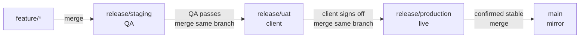
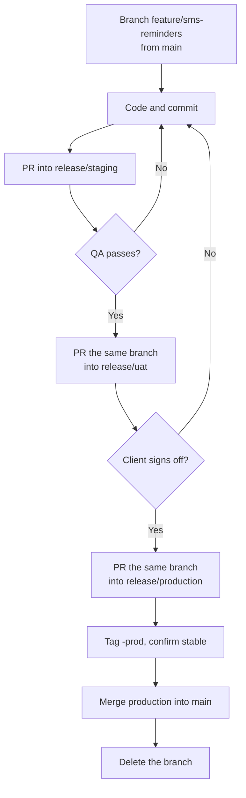
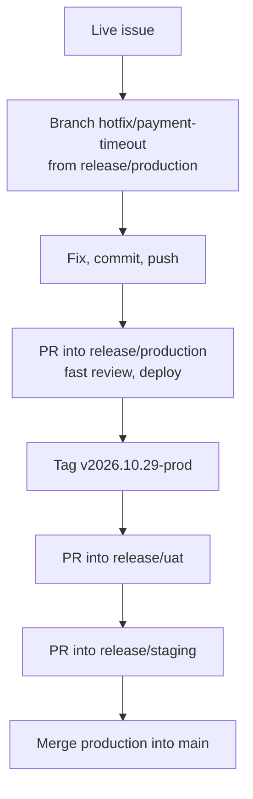

Branching Strategy
==================

> How code gets from your laptop to production. Read [Git Basics](/Git-Guide/Git-Basics) first if branches are new to you.

* * *

## 1. The idea in one picture

Three environments live as permanent branches. A feature doesn't move as one big promoted bundle — it travels on its own branch, merged into each environment branch in turn, gated by whoever signs off that stage. `main` isn't where work happens; it's a mirror that only updates once something is confirmed live.



This is the **environment branch** model (the same family as GitLab Flow), applied feature-by-feature rather than build-by-build. We picked it for a situation we hit all the time:

> The client is testing a build in UAT and has already signed off half of it. Meanwhile QA finds a bug in staging that needs fixing today, and a different feature is ready to go straight to production.

Because each release branch only receives the individual feature branches that have actually cleared its gate, `release/staging`, `release/uat` and `release/production` can legitimately hold different things at the same time. Nothing stalls waiting for an unrelated feature to clear the same gate.

### Why not GitFlow?

GitFlow is built for software where several versions are supported at the same time, like a desktop app where some customers are on v3 and some on v4. We ship one version of each project at a time, so GitFlow would give us extra release branches to manage without solving any problem we actually have.

### Why not promote whole branches?

A tempting alternative is to promote everything in one branch into the next with a single PR — `main` into `staging`, then `staging` into `uat`, and so on. We don't do that, and it's worth saying why: a whole-branch promotion forces every environment to always hold the exact same bundle of features. In practice QA clears some things faster than others, and the client doesn't review on the same schedule as QA. Merging each feature branch in individually, gated at each stage, is what actually matches that reality.

* * *

## 2. The branches

| Branch | Lives | Created from | Receives | What it's for |
| --- | --- | --- | --- | --- |
| `main` | Forever | `release/production` (once, historically) | `release/production`, once a release is confirmed stable | A mirror of what's actually live. The known-good baseline every new `feature/*` branches from. |
| `feature/*` | Temporary | `main` | | One feature, one branch. Merged into `release/staging`, then `release/uat`, then `release/production` as it clears each gate. |
| `release/staging` | Forever | `main` (once, historically) | `feature/*`, `bugfix/*` | Internal QA environment. |
| `release/uat` | Forever | `release/staging` (once, historically) | `feature/*` once QA passes, `bugfix/*` | Client testing environment. |
| `release/production` | Forever | `release/uat` (once, historically) | `feature/*` once the client signs off, `bugfix/*`, `hotfix/*` | Live. |
| `bugfix/*` | Temporary | Wherever the bug was found (`release/staging` or `release/uat`) | | Fixing bugs found in QA or UAT. Propagates onward the same way a feature does. |
| `hotfix/*` | Temporary | `release/production` | | Emergencies in live only. The one branch allowed to skip the queue, merged into `release/production` first. |

### Rules for the long-lived branches

- **Nobody pushes directly** to `main` or any `release/*` branch. Everything goes through a pull request. (The one exception is a solo dev on a small project, see section 6 below.)
- A `feature/*` branch **never** skips a gate. If it hasn't been through `release/staging`, it doesn't go into `release/uat`.
- `release/*` branches and `main` are **never rebased or force-pushed.**
- **Every merge into a release branch is a merge commit — never a squash, never a rebase.** The same feature branch gets merged into `staging`, `uat` and `production` in turn, and Git only recognises "this branch is already in that branch" if the commits are byte-identical across all three. Squashing (or rebasing) at any of those merges gives the branch a new identity each time, which is what causes conflicts that shouldn't exist and history that doesn't line up. See [Pull Requests and Merging](/Git-Guide/Pull-Requests-and-Merging) for the full reasoning and how to still keep history tidy.

* * *

## 3. The normal flow: building a feature

Example: you're adding **SMS appointment reminders** to the clinic booking app.



```bash
git switch main
git pull
git switch -c feature/sms-reminders

# ...work, commit, work, commit...

git push -u origin feature/sms-reminders
# PR 1: feature/sms-reminders → release/staging
```

Once QA is happy on staging:

```bash
# PR 2: feature/sms-reminders → release/uat   (same branch, same commits)
```

Once the client signs off on UAT:

```bash
# PR 3: feature/sms-reminders → release/production   (same branch, same commits)
```

`main` catches up separately, once production is confirmed stable — see section 4.

### Don't delete the branch early

A feature branch is still needed after it merges into `release/staging` — it still has to go into `release/uat` and `release/production`. **Only delete it once it's reached `release/production`.** Deleting it after the first merge is the easiest way to lose track of what still needs to go up, and the [PR template](/Git-Guide/Pull-Requests-and-Merging#pr-template) checklist is there so that's visible before you do.

* * *

## 4. Tracking where a feature has landed, and updating `main`

There's no promotion PR to tell you what's where, because nothing is promoted wholesale. Instead:

### The merge commits are the record

```bash
# Every release branch this feature has already reached
git branch -r --contains feature/sms-reminders

# When it landed in a specific branch
git log release/uat --merges --grep="sms-reminders"
```

Because every merge is a merge commit on an unaltered branch (see section 2), this is always accurate, even if a task falls out of date.

### The task tracker is the human-readable layer

Keep the task updated with which release branches a feature has reached, same as today. It's for people glancing at a board, not the source of truth — the git history above is. The [PR template](/Git-Guide/Pull-Requests-and-Merging#pr-template) checklist is there so updating it isn't something you have to remember separately.

### Updating `main`

Once a release is confirmed stable in `release/production` (and tagged, see [Commits and Naming](/Git-Guide/Commits-and-Naming)), merge `release/production` into `main` with a merge commit. This is usually done by the project lead, not per-feature.

```bash
git switch main
git pull
git merge release/production
git push
```

`main` sitting a step behind `release/production` for a little while is normal. What shouldn't happen is `main` ever being *ahead* of what's actually live.

* * *

## 5. Fixing bugs

A fix is a feature with urgency — it follows the same propagation rule, just starting wherever the bug was found, and skipping the queue if it's already live.

> **Fix it where you found it, then merge the same branch into every environment above it that also needs the fix, the same way a feature would.**

### Example: bug found in staging

QA finds that the booking form accepts dates in the past.

```bash
git switch release/staging
git pull
git switch -c bugfix/past-date-booking

# ...fix, commit...
git push -u origin bugfix/past-date-booking

# PR 1: bugfix/past-date-booking → release/staging
```

It then goes through `release/uat` and `release/production` the same way any feature branch does — gated by QA and the client, same branch, same commits.

### Example: bug found in UAT

The client reports that the reminder SMS shows the wrong clinic name.

1. Branch `bugfix/sms-clinic-name` from `release/uat`
2. PR into `release/uat`, then tag the new build with that day's date, e.g. `v2026.10.27-uat`
3. If `release/staging` already has the affected feature, PR the same branch into `release/staging` too, so staging doesn't regress
4. Continue to `release/production` once the client signs off on the fix

### Example: production is down (hotfix)

Payments are failing in live. This can't wait for the next gate.



The merge-into-`uat`-and-`staging` PRs don't have to happen in the same minute as the fix, but they **do** have to happen the same day. Those environments will otherwise be missing a fix that's already live, and whoever's testing there won't know it.

If the client is in the middle of reviewing UAT, let the project manager know before you merge the hotfix in, since their build will change.

### Why not just fix it in `main`?

`main` only reflects what's confirmed live. Fixing it there first wouldn't get the fix to production any faster, and `main` would briefly claim to mirror a build that doesn't actually exist yet.

* * *

## 6. Small project or big team?

It's the same model for every project, you just switch on more of it as the project grows.

| Project | What to use |
| --- | --- |
| **Solo dev, small project** | Commit straight to `release/production` (and merge to `main` after). Skip `staging`/`uat` and `feature/*`/`bugfix/*`, there's nobody to clash with and no client gate to manage. |
| **Solo dev, client wants to review first** | Turn `release/staging` and `release/uat` back on so the client has a frozen build to review, and tag each one. |
| **Two or more devs** | Turn on `feature/*` and `bugfix/*`. No direct commits to any long-lived branch any more, everything through a PR. |
| **Large or long-running project** | Everything above, plus branch protection on `main` and every `release/*` branch (merge-commit only, no squash/rebase option available), and tag every gate. |

### Branch protection

Every platform can lock a branch so the rules above are enforced rather than just hoped for. It's called **branch policies** in Azure DevOps and **protected branches** on GitHub, GitLab and Bitbucket.

For `main` and every `release/*` branch, turn on:

- No direct pushes, pull request required
- At least one approval
- The build (and tests, if the project has them) must pass
- **Merge commit only** — disable the squash and rebase merge options for these targets, so nobody can do it by habit
- No force-push, no deleting the branch

* * *

## 7. Quick reference

| Situation | Branch from | PR into, in order |
| --- | --- | --- |
| New feature or change | `main` | `release/staging` → `release/uat` → `release/production` |
| Bug found by QA in staging | `release/staging` | `release/staging` → `release/uat` → `release/production` |
| Bug found by the client in UAT | `release/uat` | `release/uat`, back-merge to `release/staging` → `release/production` |
| Emergency in production | `release/production` | `release/production` (deploy first) → `release/uat` → `release/staging` |
| Production confirmed stable | | `release/production` → `main` |

* * *

## Further reading

1.  **GitLab Flow, environment branches**
    [https://about.gitlab.com/topics/version-control/what-is-gitlab-flow/](https://about.gitlab.com/topics/version-control/what-is-gitlab-flow/)
2.  **Pro Git, Branching Workflows**
    [https://git-scm.com/book/en/v2/Git-Branching-Branching-Workflows](https://git-scm.com/book/en/v2/Git-Branching-Branching-Workflows)
