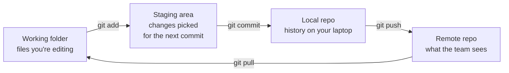
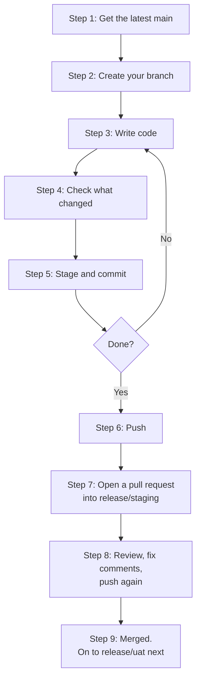

Git Basics
==========

> For anyone new to Git, or who has only used the commit button in their IDE without really knowing what happens underneath. Once you're comfortable here, move on to [Branching Strategy](/Git-Guide/Branching-Strategy).

* * *

## 1. What Git actually is

Git keeps a history of your project. Every time you **commit**, Git takes a snapshot of your files and saves it with a message saying what changed. You can go back to any snapshot, compare two of them, or see who changed a line and why.

Think of it like save points in a game. You play for a bit, save, play some more, save again. If something goes badly wrong you load an earlier save. The difference is that in Git, a whole team shares the same save file without overwriting each other.

### The words you'll hear every day

| Word | What it means | Real example |
| --- | --- | --- |
| **Repository (repo)** | The project folder plus its full history | `clinic-booking-api` |
| **Commit** | One saved snapshot, with a message | `fix: stop double booking on same time slot` |
| **Branch** | A separate line of work. You can change things without touching anyone else's code | `feature/sms-reminders` |
| **`main`** | The main branch. Mirrors what's actually live once a release is confirmed stable | |
| **Remote** | The copy of the repo on the server (Azure DevOps, GitHub...) | Usually called `origin` |
| **Clone** | Download a repo from the remote to your laptop, history included | |
| **Push** | Send your commits from your laptop to the remote | |
| **Pull** | Bring other people's commits from the remote to your laptop | |
| **Pull request (PR)** | Asking for your branch to be merged into another branch, with a review | |
| **Merge** | Combine the changes from one branch into another | |
| **Conflict** | Two people changed the same lines, and Git needs you to pick | |

### Where your changes live

Your changes move through three places before anyone else can see them, and then a fourth when you push.



- **Working folder**: the files as you see them in your editor.
- **Staging area**: a waiting room. You choose which changes go into the next commit. This lets you commit the bug fix and leave your half-done experiment out.
- **Local repo**: your commits, saved on your laptop only. Nobody else can see them yet.
- **Remote repo**: after you push, the team can see and pull your commits.

The thing that trips people up most: **committing is not the same as pushing.** If your laptop dies before you push, those commits are gone.

### What a branch looks like

A branch is just a pointer to a commit. When you create a branch and commit on it, `main` stays where it was.

```
main:                A --- B --- C
                                  \
feature/sms-reminders:             D --- E
```

You made commits `D` and `E` on your branch. `main` still ends at `C`. When the PR is merged, your work joins `main`.

* * *

## 2. First-time setup

Do this once on every new laptop.

### Install

- **Mac**: `brew install git`, or install Xcode Command Line Tools (`xcode-select --install`).
- **Windows**: install [Git for Windows](https://git-scm.com/download/win). It comes with Git Bash and Git Credential Manager.
- **Linux**: `sudo apt install git` (or your distro's package manager).

Check it worked:

```bash
git --version
```

### Tell Git who you are

Every commit is stamped with this name and email. Use your company email.

```bash
git config --global user.name "Your Name"
git config --global user.email "you@trinergydigital.com"
```

### Settings we recommend

```bash
# New repos start on "main" instead of "master"
git config --global init.defaultBranch main

# When you pull, put your local commits on top instead of making a merge commit
git config --global pull.rebase true

# Line endings (pick the one for your OS)
git config --global core.autocrlf input   # Mac / Linux
git config --global core.autocrlf true    # Windows

# The editor Git opens for commit messages (pick one)
git config --global core.editor "code --wait"   # VS Code
git config --global core.editor "nano"          # nano
git config --global core.editor "vim"           # vim
```

The line ending setting matters because our team uses both Mac and Windows. Without it, a Windows machine can change every line in a file just by saving it, and the PR shows 400 changed lines when you only touched one.

Set the editor even if you normally commit from your IDE. Git opens it for commit messages, and also during rebases and merges. If you skip this, you'll usually get `vim`, and plenty of people have got stuck there not knowing how to quit (it's `Esc`, then `:wq`, then Enter).

`pull.rebase` is explained in [Pull Requests and Merging](/Git-Guide/Pull-Requests-and-Merging). For now, just know it keeps history cleaner.

### Connecting to the remote

You need to prove who you are when you push or pull. There are two ways, and both are fine:

| Option | How it works | Good for |
| --- | --- | --- |
| **HTTPS + credential manager** | You sign in once through the browser, and the credential manager remembers you | Easiest to set up. Default on Windows. |
| **SSH key** | You generate a key on your laptop and add the public half to your account on the platform | Never asks for a password again. Works well on Mac and Linux. |

To set up SSH:

```bash
ssh-keygen -t ed25519 -C "you@trinergydigital.com"
# Press Enter to accept the default location, and set a passphrase

cat ~/.ssh/id_ed25519.pub
# Copy the output and paste it into SSH keys in your account settings on the platform
```

Some platforms also let you use a **personal access token** as a password over HTTPS. If you do, give it an expiry date and only the permissions you need. Treat it like a password.

* * *

## 3. The daily workflow

A real example. Your task: **add a "Forgot password?" link to the login page** of the clinic booking app.



### Step 1: get the latest `main`

```bash
git switch main
git pull
```

Always start from an up-to-date `main`. If you start from last week's version, you're building on old code and will get conflicts later.

### Step 2: create your branch

```bash
git switch -c feature/forgot-password-link
```

`-c` means create. You're now on your own branch, and nothing you do here affects `main`.

### Step 3: write code

Make your changes in the editor as normal.

### Step 4: check what changed

```bash
git status
```

```
On branch feature/forgot-password-link
Changes not staged for commit:
        modified:   src/pages/Login.tsx
        modified:   src/i18n/en.json

Untracked files:
        src/components/ForgotPasswordLink.tsx
```

- **modified** means Git knows this file and it has changed.
- **untracked** means a new file Git has never seen.

To see the actual line changes:

```bash
git diff
```

Read through your own diff before you commit. This is where you catch the `console.log` you forgot to remove.

### Step 5: stage and commit

```bash
git add src/pages/Login.tsx src/i18n/en.json src/components/ForgotPasswordLink.tsx
git commit
```

Git opens your editor. Write the message, save, and close the file, and the commit is made. Close without writing anything and the commit is cancelled.

```
feat: add forgot password link to login page

Links to the existing reset flow, which was only reachable
from the email sent after three failed logins.
```

Please don't use `git commit -m "message"`. It pushes you towards one-line messages with no body, which doesn't work well with [Conventional Commits](/Git-Guide/Commits-and-Naming), and quotes and special characters in the message can cause problems in the shell. In the editor you get the full message, and most editors show the 50 character guide for the first line.

You can use `git add .` to stage everything, but only after `git status` shows nothing you don't want to commit.

Commit whenever you finish a small piece that works. Several small commits are better than one big "did everything" commit at the end of the day. See [Commits and Naming](/Git-Guide/Commits-and-Naming) for how to write the message.

### Step 6: push

The first time you push a new branch:

```bash
git push -u origin feature/forgot-password-link
```

`-u` links your local branch to the remote one. After that, just `git push`.

### Step 7 onwards: pull request

Open a PR from your branch into `release/staging` on the platform (new feature work doesn't land in `main` directly — see [Branching Strategy](/Git-Guide/Branching-Strategy) for why). Someone reviews it, you fix any comments, commit, push again, and the PR updates by itself. Once it's approved and merged, the branch isn't done yet — it still needs to go into `release/uat` and `release/production` the same way. See [Pull Requests and Merging](/Git-Guide/Pull-Requests-and-Merging).

* * *

## 4. Commands you'll use every day

| I want to... | Command |
| --- | --- |
| Download a repo | `git clone <url>` |
| See what's changed | `git status` |
| See the actual line changes | `git diff` (unstaged) / `git diff --staged` (staged) |
| Stage a file | `git add <file>` |
| Stage everything | `git add .` |
| Commit | `git commit` (opens your editor) |
| Get the latest from the remote | `git pull` |
| Send my commits | `git push` |
| See all branches | `git branch -a` |
| Switch branch | `git switch <branch>` |
| Create a branch and switch to it | `git switch -c <branch>` |
| See history | `git log --oneline --graph` |
| See who changed a line | `git blame <file>` |
| Put work aside for a moment | `git stash` / `git stash pop` |
| Throw away changes to one file | `git restore <file>` |

You'll see `git checkout` in older tutorials. It does the same as `switch` and `restore` but mixes several jobs into one command, which is why the newer ones exist. Both work.

* * *

## 5. The `.gitignore` file

`.gitignore` tells Git which files to never track. Every repo needs one, set up on day one. Most frameworks generate a good starting file. You can also grab a template from [github.com/github/gitignore](https://github.com/github/gitignore).

### Never commit these

| Type | Examples |
| --- | --- |
| Secrets and environment files | `.env`, `.env.local`, `appsettings.Development.json` with real keys, `*.pem`, `*.p12`, `google-services.json` with live keys |
| Dependencies | `node_modules/`, `vendor/`, `Pods/`, `.dart_tool/` |
| Build output | `dist/`, `build/`, `bin/`, `obj/`, `.next/`, `*.apk`, `*.ipa` |
| Logs and cache | `*.log`, `storage/logs/`, `.cache/`, `.turbo/` |
| Test output | `coverage/`, `test-results/`, `playwright-report/` |
| User uploads and exports | `storage/app/public/uploads/`, generated CSV or Excel files |
| OS and editor junk | `.DS_Store`, `Thumbs.db`, `.idea/` (most of it) |
| Backups and temp files | `*.bak`, `*.tmp`, `*.swp` |

Test *code* does get committed. It's the test *output* (coverage reports, screenshots, result files) that doesn't.

### Do commit these

- `.env.example` with every variable the app needs and dummy values. New devs copy it to `.env`.
- Lockfiles: `package-lock.json`, `yarn.lock`, `composer.lock`, `pubspec.lock`.
- Shared editor settings the team agreed on, like `.editorconfig` or `.vscode/extensions.json`.

### Already committed something by mistake?

Adding it to `.gitignore` afterwards isn't enough, because Git keeps tracking files it already knows about. Remove it from tracking (this keeps it on your disk):

```bash
git rm --cached .env
git commit
# Message: chore: stop tracking .env
```

If it was a secret, that's not enough either. See [Undo and Recovery](/Git-Guide/Undo-and-Recovery#i-pushed-a-password-or-api-key).

* * *

## 6. GUI or command line?

Use whatever you like. VS Code's source control panel, the JetBrains Git tools, SourceTree, Fork and GitHub Desktop are all fine for everyday work, and they're often clearer for looking at diffs and resolving conflicts.

But learn the commands on this page anyway. GUIs hide what's happening, and when something goes wrong the error message will talk in Git terms. It's also what everyone else will ask you to run when they help you.

* * *

## Further reading

1.  **Pro Git book** (free, the official one), chapters 1 to 3 cover everything above in more depth
    [https://git-scm.com/book/en/v2](https://git-scm.com/book/en/v2)
2.  **Learn Git Branching**, an interactive visual game that's very good for understanding branches
    [https://learngitbranching.js.org/](https://learngitbranching.js.org/)
3.  **gitignore templates**
    [https://github.com/github/gitignore](https://github.com/github/gitignore)
