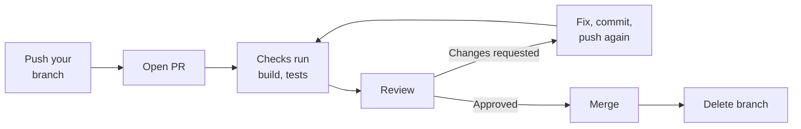

Pull Requests and Merging
=========================

> Opening a PR, keeping your branch up to date (merge), which merge option to pick (merge commit, everywhere — never squash a release branch), and dealing with conflicts. For how to *review* a PR, see [Code Review](/Code-Review).

* * *

## 1. Pull requests

Every change to `main` or a `release/*` branch goes through a pull request. It's the point where someone else looks at your code before it becomes everyone's code.



### Before you open it

- [ ] Your branch is up to date with its target (see the next section)
- [ ] It builds and runs locally
- [ ] You've read your own diff from top to bottom
- [ ] No `console.log`, `dd()`, commented-out code or debug leftovers
- [ ] No unrelated changes. If you fixed something else along the way, that's a separate PR.

### Title and description

The title follows the same format as a commit message: `feat: add SMS appointment reminders`.

Use the [PR template](#pr-template) below for the description. It covers the same four questions as [Code Review](/Code-Review) (what changed, why, how you checked it, anything the reviewer should know), plus a checklist for which release branches this feature still needs to reach — see [Branching Strategy](/Git-Guide/Branching-Strategy) for why that matters. Add screenshots or a short screen recording for anything visual.

### Keep it small

A 200-line PR gets a proper review. A 2,000-line PR gets a quick look and an approval. If your feature is big, split it into several PRs that each make sense on their own, for example the database changes first, then the API, then the UI.

### After it's merged

A `feature/*` or `bugfix/*` branch usually isn't done after one merge — it still has to go into the next environment up. **Only delete the branch once it's reached `release/production`** (see [Branching Strategy](/Git-Guide/Branching-Strategy)). Once it has:

```bash
git switch main
git pull
git branch -d feature/sms-reminders
```

* * *

## PR template

Copy this into your repo as `.github/PULL_REQUEST_TEMPLATE.md` (GitHub), `.azuredevops/pull_request_template.md` (Azure DevOps), or `.gitlab/merge_request_templates/Default.md` (GitLab) so it's pre-filled every time.

```markdown
## What changed?


## Why?


## How was it checked?


## Anything the reviewer should know?
(risks, assumptions, unusual design decisions)

## Release branches

- [ ] release/staging
- [ ] release/uat
- [ ] release/production

- [ ] Task updated with where this has landed

## Before merging

- [ ] Builds and runs locally
- [ ] No debug leftovers (console.log, dd(), commented-out code)
- [ ] No unrelated changes
- [ ] Merge commit only — do not squash or rebase this PR
```

Tick the release-branch boxes as this same branch clears each one — the PR into `release/staging` starts with none ticked, the PR into `release/uat` should already show `staging` ticked, and so on. It's a visible, shared version of the tracking described in [Branching Strategy](/Git-Guide/Branching-Strategy) — the merge commits are still the source of truth, this is just so nobody has to go looking for them.

* * *

## 2. Keeping your branch up to date

While you're working, `main` can move if a release goes live, and hotfixes can land in `release/*` branches at any time. The longer you wait to bring those in, the bigger the conflicts get.

**Rule of thumb:** sync with `main` at least once a day, and always right before you open a PR.

**Our baseline: merge `main` into your branch to keep it up to date, then land every PR with a merge commit.** It's the simplest setup that's hard to get wrong, and it's what keeps the same branch mergeable into `staging`, `uat` and `production` in turn — see [Which merge option to pick](#3-which-merge-option-to-pick).

### How to do it: merge `main` into your branch

Merge brings `main` into your branch as one new "merge commit". Your existing commits stay exactly as they are.

```
main:     A --- B --- C --- D        (C and D are other people's work)
               \             \
yours:          E --- F ----- M       (M is the merge commit)
```

```bash
git fetch origin
git merge origin/main
# Fix any conflicts, git add, git commit
git push
```

### Why merge, not rebase

- **Nothing gets rewritten.** Your commits keep their IDs, so a normal `git push` works. No force-pushing, no risk of wiping out someone else's work.
- **You fix each conflict once.** A merge looks at the end result of both sides, not every commit one by one.
- **It's safe on a shared branch.** If a teammate is on the same branch, they just pull.
- **It doesn't create a second version of your commits.** Since we never squash or rebase a release-branch merge (see [Which merge option to pick](#3-which-merge-option-to-pick)), the same commits need to stay identical from the moment you first push them to the moment they reach `release/production`. Rebasing to "clean up" after you've already shared the branch would break that.

Rebase is still a useful tool once you're comfortable with Git, but it rewrites history and has a few traps. It's covered, pitfalls and all, in section 1 of [Advanced Git](/Git-Guide/Advanced-Git). If you're not sure, merge.

**Never rebase `main` or any `release/*` branch.** Everyone's work is built on top of those, and rewriting them breaks everyone's local copy.

### What `pull.rebase true` does

If you followed the setup in [Git Basics](/Git-Guide/Git-Basics), `git pull` rebases your *unpushed* local commits on top of what's on the remote. That's why you don't get a pointless `Merge branch 'main' of ...` commit every time you pull. It's the one kind of rebase that's always safe, because those commits haven't been shared with anyone yet.

This only affects `git pull` (the same branch, local vs remote). Bringing `main` into your feature branch is still a `git merge origin/main`, as above.

* * *

## 3. Which merge option to pick

When you complete a PR, the platform asks you how to merge it. The names change from one platform to another, but the options are the same:

| What it does | Azure DevOps | GitHub | GitLab |
| --- | --- | --- | --- |
| All your commits become **one commit** on the target | Squash commit | Squash and merge | Squash commits (tick box) |
| Keeps your commits and adds a **merge commit** | Merge (no fast forward) | Create a merge commit | Merge commit |
| Replays your commits on top, no merge commit | Rebase and fast-forward | Rebase and merge | Fast-forward merge |

### What we use

| PR | Merge option | Why |
| --- | --- | --- |
| `feature/*` → `release/staging` | **Merge commit** | This is the first of (usually) three merges for the same branch — see below. |
| `feature/*` → `release/uat` | **Merge commit** | Same branch, same commits as the staging merge. |
| `feature/*` → `release/production` | **Merge commit** | Same branch, same commits as the previous two. |
| `release/production` → `main` | **Merge commit** | Keeps `main` an honest mirror of what's live. |
| `bugfix/*` and `hotfix/*` → any branch | **Merge commit** | The same fix branch goes into several branches, same reasoning as a feature. |

**Why merge commits for everything, and never squash a release-branch PR?** A squash (or a rebase) creates brand-new commits that Git doesn't recognise as the same work. Since the same `feature/*` branch gets merged into `release/staging`, then `release/uat`, then `release/production` in turn, every one of those merges needs Git to recognise "this branch is already in that branch." Squash the first merge and the second one can't tell — Git sees two unrelated sets of changes to the same lines, which is exactly where the "conflicts that come from nowhere" come from. A merge commit keeps the real history, so Git always knows what's already been brought across, no matter how many branches the same feature lands in.

Turn this on in branch protection if the platform allows it — disable the squash and rebase merge buttons entirely on `main` and every `release/*` branch, so merge commit is the only option. See [Branching Strategy](/Git-Guide/Branching-Strategy) for the full branch-protection checklist.

### So when do I squash?

Only on your own branch, before it's ever shared anywhere — never through the platform's merge button. If your local history has a string of `wip` commits, tidy it up with an interactive rebase (`git rebase -i origin/main`) before you open the first PR. See [Advanced Git](/Git-Guide/Advanced-Git) for how. That's a one-time cleanup: once the branch has been merged into `release/staging`, its commits are shared, so don't rewrite them again — just keep adding new commits for any follow-up fixes QA or the client ask for.

* * *

## 4. Merge conflicts

A conflict happens when two branches changed the same lines and Git can't tell which version you want. It isn't an error. Git is just asking you to decide.

### What one looks like

```tsx
<<<<<<< HEAD
const REMINDER_HOURS_BEFORE = 24;
=======
const REMINDER_HOURS_BEFORE = 48;
>>>>>>> feature/sms-reminders
```

- Between `<<<<<<<` and `=======` is the version on the branch you're on.
- Between `=======` and `>>>>>>>` is the version coming in.

You edit the file so it contains what it *should* be (one of them, both, or something new), delete the marker lines, and save.

### Resolving one step by step

```bash
git status                  # lists the files with conflicts ("both modified")
# open each file, fix it, remove the markers
git add src/config/reminders.ts
git rebase --continue       # if you were rebasing
git commit                  # if you were merging
```

Your editor makes this much easier. VS Code and JetBrains both show the two versions side by side with "Accept current / Accept incoming / Accept both" buttons. Use them.

Changed your mind half-way? Nothing is lost:

```bash
git merge --abort      # or
git rebase --abort
```

### Who resolves it

Only resolve a conflict yourself if you understand **both** sides. If the other side is someone else's code:

1. Ask the person who wrote the other change. Five minutes on a call beats a subtle bug in production.
2. If they're not around, ask the project lead or someone who knows that part of the code.
3. Never pick "accept mine" for everything just to make the conflict go away. That quietly deletes someone else's work.

### Resolving on a temporary branch

For a big or risky conflict, like merging a feature into `release/uat` or back-merging a hotfix, don't resolve it directly on the target. Resolve it on a temporary branch so you can build and test first:

```bash
git switch release/staging
git pull
git switch -c merge/hotfix-into-staging
git merge hotfix/payment-timeout
# resolve conflicts, build, test
git push -u origin merge/hotfix-into-staging
# PR: merge/hotfix-into-staging → release/staging
```

If it goes wrong, you delete the temporary branch and nothing shared was touched.

### Avoiding conflicts in the first place

- Sync with `main` every day.
- Keep branches short-lived. A branch open for three weeks will conflict. A branch open for three days usually won't.
- Talk to each other. If two of you are about to change the same file, agree who goes first.
- Don't reformat files you aren't otherwise changing. It causes conflicts for anyone else working in them.
- If you keep resolving the *same* conflict as a feature branch makes its way into `staging`, `uat` and `production` in turn, turn on `git config --global rerere.enabled true`. It remembers how you resolved a conflict and reapplies that resolution automatically next time Git sees the exact same one — it won't invent new resolutions, just save you redoing ones you've already made.

### After every merge, test

Even if there were no conflicts. Git only checks whether the *text* fits together. It can't tell you that your function now calls something a teammate renamed. Build it, run the tests, and click through the feature.

* * *

## 5. Two people, one branch

Sometimes two devs work on the same feature branch, when the work is closely tied together or during pair programming. That's fine, with a few changes to the usual habits:

- **Don't rebase or force-push** the shared branch. Stick to the merge baseline from section 2.
- **Pull before you start, push when you stop.** Several times a day, not once.
- **Don't push anything that breaks the build.** Your partner pulls it and is suddenly stuck.
- **Split the work by file or area** where you can, and tell each other when you're about to touch something shared.

* * *

## Further reading

1.  **Pro Git, Rebasing** (including "the perils of rebasing")
    [https://git-scm.com/book/en/v2/Git-Branching-Rebasing](https://git-scm.com/book/en/v2/Git-Branching-Rebasing)
2.  **Pro Git, Basic Merge Conflicts**
    [https://git-scm.com/book/en/v2/Git-Branching-Basic-Branching-and-Merging](https://git-scm.com/book/en/v2/Git-Branching-Basic-Branching-and-Merging)
