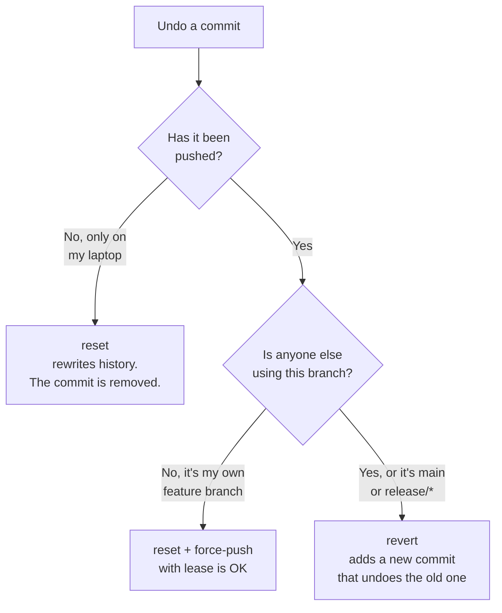
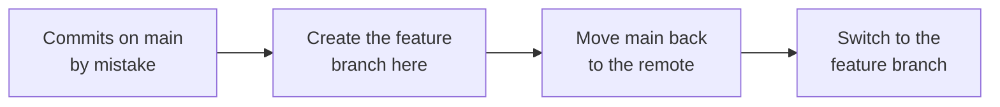

Undo and Recovery
=================

> Something went wrong. Don't panic. Almost everything in Git can be undone, and committed work is very hard to lose for good.
>
> **One rule before anything else:** if the mistake is on `main` or a `release/*` branch, or you're about to force-push anything shared, stop and ask your lead first. It's much easier to fix together than to fix a fix.

* * *

## Find your situation

| What happened | Pushed yet? | Go to |
| --- | --- | --- |
| I want to throw away changes I haven't committed | No | [Discard uncommitted changes](#discard-uncommitted-changes) |
| I staged a file I didn't mean to | No | [Unstage a file](#unstage-a-file) |
| Typo in my last commit message | No | [Fix the last commit](#fix-the-last-commit) |
| I forgot to add a file to my last commit | No | [Fix the last commit](#fix-the-last-commit) |
| I want to undo my last commit | No | [Undo an unpushed commit](#undo-an-unpushed-commit) |
| I want to undo a commit | Yes | [Undo a pushed commit](#undo-a-pushed-commit) |
| I committed to `main` instead of my feature branch | No | [Committed to the wrong branch](#committed-to-the-wrong-branch) |
| I started coding on the wrong branch (not committed) | No | [Committed to the wrong branch](#committed-to-the-wrong-branch) |
| I merged into the wrong branch | Yes | [Undo a merge](#undo-a-merge) |
| A pull or merge left everything in a mess | No | [Get out of a merge or rebase](#get-out-of-a-merge-or-rebase) |
| My commits disappeared (bad reset, deleted branch) | Either | [Get lost commits back](#get-lost-commits-back) |
| Git says "detached HEAD" | Either | [Detached HEAD](#detached-head) |
| I pushed a password or API key | Yes | [I pushed a password or API key](#i-pushed-a-password-or-api-key) |

* * *

## Revert vs reset: the one thing to understand

There are two ways to undo a commit, and picking the wrong one is how small mistakes become big ones.



- **`git reset`** moves the branch back, as if the commit never happened. Fine for work nobody else has.
- **`git revert`** keeps history and adds a new commit that does the opposite. Always safe, because nobody else's copy breaks.

**Once something's on a shared branch, it's revert. Every time.**

* * *

## Discard uncommitted changes

Throw away changes to one file, back to how it was at the last commit:

```bash
git restore src/pages/Login.tsx
```

Throw away all changes to tracked files:

```bash
git restore .
```

Also delete new files you created that were never committed:

```bash
git clean -n     # shows what would be deleted, check it first
git clean -fd    # actually deletes
```

⚠️ This is one of the few things in Git you can't undo. Uncommitted changes were never saved, so there's nothing to get back. If you're not sure, `git stash` instead. That keeps a copy.

* * *

## Unstage a file

You ran `git add .` and it picked up something you didn't want:

```bash
git restore --staged config/local-settings.json
```

The file keeps your changes. It's just not going into the next commit.

* * *

## Fix the last commit

Only if it **hasn't been pushed** (or it's your own branch and you're fine force-pushing).

Change the message:

```bash
git commit --amend
```

Your editor opens with the old message. Change it, save, and close.

Add a file you forgot:

```bash
git add src/validators/bookingDate.ts
git commit --amend --no-edit
```

`--amend` replaces the last commit with a new one. If it was already pushed to your own branch, follow up with `git push --force-with-lease`.

* * *

## Undo an unpushed commit

Undo the last commit and **keep the changes** so you can redo it properly:

```bash
git reset --soft HEAD~1
```

Your changes are back in the staging area, as if you'd just run `git add`.

Undo the last commit and **throw the changes away**:

```bash
git reset --hard HEAD~1
```

`HEAD~1` means "one commit back". Use `HEAD~3` for three.

* * *

## Undo a pushed commit

```bash
git log --oneline               # find the commit
# 7a8b9c0 feat: change reminder to 48 hours

git revert 7a8b9c0
git push
```

This adds a new commit, `Revert "feat: change reminder to 48 hours"`, which undoes the change. The original is still in history, and that's fine.

On `main` or `release/*` you can't push directly, so do the revert on a branch and open a PR like any other change. Most platforms also have a **Revert** button on a completed PR that does all of this for you.

* * *

## Committed to the wrong branch

### You committed on `main` instead of a feature branch (not pushed)



```bash
git branch feature/sms-reminders        # new branch pointing at your commits
git reset --hard origin/main            # move main back to match the remote
git switch feature/sms-reminders        # your commits are all here
```

### You haven't committed yet, just started coding on the wrong branch

Easy. Uncommitted changes go with you when you switch:

```bash
git switch -c feature/sms-reminders
```

If Git refuses to switch because of a conflict, stash first:

```bash
git stash
git switch feature/sms-reminders
git stash pop
```

### You committed on the wrong feature branch

Copy the commit to the right branch, then remove it from the wrong one:

```bash
git switch feature/right-branch
git cherry-pick 4d5e6f7

git switch feature/wrong-branch
git reset --hard HEAD~1         # only if not pushed
```

* * *

## Undo a merge

You merged something into the wrong branch and it's already pushed. Revert the merge commit:

```bash
git revert -m 1 <merge-commit-id>
```

`-m 1` tells Git to keep the side you merged *into* and undo what came in.

⚠️ There's a catch. After reverting a merge, Git remembers the branch as already merged. If you later want to merge that same branch properly, Git will think there's nothing new and bring in nothing. You'll need to revert the revert first. This is exactly the kind of thing to do together with your lead.

* * *

## Get out of a merge or rebase

In the middle of a merge or rebase and it's gone wrong? Go back to how things were before you started:

```bash
git merge --abort
git rebase --abort
git cherry-pick --abort
```

Already finished the merge or pull and don't like the result?

```bash
git reset --hard ORIG_HEAD
```

`ORIG_HEAD` is where your branch was before the last merge, pull or rebase. Only do this if you haven't pushed the result.

* * *

## Get lost commits back

You ran `git reset --hard` too far, deleted a branch that wasn't merged, or a rebase ate your work. The commits are almost certainly still there. Git keeps a log of everywhere your branches have pointed for the last 90 days or so.

```bash
git reflog
```

```
3c4d5e6 HEAD@{0}: reset: moving to HEAD~3
9f8e7d6 HEAD@{1}: commit: feat: add reminder settings page
a1b2c3d HEAD@{2}: commit: feat: add SMS reminder service
...
```

Find the last line before things went wrong. Here that's `9f8e7d6`. Put it on a new branch so it's safe:

```bash
git switch -c rescue/reminder-work 9f8e7d6
```

Look around, check it's what you want, then merge it or reset your branch to it.

The reflog only lives on your laptop, and it only knows about things you *committed*. Uncommitted changes that you threw away can't be recovered this way. One more reason to commit often.

* * *

## Detached HEAD

```
You are in 'detached HEAD' state...
```

You checked out a commit or a tag directly instead of a branch. Nothing is broken. You're just not on a branch.

- **Only looking around?** Go back with `git switch main`.
- **Made commits you want to keep?** Put them on a branch before you switch away, or they'll be hard to find:

```bash
git switch -c feature/work-from-old-release
```

Already switched away and lost them? See [Get lost commits back](#get-lost-commits-back).

* * *

## I pushed a password or API key

This one's different. **Removing it from the code isn't enough.** The key is in Git history, and anyone with access to the repo (or any clone of it) can find it.

Do this, in this order:

1. **Tell your lead straight away.** It's not about blame. It's about how fast the key gets changed.
2. **Rotate the key.** Generate a new one in the service (payment gateway, SMS provider, database) and cancel the old one. This is the step that actually fixes the problem.
3. **Update the new key** wherever the app reads it from (environment variables, pipeline secrets, key vault).
4. **Remove it from the code**, move it to `.env`, and make sure `.env` is in `.gitignore`.
5. **Check the service's logs** for any use of the old key since it was pushed.

Rewriting history to remove the key completely (with tools like `git filter-repo`) is possible, but it affects everyone's copy of the repo and has to be coordinated by the lead. It's never a substitute for rotating the key.

See [General Principles](/Coding-Standards/General-Principles) for how we handle secrets.

* * *

## When to stop and ask

Ask before you:

- Force-push to anything other than your own feature branch
- Reset or revert anything on `main` or `release/*`
- Delete a tag or a branch you didn't create
- Rewrite history on a repo others are using

Asking takes five minutes. Untangling a force-pushed `release/production` takes the afternoon.

* * *

## Further reading

1.  **Pro Git, Undoing Things**
    [https://git-scm.com/book/en/v2/Git-Basics-Undoing-Things](https://git-scm.com/book/en/v2/Git-Basics-Undoing-Things)
2.  **Pro Git, Reset Demystified**
    [https://git-scm.com/book/en/v2/Git-Tools-Reset-Demystified](https://git-scm.com/book/en/v2/Git-Tools-Reset-Demystified)
3.  **Oh Shit, Git!?!** (a well known list of quick fixes, mild language)
    [https://ohshitgit.com/](https://ohshitgit.com/)
