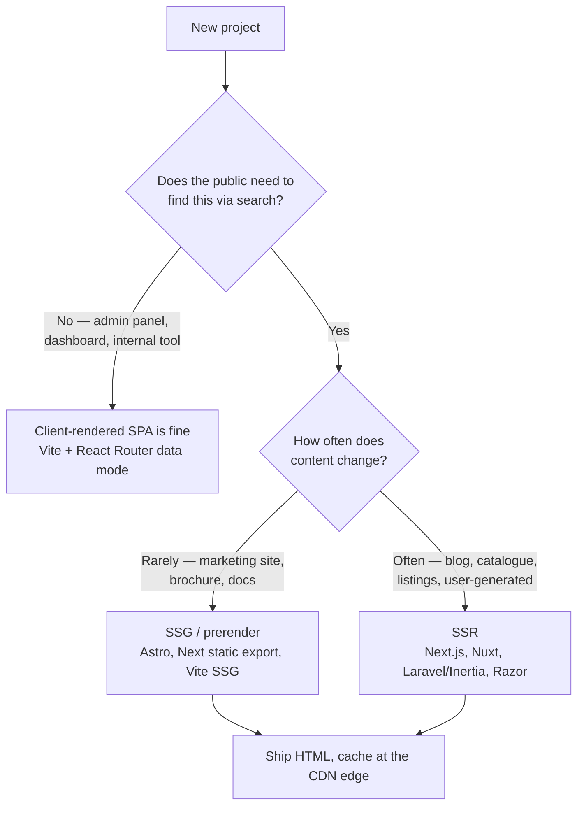

# SEO Standard

*What a developer is responsible for when a client's site has to rank. The do's, the don'ts, and the parts that are genuinely not our job.*

SEO is often treated as something a content team bolts on after the build. It isn't. Most of what decides whether a client's site can rank at all is decided by us, in code, before a single line of copy is written: how the page is rendered, what lands in the initial HTML response, and how fast it becomes usable on a mid-range phone. Titles, meta descriptions and sitemaps still matter — they're just the easy part.

Read this before you scaffold a public-facing site. Retrofitting SEO onto a client-rendered SPA six weeks before launch is the single most expensive mistake on this list.

---

## At a Glance — the non-negotiables

If you do nothing else on a public marketing/content site, do these ten.

| # | Requirement | Why it's non-negotiable |
|---|---|---|
| 1 | Content is in the **initial HTML response** (SSR or SSG) | Crawlers and AI assistants read raw HTML first. A blank `<div id="root">` ranks for nothing. |
| 2 | Every page/screen has its **own real URL** and returns the right status code | No URL, no index. A 200 on a "not found" page poisons the index. |
| 3 | Unique `<title>` and `<meta name="description">` **per route** | Site-wide duplicates are the most common audit finding we hit. |
| 4 | One `<h1>`, then semantic `<h2>`/`<h3>` in document order | Structure is how both crawlers and screen readers parse a page. |
| 5 | `rel="canonical"` on every page | Kills duplicate-content dilution from query strings, trailing slashes, `www`. |
| 6 | Images: modern format, explicit `width`/`height`, real `alt` | Biggest single lever on LCP and CLS. |
| 7 | **Core Web Vitals green** — LCP < 2.5s, INP < 200ms, CLS < 0.1 (p75) | Measured on real users, not your laptop. |
| 8 | `robots.txt` + XML sitemap, correct on prod **and** locked down on staging | A crawlable staging site can outrank the client's real one. |
| 9 | Open Graph + Twitter Card tags | Controls how the client's marketing team's links look when shared. |
| 10 | Search Console + analytics verified **before** launch, not after | Without a baseline you can't prove the migration didn't tank traffic. |

> **Rule of thumb:** view-source the page — not DevTools' Elements panel, actual `Ctrl+U` view-source. If the content you want ranked isn't in there, it doesn't reliably exist for search.

---

## I. Rendering — the decision that comes first

Our default frontend stack is [React + Vite + React Router in data mode](/Tech-Stack/Frontend-Stack) — a client-rendered SPA. **That default is correct for admin panels, dashboards and authenticated apps. It is the wrong default for anything that has to rank.**

Google can execute JavaScript, but rendering is queued, rate-limited and fragile: it happens after the initial crawl (sometimes hours or days later), only a fraction of crawled URLs make it through the render queue, and one uncaught JS error silently aborts the render with no log you'll ever see. Worse, the crawlers behind AI assistants (OpenAI, Anthropic, Perplexity) largely **do not** execute JavaScript at all — they fetch raw HTML. If you want a client cited in an AI answer, the content has to be in the HTML response.



| ✅ Do | ❌ Don't |
|---|---|
| Pick SSR or SSG **at kickoff**, when the stack is chosen | Build a CSR SPA and plan to "add SEO later" |
| Use SSG/prerender for marketing sites — cheapest, fastest, cacheable | Reach for SSR complexity when the content is static |
| Server-render the content, hydrate for interactivity | Ship content that only appears after a `useEffect` fetch |
| Keep Laravel/Blade or Razor server-rendering where the project already does | Rewrite a perfectly good server-rendered CMS site as an SPA "for the DX" |
| Treat the API-driven admin panel and the public site as **two different rendering decisions** | Assume one rendering strategy fits the whole repo |
| | Use **dynamic rendering** (serving crawlers a different prerendered page) — Google explicitly deprecated it as a workaround and it carries cloaking risk |

> **Note — the honest middle ground:** if a public site is already built as a CSR SPA and rebuilding isn't on the table, prerendering the stable routes to static HTML at build time is a legitimate bridge. It's a patch, not the standard. Flag the debt in writing to the account lead so the client understands the ceiling.

---

## II. HTML the crawler can actually read

### Titles

```html
<title>Commercial Fire Insurance | Acme Insurance Malaysia</title>
```

| ✅ Do | ❌ Don't |
|---|---|
| Unique per route, primary topic first, brand last | Ship `<title>Home</title>` or the framework's default `Vite + React` |
| Keep it ~50–60 characters so it isn't truncated | Stuff keywords — `Insurance Malaysia \| Insurance KL \| Best Insurance` |
| Set it per-route via the framework's head API (`next/head`, `@unhead`, `react-helmet-async`, Blade section) | Set it once in `index.html` and let every route inherit it |
| Accept that Google may rewrite your title — write for humans anyway | Try to game the rewrite |

### Meta description

Not a ranking factor. It **is** the ad copy in the result, and it drives click-through.

| ✅ Do | ❌ Don't |
|---|---|
| ~150–160 characters, describes the page, reads like a sentence | Duplicate the same description across every page |
| Let the CMS author override it per page | Auto-generate from the first 160 chars of body text and call it done |
| Leave it out rather than write junk — Google will pull a snippet | Keyword-stuff it |

### Headings and semantics

| ✅ Do | ❌ Don't |
|---|---|
| Exactly one `<h1>` per page, matching what the page is about | Use `<h1>` for the logo on every page |
| Nest `h2` → `h3` in order | Skip levels, or pick heading tags for their font size |
| Use `<nav>`, `<main>`, `<article>`, `<header>`, `<footer>`, `<button>`, `<a>` | Build the entire page from `<div>` and `onClick` |
| Put text in the DOM as text | Put content in `<canvas>`, in an image, or in a CSS `content:` property — none of it is indexed |
| Use `<a href="/real-url">` for navigation | Use `<div onClick={() => navigate('/x')}>` — it isn't a crawlable link |

> **Tip:** semantic HTML is where SEO and accessibility are the same work. Landmarks, real buttons, alt text, and focus order pay off twice. If your Lighthouse accessibility score is poor, your SEO foundation is usually poor too.

### Content in text form

Generative AI features and classic crawlers both rely on text. Anything you express only visually — a price inside a hero image, a spec sheet as a PDF screenshot, key info spoken in a video — is invisible. Give videos transcripts, give infographics a text summary, give data an HTML table.

---

## III. URLs, status codes and canonicals

| ✅ Do | ❌ Don't |
|---|---|
| `/services/fire-insurance` — lowercase, hyphenated, descriptive | `/page?id=4812&cat=7` or `/Services/Fire_Insurance` |
| Every screen worth finding gets a real, linkable, shareable URL | Hash routes (`/#/services`) — fragments aren't separate URLs |
| Return **404** for missing pages, **410** for permanently gone, **200** only for real content | "Soft 404s" — a 200 response rendering "Page not found" |
| **301** for permanent moves, **302** only for genuinely temporary ones | Chains — `/a → /b → /c → /d`. Point straight to the destination |
| Pick one canonical host + protocol (`https://www.` *or* `https://`) and 301 the rest | Serve identical content on four hostnames |
| Self-referencing `<link rel="canonical" href="https://site.com/page">` on every page | Canonical tags pointing at the homepage from every page |
| Keep URLs stable; on a migration, map **every** old URL to its new one | Launch a redesign with new URLs and no redirect map — this is how clients lose 60% of their traffic overnight |
| Custom 404 page with real navigation and a search box | A blank white 404, or a redirect of all 404s to the homepage |

> **Note — migrations:** the redirect map is a deliverable, not an afterthought. Before cutover, crawl the old site (Screaming Frog, `sitemap.xml`, or the client's GSC export), produce old-URL → new-URL pairs, implement as 301s, and verify with a post-launch crawl. Budget for it in the estimate.

---

## IV. Images and media

Images are usually the largest thing on the page and the most common cause of both a bad LCP and a bad CLS.

| ✅ Do | ❌ Don't |
|---|---|
| Serve **WebP** or **AVIF**, with fallbacks handled by `<picture>` or the CDN | Ship the 4 MB JPEG straight from the client's brand folder |
| Always set `width` and `height` (or a CSS `aspect-ratio`) | Omit dimensions — the page reflows as images load and CLS spikes |
| `loading="lazy"` on below-the-fold images | Lazy-load the hero/LCP image — it delays the metric you're being scored on |
| `fetchpriority="high"` + preload on the LCP image | Preload everything |
| `srcset`/`sizes` so phones don't download desktop-sized assets | One 2560px image for all breakpoints |
| Descriptive filenames: `fire-insurance-claim-form.webp` | `IMG_20240412_final_FINAL(2).jpg` |
| Meaningful `alt` describing the image's purpose | Keyword-stuffed alt, or `alt="image"`. Decorative images get `alt=""` |
| Self-host fonts, `font-display: swap`, preload the critical one | Three Google Font families loaded render-blocking |
| Lazy-load embedded video/iframes (facade pattern) | Autoplay an embedded YouTube player above the fold |

```html

```

---

## V. Performance — Core Web Vitals

Three metrics, measured on **real users at the 75th percentile** — not on your MacBook on office wifi. All three must pass for a "good" assessment.

| Metric | Good | What it measures | What the developer actually changes |
|---|---|---|---|
| **LCP** — Largest Contentful Paint | **< 2.5s** | How fast the main content appears | Optimise/preload the hero image, cut render-blocking CSS & JS, server-render, CDN + cache headers, reduce TTFB |
| **INP** — Interaction to Next Paint | **< 200ms** | How fast the page responds to taps/clicks | Break up long tasks, debounce expensive handlers, virtualise long lists, `useDeferredValue`/`startTransition`, ship less JS |
| **CLS** — Cumulative Layout Shift | **< 0.1** | Visual stability while loading | Dimensions on images/embeds/ads, reserve space for banners and lazy content, no injected content above existing content, `font-display: swap` with a matched fallback |

| ✅ Do | ❌ Don't |
|---|---|
| Measure with **field data** — Search Console's CWV report, CrUX, or a RUM script | Ship a green Lighthouse run as proof and stop there — lab ≠ field |
| Code-split routes and heavy libraries (editors, charts, PDF viewers) | Ship one 3 MB bundle so every page pays for the one page with a rich-text editor |
| Set long `Cache-Control` on hashed static assets, serve via CDN | Serve assets uncached from the origin in another region |
| Enable Brotli/gzip, HTTP/2 or HTTP/3 | Leave compression off at the NGINX/IIS layer — it's free and often forgotten |
| Audit third-party scripts; load tag managers/chat widgets deferred | Let marketing drop six tracking pixels in `<head>` unreviewed |
| Budget performance into the sprint on high-traffic builds | Treat performance as a post-launch ticket nobody prioritises |

> **Tip:** the fastest performance win on most of our builds isn't clever code — it's deleting a third-party script, compressing an image, and turning on a CDN. Do those three before you start micro-optimising React renders.

---

## VI. Crawlability and indexing control

| ✅ Do | ❌ Don't |
|---|---|
| Generate `sitemap.xml` from the CMS/routes, include only canonical, indexable 200 URLs, submit in Search Console | Hand-maintain a sitemap full of redirects and 404s |
| Keep `robots.txt` minimal and reference the sitemap | Copy the staging `robots.txt` (with `Disallow: /`) to production — this happens every year, to someone |
| Use `<meta name="robots" content="noindex">` to keep a page out of the index | Use `robots.txt` to keep a page out of the index — blocking crawling doesn't remove it, it just blinds Google to the `noindex` you also set |
| Protect staging with **HTTP auth or IP allowlist** | Rely on `noindex`/`Disallow` alone to hide staging |
| Make sure every important page is reachable by `<a>` links within ~3 clicks of the homepage | Orphan pages that only exist in the sitemap |
| Internal-link with descriptive anchor text between related pages | "Click here" / "Read more" as the only anchor text |
| Check server logs and Search Console for crawl errors post-launch | Assume it's indexed because it's live |

```
# robots.txt — production
User-agent: *
Allow: /
Disallow: /admin/
Disallow: /api/

Sitemap: https://www.example.com/sitemap.xml
```

---

## VII. Structured data

Structured data doesn't boost rankings directly. It makes a page **eligible for rich results** — star ratings, FAQ accordions, breadcrumbs, product prices, event dates — which changes how much space the client occupies in the results page.

| ✅ Do | ❌ Don't |
|---|---|
| Use **JSON-LD** in `<head>`, generated from the same data the page renders | Hand-write microdata into the markup |
| Mark up what the page genuinely is: `Organization`, `LocalBusiness`, `Article`, `Product`, `FAQPage`, `BreadcrumbList` | Mark up content that isn't visible on the page — that's a spam policy violation |
| Validate with the Rich Results Test before handover | Ship untested JSON-LD with a typo'd `@type` |
| Keep it in sync when the page data changes | Leave hardcoded prices/ratings in JSON-LD that drift from reality |

---

## VIII. Social sharing — Open Graph & Twitter Cards

These don't affect Google ranking at all. They affect what the client's team sees when they paste a link into LinkedIn, Facebook, WhatsApp or Slack — which is the thing the client will actually notice and email you about.

```html
<meta property="og:type"        content="website" />
<meta property="og:site_name"   content="Acme Insurance" />
<meta property="og:title"       content="Commercial Fire Insurance" />
<meta property="og:description" content="Cover for property, stock and business interruption, underwritten in Malaysia." />
<meta property="og:url"         content="https://www.acme.com/fire-insurance" />
<meta property="og:image"       content="https://www.acme.com/og/fire-insurance.png" />
<meta property="og:image:width"  content="1200" />
<meta property="og:image:height" content="630" />
<meta property="og:image:alt"   content="Acme Insurance commercial fire cover" />
<meta property="og:locale"      content="en_MY" />

<meta name="twitter:card"        content="summary_large_image" />
<meta name="twitter:title"       content="Commercial Fire Insurance" />
<meta name="twitter:description" content="Cover for property, stock and business interruption." />
<meta name="twitter:image"       content="https://www.acme.com/og/fire-insurance.png" />
```

| ✅ Do | ❌ Don't |
|---|---|
| **Absolute** URLs for `og:url` and `og:image` | Relative paths — scrapers won't resolve them |
| 1200 × 630 PNG/JPG, under ~1 MB | A 200px logo that renders as a thumbnail |
| Set OG tags per route, same as titles | One set of OG tags in `index.html` for the whole SPA — every share looks identical |
| Test with Facebook's Sharing Debugger / LinkedIn Post Inspector before handover | Debug it after the client's campaign has gone out |

> **Note:** LinkedIn and Facebook cache aggressively. After fixing tags, re-scrape via their debugger or the old preview sticks around for weeks.

---

## IX. Multi-language and multi-region

Relevant on most of our regional client work.

| ✅ Do | ❌ Don't |
|---|---|
| One URL per language: `/en/`, `/ms/`, `/zh/` (or subdomains) | One URL that swaps language via cookie or JS — only one version ever gets indexed |
| `hreflang` tags linking every language variant, including self, plus `x-default` | Partial hreflang sets that reference pages that don't exist |
| `<html lang="ms">` set correctly per page | `lang="en"` hardcoded in the template for all locales |
| Translate titles, descriptions, alt text and slugs too | Translate the body and leave English metadata |
| Auto-detect locale as a **suggestion** with a visible switcher | Hard-redirect by IP — crawlers get trapped in one locale |

---

## X. AI search and LLM visibility (2026)

Clients are asking about this. Google's own position, published in its generative-AI optimization guide, is that **optimizing for AI features in Search is still SEO** — the AI features retrieve from the same index using the same ranking systems.

| ✅ Do | ❌ Don't |
|---|---|
| Get the fundamentals right — indexable, crawlable, fast, snippet-eligible | Sell "GEO/AEO" as a separate technical workstream to clients |
| Put content in the raw HTML — non-Google AI crawlers generally don't run JS | Rely on client-side rendering and hope |
| Use semantic HTML and clear headings so passages are extractable | Chunk content into artificial fragments "for the LLM" |
| Include genuinely useful images/video — AI features surface them | Rewrite copy in a robotic style "for AI consumption" |
| Add `llms.txt` only if a client specifically asks and understands Google ignores it | Present `llms.txt` as a requirement — Google has said it doesn't use it |
| Decide **with the client** whether to allow or block AI crawlers in `robots.txt` (`GPTBot`, `ClaudeBot`, `PerplexityBot`) — it's a business decision | Block or allow them silently on the client's behalf |

---

## XI. Analytics, monitoring and handover

Set this up **before** launch so there's a before-and-after.

| Tool | What it's for | Who owns it after handover |
|---|---|---|
| **Google Search Console** | Indexing status, crawl errors, queries, Core Web Vitals field data, sitemap submission | Client (verify on their account, add us as user) |
| **Google Analytics 4** | Traffic, behaviour, conversions | Client |
| **Google Tag Manager** | Marketing tags without a redeploy | Client's marketing team |
| **Lighthouse CI / PageSpeed Insights** | Lab regression checks in the pipeline | Us |
| **Uptime + error monitoring** | 5xx and downtime kill rankings quickly | Us / infra |

| ✅ Do | ❌ Don't |
|---|---|
| Verify GSC on the **client's** Google account, add team members as users | Verify on a developer's personal account and lose access at handover |
| Submit the sitemap and request indexing at go-live | Wait for Google to find it |
| Add a Lighthouse/CWV check to CI on high-traffic projects | Discover the regression from the client's SEO agency |
| Hand over a short "what we did / what you own" note | Hand over a live site with no access credentials documented |

---

## XII. Where our job ends

Be clear with clients about this split — it prevents us being blamed for rankings we don't control.

| Area | Developer (us) | Client / content or SEO agency |
|---|---|---|
| Rendering, indexability, status codes | ✅ Owns | — |
| Site speed & Core Web Vitals | ✅ Owns | Supplies reasonably sized assets |
| Semantic HTML, structured data, hreflang | ✅ Owns | — |
| Title/description **templates and fields** | ✅ Owns | Writes the actual copy |
| Keyword research, topic strategy | — | ✅ Owns |
| Page copy, blog cadence, E-E-A-T signals | — | ✅ Owns |
| Backlinks, PR, off-page | — | ✅ Owns |
| Google Business Profile, Merchant Center feeds | Supports integration | ✅ Owns |

> **Rule of thumb:** we're responsible for making the site *capable* of ranking. We're not responsible for what it ranks *for* — that's content and strategy. Say so at kickoff, in writing.

---

## Pre-launch checklist

Copy this into the launch ticket.

**Rendering & content**
- [ ] Content visible in view-source (SSR/SSG/prerender) on every public route
- [ ] Unique `<title>` and meta description on every route
- [ ] One `<h1>` per page; heading hierarchy in order
- [ ] No key content locked in images, canvas, or JS-only rendering

**URLs**
- [ ] Clean, lowercase, hyphenated URLs; no hash routing on public pages
- [ ] Self-referencing canonical on every page
- [ ] Single canonical host + HTTPS enforced; all variants 301'd
- [ ] Redirect map implemented and verified (migrations)
- [ ] Custom 404 returning a real 404 status

**Assets & performance**
- [ ] Images in WebP/AVIF, sized, `srcset`, `alt` present
- [ ] Hero image preloaded, not lazy-loaded
- [ ] LCP < 2.5s, INP < 200ms, CLS < 0.1 on a throttled mobile run
- [ ] Compression + CDN + cache headers on
- [ ] Third-party scripts reviewed and deferred

**Crawl & index**
- [ ] `robots.txt` correct for production (not the staging copy)
- [ ] `sitemap.xml` generated, canonical URLs only, submitted to GSC
- [ ] Staging behind auth or IP allowlist
- [ ] `noindex` removed from production templates

**Metadata & extras**
- [ ] JSON-LD structured data, validated in the Rich Results Test
- [ ] Open Graph + Twitter Card tags per route, absolute URLs, tested in a debugger
- [ ] `hreflang` + `<html lang>` correct (multi-language sites)
- [ ] Favicon and web app manifest present

**Monitoring**
- [ ] Search Console verified on client account, sitemap submitted
- [ ] GA4 / GTM installed and firing
- [ ] Uptime and error monitoring live
- [ ] Access credentials documented and handed over

---

## References

Primary sources — prefer these over SEO blogs, which go stale and contradict each other.

- [Google Search Essentials](https://developers.google.com/search/docs/essentials) — the technical requirements, spam policies and key best practices. The baseline.
- [SEO Guide for Web Developers](https://developers.google.com/search/docs/fundamentals/get-started-developers) — Google's own developer-facing guide: crawlable links, URLs per screen, status codes, rendering, structured data.
- [SEO Starter Guide](https://developers.google.com/search/docs/fundamentals/seo-starter-guide) — the fundamentals, good to send to a client's content team.
- [Optimizing for generative AI features on Google Search](https://developers.google.com/search/docs/fundamentals/ai-optimization-guide) — Google's position that AI-search optimization is still SEO, plus its explicit list of things you don't need to do (`llms.txt`, chunking, AI-specific rewrites).
- [A new resource for optimizing for generative AI in Google Search](https://developers.google.com/search/blog/2026/05/a-new-resource-for-optimizing) — the announcement post for the above.
- [web.dev — Core Web Vitals](https://web.dev/articles/vitals) — metric definitions and current thresholds.
- [web.dev — Optimize LCP](https://web.dev/articles/optimize-lcp) · [Optimize INP](https://web.dev/articles/optimize-inp) · [Optimize CLS](https://web.dev/articles/optimize-cls) — concrete, developer-level fixes per metric.
- [Google — JavaScript SEO basics](https://developers.google.com/search/docs/crawling-indexing/javascript/javascript-seo-basics) — how Googlebot processes JS, and why CSR is risky.
- [Google — Structured data general guidelines](https://developers.google.com/search/docs/appearance/structured-data/sd-policies) · [Search Gallery](https://developers.google.com/search/docs/appearance/structured-data/search-gallery) — what's eligible for rich results.
- [Google — Canonicalization](https://developers.google.com/search/docs/crawling-indexing/consolidate-duplicate-urls) · [robots.txt](https://developers.google.com/search/docs/crawling-indexing/robots/intro) · [Localized versions / hreflang](https://developers.google.com/search/docs/specialty/international/localized-versions)
- [Open Graph protocol](https://ogp.me/) · [X Cards documentation](https://developer.x.com/en/docs/x-for-websites/cards/overview/abouts-cards)
- [MDN — HTML elements reference](https://developer.mozilla.org/en-US/docs/Web/HTML/Element) — when in doubt about which semantic element to use.

**Tools**

- [PageSpeed Insights](https://pagespeed.web.dev/) — lab + field data in one place
- [Rich Results Test](https://search.google.com/test/rich-results) · [Schema Markup Validator](https://validator.schema.org/)
- [Search Console URL Inspection](https://support.google.com/webmasters/answer/9012289) — see the rendered HTML Google actually got
- [Facebook Sharing Debugger](https://developers.facebook.com/tools/debug/) · [LinkedIn Post Inspector](https://www.linkedin.com/post-inspector/)
- [Screaming Frog SEO Spider](https://www.screamingfrog.co.uk/seo-spider/) — crawl before/after a migration
- [Chrome UX Report / CrUX Dashboard](https://developer.chrome.com/docs/crux) — real-user field data

---

*Related: [Tech Stack](/Tech-Stack) · [Frontend Development Standard](/Tech-Stack/Frontend-Stack) · [Coding Standards](/Coding-Standards) · [Code Review](/Code-Review)*
