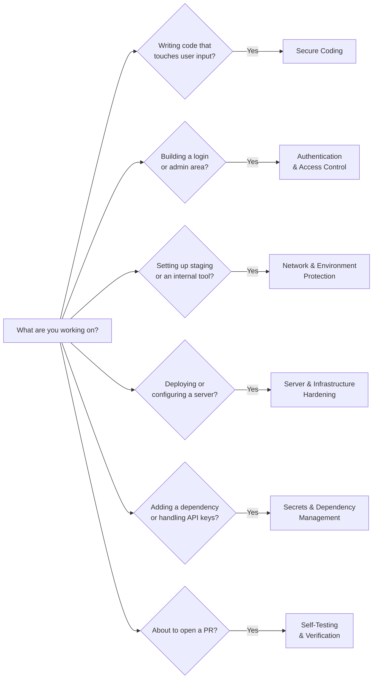

Security
========

Baseline security practices for everything we build at Trinergy. Every project follows these regardless of stack or client, unless a client's written spec says otherwise — and even then, the exception needs a documented compensating control.

* * *

### Start here

| Page | Covers |
| --- | --- |
| **[Secure Coding](/Security/Secure-Coding)** | Injection, XSS, and validating/escaping untrusted input. The stuff that shows up in code review. |
| **[Authentication & Access Control](/Security/Authentication-and-Access-Control)** | MFA, least privilege, and password policy for anything with a login. |
| **[Network & Environment Protection](/Security/Network-and-Environment-Protection)** | Locking down staging, admin panels, and internal tools behind a VPN or IP allowlist. |
| **[Server & Infrastructure Hardening](/Security/Server-and-Infrastructure-Hardening)** | Directory indexing, HTTPS, security headers, version disclosure, and cleaning up default installs before a server goes live. |
| **[Secrets & Dependency Management](/Security/Secrets-and-Dependency-Management)** | Keeping credentials out of git and keeping dependencies patched. |
| **[Self-Testing & Verification](/Security/Self-Testing-and-Verification)** | How to check your own code is secure before it reaches review. |

* * *

### The rules that matter most

1. **Never commit secrets.** No `.env`, API keys, or passwords in git — see [Secrets & Dependency Management](/Security/Secrets-and-Dependency-Management) and [General Principles → Secrets and configuration](/Coding-Standards/General-Principles#secrets-and-configuration).
2. **MFA is a default, not a nice-to-have.** Every project ships with it unless a client explicitly opts out in writing.
3. **Staging is not exempt.** It usually holds real or near-real data and gets less scrutiny than production.
4. **Never trust user input.** Validate it, escape it, use parameterized queries.
5. **An unpatched dependency is a vulnerability you own.** Keep them current and watch for CVEs.
6. **Exceptions need a paper trail.** If a client needs something outside these baselines, document it, get it reviewed, and note the compensating control.
7. **Test your own code before it reaches review.** Try to break the feature you just built — see [Self-Testing & Verification](/Security/Self-Testing-and-Verification).

* * *

### Further reading

Each page above has its own Resources section with specific cheat sheets and tools. If you bookmark two things overall, make them the [OWASP Top 10](https://owasp.org/www-project-top-ten/) for what to defend against, and [PortSwigger Web Security Academy](https://portswigger.net/web-security) for free interactive labs to practice on.

* * *

### Related pages

- [Code Review](/Code-Review) — security issues caught here are cheaper than the ones caught in production.
- [Coding Standards](/Coding-Standards) — the language and framework conventions these practices build on.
