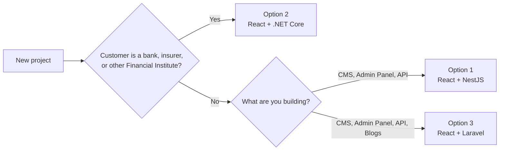

Tech Stack
==========

> Which stack a project uses depends on the **type of customer**. Start there, then open the standard for the layer you're building.

* * *

### 1. Pick the project stack

| | Frontend | Backend | Database | Web server | Use for | Customer |
| --- | --- | --- | --- | --- | --- | --- |
| **Option 1** | React + Tailwind | NestJS | MySQL / Postgres | NGINX / Apache | CMS, Admin Panel, API | Non-FI |
| **Option 2** | React + Tailwind | .NET Core | MySQL / MSSQL | NGINX / IIS | FI-related systems / websites | Bank, Insurance, any Financial Institute |
| **Option 3** | React + Tailwind | Laravel | MySQL / MSSQL | Apache / NGINX / IIS | CMS, Admin Panel, API, Blogs | Non-FI |

* * *

### 2. Open the standard for your layer

| Page | Covers |
| --- | --- |
| **[Frontend Stack](/Tech-Stack/Frontend-Stack)** | React + Vite web apps: tooling, state, forms, testing, day-one checklist. |
| **[Backend Stack](/Tech-Stack/Backend-Stack)** | NestJS services: structure, database, API, auth, config, logging, testing. |
| **[Mobile Stack](/Tech-Stack/Mobile-Stack)** | React Native (Expo), the default for every mobile project. |
| **[Mobile Stack Alternative](/Tech-Stack/Mobile-Stack-Alternative)** | Flutter, only for UI/animation-heavy apps or when the client mandates it. |

* * *

### Same job, different stack

The table below lines the stacks up side by side. **Bold** cells are deliberate exceptions, and each page explains why.

| Concern | Frontend | Backend | Mobile (React Native) | Mobile (Flutter) |
| --- | --- | --- | --- | --- |
| Language | TypeScript | TypeScript | TypeScript | **Dart** |
| Package manager | pnpm | pnpm | **Yarn** | pub |
| Framework | React + React Router | NestJS | Expo + Expo Router | Flutter widgets |
| Styling | Tailwind + shadcn/ui | — | NativeWind (Tailwind) | `ThemeData` |
| State | Zustand + TanStack Query | — | Zustand + TanStack Query | Riverpod |
| Validation | Zod | Zod | Zod | — |
| HTTP client | ky | — | **Axios** | Dio |
| Data | — | PostgreSQL + Prisma | SecureStore + AsyncStorage | Hive CE + secure storage |
| Testing | Vitest + RTL + Playwright | Jest + Supertest | *Not yet standard* | `flutter_test` |
| Lint / format | ESLint + Prettier + Husky | ESLint + Prettier + Husky | ESLint + Prettier + Husky | `flutter_lints` + `dart format` |

Rules shared by every stack:

- **One package manager, one lockfile.** Commit the lockfile and delete any stray lockfile from another tool.
- **ESLint finds bugs and Prettier owns formatting.** A pre-commit hook runs format, lint, and typecheck.
- **Define a schema once with Zod.** Reuse it for runtime validation and TypeScript types.
- **Version numbers aren't pinned here.** Check each tool's release notes when you start a project.

* * *

### Related pages

- [Coding Standards](/Coding-Standards): naming, linting, and formatting rules per stack.
- [Security](/Security): baselines every stack must meet.
