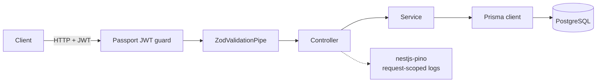
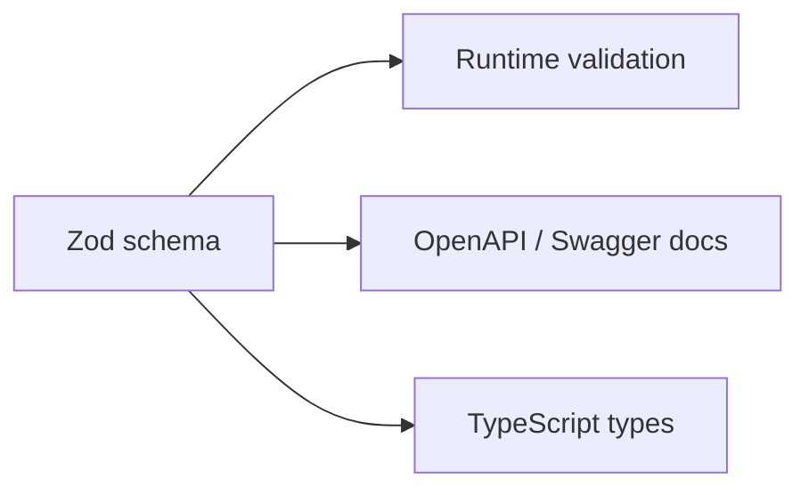
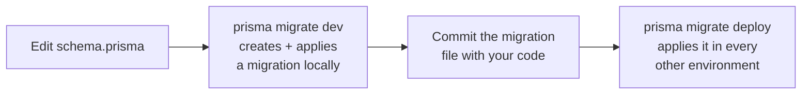
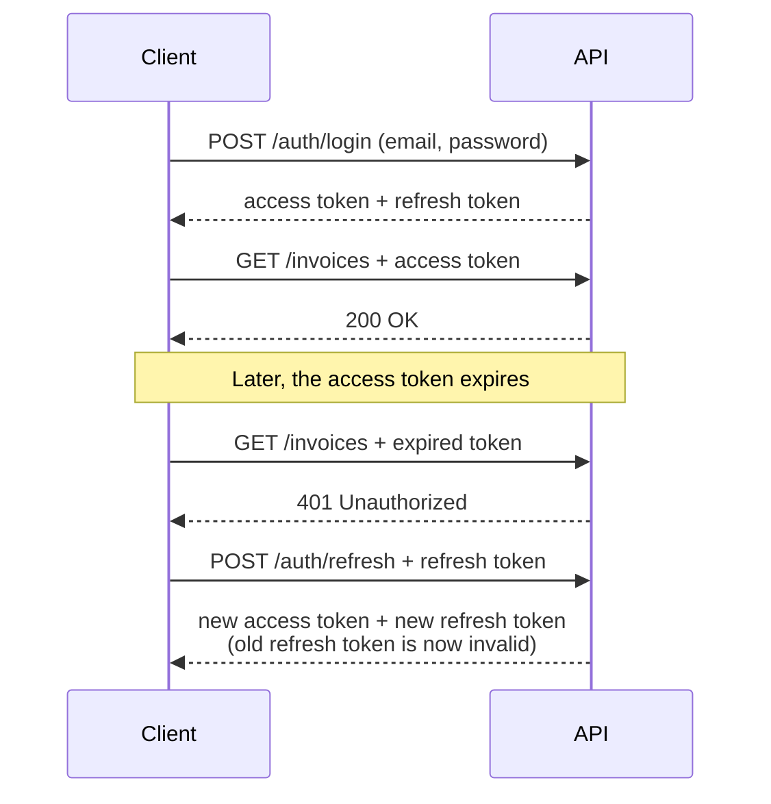
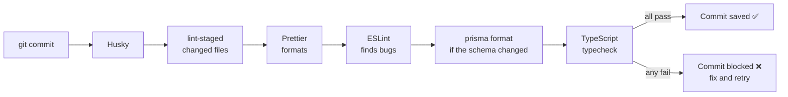
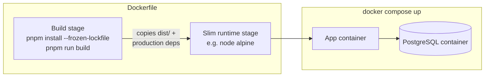

# Backend Development Standard

> The default stack for every new backend project, built on [NestJS](https://docs.nestjs.com/).
> **Scope:** how a service is built, structured, and run locally. CI/CD, registries, and deploy targets are project-specific and not covered here.
> **How to write code with it day to day:** [Coding Standards → NestJS](/Coding-Standards/Backend-NestJS).

---

## At a Glance

Click an area to jump to its section below.

| Area | Default Stack |
|---|---|
| [Language & runtime](#language-and-runtime) | **TypeScript + Node.js (current LTS)**<br/><sub>Types catch mistakes before code runs, and the LTS line keeps getting security fixes</sub> |
| [Package manager](#package-manager) | **pnpm**<br/><sub>Faster installs, less disk space, and it catches undeclared dependencies</sub> |
| [Framework & structure](#framework-and-structure) | **NestJS (modular monolith)**<br/><sub>Built-in structure keeps a growing codebase easy to navigate, with one app to deploy</sub> |
| [Database & ORM](#database-and-orm) | **PostgreSQL + Prisma**<br/><sub>One schema file drives both migrations and fully typed queries</sub> |
| [API style & docs](#api-style-and-docs) | **REST + OpenAPI (Swagger)**<br/><sub>Any client can call it, and the docs are generated from code so they never go stale</sub> |
| [Validation](#validation) | **Zod**<br/><sub>One schema drives validation, API docs, and types, so they can't drift apart</sub> |
| [Authentication](#authentication) | **JWT via Passport**<br/><sub>Stateless tokens: no session store, and any service can verify them</sub> |
| [Config & secrets](#config-and-secrets) | **`@nestjs/config` + Zod**<br/><sub>A missing or wrong environment variable fails at startup, not later</sub> |
| [Logging](#logging) | **Pino (`nestjs-pino`)**<br/><sub>Structured logs with request context on every line</sub> |
| [Testing](#testing) | **Jest + Supertest**<br/><sub>Unit tests for logic, plus real HTTP tests that check everything together</sub> |
| [Code quality](#code-quality) | **ESLint + Prettier + Husky/lint-staged**<br/><sub>Bugs and formatting issues are caught before every commit</sub> |
| [Local builds](#local-builds) | **Docker (local only)**<br/><sub>Run a production-like build against a real database on your machine</sub> |

> **Note — current recommended versions:** Version numbers are deliberately left out of this page since they go stale fast. Check each tool's own release notes before starting a new project rather than trusting any snapshot to stay current — this table is a shape, not a pin.

---

## How a Request Flows



**Define each shape once in Zod.** Every Zod schema feeds three things, so they can't drift apart:



---

## Project Layout

```
src/
  modules/
    <domain>/        # one module per business domain
      *.controller.ts
      *.service.ts
      schema.ts      # Zod request/response shapes for this module
      *.spec.ts
prisma/
  schema.prisma      # single source of truth for the data model
```

---

## Foundations

### Language and Runtime
**TypeScript + Node.js (current LTS)**

- **Node.js** runs JavaScript on the server. **LTS** (Long-Term Support) is the release line that keeps getting security and bug fixes for years. Other release lines stop getting fixes after a few months, so always stay on the **current LTS**.
- **TypeScript is required, not optional, in NestJS.** Nest reads the `@` labels (*decorators*) on your classes to work out what each class is and what it needs. That relies on information only TypeScript produces.

**In practice:** the decorators tell Nest "this is a controller", "this method handles `GET /invoices/:id`", and "give me an `InvoicesService`".

```ts
@Controller('invoices')                                  // handles /invoices/*
export class InvoicesController {
  constructor(private readonly invoices: InvoicesService) {} // Nest creates and passes this in

  @Get(':id')                                            // GET /invoices/42
  findOne(@Param('id') id: string) {
    return this.invoices.findOne(id)
  }
}
```

- ✅ Add an `.nvmrc` containing `lts/*`, so `nvm use` picks the current LTS on every machine.

> 💡 **Tip: build with [SWC](https://docs.nestjs.com/recipes/swc) for much faster restarts.** SWC is a faster compiler that does the same job as the default one, so nothing about how the app behaves changes. In watch mode, the app restarts after a save much sooner.
>
> ```bash
> pnpm add -D @swc/cli @swc/core
> ```
>
> ```json
> // nest-cli.json
> {
>   "compilerOptions": {
>     "builder": "swc",
>     "typeCheck": true
>   }
> }
> ```
>
> SWC on its own skips type checking. `"typeCheck": true` keeps it on, so type errors still show while you work.

### Package Manager
**pnpm**

**Why pnpm instead of npm:**

1. **One copy of each package per machine.** npm copies every package into every project. pnpm keeps a single copy and links each project to it, so installs are faster and use less disk.

```mermaid
flowchart LR
    subgraph npm["npm: a full copy in every project"]
        A1[service-a/node_modules/@nestjs]
        B1[service-b/node_modules/@nestjs]
    end
    subgraph pnpm["pnpm: one copy, linked"]
        S[(Shared store<br>on your machine<br>@nestjs)]
        A2[service-a] -.link.-> S
        B2[service-b] -.link.-> S
    end
```

2. **It stops you importing packages you never installed** (called *phantom dependencies*). With npm, a package installed by one of your dependencies is also importable by your code, even though it's not in your `package.json`. That works until the dependency drops it, and then the build breaks for no visible reason.

```ts
// package.json doesn't list rxjs directly, but @nestjs/core installs it
import { firstValueFrom } from 'rxjs'

// npm:  works today, may break after a Nest upgrade
// pnpm: fails today with "Cannot find module 'rxjs'"
//       → fix it properly with `pnpm add rxjs`
```

**Everyday commands:**

| Instead of | Use |
|---|---|
| `npm install` | `pnpm install` |
| `npm install zod` | `pnpm add zod` |
| `npm install -D @types/supertest` | `pnpm add -D @types/supertest` |
| `npm run start:dev` | `pnpm start:dev` |
| `npx prisma migrate dev` | `pnpm prisma migrate dev` |

> ⚠️ **Commit `pnpm-lock.yaml`, and only that lockfile.** The lockfile records the exact version of every package, so your machine, your teammates' machines, and Docker all install the same thing. If someone runs `npm install`, npm ignores pnpm's lockfile, picks its own versions, and writes a `package-lock.json`. Now two machines run different code and nobody notices. Delete any `package-lock.json` or `yarn.lock` you find, and block other package managers in `package.json`:
>
> ```json
> "scripts": {
>   "preinstall": "npx only-allow pnpm"
> }
> ```

---

## Application Layer

### Framework and Structure
**NestJS (modular monolith)**

- **Why NestJS:** it comes with a fixed structure (modules, controllers, services) and wires classes together for you. Every Nest project is laid out the same way, so you can find your way around a new one on day one.
- **Modular monolith:** **one app to deploy**, with the code split into self-contained modules, one per business area, under `src/modules/<domain>/`.

| | **Plain Nest CLI** (default) | Nx monorepo | Separate services |
|---|---|---|---|
| What it is | One app, many modules | Several apps and shared packages in one repo | Each module deployed on its own |
| Use when | Almost always | A genuine need for several apps or shared packages | A module truly needs to scale or deploy on its own |
| Cost | Lowest | More tooling to learn | Networking, separate deploys, harder debugging |

Moving right in that table is an architectural decision, not a starting point.

**In practice:** let the CLI create a new module with everything wired up.

```bash
pnpm nest g resource modules/invoices
# creates src/modules/invoices/ with module, controller, service, DTOs and test files
```

> 💡 **Tip: handle shared concerns once, globally, not in every controller.** Error formatting, validation, and response shaping belong in one global filter, pipe, or interceptor. Then controllers stay thin and never need their own `try/catch`.
>
> ```ts
> // app.module.ts
> import { APP_FILTER, APP_INTERCEPTOR, APP_PIPE } from '@nestjs/core'
> import { ZodSerializerInterceptor, ZodValidationPipe } from 'nestjs-zod'
>
> @Module({
>   providers: [
>     { provide: APP_PIPE, useClass: ZodValidationPipe },               // validates every request
>     { provide: APP_INTERCEPTOR, useClass: ZodSerializerInterceptor }, // shapes every response
>     { provide: APP_FILTER, useClass: AllExceptionsFilter },           // one error format everywhere
>   ],
> })
> export class AppModule {}
> ```

> 📘 **Coding standard:** how modules talk to each other, dependency injection, and the "fat controller" smell, with examples, are in [Coding Standards → NestJS → One module per business domain](/Coding-Standards/Backend-NestJS#one-module-per-business-domain) and [Keep controllers thin](/Coding-Standards/Backend-NestJS#keep-controllers-thin).

### Database and ORM
**PostgreSQL + Prisma**

- An **ORM** lets you read and write the database with typed code instead of hand-written SQL strings.
- With Prisma, `schema.prisma` is the **single source of truth**. Change a column there, and the types in your editor update with it. There are no separate entity classes to keep in sync.
- Its migration workflow is more reliable than TypeORM's.

**In practice:**

```prisma
// prisma/schema.prisma
model Invoice {
  id        String   @id @default(uuid())
  title     String
  total     Decimal
  createdAt DateTime @default(now())
}
```

```ts
// any service: fully typed, with autocomplete on every field
const bigInvoices = await this.prisma.invoice.findMany({
  where: { total: { gt: 1000 } },
  orderBy: { createdAt: 'desc' },
})
// rename `title` in the schema and every query still using it turns red
```

**Changing the database:** a *migration* is a small SQL file that records one change to the database, so every environment can apply the same changes in the same order.



| Command | When |
|---|---|
| `pnpm prisma migrate dev` | Create and apply a migration on your machine |
| `pnpm prisma migrate deploy` | Apply committed migrations in any other environment |
| `pnpm prisma generate` | Regenerate the typed client after a schema change |

> ⚠️ Add `prisma format` to the pre-commit step (see [Code Quality](#code-quality)). It's easy to forget because the schema isn't a JS/TS file, but everyone reads that file constantly.

> 📘 **Coding standard:** migration rules and when to use transactions are in [Coding Standards → NestJS → Database changes](/Coding-Standards/Backend-NestJS#database-changes).

### API Style and Docs
**REST + OpenAPI (Swagger)**

- **REST:** each kind of data has a URL, and the HTTP method says what to do with it. Any client (web, mobile, another service) can call it, and there's no GraphQL schema or resolvers to maintain.

| Method + URL | Does |
|---|---|
| `GET /invoices` | List invoices |
| `GET /invoices/42` | Get one invoice |
| `POST /invoices` | Create an invoice |
| `PATCH /invoices/42` | Update part of an invoice |
| `DELETE /invoices/42` | Delete an invoice |

- **OpenAPI (Swagger):** a description of every endpoint, its inputs, and its responses. [`@nestjs/swagger`](https://docs.nestjs.com/openapi/introduction) generates it **from the code**, so it can never go out of date, and serves an interactive page where frontend and mobile developers can read and try every endpoint.

```ts
// main.ts: the docs page is then at http://localhost:3000/docs
const config = new DocumentBuilder().setTitle('Invoices API').addBearerAuth().build()
SwaggerModule.setup('docs', app, SwaggerModule.createDocument(app, config))
```

- ❌ Don't hand-write Swagger decorators (`@ApiProperty`) for request bodies. The Zod schema already describes them (see [Validation](#validation)).

### Validation
**Zod**

Every request body is checked against a [Zod](https://zod.dev/) schema **before** your controller runs. One schema per shape, in the module's `schema.ts`, gives you three things at once:

```ts
// src/modules/invoices/schema.ts
export const CreateInvoiceSchema = z.object({
  customerId: z.string().uuid(),
  title: z.string().min(3),
  lines: z.array(z.object({ qty: z.number().int().positive(), unitPrice: z.number().positive() })),
})

export class CreateInvoiceDto extends createZodDto(CreateInvoiceSchema) {}
```

```ts
// invoices.controller.ts
@Post()
create(@Body() body: CreateInvoiceDto) { // 1. validated  2. typed  3. shown in Swagger
  return this.invoices.create(body)
}
```

A request with a missing `title` never reaches `create()`. The client gets a `400 Bad Request` listing which fields failed.

- The `ZodValidationPipe` is registered **globally** (see the tip in [Framework and Structure](#framework-and-structure)), so you don't add it per route.
- This replaces `class-validator` + `class-transformer` entirely. ❌ **Don't mix the two in one project.**

> 📝 **Note:** Nest's docs default to `class-validator`, and it's a reasonable choice in general. We use Zod so that validation, config parsing, and DTO typing all use one library, the same one the frontend uses.

> 📘 **Coding standard:** what a DTO is and why it's kept separate from the database model is in [Coding Standards → NestJS → DTO](/Coding-Standards/Backend-NestJS#dto), and the day-to-day rule is in [Validate at the boundary](/Coding-Standards/Backend-NestJS#validate-at-the-boundary).

### Authentication
**JWT via Passport**

- A **JWT** is a signed token the client sends with every request (`Authorization: Bearer <token>`). The server checks the signature, so it doesn't need to look anything up. There's no session store, and any service with the key can verify it.
- Use two tokens:

| Token | Lives for | Stored | Used for |
|---|---|---|---|
| **Access token** | Minutes | Client only | Sent with every request |
| **Refresh token** | Days | Client **and** server | Getting a new access token. Replaced with a new one each time it's used (*rotation*), so a stolen one stops working quickly |



**In practice:** [`@nestjs/passport`](https://docs.nestjs.com/security/authentication) + `passport-jwt` do the checking. You write one strategy, then protect routes with a guard.

```ts
// src/modules/auth/jwt.strategy.ts
@Injectable()
export class JwtStrategy extends PassportStrategy(Strategy) {
  constructor(config: ConfigService) {
    super({
      jwtFromRequest: ExtractJwt.fromAuthHeaderAsBearerToken(),
      secretOrKey: config.getOrThrow('JWT_SECRET'),
    })
  }

  validate(payload: { sub: string; role: string }) {
    return { userId: payload.sub, role: payload.role } // becomes req.user
  }
}
```

```ts
// any controller
@UseGuards(AuthGuard('jwt'))
@Get('me')
me(@Req() req) {
  return req.user
}
```

> 📝 **External IdP (e.g. OIDC / WSO2 IS)?** Swap only the strategy's token-checking step so it points at the IdP's public keys or introspection endpoint. The guards and decorators stay the same.

### Config and Secrets
**`@nestjs/config` + Zod**

The app checks **every environment variable when it starts**. If one is missing or wrong, it refuses to start and names the variable. Without this, a missing `JWT_SECRET` only shows up the first time someone tries to log in, possibly in production.

```ts
// src/config/env.ts
export const envSchema = z.object({
  NODE_ENV: z.enum(['development', 'test', 'production']),
  PORT: z.coerce.number().default(3000),
  DATABASE_URL: z.string().url(),
  JWT_SECRET: z.string().min(32),
})

// app.module.ts
ConfigModule.forRoot({ isGlobal: true, validate: (config) => envSchema.parse(config) })
```

```ts
// anywhere: read a value, and fail loudly if it's somehow missing
const secret = this.config.getOrThrow<string>('JWT_SECRET')
```

- We use Zod here instead of the docs' default Joi, so the backend has one validation library.
- ✅ Commit a `.env.example` listing every variable with a dummy value. ❌ Never commit `.env`.

> 📝 **Future direction:** `.env` + Zod is the default for now. Secrets will move to a KMS (e.g. Azure Key Vault, AWS Secrets Manager) once one is chosen.

### Logging
**Pino (`nestjs-pino`)**

[`nestjs-pino`](https://github.com/iamolegga/nestjs-pino) writes **structured logs**: each line is JSON with named fields, and every line automatically includes the ID of the request that produced it. Log tools can then filter by any field, for example "everything from request `a1b2`".

```
console.log  →  Invoice created 42
nestjs-pino  →  {"level":"info","req":{"id":"a1b2"},"invoiceId":"42","msg":"Invoice created"}
```

Nest's built-in `Logger` is fine for quick local output, but it isn't structured.

**In practice:**

```ts
// app.module.ts
LoggerModule.forRoot({
  pinoHttp: {
    transport: process.env.NODE_ENV === 'development' ? { target: 'pino-pretty' } : undefined,
    redact: ['req.headers.authorization'], // never log tokens
  },
})

// main.ts
const app = await NestFactory.create(AppModule, { bufferLogs: true })
app.useLogger(app.get(Logger))

// invoices.service.ts
constructor(@InjectPinoLogger(InvoicesService.name) private readonly logger: PinoLogger) {}

this.logger.info({ invoiceId: invoice.id }, 'Invoice created')
```

> 💡 **Tip:** The `transport` line above turns on `pino-pretty` only in development. You get readable, colored logs on your machine and raw JSON in production, from the same logger.

> 📘 **Coding standard:** what a correlation ID is and what never to log are in [Coding Standards → NestJS → Logging](/Coding-Standards/Backend-NestJS#logging).

---

## Quality and Workflow

### Testing
**Jest + Supertest**

| Layer | Tool | What it checks | How many |
|---|---|---|---|
| Unit | [Jest](https://jestjs.io/docs/getting-started) + `@nestjs/testing` | One service's logic on its own, with its dependencies swapped for fakes | Lots |
| End-to-end (e2e) | [Supertest](https://github.com/ladjs/supertest) | Real HTTP requests through routing, guards, validation, and a real database together | The flows that must not break |

- **Why Jest:** `nest new` sets it up for you, and `@nestjs/testing` builds a test version of a module so you can swap any dependency for a fake.
- **Why Supertest:** it sends real HTTP requests to the app without starting a server on a port.

> ⚠️ Run e2e tests against a **real PostgreSQL** (a docker-compose service or a throwaway database), **not a mocked Prisma**. A mock always agrees with the test, so it hides schema mismatches, broken joins, and migrations that drifted from the code.

> 📘 **Coding standard:** example unit and e2e tests, and what each layer should cover, are in [Coding Standards → NestJS → Testing](/Coding-Standards/Backend-NestJS#testing).

### Code Quality
**ESLint + Prettier + Husky/lint-staged**

Four tools, each with one job:

| Tool | Job | Example |
|---|---|---|
| **ESLint** | Finds likely bugs and bad patterns | An unused variable, a promise that's never awaited |
| **Prettier** | Owns formatting, nothing else | Quotes, semicolons, line wrapping |
| **Husky** | Runs scripts when you `git commit` | Triggers lint-staged |
| **lint-staged** | Runs checks only on the files you changed | Keeps the commit check fast |

Every commit goes through the same checks, so problems are caught on your machine, not in code review:



> 📝 **Note:** Nest's dependency injection produces constructors that look "empty" and classes that only exist to carry decorators. Tune `no-useless-constructor` and similar rules for that pattern once in the shared config, instead of fighting them in every project.

> 📘 **Coding standard:** the ESLint, Prettier, Husky, and lint-staged config files are in [Coding Standards → NestJS → Linting and formatting](/Coding-Standards/Backend-NestJS#linting-and-formatting).

---

## Local Development

### Local Builds
**Docker (local only)**

Use Docker to run a **production-like build** of the API together with a **real PostgreSQL**, without installing Postgres on your machine. It's for checking that the production build works. It is **not** part of CI/CD, which stays project-specific.

The `Dockerfile` has two stages: the first installs everything and builds, and the second copies only what's needed to run, so the final image stays small.



```yaml
# docker-compose.yml
services:
  app:
    build: .
    ports: ['3000:3000']
    env_file: .env
    environment:
      DATABASE_URL: postgresql://postgres:postgres@db:5432/app # host is "db", not localhost
    depends_on: [db]
  db:
    image: postgres:alpine
    environment:
      POSTGRES_PASSWORD: postgres
      POSTGRES_DB: app
    ports: ['5432:5432']
```

```bash
docker compose up --build                  # app + database
pnpm prisma migrate deploy                 # apply migrations to the container database
```

> ⚠️ **Inside Docker, the database host is the service name** (`db`), not `localhost`. `localhost` inside the app container means the app container itself. From your own machine (e.g. running `prisma migrate deploy`), it's still `localhost:5432`.

---

## Adoption Checklist

For a new project starting from this standard, set these up on day one:

**Foundations**

- [ ] Initialize with **pnpm** (not npm), with `only-allow pnpm` in `preinstall`
- [ ] **NestJS on the current Node LTS** (`.nvmrc`), TypeScript, **SWC** builder with `typeCheck: true`

**Application layer**

- [ ] One module per domain under `src/modules/<domain>/`
- [ ] **PostgreSQL + Prisma**, with `schema.prisma` as the source of truth
- [ ] **REST + `@nestjs/swagger`**, driven from Zod DTOs via `nestjs-zod`
- [ ] Global **`ZodValidationPipe`**, no `class-validator`
- [ ] **`@nestjs/passport` + `passport-jwt`**, with a rotating refresh-token flow
- [ ] **`@nestjs/config`** with Zod-validated env vars (fails fast at startup) and a committed `.env.example`
- [ ] **`nestjs-pino`**, with `pino-pretty` in development only and auth headers redacted

**Quality & workflow**

- [ ] **Jest** + `@nestjs/testing` for unit tests
- [ ] **Supertest** for e2e tests, against a real PostgreSQL
- [ ] **Prettier + eslint-config-prettier**, with the ESLint flat config tuned for Nest decorators
- [ ] **Husky + lint-staged**, running format, lint, `prisma format`, and typecheck on every commit

**Local development**

- [ ] A `Dockerfile` + `docker-compose.yml` (app + PostgreSQL) for local production-build checks
