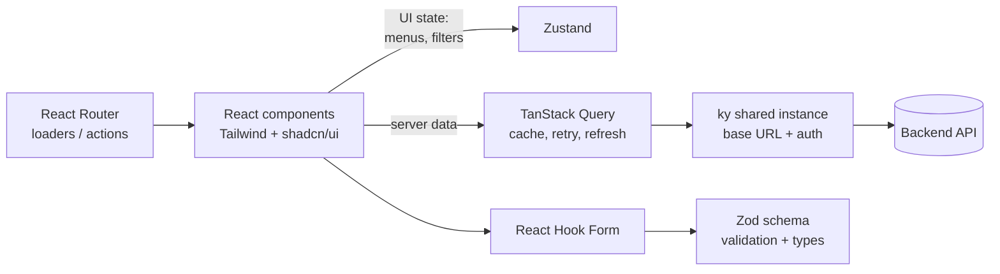
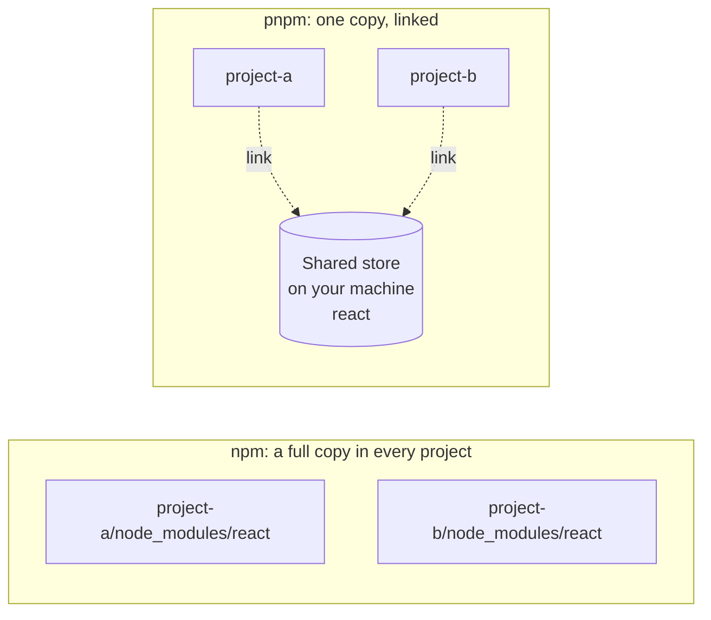
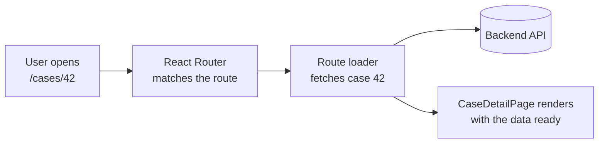
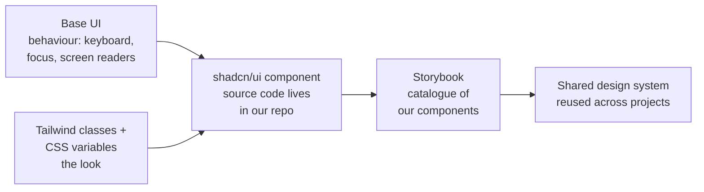
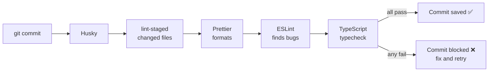
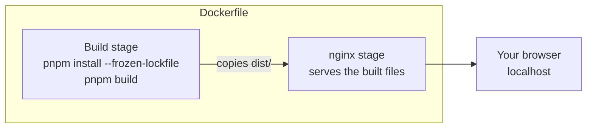

[🏠 Home](../README.md) › [Tech Stack](README.md) › **Frontend Stack**

# Frontend Stack

> The default stack for every new frontend project: a client-rendered React SPA built with Vite.
> **This page:** what we use, why, and how to set it up. **How to write code with it day to day:** [Coding Standards → Frontend](../Coding-Standards/Frontend-React-TypeScript.md).

---

## At a Glance

Click an area to jump to its section below.

| Area | Default Stack |
|---|---|
| [Language & build](#language-and-build) | **TypeScript + Vite**<br/><sub>Catches mistakes before code runs, and reloads instantly while you work</sub> |
| [Package manager](#package-manager) | **pnpm**<br/><sub>Faster installs, less disk space, and it catches undeclared dependencies</sub> |
| [Framework & routing](#framework-and-routing) | **React + React Router** (data mode)<br/><sub>Routing, loading states, and data fetching work as one system, with no server needed</sub> |
| [Styling & UI](#styling-and-ui) | **Tailwind CSS + shadcn/ui**<br/><sub>Fast, consistent styling, and we own the component code</sub> |
| [State](#state) | **Zustand + TanStack Query**<br/><sub>Keeps UI state separate from server data, which avoids stale data</sub> |
| [Forms & validation](#forms-and-validation) | **React Hook Form + Zod**<br/><sub>One schema drives both validation and types, so they never drift apart</sub> |
| [Data tables](#data-tables) | **TanStack Table**<br/><sub>Handles sorting, filtering, and paging, and we style it our way</sub> |
| [HTTP client](#http-client) | **ky**<br/><sub>A small fetch wrapper with retries and timeouts built in</sub> |
| [Rich text & PDF](#rich-text-and-pdf) | **TipTap + pdfjs-dist**<br/><sub>One extensible editor for every text field, and PDFs open in the browser</sub> |
| [Testing](#testing) | **Vitest + React Testing Library + Playwright**<br/><sub>Fast unit tests, plus real-browser checks on the flows that matter</sub> |
| [Code quality](#code-quality) | **ESLint + Prettier + Husky/lint-staged**<br/><sub>Bugs and formatting issues are caught before every commit</sub> |
| [Component development](#component-development) | **Storybook**<br/><sub>Build and preview components on their own, and it doubles as living docs</sub> |
| [Local builds](#local-builds) | **Docker**<br/><sub>Check the production build on your own machine</sub> |

> **Note — current recommended versions:** Version numbers are deliberately left out of this page since they go stale fast. Check each tool's own release notes before starting a new project rather than trusting any snapshot to stay current — this table is a shape, not a pin.

---

## How the Pieces Fit



---

## Foundations

### Language and Build
**TypeScript + Vite**

**TypeScript** checks your code while you type, so mistakes show up as red underlines in the editor instead of as bugs in the browser. The payoff is biggest when you change something many files depend on.

**In practice:** someone renames a prop on a shared component, and someone else makes a typo.

```tsx
// status-badge.tsx: the prop used to be called `state`, now it's `status`
type StatusBadgeProps = { status: 'open' | 'closed' }

// case-list.tsx: still uses the old name
<StatusBadge state="open" />
//           ~~~~~ ❌ Property 'state' does not exist on type 'StatusBadgeProps'

// case-detail.tsx: a typo
<StatusBadge status="opne" />
//           ~~~~~~ ❌ Type '"opne"' is not assignable to type '"open" | "closed"'
```

In plain JavaScript both mistakes run without complaint and render an empty badge. A user finds them in production. With TypeScript, every broken file is listed before you even save.

> 📘 **Coding standard:** strict mode, and what to use instead of `any`, are in [Coding Standards → Frontend](../Coding-Standards/Frontend-React-TypeScript.md#do--dont) (Do / Don't).

**Vite** is the tool that runs the app while you work and packages it for release.

| | `pnpm dev` (while you work) | `pnpm build` (for release) |
|---|---|---|
| What it does | Starts a local server at `localhost:5173` | Produces small, optimized files in `dist/` |
| How fast | Ready in about a second, even in a large app | Takes longer, but you only run it to ship |
| When you save a file | Only that file is swapped in the browser, usually in well under a second, without losing what's on screen | — |
| Why it's fast | It doesn't package the whole app up front. The browser asks for each file as it needs it. | Everything is bundled and minified so users download as little as possible |

- ✅ Run `pnpm build && pnpm preview` before a release to check the real production build locally.
- ⚠️ Only environment variables starting with `VITE_` reach browser code, and **everything in the browser is public**. Never put secrets (API keys, passwords) in a `VITE_` variable.

> 💡 **Tip: don't make every page download heavy libraries.** By default, the rich-text editor and the PDF viewer get bundled into the main file, so even the login page downloads them. Two steps fix that:
>
> **1. Load the heavy page only when someone opens it** (in the router):
>
> ```tsx
> {
>   path: '/documents/:id/edit',
>   lazy: () => import('./pages/document-editor'), // downloaded on first visit, not at startup
> }
> ```
>
> **2. Give the heavy libraries their own files** (in `vite.config.ts`):
>
> ```ts
> export default defineConfig({
>   build: {
>     rollupOptions: {
>       output: {
>         manualChunks(id) {
>           if (id.includes('@tiptap') || id.includes('prosemirror')) return 'editor'
>           if (id.includes('pdfjs-dist')) return 'pdf'
>         },
>       },
>     },
>   },
> })
> ```
>
> | Page | Before | After |
> |---|---|---|
> | Login, dashboard | `main.js` (app + editor + PDF) | `main.js` (app only) |
> | Document editor | `main.js` | `main.js` + `editor.js` |
>
> If a newer Vite renames this option, the [Vite build docs](https://vite.dev/guide/build) show the current name. The idea stays the same.

### Package Manager
**pnpm**

**Why pnpm instead of npm:**

1. **One copy of each package per machine.** npm copies every package into every project. pnpm keeps a single copy and links each project to it, so installs are faster and use less disk. The more projects on your machine use pnpm, the bigger the saving.



2. **It stops you importing packages you never installed** (called *phantom dependencies*). With npm, a package installed by one of your dependencies is also importable by your code, even though it's not in your `package.json`. That works until the day the dependency drops it, and then your build breaks for no visible reason.

```ts
// package.json lists react-datepicker, which happens to install date-fns
import { format } from 'date-fns' // date-fns is NOT in your package.json

// npm:  works today, breaks when react-datepicker stops using date-fns
// pnpm: fails today with "Cannot find module 'date-fns'"
//       → fix it properly with `pnpm add date-fns`
```

**Everyday commands:**

| Instead of | Use |
|---|---|
| `npm install` | `pnpm install` |
| `npm install zod` | `pnpm add zod` |
| `npm install -D vitest` | `pnpm add -D vitest` |
| `npm run dev` | `pnpm dev` |
| `npx shadcn@latest add button` | `pnpm dlx shadcn@latest add button` |

> ⚠️ **Commit `pnpm-lock.yaml`, and only that lockfile.** The lockfile records the exact version of every package, so your machine, your teammates' machines, and the build server all install the same thing. If someone runs `npm install`, npm ignores pnpm's lockfile, picks its own versions, and writes a `package-lock.json`. Now two machines run different code and nobody notices. Delete any `package-lock.json` or `yarn.lock` you find, and block other package managers in `package.json`:
>
> ```json
> "scripts": {
>   "preinstall": "npx only-allow pnpm"
> }
> ```

---

## Application Layer

### Framework and Routing
**React + React Router (data mode)**

- **React** builds the screens. **React Router** decides which screen shows for each URL, and can fetch the screen's data before it appears.
- Our apps are **single-page apps (SPA)**: the server sends one HTML file plus the JavaScript, and everything after that happens in the browser. Any static host or nginx can serve it.
- Because routing, loading states, and data fetching are handled together, you don't hand-write a `useEffect` + loading spinner in every page.

**Which mode to use:**

| | **Data mode** (default) | Framework mode |
|---|---|---|
| Set up with | [`createBrowserRouter`](https://reactrouter.com/start/modes) in code | A Vite plugin with file-based routes |
| Runs on | The browser only | Needs a Node server running in production |
| Gives you | Loaders, actions, per-route data fetching | All of that, plus server-side rendering (SSR) |
| Use when | Almost always: admin panels, portals, dashboards | **Only** when server rendering is a genuine requirement (e.g. public pages that must rank in search) |

**How a page gets its data:** the **loader** runs before the page renders, so the page never shows half-loaded.



**In practice:**

```tsx
// router.tsx
import { createBrowserRouter, RouterProvider } from 'react-router'
import { api } from '@/shared/api'

const router = createBrowserRouter([
  {
    path: '/cases/:caseId',
    loader: ({ params }) => api.get(`cases/${params.caseId}`).json<Case>(), // runs first
    Component: CaseDetailPage,
  },
])

export function App() {
  return <RouterProvider router={router} />
}

// case-detail-page.tsx
import { useLoaderData } from 'react-router'

export function CaseDetailPage() {
  const caseData = useLoaderData() as Case // already loaded, no spinner needed
  return <h1>{caseData.title}</h1>
}
```

- An **action** is the same idea for writes: it runs when a route's form is submitted, then the router reloads the page's data for you.

> 📝 **Using TanStack Query for the same data?** Call `queryClient.ensureQueryData(...)` inside the loader instead of fetching directly. Then the loader and the page share one cache (see [State](#state)).

### Styling and UI
**Tailwind CSS + shadcn/ui**

Three pieces, each with one job:



- **[Tailwind](https://tailwindcss.com/docs):** you style elements with small utility classes right in the markup, so there's no separate CSS file per screen and spacing and colors stay consistent. It builds fast and needs almost no config.

  ```tsx
  <div className="flex items-center gap-4 rounded-lg border p-4">
  ```

- **[Base UI](https://base-ui.com/):** a *headless* library. It provides the behaviour with no styling, for example a dropdown that opens with Enter, closes with Esc, moves between options with the arrow keys, and is announced correctly by screen readers.
- **[shadcn/ui](https://ui.shadcn.com/docs):** ready-made components (Button, Dialog, Select…) built from the two above. Unlike a normal library, the command copies the component's **source code into our repo**, so we can change anything without waiting on, or fighting, someone else's package.

  ```bash
  pnpm dlx shadcn@latest add button   # creates src/shared/ui/button.tsx, which we own
  ```

**Why shadcn/ui, long term:** because we own the code, these components can grow into **our own design system**: a shared, branded component set that every new project starts from, instead of each project restyling a library from scratch. [Storybook](#component-development) is where that component set is built, previewed, and documented.

> 💡 **Tip: keep `cssVariables: true` in `components.json`.** Components then read their colors from a handful of CSS variables in one file, instead of having colors baked into every component. Dark mode, a rebrand, or a white-label version for another client becomes a change to that one file.
>
> ```json
> // components.json: also points shadcn at our shared/ folder
> {
>   "tailwind": { "css": "src/index.css", "cssVariables": true },
>   "aliases": { "ui": "@/shared/ui" }
> }
> ```
>
> ```css
> /* src/index.css: the whole brand lives here */
> :root {
>   --primary: #1d4ed8;   /* light mode */
>   --radius: 0.5rem;
> }
> .dark {
>   --primary: #60a5fa;   /* dark mode */
> }
> ```
>
> ```tsx
> <Button>Submit</Button> // uses bg-primary → reads --primary, so it changes everywhere at once
> ```

> 📘 **Coding standard:** using theme classes instead of hard-coded colors, and adding variants instead of copying components, are in [Coding Standards → Frontend](../Coding-Standards/Frontend-React-TypeScript.md#do--dont) (Do / Don't).

### State
**Zustand + TanStack Query**

Split state by **where it comes from**:

| Kind of state | Tool | Examples |
|---|---|---|
| Controlled by the UI | [Zustand](https://zustand.docs.pmnd.rs/) (keep it small) | Sidebar open, current filter, selected tab |
| Came from an API | [TanStack Query](https://tanstack.com/query/latest/docs/framework/react/overview) | Cases, applications, dropdown lookups |

**Why not put everything in one store?** Say you copy the case list from the API into a store. Another user edits a case, but your store keeps showing the old version until someone remembers to refetch. Meanwhile each screen refetches "just in case". TanStack Query tracks how old the data is, refetches when it goes stale, shares one copy between screens, and gives you loading and error states for free.

> 📘 **Coding standard:** how to keep the two apart in code, with right and wrong examples, plus **query-key factories** (how to name cached data so refreshing after a save is reliable) are in Coding Standards → Frontend ([Server state vs. client state](../Coding-Standards/Frontend-React-TypeScript.md#keep-server-data-out-of-stores), [Query keys](../Coding-Standards/Frontend-React-TypeScript.md#query-key-factories)).

### Forms and Validation
**React Hook Form + Zod**

Write each form's rules **once** in a [Zod](https://zod.dev/) schema. That schema drives both the error messages on screen and the TypeScript type of the form data, so the two can never disagree.

> 📘 **Coding standard:** a full schema + form example is in [Coding Standards → Frontend → Schema-first with Zod](../Coding-Standards/Frontend-React-TypeScript.md#schema-first-with-zod).

> 📝 **Watching: [TanStack Form](https://tanstack.com/form/latest).** It isn't the standard yet. It works like TanStack Query, has stronger type inference, and handles async validation per field. It's worth evaluating for **deeply nested, dynamic forms** (multi-step wizards, repeatable field groups). For everything else, React Hook Form is more mature and the safer default.

### Data Tables
**TanStack Table**

- It's *headless*: it works out which rows to show, in what order, and on which page, but draws nothing. You render the rows with our own shadcn `<Table>`, so tables look like the rest of the app.
- We chose it over pre-styled table libraries so tables don't bring a second design language into the product.

```tsx
const columns: ColumnDef<Case>[] = [
  { accessorKey: 'title', header: 'Title' },
  { accessorKey: 'status', header: 'Status', cell: ({ row }) => <StatusBadge status={row.original.status} /> },
]

const table = useReactTable({
  data: cases,
  columns,
  getCoreRowModel: getCoreRowModel(),
  getSortedRowModel: getSortedRowModel(), // add sorting, filtering, paging as needed
})
```

> 💡 **Tip:** Start from the shadcn [Data Table guide](https://ui.shadcn.com/docs/components/data-table). It shows TanStack Table and shadcn's `<Table>` wired together, with sorting, filtering, and paging.

### HTTP Client
**ky**

- A small wrapper around the browser's built-in `fetch`. It adds what you'd otherwise write yourself: **retries** (tries again if the network blips), **timeouts** (gives up instead of hanging forever), automatic JSON parsing, and a base URL. It adds very little to the bundle.

> 💡 **Tip: create one shared instance and import it everywhere.** The base URL, auth header, and timeout are set once, and every call stays one line.
>
> ```ts
> // src/shared/api.ts
> import ky from 'ky'
>
> export const api = ky.extend({
>   prefixUrl: import.meta.env.VITE_API_URL,
>   timeout: 10_000,
>   retry: 2,
>   hooks: {
>     beforeRequest: [(request) => request.headers.set('Authorization', `Bearer ${getToken()}`)],
>   },
> })
> ```
>
> ```ts
> // anywhere in the app
> const cases = await api.get('cases').json<Case[]>()
> ```
>
> With `prefixUrl`, paths must **not** start with `/` (`'cases'`, not `'/cases'`).

> 📘 **Coding standard:** where API calls live in a feature folder, and the rule against creating ky instances in feature code, are in Coding Standards → Frontend → [Calling the API](../Coding-Standards/Frontend-React-TypeScript.md#calling-the-api).

### Rich Text and PDF
**TipTap + pdfjs-dist**

- **[TipTap](https://tiptap.dev/docs)** is our one editor for every formatted-text field. You turn features on by adding *extensions*: a simple comment box uses `StarterKit` alone, and a full document editor adds tables, images, alignment, and highlighting.
- TipTap can also add real-time collaboration and AI-assisted writing later, without changing tools.

```tsx
const editor = useEditor({
  extensions: [StarterKit], // add Table, Image, TextAlign… only where the field needs them
  content: '<p>Write your notes here</p>',
})

return <EditorContent editor={editor} />
```

- **[pdfjs-dist](https://mozilla.github.io/pdf.js/)** is the PDF engine used by Firefox. It shows PDFs inside our pages with no browser plugin.

> ⚠️ **pdfjs needs its worker file set up**, or PDFs won't render. With Vite:
>
> ```ts
> import * as pdfjs from 'pdfjs-dist'
> import workerSrc from 'pdfjs-dist/build/pdf.worker.min.mjs?url'
>
> pdfjs.GlobalWorkerOptions.workerSrc = workerSrc
> ```

> 📝 **Escape hatch:** If a project truly can't use TipTap (a performance ceiling or a very specialized editor), the team decides case by case. Lexical is the other maintained option. It is **not** a second default.

---

## Quality and Workflow

### Testing
**Vitest + React Testing Library + Playwright**

| Layer | Tool | What it checks | How many |
|---|---|---|---|
| Unit / component | [Vitest](https://vitest.dev/guide/) + [React Testing Library](https://testing-library.com/docs/) | One function or component on its own. Runs in milliseconds. | Lots |
| End-to-end (E2E) | [Playwright](https://playwright.dev/docs/intro) | A whole user journey in a real browser | A few |

- **Why Vitest, not Jest:** Vitest reads the same `vite.config.ts` as the app, so imports like `@/shared/...` just work in tests. Jest needs its own separate setup to understand them.
- **Why Playwright:** it drives a real browser, waits for elements automatically (fewer flaky tests), runs across browsers, and records a step-by-step trace when a test fails.

> 💡 **Tip: let Playwright write the first draft of an E2E test.** Run the recorder, click through the flow in the browser, and it writes the test code for you to tidy up.
>
> ```bash
> pnpm exec playwright codegen http://localhost:5173
> ```

> 📘 **Coding standard:** example unit and E2E tests, which flows deserve an E2E test, and how to mock the API are in [Coding Standards → Frontend → Testing](../Coding-Standards/Frontend-React-TypeScript.md#testing).

### Code Quality
**ESLint + Prettier + Husky/lint-staged**

Four tools, each with one job:

| Tool | Job | Example |
|---|---|---|
| **ESLint** | Finds likely bugs and bad patterns | An unused variable, a hook called inside an `if` |
| **Prettier** | Owns formatting, nothing else | Quotes, semicolons, line wrapping |
| **Husky** | Runs scripts when you `git commit` | Triggers lint-staged |
| **lint-staged** | Runs checks only on the files you changed | Keeps the commit check fast |

Every commit goes through the same checks, so problems are caught on your machine, not in code review:



> 📘 **Coding standard:** the ESLint, Prettier, Husky, and lint-staged config files, and our team formatting choices, are in [Coding Standards → Frontend → Linting & formatting](../Coding-Standards/Frontend-React-TypeScript.md#linting-and-formatting).

### Component Development
**Storybook**

- Build and preview a component **on its own**, in every state (loading, error, disabled, long text…), without clicking through the app to reach it.
- It doubles as **living documentation** of our shadcn/ui component set for designers and developers. This is where our future shared design system takes shape (see [Styling and UI](#styling-and-ui)).
- It catches visual regressions at the component level, before they reach a page.

> 📘 **Coding standard:** how to write a story, and where story files go, are in [Coding Standards → Frontend → Storybook stories](../Coding-Standards/Frontend-React-TypeScript.md#storybook-stories).

---

## Local Development

### Local Builds
**Docker (local only)**

Use Docker to run the **real production build** on your machine, served by **nginx** (a small, fast web server that hands the built files to the browser), exactly as it will run when deployed. It's for checking that the production build works. It is **not** CI/CD, which stays project-specific.



```bash
docker compose up --build   # then open the port set in compose.yml
```

> ⚠️ **Add the SPA fallback to the nginx config.** Without it, refreshing on a deep link like `/cases/42` returns a 404, because that file doesn't exist on disk. React Router needs every path to serve `index.html`:
>
> ```nginx
> location / {
>   try_files $uri $uri/ /index.html;
> }
> ```

---

## Adoption Checklist

For a new project starting from this standard, set these up on day one:

**Foundations**

- [ ] Initialize with **pnpm** (not npm), with `only-allow pnpm` in `preinstall`
- [ ] **Vite + TypeScript**, with `strict: true`

**Application layer**

- [ ] **React + React Router** (data mode via `createBrowserRouter`), heavy pages lazy-loaded
- [ ] **Tailwind CSS + shadcn/ui** (Base UI primitives), with `cssVariables: true`
- [ ] **Zustand** (client state) + **TanStack Query** (server state), kept separate, not merged
- [ ] **React Hook Form + Zod**, with schemas shared between validation and types
- [ ] **TanStack Table** for any data grid
- [ ] **ky** as the HTTP client: one shared instance in `src/shared/api.ts`
- [ ] **TipTap** (`StarterKit` baseline, extended as needed) + **pdfjs-dist** for PDFs, with its worker configured

**Quality & workflow**

- [ ] **Vitest** + React Testing Library for unit/component tests (not Jest)
- [ ] **Playwright** for end-to-end tests
- [ ] **Prettier + eslint-config-prettier**, wired against the ESLint flat config
- [ ] **Husky + lint-staged**, running format, lint, and typecheck on every commit
- [ ] **Storybook**, set up alongside the first shared components

**Local development**

- [ ] A `Dockerfile` + `compose.yml` for local production-build checks, with the nginx SPA fallback

---

[⬅ Back to Tech Stack](README.md)
