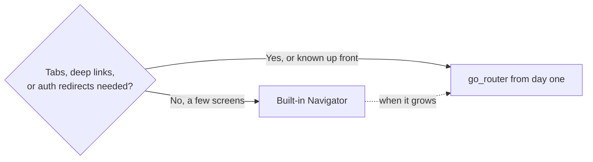

[🏠 Home](../README.md) › [Tech Stack](README.md) › **Mobile Stack Alternative**

# Mobile Stack Alternative: Flutter

> The **alternative** mobile stack, for apps whose value is in their visuals and motion, or where the client mandates Flutter. **[React Native](Mobile-Stack.md) stays the default.**
> **How to write code with it day to day:** [Coding Standards → Flutter](../Coding-Standards/Mobile-Flutter.md).

> ⚠️ **Not battle-tested yet.** We haven't shipped a Flutter project. Treat this page as a well-researched starting point that the first Flutter project should confirm and correct.
> Use it only when the **[Which Stack?](Mobile-Stack.md#which-stack)** chart on the Mobile Stack page points here. Otherwise, use React Native.

---

## At a Glance

Click an area to jump to its section below.

| Area | Default Stack |
|---|---|
| [Language & SDK](#language-and-sdk) | **Dart + Flutter**<br/><sub>Draws every pixel itself, so custom design and animation look the same everywhere</sub> |
| [UI framework](#ui-framework) | **Flutter's built-in widgets (Material)**<br/><sub>Flutter already is the UI framework, so nothing extra is needed</sub> |
| [State](#state) | **Riverpod**<br/><sub>Compile-time safe, and testable without a widget tree</sub> |
| [HTTP client](#http-client) | **Dio**<br/><sub>Interceptors handle auth tokens and expired sessions in one place</sub> |
| [Navigation](#navigation) | **Navigator, then `go_router`**<br/><sub>Simple to start, with `go_router` once tabs, deep links, or auth redirects arrive</sub> |
| [Storage](#storage) | **Hive CE + flutter_secure_storage**<br/><sub>Fast storage for cached data, encrypted storage for tokens</sub> |
| [Code quality](#code-quality) | **`flutter_lints` + `dart format`**<br/><sub>The built-in formatter ends style debates</sub> |
| [Testing](#testing) | **`flutter_test`**<br/><sub>Built into the SDK, and widget tests are cheap and high value</sub> |

### Language and SDK
**Dart + Flutter**

- **[Flutter](https://docs.flutter.dev/) draws every pixel itself** instead of using the phone's own buttons and lists, so custom animation and layout look exactly the same on iOS and Android. That's the reason to choose it.
- **The trade-off:** the app doesn't automatically pick up native behavior or OS design updates, and nothing transfers to or from our TypeScript work.

```bash
flutter channel stable   # always build on the stable channel
flutter create my_app
flutter run              # runs on the connected phone or emulator, with hot reload
```

### UI Framework
**Flutter's built-in widgets (Material)**

- **Don't add a UI framework.** Flutter *is* the UI framework. It includes [Material](https://docs.flutter.dev/ui/widgets/material) (default) and [Cupertino](https://docs.flutter.dev/ui/widgets/cupertino) (iOS look).
- Define colors, typography, and component defaults once in `ThemeData`, and read them with `Theme.of(context)`. This is Flutter's equivalent of `tailwind.config.js`.

```dart
// main.dart: the whole brand lives here
MaterialApp(
  theme: ThemeData(colorScheme: ColorScheme.fromSeed(seedColor: const Color(0xFF1D4ED8))),
  darkTheme: ThemeData(
    colorScheme: ColorScheme.fromSeed(seedColor: const Color(0xFF1D4ED8), brightness: Brightness.dark),
  ),
)

// any widget: read the theme, never hard-code the color
Container(color: Theme.of(context).colorScheme.primary)
```

> 📘 **Coding standard:** widgets, `build()`, `const` constructors, and splitting widgets, with examples, are in Coding Standards → Flutter → [Build runs constantly](../Coding-Standards/Mobile-Flutter.md#build-runs-constantly) and [Split widgets into widgets](../Coding-Standards/Mobile-Flutter.md#split-widgets-into-widgets-not-methods).

### State
**Riverpod**

- Picking one state library and sticking to it matters more than which one. **[Riverpod](https://riverpod.dev/docs/introduction/why_riverpod)** catches mistakes when the code compiles rather than when it runs, can be tested without building any UI, and doesn't depend on `BuildContext`, which removes the runtime errors the older Provider package is prone to.
- Use `riverpod_generator` (the `@riverpod` annotation), not hand-declared providers. It writes the boilerplate for you.
- `AsyncNotifier` / `FutureProvider` handle server data with loading and error states, filling the same role as TanStack Query in the [React Native stack](Mobile-Stack.md).

```dart
// invoice_provider.dart
part 'invoice_provider.g.dart';

@riverpod
Future<Invoice> invoice(Ref ref, String id) async {
  final dio = ref.watch(dioProvider);
  final response = await dio.get('/invoices/$id');
  return Invoice.fromJson(response.data);
}
```

```dart
// in a widget: loading, error, and data are all handled explicitly
final invoice = ref.watch(invoiceProvider(id));

return invoice.when(
  data: (inv) => Text(inv.title),
  loading: () => const CircularProgressIndicator(),
  error: (error, _) => const Text('Could not load the invoice'),
);
```

> 💡 **Tip:** Run `dart run build_runner watch` while you work, so the generated `.g.dart` files update as you save.

> 📘 **Coding standard:** providers, `ref.watch` vs `ref.read`, and keeping logic out of widgets are in Coding Standards → Flutter → [Riverpod providers](../Coding-Standards/Mobile-Flutter.md#riverpod-providers) and [Keep logic out of widgets](../Coding-Standards/Mobile-Flutter.md#keep-logic-out-of-widgets).

### HTTP Client
**Dio**

- Dio is the counterpart to Axios: one shared instance with the base URL, timeouts, and headers set once.
- It has the same two interceptors: **attach the token** from secure storage, and **catch 401** to clear the session.
- Dart's built-in `http` package has no interceptors, so it's not enough once the app has a login.

```dart
final dio = Dio(BaseOptions(
  baseUrl: const String.fromEnvironment('API_BASE_URL'),
  connectTimeout: const Duration(seconds: 10),
  receiveTimeout: const Duration(seconds: 15),
))
  ..interceptors.add(InterceptorsWrapper(
    onRequest: (options, handler) async {
      final token = await secureStorage.read(key: 'token');
      if (token != null) options.headers['Authorization'] = 'Bearer $token';
      handler.next(options);
    },
    onError: (error, handler) async {
      if (error.response?.statusCode == 401) await session.clear();
      handler.next(error);
    },
  ));
```

### Navigation
**Navigator, then `go_router`**



- [`go_router`](https://pub.dev/packages/go_router) is maintained by the Flutter team. Every screen gets a URL, so deep links are just configuration, and its `redirect` callback handles the login check in one place.

```dart
final router = GoRouter(
  routes: [
    GoRoute(path: '/', builder: (context, state) => const HomeScreen()),
    GoRoute(path: '/login', builder: (context, state) => const LoginScreen()),
    GoRoute(
      path: '/invoices/:id',
      builder: (context, state) => InvoiceScreen(id: state.pathParameters['id']!),
    ),
  ],
  // not logged in? send every screen except /login to /login
  redirect: (context, state) =>
      !isLoggedIn && state.matchedLocation != '/login' ? '/login' : null,
);
```

### Storage
**Hive CE + flutter_secure_storage** (split by sensitivity, same rule as React Native)

| Store | Use for |
|---|---|
| [Hive CE](https://pub.dev/packages/hive_ce) (maintained fork) | Cached data, preferences. Fast, no native setup |
| [`flutter_secure_storage`](https://pub.dev/packages/flutter_secure_storage) | **The only place** for tokens and credentials (Keychain / Keystore) |
| `sqflite` / `drift` | Only when you need relational queries or joins |
| `shared_preferences` | A few simple flags (Hive scales past it without a migration) |

```dart
// tokens → encrypted
const secureStorage = FlutterSecureStorage();
await secureStorage.write(key: 'token', value: token);

// everything else → Hive
await Hive.initFlutter();
final prefs = await Hive.openBox('preferences');
await prefs.put('onboardingDone', true);
```

### Code Quality
**`flutter_lints` + `dart format`**

- `flutter_lints` goes in `analysis_options.yaml`. `dart format` is built in and **can't be configured**, so there's nothing to debate about style.
- A pre-commit hook (`lefthook`, the `husky` pub package, or a plain Git hook) runs `dart format`, `dart analyze`, and `flutter test`.

> 📘 **Coding standard:** the `analysis_options.yaml` rules, the pre-commit commands, and null-safety rules are in Coding Standards → Flutter → [Linting and formatting](../Coding-Standards/Mobile-Flutter.md#linting-and-formatting) and [Null safety](../Coding-Standards/Mobile-Flutter.md#null-safety).

### Testing
**`flutter_test`**

- Built into the SDK: **unit** tests (plain Dart logic), **widget** tests (build one widget on its own and check what it shows), and **integration** tests (the whole app on a device).
- Widget tests give the most value for the least effort, so **testing is a day-one expectation here**, unlike [React Native](Mobile-Stack.md).
- Riverpod lets a test swap any provider for a fake, so you can test logic without building the UI.

> 📘 **Coding standard:** what to test at each layer, with an example widget test, is in Coding Standards → Flutter → [Testing](../Coding-Standards/Mobile-Flutter.md#testing).

---

## Adoption Checklist

For a new project starting from this standard, set these up on day one:

**Foundations**

- [ ] **Flutter + Dart** on the current stable channel
- [ ] Theme in **`ThemeData`**, read via `Theme.of(context)`, no extra UI framework

**Application layer**

- [ ] **Riverpod** + `riverpod_generator`, `AsyncNotifier` for remote data
- [ ] One shared **Dio** instance with auth-token and 401 interceptors
- [ ] **Navigator** to start, or **`go_router`** from day one if tabs, deep links, or auth gating are known
- [ ] **Hive CE** for cache, **flutter_secure_storage** for tokens

**Quality & workflow**

- [ ] **`flutter_lints`** in `analysis_options.yaml`, `dart format` on commit
- [ ] **Widget tests** for shared components from the first sprint

---

[⬅ Back to Tech Stack](README.md)
