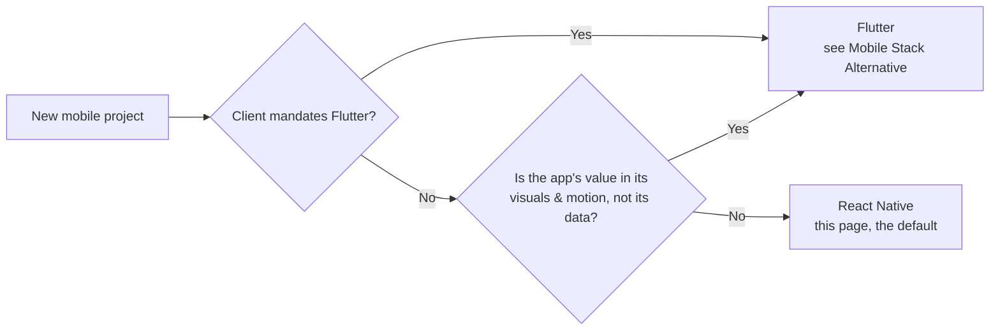
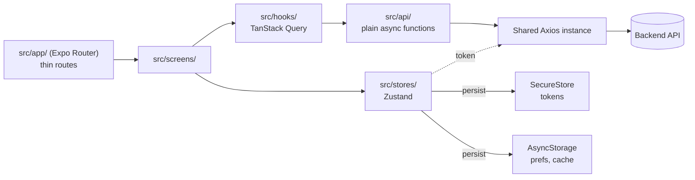
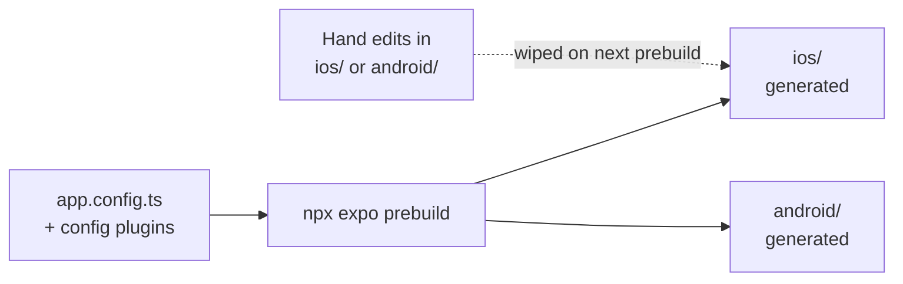
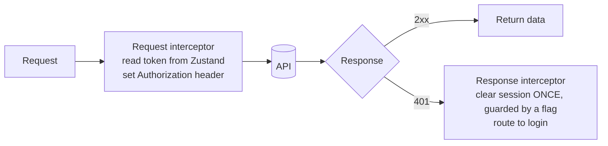
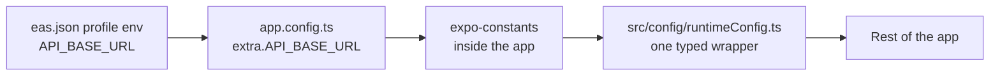
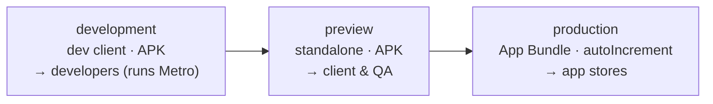
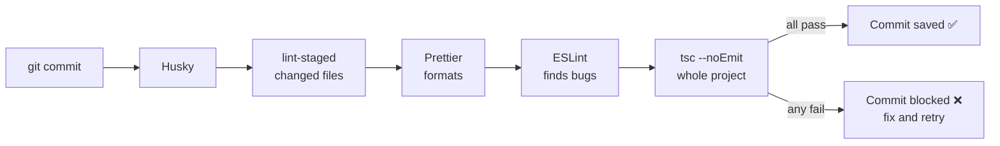

# Mobile Development Standard

> The default stack for every new mobile project: **React Native with Expo**. Flutter is the approved alternative for one specific kind of project, covered in [Mobile Stack Alternative](/Tech-Stack/Mobile-Stack-Alternative).
> **How to write code with it day to day:** [Coding Standards → React Native](/Coding-Standards/Mobile-React-Native).

---

## Which Stack?



| | **React Native** (default) | **Flutter** (alternative) |
|---|---|---|
| **For** | Business apps: forms, lists, dashboards, workflows, API-driven data | UI- and animation-heavy apps: custom motion, bespoke design, interactive graphics |
| **Why** | Same language (TypeScript) and mental model (components, hooks, Zustand, TanStack Query, Tailwind) as our web stack, so web devs are productive fast | Draws every pixel itself, so complex animation and pixel-exact design are much easier to get smooth |
| **Trade-off** | Heavy custom animation is possible but more work | Dart is a separate ecosystem. Nothing transfers to or from the web team |
| **Pick when** | Nothing pushes you to Flutter. It's the default, so no justification is needed | The client mandates it, or the visuals *are* the product |
| **Standard** | This page | [Mobile Stack Alternative](/Tech-Stack/Mobile-Stack-Alternative) |

> 📝 Both stacks are cross-platform (one codebase for iOS and Android). The choice is about which ecosystem you'll live in **for the life of the project**. You make it once, at the start.

---

*Everything below describes a real, shipped React Native app: what works, not a proposal.*

## At a Glance

Click an area to jump to its section below.

| Area | Default Stack |
|---|---|
| [Language & platform](#language-and-platform) | **TypeScript + Expo**<br/><sub>One codebase becomes real native iOS and Android apps, with native features pre-integrated</sub> |
| [Package manager](#package-manager) | **Yarn**<br/><sub>pnpm breaks native builds, and Yarn gives them the flat `node_modules` they need</sub> |
| [Navigation](#navigation) | **Expo Router**<br/><sub>The folder structure is the map of the app, with no separate navigation config</sub> |
| [Styling](#styling) | **NativeWind**<br/><sub>The same Tailwind classes the web team already writes</sub> |
| [State](#state) | **Zustand + TanStack Query**<br/><sub>Keeps app state separate from server data, which matters even more offline</sub> |
| [Forms & validation](#forms-and-validation) | **React Hook Form + Zod**<br/><sub>One schema for validation and types, and forms stay fast on mid-range phones</sub> |
| [HTTP client](#http-client) | **Axios**<br/><sub>Interceptors handle auth tokens and expired sessions in one place</sub> |
| [Storage](#storage) | **expo-secure-store + AsyncStorage**<br/><sub>Encrypted storage for tokens, plain storage for everything else</sub> |
| [Animation & gestures](#animation-and-gestures) | **Reanimated + Gesture Handler**<br/><sub>Runs on the UI thread, so it stays smooth while the app is busy</sub> |
| [Native modules](#native-modules) | **Expo SDK modules**<br/><sub>Camera, notifications, files and more come as ready-made, maintained packages</sub> |
| [Icons & graphics](#icons-and-graphics) | **@expo/vector-icons + react-native-svg**<br/><sub>Sharp at every screen density, with no PNG exports</sub> |
| [Configuration](#configuration) | **`app.config.ts` + expo-constants**<br/><sub>One place for the app name, icons, permissions, and per-environment values</sub> |
| [Builds & distribution](#builds-and-distribution) | **EAS Build**<br/><sub>Clean, repeatable cloud builds, with no Mac needed for iOS</sub> |
| [Code quality](#code-quality) | **ESLint + Prettier + Husky/lint-staged**<br/><sub>Bugs, formatting, and type errors are caught before every commit</sub> |

> **Note — current recommended versions:** Version numbers are deliberately left out of this page since they go stale fast. Check each tool's own release notes before starting a new project rather than trusting any snapshot to stay current — this table is a shape, not a pin.
>
> ⚠️ Within an Expo project, let the **Expo SDK version decide** React Native and every `expo-*` version. Don't upgrade them one by one. Run `npx expo install --check` instead.

---

## Rules That Bite

The most common silent failures, all explained further down:

| ⚠️ Rule | What happens if you skip it |
|---|---|
| Use Yarn, not pnpm. Yarn Berry needs `nodeLinker: node-modules` | Native module resolution breaks |
| Reanimated's Babel plugin goes **last** | Animations silently don't run |
| Tokens go in **SecureStore**, never AsyncStorage | Readable on rooted devices, and gets flagged in client security reviews |
| Put permission usage descriptions in `app.json` | App store rejects the build |
| Wrap forms in a keyboard-aware scroll view | Fields hide behind the keyboard (the \#1 mobile form bug) |
| Set an explicit Axios `timeout` | Spinner hangs forever on slow networks |
| Never put secrets in `app.config.ts` `extra` | Anyone who downloads the app can read them |

---

## How the Pieces Fit



> 📘 **Coding standard:** the full folder structure (what goes in `app/`, `screens/`, `components/`, `hooks/`, `api/`…) and why it's organized that way are in [Coding Standards → React Native → Folder structure](/Coding-Standards/Mobile-React-Native#folder-structure).

---

## Foundations

### Language and Platform
**TypeScript + Expo**

- **React Native** turns one TypeScript codebase into **real native iOS and Android apps**. The buttons and lists are the phone's own, not a website inside an app.
- **[Expo](https://docs.expo.dev/)** is the toolkit around it. Camera, push notifications, files and more come as ready-made modules, so you don't hand-wire them in Xcode and Android Studio.

**Development build, not Expo Go:**

| | Expo Go | **Development build** (ours) |
|---|---|---|
| What it is | A ready-made app from the store that loads your code | Your own app, built with your native modules inside |
| Runs libraries with their own native code | ❌ No | ✅ Yes |
| Use it | Never, for our projects | Always (`expo-dev-client`) |

```bash
npx expo install expo-dev-client
eas build --profile development --platform android   # install this build once on your phone or emulator
npx expo start                                      # then day to day: start the dev server and open the app
```

**The `ios/` and `android/` folders are generated, never edited** ([Continuous Native Generation](https://docs.expo.dev/workflow/continuous-native-generation/)). You describe native settings in `app.config.ts` and *config plugins*, and `npx expo prebuild` writes the native folders from them. Anything typed directly into `ios/` or `android/` is wiped the next time they're generated.



> 💡 **Tip: add path aliases and strict mode on day one.** Mobile screens nest deeply, so relative imports get long and break whenever a file moves.
>
> ```json
> // tsconfig.json
> {
>   "extends": "expo/tsconfig.base",
>   "compilerOptions": {
>     "strict": true,
>     "paths": { "@/*": ["./src/*"] }
>   }
> }
> ```
>
> ```ts
> // ❌ Before
> import { Button } from '../../../components/ui/Button'
> // ✅ After: works from any folder
> import { Button } from '@/components/ui/Button'
> ```

> 📘 **Coding standard:** what makes mobile code different from web code (two threads, weaker devices, denied permissions) is in [Coding Standards → React Native → What makes mobile different](/Coding-Standards/Mobile-React-Native#what-makes-mobile-different).

### Package Manager
**Yarn** (a deliberate exception to our pnpm rule)

- **Why not pnpm:** pnpm saves disk by linking packages from a shared store instead of placing real folders in `node_modules`. React Native's native build tools (autolinking, CocoaPods for iOS, Gradle for Android) expect plain folders in a flat `node_modules`, and break on the links.
- **Why Yarn:** it gives that flat `node_modules`, installs faster than npm, and has a stricter lockfile. Expo and EAS detect it from `yarn.lock`, so nothing needs a workaround.

**Everyday commands:**

| Task | Command |
|---|---|
| Install everything | `yarn` |
| Add a plain JS package | `yarn add zod` |
| Add a dev tool | `yarn add -D prettier` |
| Add anything `expo-*` or with native code | `npx expo install expo-camera` (picks the version that matches the Expo SDK) |

> ⚠️ **Yarn Classic or Yarn Berry both work**, but Berry **must** use plain folders instead of its default Plug'n'Play mode, which breaks Metro (the React Native bundler) for the same reason pnpm does:
>
> ```yaml
> # .yarnrc.yml
> nodeLinker: node-modules
> ```

> ⚠️ **Commit `yarn.lock`, and only that lockfile.** Delete any `package-lock.json` when converting a project. One lockfile, one package manager.

---

## Application Layer

### Navigation
**Expo Router**

- **The file is the screen.** Where a file sits in `src/app/` decides its URL, so there's no separate navigation config to keep in sync. It's built on React Navigation (stack and tab navigators).
- **Route groups** are folders in brackets, e.g. `(auth)` and `(tabs)`. Each has its own `_layout.tsx` (its own stack, tab bar, or login check), but the bracketed name never appears in the URL.

| File | Opens at |
|---|---|
| `src/app/(tabs)/index.tsx` | `/` (first tab) |
| `src/app/(tabs)/appointments.tsx` | `/appointments` |
| `src/app/(auth)/login.tsx` | `/login` |
| `src/app/settings/account.tsx` | `/settings/account` |
| `src/app/(services)/appraisal/[id].tsx` | `/appraisal/42` (`[id]` is a parameter) |

```tsx
import { Link, router } from 'expo-router'

<Link href="/settings/account">Account</Link>  // in JSX
router.push(`/appraisal/${id}`)                 // in code, e.g. after a save
```

> 💡 **Tip:** Keep route files **thin**: read the params, then render a screen component from `src/screens/`. Logic in a route file can't be reused or tested.

> 📘 **Coding standard:** a full thin-route example, and route groups, are in [Coding Standards → React Native → Route file and screen component](/Coding-Standards/Mobile-React-Native#route-file-and-screen-component).

### Styling
**NativeWind**

- NativeWind is **Tailwind for React Native**: the same `className="flex-1 px-4"` the web team writes. Classes are turned into native styles when the app is built, so they cost nothing while it runs.
- Use `tailwind-merge` (usually wrapped in a `cn()` helper) for conditional classes, as on the web.

```tsx
<Pressable className={cn('rounded-lg px-4 py-3', disabled ? 'bg-gray-300' : 'bg-primary')}>
  <Text className="text-center font-semibold text-white">Submit</Text>
</Pressable>
```

**Setup takes three pieces:**

```js
// 1 + 2. babel.config.js
module.exports = function (api) {
  api.cache(true)
  return {
    presets: [['babel-preset-expo', { jsxImportSource: 'nativewind' }], 'nativewind/babel'],
    plugins: ['react-native-reanimated/plugin'], // must stay LAST (see Animation and Gestures)
  }
}
```

```js
// 3. metro.config.js (the full file, with SVG support, is under Icons and Graphics)
const { getDefaultConfig } = require('expo/metro-config')
const { withNativeWind } = require('nativewind/metro')

module.exports = withNativeWind(getDefaultConfig(__dirname), { input: './global.css' })
```

> 💡 **Tip: keep colors, spacing, and fonts in `tailwind.config.js`**, not as literal values in components. A rebrand or dark mode then touches one file.
>
> ```js
> // tailwind.config.js
> theme: {
>   extend: {
>     colors: { primary: '#1d4ed8' }, // every bg-primary / text-primary in the app reads this
>   },
> },
> ```

### State
**Zustand + TanStack Query**

| Kind of state | Tool | Examples |
|---|---|---|
| Controlled by the app | [Zustand](https://zustand.docs.pmnd.rs/) (keep it small) | Logged in?, selected filter, draft form |
| Came from an API | [TanStack Query](https://tanstack.com/query/latest/docs/framework/react/overview) | Anything fetched |

**Why the split matters even more on a phone:** phones lose signal, and the OS can pause or kill the app in the background. TanStack Query keeps showing the last data it fetched while offline, and refetches when the app comes back. Zustand holds what the user was doing, and its `persist` option saves that to the phone so it survives a restart (see [Storage](#storage) for where it's saved).

> 📘 **Coding standard:** the state rules, the shared query-key factory, paging long lists with `useInfiniteQuery` + `FlatList`, and how the API layer and query hooks fit together are in [Coding Standards → React Native → State follows the web rules](/Coding-Standards/Mobile-React-Native#state-follows-the-web-rules) and [Long lists use FlatList](/Coding-Standards/Mobile-React-Native#long-lists-use-flatlist).

### Forms and Validation
**React Hook Form + Zod**

- One Zod schema provides both the runtime validation and the TypeScript type (through `@hookform/resolvers/zod`), the same as on the web.
- **Why it matters more on mobile:** React Hook Form doesn't re-render the whole form on every keystroke. On a long form, that's the difference between smooth typing and visible lag on a mid-range Android phone.
- Native `TextInput`s are connected through `<Controller>`:

```tsx
<Controller
  control={control}
  name="email"
  render={({ field: { onChange, onBlur, value } }) => (
    <TextInput value={value} onChangeText={onChange} onBlur={onBlur} keyboardType="email-address" />
  )}
/>
```

> ⚠️ **Fields hidden behind the keyboard are the #1 mobile form bug**, and you only see it on a real device. Wrap scrollable forms so the focused field scrolls into view (or use a `KeyboardAvoidingView` setup):
>
> ```tsx
> import { KeyboardAwareScrollView } from 'react-native-keyboard-aware-scroll-view'
>
> <KeyboardAwareScrollView enableOnAndroid extraScrollHeight={24}>
>   {/* form fields */}
> </KeyboardAwareScrollView>
> ```

> 📘 **Coding standard:** the full schema-first pattern is on [Coding Standards → Frontend → Schema first with Zod](/Coding-Standards/Frontend-React-TypeScript#schema-first-with-zod). It applies here unchanged.

### HTTP Client
**Axios** (instead of the web stack's ky)

We use Axios because its *interceptors* (code that runs on every request or response) are the cleanest place for the two things every mobile app needs: attaching the login token, and logging out cleanly when the session expires.



**In practice:** one shared instance in `src/lib/apiClient.ts`.

```ts
export const apiClient = axios.create({
  baseURL: runtimeConfig.apiBaseUrl,
  timeout: 15_000, // always set: mobile networks fail slowly, not instantly
})

apiClient.interceptors.request.use((config) => {
  const token = useSessionStore.getState().token
  if (token) config.headers.Authorization = `Bearer ${token}`
  return config
})

let isLoggingOut = false // reset after the next successful login

apiClient.interceptors.response.use(
  (response) => response,
  (error) => {
    if (error.response?.status === 401 && !isLoggingOut) {
      isLoggingOut = true // five requests failing together trigger ONE logout, not five
      useSessionStore.getState().clear()
      router.replace('/login')
    }
    return Promise.reject(error)
  },
)
```

> ⚠️ **Always set an explicit `timeout`.** Without one, a request on a weak signal can hang with a spinner forever.

> 📘 **Coding standard:** how `src/api/` functions and `src/hooks/` query hooks use this instance is in [Coding Standards → React Native → Calling the API](/Coding-Standards/Mobile-React-Native#calling-the-api).

### Storage
**expo-secure-store + AsyncStorage** (split by sensitivity)

| Store | Backed by | Use for | Never for |
|---|---|---|---|
| [expo-secure-store](https://docs.expo.dev/versions/latest/sdk/securestore/) | iOS Keychain / Android Keystore (encrypted by the OS) | Auth tokens, credentials | Cached data (limit is about 2KB per value on iOS) |
| [AsyncStorage](https://react-native-async-storage.github.io/async-storage/) | Plain, unencrypted key-value storage | Cached lists, preferences, onboarding flags | Tokens (readable on rooted or jailbroken devices) |

**In practice:** both plug into Zustand's `persist`, so choosing where a store is saved is **one line**.

```ts
// src/lib/storage.ts: wrap SecureStore in the shape Zustand expects
export const secureStorage: StateStorage = {
  getItem: (key) => SecureStore.getItemAsync(key),
  setItem: (key, value) =>
    SecureStore.setItemAsync(key, value, { keychainAccessible: SecureStore.WHEN_UNLOCKED }),
  removeItem: (key) => SecureStore.deleteItemAsync(key),
}
```

```ts
// src/stores/session.ts: tokens → encrypted
export const useSessionStore = create<SessionState>()(
  persist(
    (set) => ({ token: null, setToken: (token) => set({ token }), clear: () => set({ token: null }) }),
    { name: 'session', storage: createJSONStorage(() => secureStorage) },
  ),
)

// src/stores/preferences.ts: everything else → plain
persist(/* ... */, { name: 'preferences', storage: createJSONStorage(() => AsyncStorage) })
```

> 📝 `keychainAccessible: WHEN_UNLOCKED` (in the example above) means the app can't read the session token while the phone is locked.

---

## Native Capabilities

### Animation and Gestures
**Reanimated + Gesture Handler**

- A React Native app has two threads: one runs your JavaScript, the other draws the screen. Reanimated and Gesture Handler run on the **drawing (UI) thread**, so animations stay smooth even while your JavaScript is busy loading data. Animations done in plain React stutter under load, which is exactly when users notice.

```tsx
// A card that shrinks slightly while pressed, entirely on the UI thread
const scale = useSharedValue(1)
const animatedStyle = useAnimatedStyle(() => ({ transform: [{ scale: scale.value }] }))

const tap = Gesture.Tap()
  .onBegin(() => { scale.value = withSpring(0.96) })
  .onFinalize(() => { scale.value = withSpring(1) })

return (
  <GestureDetector gesture={tap}>
    <Animated.View style={animatedStyle}>{children}</Animated.View>
  </GestureDetector>
)
```

- For bottom sheets (filters, pickers, detail panels), use [`@gorhom/bottom-sheet`](https://gorhom.dev/react-native-bottom-sheet/). Don't build your own from a modal and a pan gesture.

> ⚠️ **Two setup steps, or nothing works:**
> - Reanimated's Babel plugin must be **last** in `babel.config.js` (see [Styling](#styling)). If animations silently don't run, check this first.
> - Wrap the root `src/app/_layout.tsx` in `<GestureHandlerRootView style={{ flex: 1 }}>`. Gestures and bottom sheets need it.

> 📘 **Coding standard:** why animated values are `useSharedValue` and not `useState` is in [Coding Standards → React Native → Reanimated worklets](/Coding-Standards/Mobile-React-Native#reanimated-worklets).

### Native Modules
**Expo SDK modules**

- Each phone capability (camera, photos, files, notifications, calendar, haptics, biometrics) comes as a maintained Expo module, and they all ask for permissions the same way. This is the main payoff of choosing Expo.
- Common modules: `expo-camera`, `expo-image-picker`, `expo-image` (a faster, caching replacement for `Image`), `expo-file-system`, `expo-notifications`, `expo-calendar`, `expo-haptics`, `expo-clipboard`, `expo-linking`, `expo-splash-screen`.
- Go outside the Expo SDK only when it can't do the job, e.g. `react-native-vision-camera` for frame-by-frame processing such as on-device OCR.

**In practice:** install with Expo's installer, then explain every permission in the config.

```bash
npx expo install expo-camera   # not `yarn add`: this picks the version that matches the Expo SDK
```

```ts
// app.config.ts: the text the user sees in the permission popup
plugins: [
  ['expo-camera', { cameraPermission: 'Allow $(PRODUCT_NAME) to photograph vehicles for appraisals.' }],
],
```

> ⚠️ **Permissions:** a denied permission is a normal state, not an error.
> - Centralize permission requests in **one hook**
> - Always handle the denied path with a clear message and a link to system settings
> - Write every usage description in the app config (as above), or **both stores reject the build**

> 📘 **Coding standard:** handling the denied path in code, with examples, is in [Coding Standards → React Native → Every native capability has a denied path](/Coding-Standards/Mobile-React-Native#every-native-capability-has-a-denied-path).

### Icons and Graphics
**@expo/vector-icons + react-native-svg**

- **Standard icons** come from [@expo/vector-icons](https://icons.expo.fyi/) (search the catalogue, then use the name).
- **Designer artwork** (logos, illustrations) is rendered as SVG with [react-native-svg](https://github.com/software-mansion/react-native-svg). It stays sharp on every screen, so there's no need to export three PNG sizes. Updating an asset is just a file swap.

```tsx
import { Ionicons } from '@expo/vector-icons'
import Logo from '@/assets/logo.svg'

<Ionicons name="calendar-outline" size={24} color="#1d4ed8" />
<Logo width={120} height={40} />
```

> 💡 **Tip: importing `.svg` files needs `react-native-svg-transformer` in Metro.** The full `metro.config.js`, with NativeWind:
>
> ```js
> const { getDefaultConfig } = require('expo/metro-config')
> const { withNativeWind } = require('nativewind/metro')
>
> const config = getDefaultConfig(__dirname)
> config.transformer.babelTransformerPath = require.resolve('react-native-svg-transformer/expo')
> config.resolver.assetExts = config.resolver.assetExts.filter((ext) => ext !== 'svg')
> config.resolver.sourceExts.push('svg')
>
> module.exports = withNativeWind(config, { input: './global.css' })
> ```
>
> Add `declare module '*.svg'` in a `.d.ts` file so TypeScript accepts the import.

---

## Config, Build and Quality

### Configuration
**`app.config.ts` + expo-constants**

- One file defines the app name, icons, permissions, and per-environment values such as the API base URL.
- Use a dynamic **`app.config.ts`** (not a static `app.json` alone), so environment variables can be fed into `extra` at build time.



```ts
// app.config.ts
export default ({ config }: ConfigContext): ExpoConfig => ({
  ...config,
  name: 'Appraisals',
  slug: 'appraisals',
  extra: { API_BASE_URL: process.env.API_BASE_URL },
})
```

```ts
// src/config/runtimeConfig.ts: the only file that touches Constants
const extra = Constants.expoConfig?.extra ?? {}

export const runtimeConfig = {
  apiBaseUrl: extra.API_BASE_URL as string,
}
```

- ❌ Don't read `Constants.expoConfig?.extra` all over the codebase. Import `runtimeConfig` instead.

> ⚠️ Everything in `extra` **ships inside the app**, and anyone who downloads it can read it. It's for config, **never secrets**.

### Builds and Distribution
**EAS Build**

Builds run in Expo's hosted, repeatable environment, **not on laptops**. You don't need a Mac for iOS builds.

Keep three profiles in `eas.json`, and don't merge them:



| Profile | Settings | Who installs it |
|---|---|---|
| `development` | `developmentClient: true`, internal, Android APK | Developers, to run the Metro dev server |
| `preview` | Standalone internal build, Android APK, no dev server | Client and QA |
| `production` | Store distribution, `app-bundle` (required by Play Store), `autoIncrement: true` so build numbers can't collide | App stores |

Each profile has its own `env` block. That's how preview points at staging and production points at the live API.

```json
// eas.json
{
  "build": {
    "development": {
      "developmentClient": true,
      "distribution": "internal",
      "android": { "buildType": "apk" },
      "env": { "API_BASE_URL": "https://dev-api.example.com" }
    },
    "preview": {
      "distribution": "internal",
      "android": { "buildType": "apk" },
      "env": { "API_BASE_URL": "https://staging-api.example.com" }
    },
    "production": {
      "autoIncrement": true,
      "android": { "buildType": "app-bundle" },
      "env": { "API_BASE_URL": "https://api.example.com" }
    }
  }
}
```

```bash
eas build --profile preview --platform android   # a build to send to the client and QA
```

> 💡 **Tip: small fixes can skip the app store.** A change that only touches JavaScript can be pushed straight to installed apps with [EAS Update](https://docs.expo.dev/eas-update/introduction/), with no store review. Anything that touches native code needs a full rebuild.
>
> | Change | Ship with |
> |---|---|
> | Fix a typo, adjust styling, fix a logic bug | `eas update --branch production --message "Fix total on invoice screen"` |
> | Add a native module (e.g. `expo-camera`), change permissions or the app icon | A new `eas build` + store review |

### Code Quality
**ESLint + Prettier + Husky/lint-staged**

| Tool | Job |
|---|---|
| **ESLint** (`eslint-config-expo` + `typescript-eslint`) | Finds likely bugs, including React, Hooks, and React Native mistakes |
| **Prettier** | Owns formatting, nothing else |
| **Husky + lint-staged** | Run format, lint, and a project-wide typecheck on every commit |

**The typecheck matters more here than on the web.** React Native has no build step that stops on a type error, so without `tsc --noEmit` before each commit, a type error reaches the phone.



> 📝 **Testing isn't standard yet for mobile.** If a project invests in it, use Jest + `jest-expo` + React Native Testing Library for unit and component tests, and **Maestro** for E2E on a device or emulator. It's a per-project decision for now, not a day-one requirement.

> 📘 **Coding standard:** the ESLint, Prettier, and lint-staged config files, and testing guidance, are in [Coding Standards → React Native → Linting and formatting](/Coding-Standards/Mobile-React-Native#linting-and-formatting) and [Testing](/Coding-Standards/Mobile-React-Native#testing).

---

## Adoption Checklist

For a new project starting from this standard, set these up on day one:

**Foundations**

- [ ] **Expo + TypeScript**, installed with **Yarn** (not pnpm); Yarn Berry with `nodeLinker: node-modules`
- [ ] Path aliases (`@/*` → `./src/*`) and `strict: true`
- [ ] **`expo-dev-client`** development build, not Expo Go

**Application layer**

- [ ] **Expo Router** with route groups (`(auth)`, `(tabs)`, feature groups)
- [ ] **NativeWind**, with the theme in `tailwind.config.js`
- [ ] **Zustand + TanStack Query**, kept separate, with a single `queryKeys.ts`
- [ ] **React Hook Form + Zod**, with keyboard-aware scrolling on forms
- [ ] One **Axios** instance with auth-token and 401 interceptors, plus a timeout
- [ ] **SecureStore** for tokens, **AsyncStorage** for everything else

**Native capabilities**

- [ ] **Reanimated** (Babel plugin **last**) + **Gesture Handler** (`GestureHandlerRootView` at the root)
- [ ] Expo modules via `npx expo install`, one permissions hook, usage descriptions in the app config
- [ ] **`react-native-svg`** + `react-native-svg-transformer`

**Config, build & quality**

- [ ] **`app.config.ts`** + typed `runtimeConfig.ts`
- [ ] **`eas.json`** with `development` / `preview` / `production`
- [ ] **ESLint** (`eslint-config-expo` + typescript-eslint) + **Prettier**
- [ ] **Husky + lint-staged**, running format, lint, and `tsc --noEmit` on every commit
